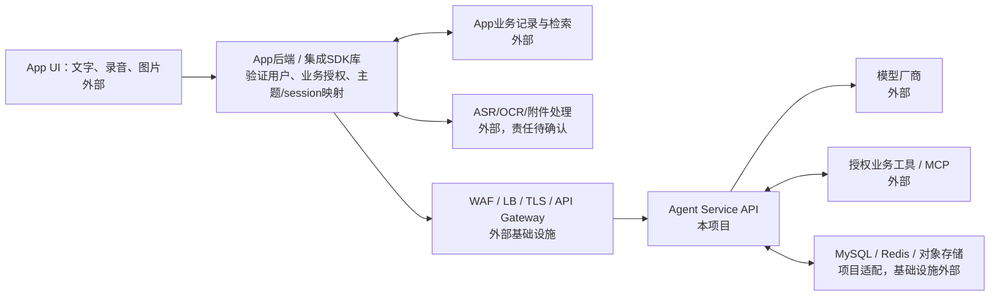
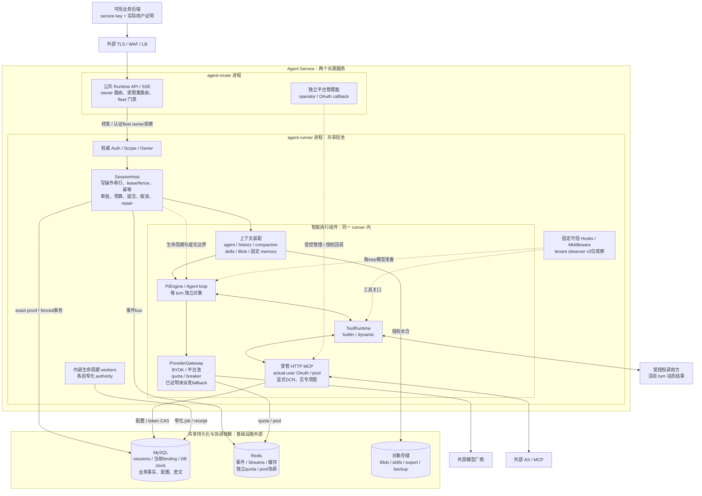
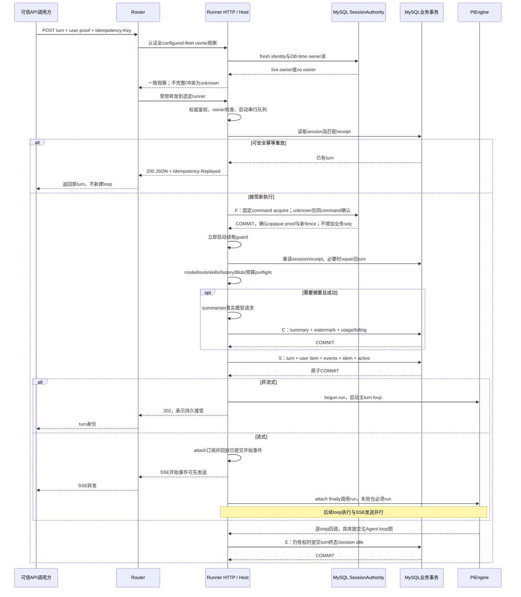
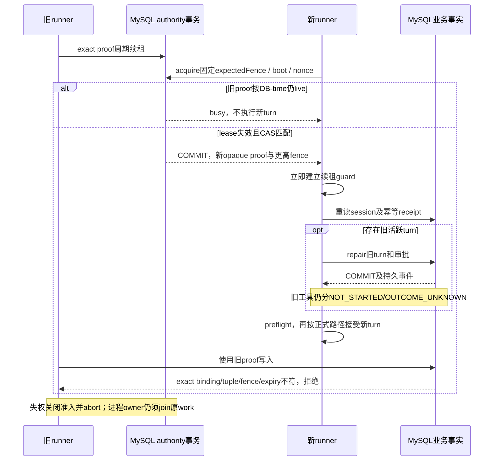
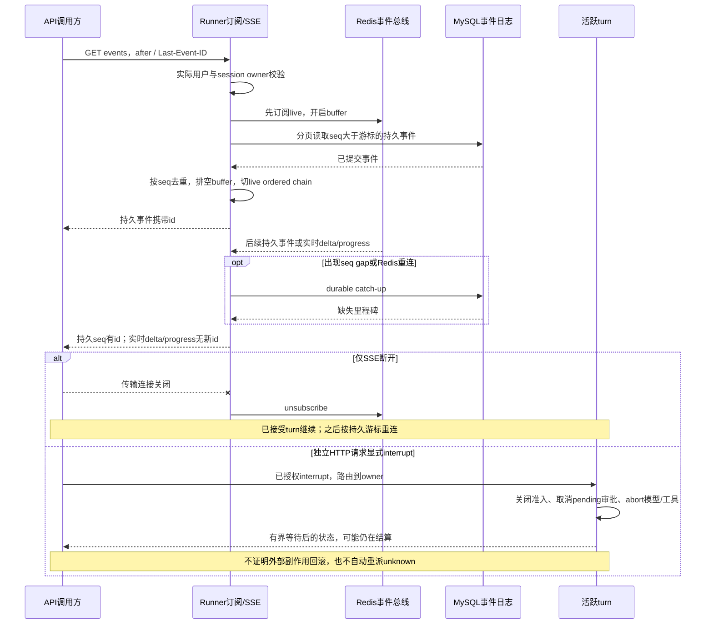
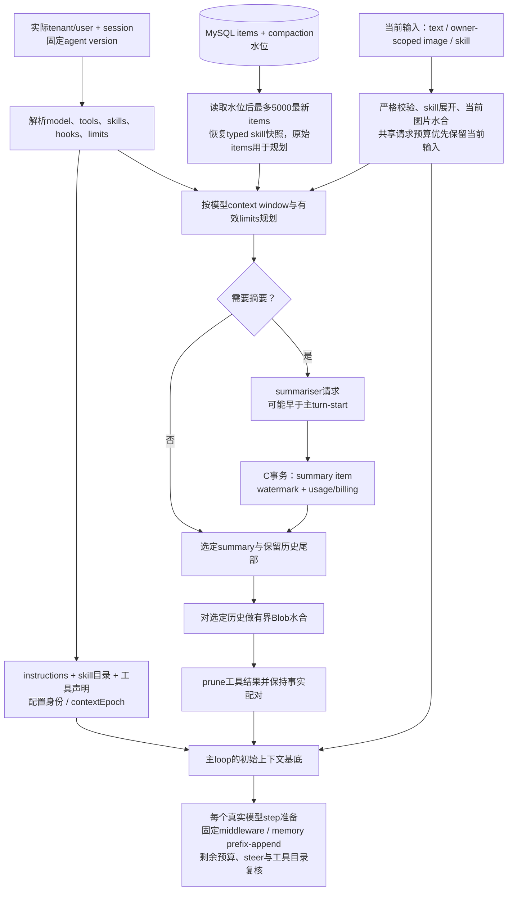
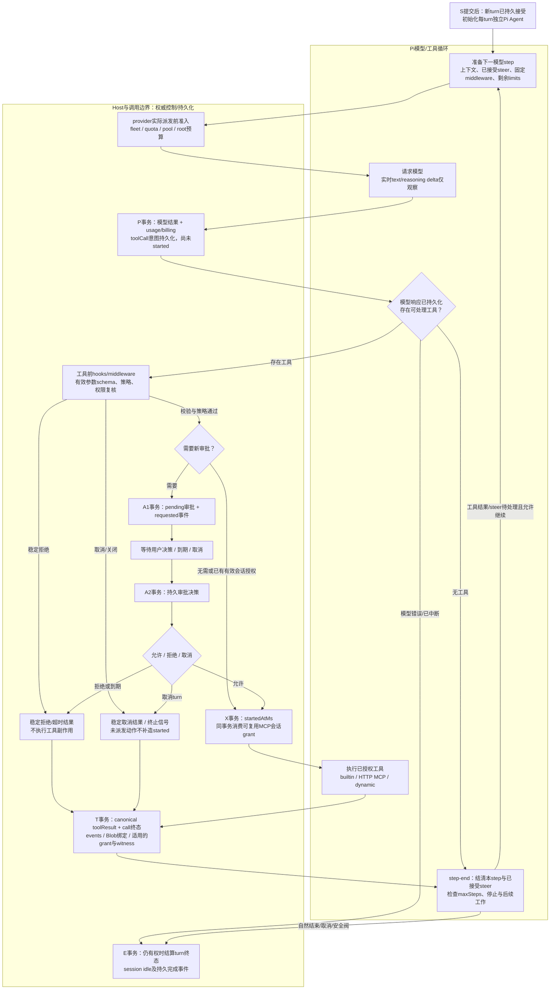
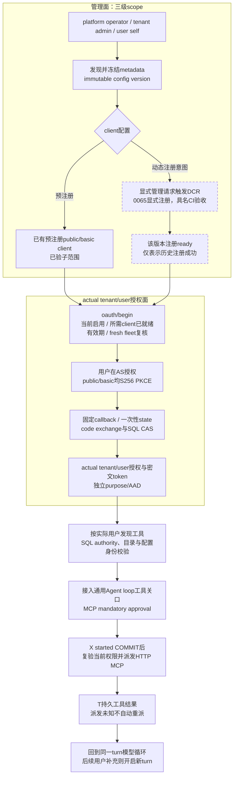
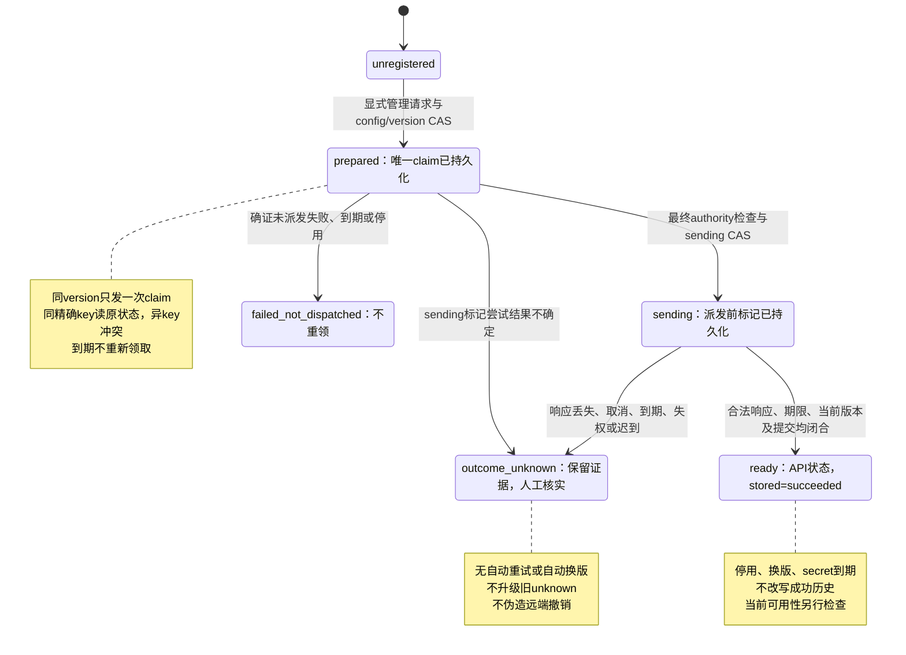

# Agent Service 架构

当前规范（2026-10-25）：本页描述 `61c3a58` 对应的实现边界。通用部署包B已通过 [CI40211433064](https://github.com/zhgqwx-del/agent-service/actions/runs/40211433064)/attempt1全部13job及主历史/runtime/Linux双VM字节三项独立审计；实际生产C等待资源。正式本地A仍为5ce317d、HTTP58654，旧HTTP57819保留；当前文档工作树不改变它们的版本、数据或配置。

M0完成，M1核心运行能力已实现但完整生命周期未闭环，M2本地/CI代码范围冻结，M3与M4已有具名验收子范围但均未整体完成，P2完整生命周期/灾备仍后置保留。当前只继续手动体验、文档优化及资源就绪后的目标验收，不自动恢复旧开发队列。四次助手真实模型额度已耗尽，正常步数自然end_turn与日常质量未据此验收。

精确事实与失败记录见 [PROGRESS](../PROGRESS.md)；专题见[设计索引](README.md)。原阶段评审、迁移逐条流水、旧接口/DDL/目录树和成本假设已移至[2026-10-25历史全文](../history/2026-10-25/docs/design/00-architecture.md)，只作时间点记录。本文保留其必要安全契约，不将旧候选状态继续表述为当前进度。

## 0. 一页结论

- 两个长期服务：无业务持久状态的router负责入口/SSE转发/owner路由/fleet门禁；runner负责权威身份、SessionHost、Pi loop、凭据与工具。Gateway、MCP、hooks和workers均内嵌runner，仍为2服务/6产品JavaScript入口/2镜像。
- MySQL保存共享业务事实，并由0066 binding、DB clock、完整tuple与opaque proof决定普通session写权。Redis负责事件、热重放及独立quota/pool协调，不能从其lease/counter恢复推导普通写权限。
- 每turn独立Agent；session为历史/单写者/游标单元。共享进程隔离依赖owner、scope、配置身份、凭据、审批、预算与authority，不依赖一用户一进程。
- DB原子提交、模型/工具副作用与客户端收到响应是不同事实。已started未知动作不自动重放；实时delta/progress不补持久seq。
- 默认off不豁免普通路径、启动和迁移正确性。0037 grant硬拒、0054 original-primary-only destructive、旧receipt不重签、unknown不提升、适用功能的production拒绝、外部删除/自动清理off和completion=false保持。

## 1. 目标与约束

### 1.1 业务链与项目责任

主要调用场景是记录类App：用户持续输入文字、语音或图片，业务后端验证身份和访问权限，选择内部上下文，调用Agent API装配模型、skills、MCP和工具，执行后返回普通或流式结果，并按业务合同保存事实与使用量。通用runtime不绑定某个App界面或记录流程。

2000万以上DAU指整个App；Agent采用率、调用频次、峰值、执行时长和供应商额度尚待估算。它不是Agent DAU、QPS或并发执行数；容量与费用按§9建模，延迟、可用性、首期容量、预算和RPO/RTO仍是待确认参数。

| 职责/模块 | 所属范围 | 当前接口边界 |
|---|---|---|
| App UI、录音采集、拍照、业务记录展示 | App外部系统 | 不要求Agent Service实现终端页面或录音链路 |
| 终端用户验证、业务权限、主题/任务关联 | App后端；映射责任待正式约定 | 推荐近期由可信后端维护主题/任务到session的映射；服务仍校验实际tenant/user与资源归属 |
| App业务记录、检索、写入 | 外部业务系统 | 通过授权业务API/MCP或调用方注入；runtime不任意读取App数据库 |
| ASR/OCR、通用附件解析 | App或独立服务，责任待确认 | 不默认自建；现有image Blob上传/水合仍要求owner、字节格式和模型能力校验，不等于所有模型支持图片 |
| CDN/WAF/LB/TLS/外部API Gateway | 外部接入设施 | 可在全景中表达，不自动成为项目开发待办 |
| Runtime API、SDK、HTTP/SSE、scope、owner路由、执行与限额 | Agent Service | router为公共入口；权威service/user鉴权和执行在runner，平台管理及fresh fleet决策按独立authority执行 |
| MySQL/Redis/S3与模型、远端工具 | 外部依赖，项目负责适配 | 功能协议、数据归属与运行限制由项目定义；真实托管环境/IAM/容量另验 |
| 任意脚本、stdio、代码沙箱、通用长任务 | 后续范围 | 按真实业务需求独立评审，不能从hooks、dynamic callback或全景节点推导为已交付 |

“接入层”须按职责区分：外部TLS/WAF设施与本项目API入口不是同一层；把外部设施排除出实施范围，不排除Agent Service自身的协议、安全、流量管理和路由责任。设计、实现、部署与验收范围分别记录，外部节点不机械标成本项目todo。

### 1.2 身份、业务记录与内部执行单元

| 概念 | 含义与归属 |
|---|---|
| tenant / caller | 授权业务与调用方权限；service key、admin、operator各有边界 |
| user | 经验证或由可信业务后端委托的实际用户，不直接等同tenant |
| 业务记录 / 主题 / task关联 | App的业务对象与关联关系，不自动等同session |
| session | 服务端历史归属、单写者控制、压缩水位及事件游标单元 |
| turn | 一次Agent执行；同一session可以多turn，同一user可以多session并行 |
| SSE连接 | 可断开、更换的传输连接，不等同执行或持久任务 |

用户无需显式创建聊天会话，但当前Runtime API仍要求内部session ID。session不等于用户、设备、常驻Agent或runner。共享进程按活跃turn承载，Pi每turn新建独立Agent；隔离依赖实际owner、配置、凭据、权限、缓存身份和lease/fence，而非一用户一VM/容器/进程。

### 1.3 业务集成合同与待确认决策

推荐先由App后端维护`(tenant,user,业务主题/任务) → session`，定义跨设备选择、CAS、结束/归档以及创建响应丢失后的处理。当前[`CreateSessionRequest`](../../packages/protocol/src/session.ts)没有业务context key或session创建幂等合同；turn的`Idempotency-Key`不能消除重复session。若需要跨多个调用方共享映射能力，再单独设计原子get-or-create，不把它隐含进现有POST语义。

核心V1的[记录SDK参考集成](../../examples/record-assistant/README.md)将映射、版本记录读取与保存判定定义为App侧小接口，只用单进程内存fixture示范三轮分析、补充与追问。真实App仓储和跨进程CAS不属于该fixture的交付证明；旧版本输入会保留在runtime历史中，参考结果的`current`仅表示保存时版本匹配，不提供自动撤权、删除或副本失效。

业务历史的权限、相关性和token预算应共同决定上下文。引入App记录时，需明确授权查询或注入方式、source ID/version、允许保存的副本、业务写入权限、更正/撤权/删除通知，以及旧工具结果/summary失效规则。当前metadata透传和同session compaction不会自动完成这些工作，固定memory注入也不是跨session记忆系统。

普通反问可以结束当前turn，由下次补充开启新turn；权限审批、活动turn内工具回调、跨天挂起和外部回调恢复分别定合同。是否近期实施长期任务、业务检索/记忆由谁负责，以及ASR/OCR边界仍待确认；这不阻碍已有通用API与轻池能力的范围判断。


## 2. 技术选择

当前使用TypeScript/Node24、Hono、固定Pi adapter、MySQL、Redis与S3-compatible/受限本地BlobStore。实际依赖和精确版本以 [package.json](../../package.json)、[core manifest](../../packages/core/package.json)及[lockfile](../../pnpm-lock.yaml)为准。调研形成时的替代方案见[历史全文](../history/2026-10-25/docs/design/00-architecture.md#2-调研结论摘要)；它们不构成第二engine、Kafka、Kubernetes或重池已交付证明。

## 3. 总体架构

<a id="architecture-view-index"></a>

### 3.0 视图分工与阅读顺序

总体图回答“谁负责、组件在哪里、依赖谁”；行为图回答“何时提交、如何循环、失败后怎样处理”。下表列当前视图；§3.3指向旧文本图，仅用于历史对照。图表达协议，不产生部署验收。

| 视图 | 回答的问题 | 位置 |
|---|---|---|
| 业务全景/责任 | App、业务数据、外部设施与本项目如何分工 | [§3.1](#31-全景业务架构与范围) |
| 容器与组件/分层 | 两个服务、runner内组件、模型/工具支路与并列依赖 | [§3.2](#32-当前实现架构)、[§3.3](#current-layered-architecture) |
| turn接收时序 | 鉴权、租约、fence、摘要、turn-start与响应的先后 | [§4.6](#turn-request-sequence) |
| 所有权接管 | 旧新runner和MySQL authority怎样拒绝旧proof、修复旧执行 | [§4.7](#ownership-handoff-sequence) |
| SSE与取消 | 订阅/回放/补gap怎样交接，断流与interrupt为何不同 | [§4.8](#sse-recovery-sequence) |
| 上下文数据流 | 持久历史怎样变成本次有限模型上下文 | [§6.2](#context-projection-flow) |
| Agent智能循环 | 模型、工具、审批、安全阀和业务提交如何闭环 | [§6.6](#agent-step-loop) |
| MCP管理、授权与运行 | 配置owner与actual-user凭据为什么分开，何时注册 | [§7.2.1](#mcp-control-runtime-flow) |
| DCR状态机 | 一次claim、派发标记、ready与unknown怎样转换 | [§7.2.2](#dcr-registration-state) |

发布/迁移的目标环境合同见[部署契约](../operations/local-and-deployment.md)，分域T1/T3及受控恢复见[生命周期](04-data-lifecycle.md)。实际副本、网络与故障域需目标资源确认，不能从组件图推导。

### 3.1 全景业务架构与范围



图表达业务调用关系，不授权runtime绕过业务接口访问App数据，也不要求本项目建设图中的全部外部模块。主题/session映射当前是推荐的App后端职责，仍需集成合同确认。

### 3.2 当前实现架构



实现依据为[`router/app`](../../apps/agent-router/src/app.ts)、[`runner/auth`](../../apps/agent-runner/src/auth.ts)、[`SessionHost`](../../packages/core/src/session/host.ts)、[`PiEngine`](../../packages/core/src/engine/pi.ts)、[`ProviderService`](../../packages/providers/src/service.ts)和受管MCP/skills/hooks模块。框内组件属于所在进程；实线表示主要调用/数据依赖，虚线表示治理或管理关系，不表达时序：Host控制审批、持久化和账务，engine不得绕过authority直接提交业务事实。主链路为身份/owner校验→session串行及lease/fence→必要repair→模型/工具/上下文preflight→原子turn-start→loop与逐步提交→turn终结。

MCP管理/OAuth是另一条受控链：管理scope选择immutable配置→显式DCR注册或已有预注册client→actual-user OAuth→工具发现→强审批/write-ahead→调用/持久结果→后续模型步骤。共享配置不共享用户token，管理权限不授予普通writer或任意工具执行权。当前图不包含跨session自动检索、通用长期任务、任意脚本、stdio/沙箱和Kafka；它们不是已有实现。

| 逻辑组件 | 当前进程边界与状态 | 扩缩容/依赖 |
|---|---|---|
| agent-router | 两长期服务之一；无业务持久状态，但有连接、peer能力观察与门禁状态 | 连接数/QPS；依赖稳定configured地址和共享Redis |
| agent-runner轻池 | 两长期服务之一；活跃turn/回调/池在内存，权威事实在共享存储 | 活跃turn、内存、I/O、供应商quota；不是永久user Agent |
| ProviderGateway、tools、hooks、生命周期workers | runner内库/内嵌循环，不新增服务 | 保留实际身份、事务和资源治理边界 |
| 独立schema/备份恢复/selected维护命令 | 既有显式one-shot入口/模式 | 独立operator权限、停服与exact-run门禁，不是daemon |
| 重池/exec-server/其它harness进程 | 后续规划，尚未交付 | 先证明代码执行隔离需求，再定资源和权限合同 |

<a id="current-layered-architecture"></a>

### 3.3 分层与部署边界

§3.2为当前组件图；同一架构的旧ASCII图及历史职责对照见[归档§3.3](../history/2026-10-25/docs/design/00-architecture.md#current-layered-architecture)。router与runner按角色扩缩容，库/内嵌worker不是独立部署单元；真实副本、网络、故障域、TLS和容量由目标环境决定，见[部署契约](../operations/local-and-deployment.md)。

## 4. 有状态性与分布式一致性

### 4.1 三层有状态性（沿用前期方案，结论不变）

| 层次 | 要求 | 不满足的后果 |
|---|---|---|
| 一个 turn 之内 | **强制单所有者** | 两个 writer → seq 冲突、工具重复执行，数据损坏 |
| 同 session 跨 turn | 优选亲和 | 只是变慢（上下文冷启动） |
| 同用户跨 session | 不需要 | — |

### 4.2 所有权与租约

当前同session的turn-start、显式compaction及相关写操作仍经runner本地串行队列；普通GET、订阅和interrupt不概括为均经此队列。MySQL模式0066由sessions完整tuple、当前binding、真实DB时间及事务锁提供live authority。固定acquire command绑定实际runner/boot/nonce、expectedFence和owner；确认后才获得不可由数值fence或JSON补造的opaque proof。unknown只确认同一command，不更换nonce或退回Redis。业务写入在同一事务内重验proof、binding、root/owner/fence与DB-time后发布原子写集。

新owner实际提交acquire后再重读session/receipt、repair和preflight；同runner不再因名称相同自动复用旧lease。原work真正settle后exact release旧proof，后续turn用新command取得新proof/fence；warm内容缓存本身仍可保留。失权guard不会被迟到renew复活，不把abort或grace到期当原生work已结清；进程owner仍须实际join。路由通过认证全configured-fleet观察，只有一致fresh结果才判断live/no owner，不完整/冲突为unknown；它不授予写权限。

Redis的bus/热重放/缓存、Gateway及其它独立协调和配额域仍按各自合同工作；Redis lease/counter被删、恢复或回退不再授权普通session接管。MySQL物理回退、双primary、部署凭据泄露及真实HA仍不由本切片证明。0066启动没有inactive/numeric/Redis fallback，既有session须按[schema bootstrap §5.5](../operations/schema-bootstrap.md#55-0066-单一-mysql-authority独立停止窗口与固定初始绑定)完成全writer停服、旧runtime所有host退休、独立迁移/metadata、新账号固定初绑与同command确认。实现见[Host](../../packages/core/src/session/host.ts)、[authority guard](../../packages/core/src/session/authority.ts)、[MySQL authority](../../packages/store/src/mysql/session-authority.ts)、[binding](../../packages/store/src/mysql/session-authority-binding.ts)和[router观察](../../apps/agent-router/src/registry.ts)。原Redis普通authority方案已由0066取代，历史键与请求顺序见归档；Redis其它独立域仍有各自正确性意义。


### 4.3 故障场景

| 场景 | 当前行为与限制 |
|---|---|
| router重启/SSE断开 | 客户端按持久seq重连，turn继续；临时delta/progress不补发 |
| runner在turn中崩溃 | 下一写请求取得lease和新fence后做orphan repair；保留已提交事实，旧turn终结为interrupted，工具分NOT_STARTED/OUTCOME_UNKNOWN；不恢复原模型栈、不盲目重放已派发动作 |
| runner发布/缩容 | drain停止新turn，在grace内等待现有turn完成，到期后取消并有界等待结算；没有持久暂停在step边界再跨runner续跑的协议 |
| 审批等待时runner重启 | approval行持久化，但等待栈不持久化；新owner修复旧turn时将其pending审批过期/取消，标记`system:owner_lost`；续聊开启新turn |
| 调用resume | 返回session/近期turn/pending审批标识的快照，不恢复原执行，不因读快照自动接管 |
| 显式interrupt | 发起abort及审批取消，有界等待后可能返回仍在结算的turn；不证明厂商或工具副作用回滚 |
| Redis中断/丢失/回退 | 不改变0066 MySQL live authority；事件提示/缓存及独立配额域可降级或拒绝，持久事件按MySQL补齐。MySQL HA与跨域恢复另验，不把Redis重建等同全域恢复 |

依据为[`host.ts`](../../packages/core/src/session/host.ts)的repair、interrupt和drain，以及[`runner/app.ts`](../../apps/agent-runner/src/app.ts)的resume入口。原“step checkpoint后释放”“重发未决审批”目标表见归档，不作为当前实现承诺。


### 4.4 事件扇出与重放

持久事件先随业务写集提交MySQL，再发布Redis；实时delta/progress没有持久seq，不写业务历史或Redis Stream。订阅先接live再补历史，按seq去重并从MySQL补gap，避免回放与订阅之间漏持久事件。超过热Stream保留窗口仍可读取持久业务事件和最终文本，不恢复逐token输出；具体支持事件以协议源码为准。

当前[SSE writer](../../apps/agent-runner/src/sse.ts)采用runner本地共享连接准入、单pump和有界in-flight；[Host订阅](../../packages/core/src/session/host.ts)使用单worker、queue/replay字节与事件数及episode期限，并等待实际退订。默认上限由[observation.ts](../../packages/core/src/session/observation.ts)定义：128总连接/32每tenant、queue256事件/4MiB、单frame2MiB、单replay10000事件/32MiB及30秒replay/stall。超限关闭观察，客户端仍可按持久游标重连。它们不证明全进程RSS硬上限、跨fleet公平性、真实LB或持续生产容量。

Stream分片/Kafka选择依赖§9的实际到达率、存储与SLO；旧固定20M负载假设见归档，不是当前规模证明。


### 4.5 接收、提交、派发与可见结果

| 边界 | 当前保证 | 限制 |
|---|---|---|
| MySQL fenced commit | 同一业务写集的item/event、状态、usage/billing及receipt原子提交 | 不保证客户端必收到响应；模型和远端工具不在该事务内 |
| turn接收 | preflight后持久提交turn-start/user item/events/幂等receipt，再启动主turn loop；202是durable接受 | preflight摘要可能先派发并独立记账；202不等于模型或外部业务完成，session创建不因此获得turn幂等语义 |
| 模型请求 | 记录实际派发与已报告usage，完整估价与unknown分开；Pi请求明确零自动重试 | 取消不证明未执行/未收费，估价不等于厂商账单 |
| 工具 | 审批、write-ahead、started证据和持久结果；失联分类结果未知 | 不承诺与DB共同exactly-once，不盲目重试unknown |
| SSE | 持久seq重连补齐；已接受执行不因客户端断流而取消 | delta/progress为实时观察，不逐token重放 |

<a id="turn-request-sequence"></a>

### 4.6 turn请求、接收与提交时序

本图聚焦一个新turn的主路径；幂等重放、同session busy/steer、拒绝与fenced分支仍遵循正式合同。F/C/S/E只是图中助读记号，不新增API、schema或receipt类型。



L与D是同一MySQL的authority及业务逻辑关口，不是两个独立存储。S提交后才可启动主turn loop；但preflight的摘要请求及其独立账务可能先于S发生，不能写成“turn-start前绝无付费模型请求”。摘要已派发后失败/取消按现有失败账务合同结清，不因缺S而伪造免费或重派。HTTP attach失败也须运行已接受turn，避免持有lease却永不执行。启用hooks/子任务等可能增加正式提交边界，本图不替代完整事务合同。

依据：[HTTP分支](../../apps/agent-runner/src/app.ts)、[Host beginTurn/maybeCompact/finishTurn](../../packages/core/src/session/host.ts)、[Pi adapter](../../packages/core/src/engine/pi.ts)。202、模型/工具副作用、DB COMMIT和客户端可见结果分别判断；SSE细节见§4.8。

<a id="ownership-handoff-sequence"></a>

### 4.7 正常lease失效后的接管与fencing

0066的MySQL authority在同一binding和DB-time下原子判断expiry及fixed expectedFence；Redis不参与这个决定。这里恢复的是新owner对旧执行的修复，不迁移原Pi对象。图中两个MySQL参与者是同一DB的逻辑关口。



同runner的新claim也须新command/proof，不以runnerId相同续活；旧work未真正结清不提前release。unknown只confirm原command，不更新expectedFence或重获替代proof。失权后不能补写自己的terminal；新owner按来源修复，已started动作不自动重放，审批不续原等待栈。普通模型step不是每步都await DB admission，本图不作每步派发强隔离承诺。依据：[guard](../../packages/core/src/session/authority.ts)、[MySQL authority](../../packages/store/src/mysql/session-authority.ts)、[Host](../../packages/core/src/session/host.ts)。

<a id="sse-recovery-sequence"></a>

### 4.8 SSE订阅、持久重放与两种取消路径



router负责转发连接，图中省略该代理以突出订阅交接。持久事件先随业务提交再发布；回放不恢复临时delta或原SSE/Pi对象。队列、replay与stall受§4.4的本地资源上限约束；超限关闭观察不取消已接受turn，也不证明跨fleet公平性。依据：[Host subscribe/interrupt](../../packages/core/src/session/host.ts)、[SSE writer](../../apps/agent-runner/src/sse.ts)、[events入口](../../apps/agent-runner/src/app.ts)。


## 5. 对外协议（agent-router 公网入口 / agent-runner 执行 API v1）

对外资源为session、turn与item；session是本服务的owner/history/并发单元。实际ID格式、字段与兼容行为以协议schema为准。

当前端点、字段、错误信封和兼容边界以[`packages/protocol/openapi.json`](../../packages/protocol/openapi.json)、对应route及专用合同为准。MCP/skills/hooks、受保护L0 metrics已有已发布子能力，不能一概称“未实现”；`fork`、重池和其它目标态也不能因出现在原资源表中就当已交付。当前范围见§11；原资源/事件示意表已归档。

### 5.1 鉴权

双层：`Authorization: Bearer <service_api_key>`（→ `tenantId`，服务级）+ `X-User-Id`（或租户配置的端用户token，→ `userId`）。`principal = (tenantId, userId)`贯穿业务存取；用户凭据及可变执行缓存按正式scope、实际subject和配置版本隔离，共享配置缓存遵循其配置身份，不能笼统要求所有缓存都按principal分片。

当前精确合同见[身份设计](01-identity-and-auth.md)及[`auth.ts`](../../apps/agent-runner/src/auth.ts)：`trusted_caller`依赖持service key的可信租户后端验证并委托本tenant用户；终端不得持该key。`end_user_token`以验证后的subject决定user，若同时提交X-User-Id必须一致。session普通路径要求实际user，admin管理与runtime权限分开，platform/operator为独立authority；共享配置缓存可按其正式身份复用，但不能混用用户凭据或可变执行状态。

### 5.2 资源与端点

内部session由调用方显式创建/选择，绑定agent version与owner；App隐藏session的映射、创建CAS和response-loss处理仍须§1.3的业务合同。turn幂等作用域为tenant/user/session；接收、执行、业务提交、SSE可见与终结分开，见§4.5。resume是快照读取，不是长期执行恢复。


### 5.3 输入与信封

当前输入、模型选择、limits、busyPolicy和dynamic tool字段以[turn协议](../../packages/protocol/src/session.ts)与OpenAPI为准。text、owner-scoped image和显式skill均须实际能力/agent/owner校验，mention尚未开放；metadata不提供业务检索或长期记忆权限。可运行HTTP/SDK流程见[体验手册](../operations/http-experience.md)，原示例模型和未实现字段见归档，不作为可执行请求。

### 5.4 事件类型

持久里程碑事件与实时delta/progress的区分见§4.4；业务items/events可能含正文或快照，须适用内容授权与生命周期，不可作为普通诊断日志无限保留。支持事件以[事件协议](../../packages/protocol/src/event.ts)为准；resume不重发原等待栈，实际恢复见§4.3。


### 5.5 错误码

HTTP status和闭合错误字段以当前OpenAPI/route为准。unknown外部结果、幂等冲突、busy、lease conflict、quota与draining分别处理，不能从通用错误文本/零token推断安全重试；公共响应不携带原始上游正文、URL或secret。

## 6. agent-runner 内部设计

### 6.1 AgentEngine 接口（harness adapter 边界）

当前接口由[`engine/types.ts`](../../packages/core/src/engine/types.ts)定义：`AgentEngine.start(params,sink)`返回带`steer/interrupt/done`的`EngineRun`。Pi负责模型/工具loop，Host负责身份、审批、authority、持久化、预算与恢复；每turn建立独立Agent，并显式装载该session上下文。`prepareModelStep`、工具前write-ahead和结果提交等sink边界不能被替换harness绕过。

保留当前Pi精确版本与adapter，只有可证明的兼容、隔离、性能或维护收益出现后才评估替换。独立执行进程需重新定义IPC、取消、状态归属、审批、usage和恢复；NativeEngine仍为规划退路，不能作为已验第二运行时。旧runTurn接口和“双实现契约”见归档，属于设计目标；当前NativeEngine尚未交付。


### 6.2 上下文装配与前缀稳定

当前流水线由[`host.ts`](../../packages/core/src/session/host.ts)、[`history.ts`](../../packages/core/src/context/history.ts)、[`compact.ts`](../../packages/core/src/context/compact.ts)与[`assemble.ts`](../../packages/core/src/context/assemble.ts)共同实现：

1. 按session的agent version和实际tenant/user解析模型、工具、skills、hooks与有效limits。
2. 从最近compaction水位后读取最多5000条最新items，形成有限历史；持久历史可以更多，但本次模型不保证看到所有尚未压缩的内容。
3. 规划预算，按条件做摘要、保留近期步骤，执行有界Blob水合和工具结果prune，再加入当前输入。
4. 使用固定instructions、服务端解析的skill目录和工具声明形成前缀/epoch；实际模型调用准备边界可以应用固定可信middleware。

| 概念 | 当前状态 | 不应推导的能力 |
|---|---|---|
| 服务端持久历史 | items/events等业务事实在共享存储 | 全部历史都进入当前模型 |
| 本次模型上下文 | 按版本、压缩水位、预算与资源上限形成投影 | 整用户/跨session历史或任意App数据访问 |
| 固定memory注入 | [`middleware.ts`](../../packages/core/src/hooks/middleware.ts)按实际subject ACL注入可信配置prefix/append，已有发布范围 | 自动检索、记忆写回、来源更新或失效系统 |
| 跨session用户记忆/业务检索 | 归属、授权、source/version及修改删除传播合同待定 | 由compaction、metadata、skills或MCP自动形成 |

5000条是当前有界读取行为，不是历史删除。极长短消息历史、summary是否仍在有效窗口、工具配对与上下文缺口表达需另行验证；不据静态上限认定已发生数据丢失。若App记录被复制进item、工具结果或summary，原记录更正/删除不会自动替换这些副本，必须由业务合同明确失效与重建行为。

前缀稳定是上下文一致性/缓存效率设计，不表示实际厂商命中率或完整observability已经验收。L0 metrics没有因此获得逐tenant prompt正文、成本账本或无限基数标签；完整观测见[05](05-observability.md)。

<a id="context-projection-flow"></a>

#### 6.2.1 从持久历史到模型上下文

图表示资源与投影依赖；当前输入先做严格校验并保留同请求水合预算，再根据规划选择历史，不能让旧附件先耗尽当前输入预算。模型实际收到的是有界投影，不是整个数据库历史。



业务记录、source/version、跨session记忆写回和更正/删除后的摘要失效没有自动接入该数据流；它们仍依赖§1.3集成合同。M→C仅表示摘要成功：失败不提交成功C，可跳过的优化失败退回未压缩投影；已派发摘要失败及准入拒绝按正式合同结清或拒绝新turn，不伪造免费、成功摘要或自动重派。具体预算、skill typed快照和Blob行为以[Host](../../packages/core/src/session/host.ts)、[history](../../packages/core/src/context/history.ts)、[compact](../../packages/core/src/context/compact.ts)、[assemble](../../packages/core/src/context/assemble.ts)为准。


### 6.3 安全阀（内核不变量，策略只能收紧）

`maxSteps`、`maxToolCalls`、`maxWallClockMs`、`maxCostCNY`、重复工具调用检测、`finish_reason=length` 丢弃**全部** tool call。取 `min(config, agentDef, request)`。触发后优雅终止：带 `partialText` 的 `turn/completed{status:completed, stopReason}`，session 回到 `idle`。

### 6.4 压缩与崩溃恢复

当前摘要作为业务item与compaction水位、usage在同一fenced commit提交，不能将摘要生成、DB提交和对外结果混为一步。工具call/result按配对与步骤边界处理，水合和持久化大输出有独立资源限制；prune实现见[`context/history.ts`](../../packages/core/src/context/history.ts)，compaction规划见[`context/compact.ts`](../../packages/core/src/context/compact.ts)，不能沿用旧示意的固定20k阈值推断实现。

write-ahead在实际工具副作用前保存started事实；恢复区分未开始与结果未知。新owner的repair是保留已提交事实并终结旧turn，不自动重放已派发工具或原模型请求；审批恢复见§4.3。真正的跨天挂起、跨重启callback inbox和持久continuation须另立范围，当前dynamic pending仍是进程内Map。


### 6.5 八条生产坑 → 回归测试

Pi/Host的正式契约覆盖tool-result关联、length时工具拒绝、压缩/usage原子提交、取消、write-ahead与失权恢复等具名范围，具体以实现、测试和61c证据为准。NativeEngine尚未交付，不称“两种engine均通过”；本次文档修订未运行产品测试。

---

<a id="agent-step-loop"></a>

### 6.6 Agent智能循环与Host持久化关口

Pi负责反复请求模型、分派工具并把canonical结果加入下一step；Host负责身份/权限、安全阀、审批、预算与业务提交。图中的P/A1/A2/X/T/E仅为现有边界的阅读记号。工具批可有受控并发，但提交顺序、grant和结果来源仍按正式合同，不由图授予新并发或执行权。



| 图中边界 | 必须区分的事实 |
|---|---|
| P：模型step提交 | 保存模型结果、step usage/billing与未派发toolCall；item/started事件本身不是远端已派发证明 |
| A1/A2：审批 | pending与决策分别持久化；审批资源可读不等于跨重启恢复等待栈 |
| X：工具执行开始 | startedAtMs持久化，并按适用MCP合同同事务消费会话grant，成功后才允许副作用 |
| T：工具结果 | canonical结果提交后才回到Pi live transcript；失败/unknown不能保留可静默重用的MCP授权 |
| E：执行结束 | 与前述step/result提交分开；被fenced的旧owner不补写自己的terminal，由接管者repair |

无工具也要先判定已接受steer；maxSteps在本step工具批结算后检查。取消/blocked工具的合成结果仍经T持久化，取消后不再派发下一模型。图示主路径以继续持有执行权为前提；准入拒绝时不派发模型，失权后旧owner不提交E。失败/未知工具结果进入下一模型step不代表自动重派同一外部动作；MCP再次执行仍需新的有效审批，已派发模型费用unknown会关闭后续准入。固定observer只有观察权限；不把模型/skill/工具返回自动升级为系统权限。图省略的hook witness、子任务和来源捕获必须继续遵守各自提交合同。

依据：[Host step、beforeToolCall、result、finish](../../packages/core/src/session/host.ts)、[Pi afterToolCall先提交再追加transcript](../../packages/core/src/engine/pi.ts)、[Gateway实际派发与准入](../../packages/providers/src/service.ts)。


---

## 7. 扩展性

### 7.1 工具

当前builtin为`current_time`与`web_fetch`，见[`builtin/index.ts`](../../packages/core/src/tools/builtin/index.ts)；agent须显式授权可见工具。MCP和客户端dynamic工具各有独立解析/权限路径，不能从`GET /v1/tools`概要推导全部运行期目录。`http_request`和结构化业务工具的旧目标见归档，不是已交付builtin。

`web_fetch`实现使用原生匿名HTTP(S) GET，校验全部DNS答案、把选定公网IP绑定到实际socket，并保留原hostname、Host/SNI与TLS证书身份校验；拒绝redirect并保持有界读取。实现见[`public-web.ts`](../../packages/core/src/tools/builtin/public-web.ts)及[`web-fetch-tool.ts`](../../packages/core/src/tools/builtin/web-fetch-tool.ts)，25个原生HTTP/TLS用例已通过，最终发布状态见PROGRESS。取消与deadline触发后会协作式等待DNS lookup结清及native资源关闭，不承诺15秒硬返回；导出的`assertPublicHost`仍只是预检，不能当作其它调用路径的socket能力。dynamic tool是活跃turn内反向委托，pending和默认等待期限不构成通用durable任务队列；跨重启结果仍按未知副作用合同处理。


### 7.2 MCP

受管MCP内嵌既有router/runner。配置owner分platform、tenant、user；共享配置及该版本的AS client身份，实际用户的OAuth state、PKCE和access/refresh token不共享，始终属于actual tenant/user。router处理独立operator平台面、固定callback和configured-fleet门禁；runner执行SQL授权状态机、凭据加解密、HTTP出站和连接池。精确合同见[06](06-mcp.md)，代码见[`mcp/registered.ts`](../../packages/core/src/mcp/registered.ts)、[`cipher.ts`](../../packages/core/src/mcp/cipher.ts)和[`network.ts`](../../packages/core/src/mcp/network.ts)。

已发布范围包括受管HTTP MCP、预注册public/basic OAuth、强制审批、池、公共progress及支持的stateful协议。全部远端工具保持强审批，工具结果/description/annotations不能授予系统权限；progress是非durable观察，remote SID/GET不迁移，已started副作用不重放。

0065 DCR已实现并纳入61c本地/CI验收：显式管理操作prepare→sending→ready/outcome_unknown，oauth/begin不隐式注册；每immutable config version独立AS client、同version只发一次claim。相同精确idempotency key读原状态、异key冲突，prepared丢claim到期也不重新领取；仅确证未派发且确需再次注册时由管理者显式新建version，unknown不能借自动换版绕过人工核实。ready是历史注册成功receipt，不证明当前enabled、secret未过期或实际用户已授权。

首包只支持无需initial-access-token的注册端点，不借用其它凭据；public/basic的实际用户OAuth均使用S256 PKCE，basic另将client secret仅注入精确token endpoint。AS client secret与用户token以独立purpose/AAD加密，state为受保护派生值，不将旧raw tuple示意当当前wire格式。实际受保护密钥/AES-GCM实现不等于云KMS交付。

metadata、registration、token、resource分目的控制；DNS全答案校验、socket pin、原hostname/SNI/TLS校验、精确目的地凭据注入、redirect拒绝及字节/时间预算共同约束出站。派发前后重验CAS/失权/expiry和fresh configured fleet；未知结果不自动重试，本地disconnect/delete不冒充远端client撤销。严格闭合DCR响应子集会拒绝包含未支持字段的响应，派发后可能为unknown；此保守兼容取舍已在06§12披露，真实AS兼容矩阵未完成。共享DCR行锁热点见§12。

stdio、任意headers/env、trust-full绕过审批、脚本/resources执行及远端client management read/delete不属于上述已验范围。完整兼容及重池目标仍见历史设计，不放宽当前合同。

<a id="mcp-control-runtime-flow"></a>

#### 7.2.1 管理配置、实际用户授权与工具运行

管理面决定“谁能配置/注册AS client”，actual-user授权面决定“谁持有state、PKCE和token”；二者不随共享配置合并。配置/OAuth不是每turn必经的重新注册链，已存在授权仍在实际使用边界复验。



图中的DCR与预注册为两种已实现配置路径；均须实际用户独立授权。oauth/begin不触发DCR；AS client secret不与user token混用，basic secret只进入精确token endpoint。本地disconnect/停用/删除不证明远端client撤销；remote client management不在首包范围。运行关口X/T对应§6.6，避免在本图重复通用loop和SSE。

<a id="dcr-registration-state"></a>

#### 7.2.2 DCR一次claim与未知结果状态机



sending是派发前的持久标记，不单独证明AS已实际收到请求。终态没有回到prepared/unregistered的边；只有确证未派发且仍需注册时，管理者才可显式创建新immutable version，那是新配置操作，不是原claim重领。unknown不能借自动新版本重建绕过核实。实现与证据见[registered](../../packages/core/src/mcp/registered.ts)、[store状态机](../../packages/store/src/mcp-registry.ts)、[MySQL CAS](../../packages/store/src/mysql/mcp-registry.ts)和[06§12](06-mcp.md)。


### 7.3 Skills

当前受管包仅执行Markdown文档读取/注入：三scope、不可变版本/CAS、实际owner解析、user优先及已挂载名的请求version pin已有发布范围。请求override不能挂载新权限，guard是启发式安装门禁，不证明正文可信。scripts/resources物化、任意代码执行和完整物理生命周期未交付；精确格式、选择与typed历史快照见[07](07-skills.md)和[`skills/registered.ts`](../../packages/core/src/skills/registered.ts)。以下为格式/选择摘要，字段和行为以专题合同为准。

- 格式：`SKILL.md` frontmatter（`name`、`description`、`whenToUse`、`disable-model-invocation`、`user-invocable`、`metadata`、`dependencies.tools[]`(codex)）。
- 来源与优先级：请求级 > user > tenant > platform；存 MySQL（元数据）+ 对象存储（包）；provider 接口照 dsh `SkillProvider{list, get}`。
- 注入：目录消息（按摘要去重）+ `skill` 工具 + 输入项 `{type:"skill"}`；codex 的 token 预算截断。
- 安装前跑 `skills_guard` 规则扫描（翻译 hermes 正则表）。
- 资源物化（`scripts/`、`reference/`）只在重池有意义，一期不做。

### 7.4 BYOK 与 Provider Gateway

当前Gateway内嵌runner，已随`3a5f102`完成功能包本地/CI验收；独立tenant/user/provider配额、平台key池、BYOK熔断、有限L0指标和显式未派发fallback见[09](09-provider-gateway.md)。只有已证明未派发的key-selection候选可以切换，BYOK到平台付费还需显式opt-in；派发后费用unknown停止自动尝试，usage记录实际目标。取消、零token或HTTP错误不能作为免费证明。

BYOK按tenant保存配置与密文、按请求解析注入和重验lifecycle；当前[`SecretCipher`](../../packages/providers/src/secrets.ts)及本地AES-GCM不等于真实云KMS已部署或轮换已验。租户删除只清除本系统key，客户负责厂商侧撤销，不重释旧external blocker。[`presets.ts`](../../packages/providers/src/presets.ts)明确价格为占位估价，不能作为厂商账单或金融级hard cap；保留unknown和独立billing事实，不回写历史。

模型方言、工具调用、stream、usage/cache、上下文和image能力分别由实际provider/model配置及adapter验证；Qwen/Kimi/DeepSeek不能因兼容API名称而视为行为相同。模型配置与方言以实际版本合同为准，旧KMS URI/示例模型/出站代理示意见归档，不构成可执行配置。


### 7.5 Plugins / Hooks

- Hook 名沿用 Claude Code / codex：`SessionStart | UserPromptSubmit | PreToolUse | PostToolUse | PermissionRequest | PreCompact | PostCompact | SubagentStart | SubagentStop | Stop | Interrupt`。
- 两层：**observer hook**（只观察，有超时、fail-open）与 **middleware**（可改写 LLM 参数 / 工具参数 / 拦截，fail-closed），租户策略（配额、内容安全、审计、模型路由）用 middleware。
- 一期插件形态：① 平台部署的进程内包（随 runner 发布）；② 租户级 **webhook hook**（HTTP 回调，带超时与签名）。**不在共享进程加载租户上传的代码**；需要的话二期在重池以隔离进程/容器承载。

已发布的 operator v1 与 tenant-admin observer v2 分别见[08](08-tool-hooks.md)。v2只覆盖pre/post两阶段、管理员逐范围披露和有durable witness的单次ACK观察，不是上述11阶段或middleware改写。完整轻池11阶段/固定middleware/root-lease子任务已随`197800b`完整CI验收，固定平台包与tenant webhook的配置和权限仍独立；真实task协议见[02](02-subagents.md)，不从普通parentSessionId推断委托。不加载租户代码、逻辑DELETE不等于新域物理生命周期完成；最终发布/验证事实只看PROGRESS。

tenant observer的ACK没有allow/deny或参数改写authority；prompt/tool正文披露必须由管理员显式配置，prompt快照不是整个拼装上下文。固定可信middleware的改写仍须schema复核和工具审批，不能将用户提供的skill、检索或工具返回升级为系统权限。它们不是任意插件平台或长期回调workflow。

### 7.6 沙箱分层（一期只建轻池）

轻池已实现并具名验收；重池、exec-server和替代harness尚未交付。受控profile的1000峰值不作通用密度或生产SLO，是否引入沙箱由实际代码执行隔离需求决定。
| | 轻池 | 重池 |
|---|---|---|
| 工具 | API 工具 + 远程 MCP + 动态工具 | + shell / fs / stdio MCP |
| 隔离 | 进程内租户上下文 | 每会话沙箱（exec-server 协议，`ExternalSandbox` 语义）或容器化 opencode |
| 密度 | 按目标模型/工具/内存/I/O测量，受控峰值不外推 | 规划：按隔离单元分配 |
| 审批策略 | `on-request` 默认 | `untrusted` 默认 + `read-only|workspace-write` 沙箱轴 |

旧设计的AgentDef.sandbox/environments/exec-server方法表属于规划示意，不是当前已交付API。

---

## 8. 存储

| 数据域 | 当前权威与实现 | 明确限制 |
| --- | --- | --- |
| sessions/turns/items/events、审批、幂等、usage/billing | MySQL共享事实；同一业务写集内重验authority并提交 | DB COMMIT不包含厂商/工具副作用，不保证响应已送达 |
| 普通session live owner/lease/fence | 0066 MySQL sessions/binding/DB clock、opaque proof及metadata/ACL合同 | 无Redis/numeric/inactive fallback；不同UUID和恢复须显式successor，真实HA另验 |
| Redis事件/Stream/PubSub、quota/pool/MCP协调 | 各自独立协议、namespace与生命周期 | 可补事件不代表配额可任意重置；purge marker/既有Redis域不可当任意缓存清除 |
| 图片、大结果、skills/export/backup bytes | BlobStore/S3-compatible或对应受限本地FS；DB存owner/manifest/摘要 | 摘要不替代实际bytes；同机bucket不证明独立故障域 |
| credential/skills/MCP/webhook/task元数据 | 对应store领域及不可变版本/来源/receipt | 逻辑delete不证明物理销毁；新域未覆盖时阻断旧T3计划 |
| 活跃loop、dynamic pending、pool/cache | runner内存，按owner与配置身份隔离 | 冷加载修复事实，不恢复原栈、远端SID或跨天等待 |

Memory是显式单进程实现/夹具，不充当跨进程或事务服务证明。filesystem须满足对应单runner/private-root合同；目录权限不证明断电持久或多机共享。

### 8.1 MySQL schema与迁移

实际表、索引、CHECK/trigger和marker以[迁移目录](../../packages/store/migrations)及[MySQL store](../../packages/store/src/mysql/store.ts)为准。迁移逐条历史说明已移至[归档§8.1](../history/2026-10-25/docs/design/00-architecture.md#81-mysql一期单库schema-预留分片)，各域当前合同见[生命周期](04-data-lifecycle.md)、[MCP](06-mcp.md)、[skills](07-skills.md)和[hooks](08-tool-hooks.md)。事件分区、外部归档、跨业务分片与Kafka仍为规划。

0030/0031 journal/catalog、0053 capture、0054 retained-source、0055～0058 checkpoint/continuation及0066 authority分属不同权限/证据层；备份读取兼容不授予删除、ordinary writer或自动恢复权限，旧receipt不重签，unknown不提升。

### 8.2 Redis

Redis用于热分发和独立治理域。普通session写权由0066决定；旧Redis lease/fence/purge marker域仍须按历史和T3g合同处理，不能因ordinary authority迁走就删其状态。真实Redis Cluster、AOF/ACL/failover、Gateway单slot和持久化要按精确binary/config/目标环境验证；CI本地协议范围不替代目标生产。

### 8.3 升级与恢复

先摘流、停止并结清所有旧writer/事务，再由独立operator执行迁移、metadata安装与strict verify，按0066合同退休旧runtime全部host并固定command确认binding，仅新binary冷启；只能forward-fix，不热混跑、不删marker、不靠普通启动隐式DDL。完整操作见[schema bootstrap](../operations/schema-bootstrap.md)和[部署契约](../operations/local-and-deployment.md)。

selected恢复的五显式continuation须exact run、独立ACK、held GCM、实际target/operator锁与完整外部链验真。production手工R1只支持健康可读source、全writer持续停服、先外部预留再物理导入及受控successor；它不开放production artifact/selected guard，也不等于HA或完整P2，见[初版部署](../operations/initial-production.md)。

## 9. 容量与成本：参数化模型与验证层次

App DAU不是Agent DAU。先定义采用率、人均turn、峰值分布、执行与连接时长、模型step/token、工具耗时和供应商quota；延迟、可用性、预算、首期容量与RPO/RTO未提供时保留待确认，不由本地profile或CI填入承诺值。

```text
AgentDAU = AppDAU × Agent采用率 a
turn/day = AgentDAU × 人均turn数 r
平均turn启动率 = turn/day ÷ 86400
峰值turn启动率 = 平均启动率 × 峰值因子 k
活跃turn ≈ 峰值启动率 × 平均执行时长 W
SSE连接 ≈ 流到达率 × 平均连接寿命
模型RPM ≈ 60 × 峰值turn启动率 × 平均模型step数
```

活跃量近似需要相应时间窗口/到达分布，突发、排队和重连应另建情景。SSE连接寿命不同于turn执行时长，不能固定把两者等同；摘要模型请求另计。供应商token额度按实际input/output/cache、模型step及摘要开销计算；工具并发、上传/下载带宽和业务记录检索也分别计量。

下面仅是假设情景，采用`AppDAU=2000万、r=2、k=4、W=30秒`，不是业务确认或容量承诺：

| Agent采用率a | turn/天 | 峰值启动率 | 估算活跃turn |
|---|---:|---:|---:|
| 1% | 40万 | 18.5/秒 | 约556 |
| 5% | 200万 | 92.6/秒 | 约2778 |
| 10% | 400万 | 185.2/秒 | 约5556 |

存储按各域`每日turn × 每turn条数 × 平均bytes × 保留天数`及附件/大结果实际bytes计算，再加入索引、复制、备份与增长；业务正文、运行日志、metrics/traces和审计分别设计保留与访问控制。费用按实际模型、价格版本、规范usage/cache字段计算估价，unknown不作零；preset占位价格和估价不得当厂商账单，不回写历史账务。

验证分层是本地功能→假模型容量→有限真实模型→最终SHA CI→真实环境持续容量/故障→生产验收。现有1000并发profile只证明对应受控构建/路径的峰值与对账，不能直接用来除算生产runner数量；BYOK/fallback持续容量、公网SSE、慢消费者、公平性、单Redis slot及全configured-fleet证明成本均需测量。quota拒绝和有限proof FIFO不是通用公平任务队列，不据此宣称背压/排队完整。


## 10. 代码组织

| 当前目录 | 职责 |
| --- | --- |
| `apps/agent-router` | Runtime API/SSE代理、owner/fleet观察、独立平台管理面 |
| `apps/agent-runner` | HTTP鉴权/路由、配置与main/one-shot入口 |
| `packages/protocol` / `packages/sdk` | 闭合协议、OpenAPI与生成TypeScript SDK |
| `packages/core` | Host、Pi/context/tools、MCP/skills/hooks和内嵌workers |
| `packages/providers` | 模型解析/密文、Gateway和受控实际派发 |
| `packages/store` | Memory/MySQL业务与authority、Redis/S3 adapter和迁移 |
| `packages/testkit` / `test` | 确定性vendor与真实协议/集成/cluster验收设施 |
| `deploy` / `scripts` | 双角色VM/OCI、schema/恢复工具与显式部署样例 |

原独立lease/mcp/skills/hooks包目录、NativeEngine、Kafka和Kubernetes拓扑是历史目标，不能当作当前文件或已交付能力。实际发布入口和依赖闭包由构建/发布工具核验，仍为2服务/6入口/2镜像。

## 11. 里程碑与验收

### 11.1 当前模块矩阵

“已实现且具名本地/CI验收”仅封闭下表范围，不把接口存在、默认off或测试登记当通过；生产C统一待资源。61c完整CI和三审计事实见PROGRESS，不由本次文档修改产生新的binary验收。

| 模块 | 状态与已验范围 | 未完/待验边界 |
| --- | --- | --- |
| API/SDK、session/turn/items、鉴权/owner | 已实现且具名本地/CI验收 | 实际App身份/仓储、撤权时效和持续容量 |
| MySQL0066 authority/路由/失权结清 | 已实现且具名本地/CI验收；旧Redis ordinary authority被取代 | 目标账号退休/固定binding、MySQL物理回退/双primary/HA |
| Pi loop、安全阀、历史/摘要/Blob投影 | 已实现且具名本地/CI验收 | 完整方言、5000条投影边界、业务副本失效、模型质量 |
| SSE持久重连/interrupt与本地资源上限 | 已实现且具名本地/CI验收 | 真LB/持续慢消费者、公平性与全RSS/fd容量 |
| 记录SDK参考集成 | 单进程App fixture及真实runtime/FakeVendor纵向已验 | 真实App持久映射/CAS、自动失效与模型理解不在证明内 |
| HTTP MCP/OAuth/pool/progress/stateful/DCR | 已实现且具名本地/CI验收，见[06](06-mcp.md) | 完整AS/MCP兼容、远端management、stdio重池、物理生命周期 |
| 静态/受管SKILL.md | 文档、scope/version/pin/guard具名已验，见[07](07-skills.md) | scripts/resources执行、物理清理与真实云配置 |
| operator/tenant hooks、固定middleware/subagents | 轻池合同具名已验，见[08](08-tool-hooks.md)、[02](02-subagents.md) | 任意tenant代码、长期workflow与新域物理生命周期 |
| Gateway/BYOK/L0观测 | 三级quota、pool/breaker、未派发fallback和有限指标具名已验 | 价格/厂商账单、持续容量、云KMS/撤销与完整观测平台 |
| 生命周期/backup/restore | 已实现各受限切片及手工R1的具名本地/CI范围 | generic purge、external/KMS、backup erasure、联合恢复和completion未闭环 |
| VM/OCI/schema/初版部署样例 | 双角色通用包B与本地/CI制品已接受 | 真实systemd/TLS/IAM/ACL/采集告警及生产C待验 |
| 业务检索/跨session记忆、长期回调 | 责任待定/规划，固定memory注入不等于产品记忆 | 先约定source/version、权限、撤销/删除传播、inbox与期限 |
| stdio/脚本/resources/exec-server/替代engine | 规划，尚未交付 | 需求、sandbox、IPC、权限/取消/账务/恢复设计评审 |

M0完成；M1未冻结；M2本地/CI代码范围冻结；M3/M4已有上述子范围但均未整体完成；P2完整生命周期/灾备仍未完成。原始阶段定义、工期与旧done/doing矩阵见[归档§11](../history/2026-10-25/docs/design/00-architecture.md#11-里程碑与验收)，旧工期不作当前承诺。

### 11.2 当前工作与长期顺序

当前优先为手动体验、文档优化和C资源就绪后的目标验收；只有核心正确性阻断才定向处理。A5ce/B61c分源，不自动升级、迁移、重建DB或清理。助手模型4/4额度已用尽，额外真实调用须独立预算；测试case默认预算授权不包含模型费用。

长期顺序仍为功能包验收→尽早本地体验→剩余M3真实纵向→必要M4本地可验发布/迁移/运行与基础quota/观测→P2完整生命周期/灾备，真实云验收待资源。M1全部闭环不再是M3启动前提；旧阶段优先级已取代，协议、安全限制和未验WIP保持。

## 12. 风险与调整取舍

源码窗口、锁和边界不等于已发生攻击或已证明CI慢因；原失败与后继通过均保留于PROGRESS。0066 ordinary authority、web_fetch原生socket绑定和SSE本地资源上限已由61c具名CI接受，不继续列为“候选待最终CI”；以下是仍需独立工作的边界。

| 风险/约束 | 当前处理与后续条件 |
| --- | --- |
| MySQL物理回退、双primary与HA | 0066库内证据不证明任意物理回滚可识别；operator封闭旧目标/旧writer，真实successor与独立恢复来源另验 |
| SSE持续容量与公平性 | 本地限额不证明全RSS/fd硬上限或多runner公平性；须实际LB、慢消费者、重连和邻租户延迟测量 |
| DCR共享行锁 | dynamic-client读取的当前锁粒度可能令同配置不同subject串行；需持锁并发证据，不能推为已证漏洞或原CI根因 |
| Gateway单slot与逐请求全fleet proof | 保现有原子/失效合同，真实持续容量与configured地址规模另测，峰值profile不外推 |
| 上下文/业务副本失效 | App更正/撤权/删除不自动替换items/结果/summary；真实集成须明确source/version与副本规则 |
| 计价与完整观测 | preset占位估价不是厂商账单；保unknown，正式价格/对账、collector/SLO/告警与持续负载待验 |
| 生命周期大范围锁/启动审计/长链重放 | strict集合、来源和fail-closed不缩减，索引/锁等待/死锁/lease与维护窗口需staging测量 |
| 不可取消授权读取与SDK输出 | 真实settlement可能延长drain；应用安全logger不证明全部依赖stdout/stderr已审计 |

保留router/runner和Pi adapter；局部改进须有影响范围与验收依据。Kafka、独立harness进程或重池由需求/测量触发，新增后须重定IPC、顺序、权限、取消、账务和恢复，不为架构图完整而引入服务。

## 13. 决策与待确认

已确定：TypeScript/Node与Pi adapter、两服务边界、内部session/turn资源、可信后端service key与租户级user模式、当前轻池不加载任意tenant代码、普通DELETE保留30天但内容purge关闭、BYOK远端撤销归客户。明确合同以对应专题为准。

待实际业务/环境确认：App主题映射与CAS、ASR/OCR/业务检索责任、上下文副本更正删除、长期任务需求、准确AI采用率/负载/SLO/预算/RPO/RTO、云IAM/KMS/TLS和故障域。资源尚无时不猜参数，不由CI或本地替身填成生产承诺。

## 14. 历史设计与取代关系

v0.1原始缺口、替代方案、固定20M成本情景、旧Redis authority、旧runTurn接口和逐迁移流水完整保存在[历史全文](../history/2026-10-25/docs/design/00-architecture.md)。其“未实现/下一步/M3未开始”等状态已由本文及PROGRESS当前快照取代；旧receipt语义、失败证据与安全不变量不因文档精简失效。
