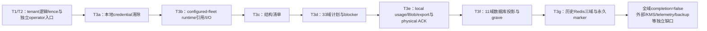

# 数据生命周期设计

当前规范（2026-10-25）：本页区分已实现并具名本地/CI验收的受限切片、非生产协议夹具、未验环境与规划。基线为 `61c3a58 / CI40211433064 attempt1`，证据及全部旧失败见 [PROGRESS](../PROGRESS.md)。M1未冻结、M2冻结，M3/M4/P2与实际生产仍未完成。

原逐迁移流水、旧候选状态与历史验收数字完整保存在[2026-10-25历史全文](../history/2026-10-25/docs/design/04-data-lifecycle.md)。历史中的“未合main”“M3未开始”“300秒待答”等状态已被当前记录取代；协议与旧receipt语义保持。当前继续手动体验/文档优化及C目标环境验收，不自动执行迁移、恢复、清理或重新打开开发队列。

## 1. 当前实现与缺口

| 能力 | 当前状态与范围 | 不能推出的结论 |
| --- | --- | --- |
| archive/unarchive、tombstone、outbox、Blob ownership | 已实现，具名本地/CI验收 | 普通DELETE已物理purge或到期可自动删 |
| user erasure、policy/hold、usage reconciliation、user export | 已实现受限编排与制品/TTL | user erasure completed、generic内容purge或tenant export |
| tenant T1/T2、T3a～T3g | 已实现各自受限本地动作/来源/ACK | 所有域删除完成、远端凭据/KMS已销毁 |
| 0029 external-credential执行账本 | 账本已实现；唯一adapter为显式Memory非生产fake | 真实provider或KMS执行；fake不是远端ACK |
| 0030/0031 journal/catalog | 已实现来源、T1 fence、epoch reservation与显式恢复元数据 | 仅靠catalog摘要证明物理backup，或任意旧快照/联合恢复安全 |
| telemetry writer、0053 failure capture、0054 retained-source | 已实现默认关闭的受控本地切片 | 通用logs/traces处置、可信grant或全域completion |
| 0055～0058 checkpoint/selected continuation/多跳 | 已实现协议及具名本地/CI范围 | 旧schema原生制品跨迁移续跑、production selected恢复或完整P2 |
| production手工R1 | 健康可读source、先预留后物理导入的有限实现与本地/CI范围 | 丢主机无预留恢复、HA、自动灾备或目标生产已验 |
| 外部删除、telemetry处置/retention、generic session/user purge、backup-copy erasure | 未完成/保持拒绝 | 不得以default-off、unknown或其它域ACK代替完成 |

所有全域receipt的 `allDomainsComplete=false` / `contentPurgeExecuted=false` 保持。0037 grant硬拒、0054 original-primary-only destructive、旧receipt不重签/unknown不提升、适用功能的production拒绝及外部删除/自动清理off不变。新MCP/skills/webhook/task域未被旧计划覆盖时必须阻断，不能扩义旧33域receipt。

## 2. 生命周期模型与不变量

运行状态与生命周期分开：当前session提供可读、archived和tombstoned语义；`purging/purged`是最终生命周期目标，不是通用erasure API当前可写状态。

1. 普通session变更进入Host对应串行队列。MySQL模式使用0066 binding、DB clock、完整owner tuple和opaque authority proof，在同一事务重验后写入；新owner确认acquire后重读并repair，Redis数值fence或旧owner目录不授予写权。
2. tombstone提交后普通API隐藏并拒写；跨tenant/user与不存在保持相同404，ID不复用。
3. archive可逆；DELETE对普通用户不可逆。grace用于保留与受控后台证明，不是用户回收站，也不是自动删除许可。
4. items、turns、events内的快照与附件都属于内容域；不能把prompt/args/result放进日志或“审计”绕过相同生命周期。
5. operational usage与独立billing facts分别处置；内容删除不能丢账，unknown成本不能当零。
6. MySQL事务不包含S3或Redis外部动作；必须由exact operation/outbox/marker/ACK收口，不宣称分布式exactly-once。
7. immutable policy、canonical hold、owner/source、DB time、claim lease、restore/fleet proof在各动作边界独立复验；关闭gate不撤销已持久化fence或把unknown变成功。
8. receipt只证明其版本与scope。旧NULL/legacy缺证据不回填、不重签、不解释为零项；operator不因维护权限获得ordinary writer能力。

## 3. Archive

`POST /v1/sessions/:id/archive`与unarchive幂等。archived可读/resume/列举，默认列表隐藏，`includeArchived=true`可见；新turn、steer、compact、approval decision和dynamic result返回 `409 session_archived`。archive清autoApprovedTools，将异常pending审批置expired，恢复后重新审批。

active session返回 `409 session_busy`，不隐式interrupt。archive先提交则turn不生成receipt/item/event；turn先接受则archive busy。失去owner的active历史先由新proof repair；marker、生命周期事件与seq在同一业务commit保存。

## 4. DELETE、tombstone与purge

DELETE在authority/行锁下确认idle，原子保存tombstone、terminal `session/deleted`、连续seq、单调deletion generation、即时 `session.tombstoned` 与不可领取 `session.purge` intent。active返回busy；同owner重复DELETE可204，跨owner404。普通commit永远拒绝tombstoned session。

普通内容宽限期已确认30天，但 `purge_after_ms=NULL`、`session.purge.available_at_ms=NULL`。0050只封存可信ordinary来源与post-COMMIT DB-time floor，0051冻结既有证据；默认关闭的恢复caller只补可信未seal来源，不能为旧行补造或排期purge。详见[30天证据](06-session-delete-grace.md)。

legacy generation0不伪造event/outbox。0014受独立fleet barrier/cutover保护的补偿只把安全可证明的行推进到generation1并补terminal intent，不删除内容、receipt、Blob或推进completion。通用outbox claim/renew/complete/retry仅接受 `session.tombstoned`，即使异常旧进程给purge留下token也不能续租/ACK它。

## 5. 各数据域的处置

| 数据域 | 当前动作 | 仍待闭环 |
| --- | --- | --- |
| session/turn/item/event/approval | tombstone后普通读取隐藏；tenant T3f有限事务可删canonical | generic session/user物理purge |
| completed/legacy pending幂等receipt | tombstone后不普通重放；T3f按计划处理 | 旧writer未排空时不得把pending当无用缓存删除 |
| operational usage | reconciliation；0052受控retention或T3e有限去身份化 | 真实财务保留策略、sealed-source限制和通用批量执行 |
| billing facts | 保留最小独立账务与root/checksum | 正式期限/对账；不等于匿名完所有数据 |
| Blob/export bytes | staging orphan、TTL/revocation与T3e exact outbox/physical ACK | generic ready-Blob purge、云IAM/容量/故障域 |
| Redis历史session域 | T3g exact同slot marker+删除+ACK | 未ACK首次bits丢失、联合旧快照、真实Cluster/failover |
| BYOK凭据 | T3a本地清除/T3b受跟踪引用释放/0059责任来源 | 客户负责厂商撤销；KMS/副本生命周期独立 |
| logs/traces/backup与新registry域 | 已有inventory/source/checkpoint等分层协议 | 产品处置、backup erasure、新域物理销毁/完整恢复 |

将来事件冷归档也必须有owner manifest并参与相同erasure，不能形成删除盲区。

## 6. Usage与财务保留

新usage在同一业务commit以opaque usage_id双写operational ledger与billing fact，并更新原投影/usage事件； `(session_id,turn_id,step)`唯一。billing只留tenant/accounting period/provider/model/tokens/可选cost/currency与完整性数据，不留user/session/turn/step、prompt或原始usage JSON。

cost统一9位小数规范化；priced/unpriced混合保持unknown，硬成本上限遇unknown关闭后续准入。legacy reconciliation只在owner/tombstone generation真实闭合后分配ID、核tokens/known-cost/count/root，冲突整体回滚，不静默覆盖。

0052只删除普通session operational ledger：同事务复验可信DELETE policy v2、0050/0051 seal、DB time、30天与更长政策、canonical hold、erasure/restore fence、reconciliation和独立billing。内容与匿名账单保留；每session超过10000 facts拒绝，不截断。runner/router独立gate默认0且production拒绝；每scan/reconcile/execute需fresh configured-fleet proof。

sealed 0053来源依赖的usage不能由ordinary retention、legacy匿名化或旧T3e删除；0054只在下述精确retained-source桥下允许释放。SQL current read防旧RR快照绕过receipt。0052 prior-retained-billing bridge供T3f独立核对，不重算legacy hash。

原Idempotency-Key可能含调用方个人信息，当前明文存储面仍保留；服务端HMAC迁移属于后续设计，不能在文档中当作已实现。

## 7. 父子session

创建时parent/child必须同tenant/user，parent行锁串行child create与parent DELETE。当前有任何未tombstone child时父DELETE返回 `409 session_has_children`，不静默级联；archive默认只改目标。显式subagent执行另由[根authority协议](02-subagents.md)控制，普通parentSessionId不授委托权。

最终区分subagent/fork、副本独立性和级联策略仍待明确。主体erasure覆盖该主体全部session，不因关系类型漏项；不能从未来“subagent随父删除”目标推导当前自动级联。

## 8. User/Tenant erasure与导出

user admission原子提交subject deleting/generation、request gated、audit与当时active policy。worker独立于新请求admission继续已有任务，只做drain、child-first tombstone与usage reconciliation，停在 `awaiting_purge_policy`。evaluator的 `eligible_execution_disabled`是候选，不授purge；隔离/quarantine、repair/resume按exact control generation/evidence CAS，不直接SQL改证据。

每阶段有独立claim/lease、来源与默认关闭gate。T3c/planComplete只是清单/计划完整，physical ACK只表示精确子集，tenant公开状态仍为gated。T3b只证明已登记configured实例引用/I/O结清，不证明内存零化、未登记后台I/O或远端撤销。

T3f在Memory原子发布/MySQL RR中封pre-delete证据、永久owner-bound session grave、11域删除、ACK/receipt与terminal；失败整体回滚。grave阻止全局session ID复用，owner hash不是可脱离真实tuple独立反推的上游证明。0052/0054/telemetry sidecar与新域footprint须再按各自合同核验。

T3g只覆盖历史 `redis_leases/redis_fences/redis_streams`，owner曾位于lease hash；0066已取代普通live authority，但这些历史域/marker不因此可删。首次Lua在同slot预检后写永久无TTL marker并删除三域；无MySQL ACK时只可existing-marker-only exact replay，marker缺失不创造bits/删除状态。已有durable ACK可在startup/周期重放；gate只授权materialize和新mutation，ACK/seal/已有marker收口不能因gate关闭停滞。marker-only且未ACK后再次丢marker、MySQL与Redis一起回退不受此协议完整保护。

user export以RR snapshot复制owner白名单，生成确定性multipart NDJSON，download持durable lease并逐part校验manifest/size/hash。TTL/revocation走独立outbox。秘密、其它owner、receipt、内部authority与locator不导出；tenant export未公开，受管skill另有独立补充导出。

## 9. Blob ownership与outbox

业务层只保存opaque blob_id；manifest绑定tenant/user/session/item、purpose、generation、bytes/hash/backend。上传staging、业务原子绑定后ready；不跨item/session共享对象。source blob、工具输出水合与compaction都验owner/用途/预算。历史图片在摘要中可变文字占位，不能宣称多模态长期上下文无损。

Blob cleanup普通路径只处理stale staging；T3e另按sealed计划调度ready/staging与export exact outbox，实际completed后才physical ACK，dead-letter不算成功。filesystem cancellation fence与S3同key条件PUT tombstone阻止迟到writer复活；无条件DeleteObject仅限随机startup probe。永久marker增长、runner时钟TTL及长停机/容量仍是边界。

S3使用闭合ASBLOB02 envelope、If-None-Match create-only与If-Match CAS/强读，不依赖DeleteObject If-Match。production filesystem拒绝；S3目标须真实验证private IAM、versioning/lifecycle/Object Lock、条件PUT、强读与容量。0027 storage control/0028离线mover须sealed inventory、逐对象owner/descriptor与copy/verify/cleanup ACK；abort不复用目标key，不自动改manifest。

## 10. 升级与恢复

本文不提供“照编号在线滚动”的升级流程。发布须先关闭相关admission/gate，摘流并实际结清全部旧writer/事务，独立迁移/metadata/strict verify，仅新binary冷启并forward-fix；不删marker、不回改已发布SQL、不隐式DDL。0066还要求旧runtime全部host退休、固定binding command及同command确认，详见[schema bootstrap](../operations/schema-bootstrap.md)。

各阶段fresh fleet、claim lease、source/DB time与native settlement边界分别保留；不能用统一cached proof替代。T3e/T3f每destructive/replay需各自fresh gate；T3g新mutation固定 gate→renew→gate，existing-marker/ACK/restore按其窄权收口。最小权限runtime与migration/operator分开，SHOW_ROUTINE全局定义披露仍须部署落实。

0030 journal只发布激活后的新T1并支持永久fence replay；0031 catalog提供anchor、source binding、external never-used epoch reservation、retention/eviction。catalog不读物理backup bytes；须producer/operator独立核snapshot/provider evidence。同机bucket不证明故障域，仍含anchor的错误更晚快照不能仅靠DB内证据识别，eviction持续停服ACK不等于durable两阶段删除intent。

本地create-artifact读取真实MySQL逻辑bytes并加密，verify-artifact不是严格只读；restore-selected是显式DDL/DML空目标导入例外，先自身reserve，不先generic prepare。已用run/epoch永久不能再import；失败保留reservation与部分target，不自动DROP、清空、重导。五selected continuation见§15。旧schema原生制品跨迁移import→独立upgrade→continuation仍未验收，不因格式兼容升级该结论。

production手工R1仅支持source仍健康可核读：全writer持续停服，先source external reservation，再外部正式producer/importer物理导入，target exact prepare、replay/verify、0066真正successor同command确认及resolution。capture须inactive，不开放production本地artifact/selected guard；无可读源/无灾前预留、HA和自动灾备不在该切片内。具体合同见[初版部署](../operations/initial-production.md)。

## 11. 已确认与待确认策略

| 策略 | 当前决定 |
| --- | --- |
| 普通DELETE内容宽限期 | 30天最低floor；更长policy/hold不缩短，内容purge关闭 |
| BYOK厂商侧撤销 | 客户负责，本系统只清自身副本；[责任来源](05-credential-responsibility.md)已实现 |
| operational/billing/审计/备份期限 | 分域确认，不共享内容宽限期；NULL fail closed |
| active强删 | 先interrupt并实际结清，不合并同步外部回滚承诺 |
| parent/fork副本、级联与导出SLA | 仍待具体业务合同 |
| 法律保留/管理员恢复 | hold阻止物理purge，不恢复普通可见性；恢复权限须独立协议 |
| 生产故障域/RPO/RTO | 待实际资源与演练，不由本地MinIO/正常cold read代填 |

## 12. 验收边界与实现定位

61c已接受主/历史/runtime/Linux VM证据的具名范围，主专用skip精确解释见PROGRESS；本页不把分段结果拼成一次本地full。Memory/MySQL、真实Redis/MinIO、冻结旧binary与migration夹具各证明实际执行范围，非生产fake不作真实provider证明，正常冷恢复不等于断电/HA。

| 合同 | 代码/验收入口 |
| --- | --- |
| 普通session/authority/usage | [Host](../../packages/core/src/session/host.ts)、[MySQL store](../../packages/store/src/mysql/store.ts)、[authority](../../packages/store/src/mysql/session-authority.ts) |
| tenant执行与来源 | [store领域](../../packages/store/src)、[内嵌workers](../../packages/core/src/lifecycle)、[历史迁移](../../packages/store/migrations) |
| telemetry capture/retained-source | [capture](../../packages/store/src/tenant-telemetry-persisted-provider-capture.ts)、[retained-source](../../packages/store/src/tenant-telemetry-retained-source.ts) |
| checkpoint/continuation/bytes | [restore codec](../../packages/store/src/tenant-telemetry-capture-restore.ts)、[artifact](../../apps/agent-runner/src/mysql-backup-artifact.ts)、[selected](../../apps/agent-runner/src/backup-selected-restore.ts)、[CLI](../../apps/agent-runner/src/backup-catalog-cli.ts) |
| 当前限制与历史失败 | [PROGRESS](../PROGRESS.md)、[历史全文](../history/2026-10-25/docs/design/04-data-lifecycle.md) |

真实managed IAM/KMS、跨故障域/联合恢复、backup-copy erasure、telemetry处置、generic purge与全域completion仍未闭环；不因该表有源码/测试入口就称通过。

## 13. 0054 retained-source本地协议

`tenant-telemetry-retained-source-v1`以独立content-free证据表绑定真实T1/T3d/T3e/T3f业务边界，不重释旧v1/0053 hash。它仅允许原active-primary epoch、0033/0053激活后creation-complete新tenant、T1前完整v2 cohort全部written/reservation/ACK/source闭合的有限路径；legacy、mixed、unknown、pending/reserved及新epoch保持拒绝。0037与全域completion不开放。

### 13.1 T1 cohort

admission/fence/audit/真实telemetry subject、完整cohort和publication同一Memory原子边界/MySQL RR提交。先锁来源再取DB time；coverage起点精确等canonical subject birth且不早于activation。cohort逐状态count/root含空集，不只挑已完成项。迟到ACK不能提升T1冻结资格，T1后不补新create；runtime_unknown/gen1不冒充NULL/gen0或managed来源。

### 13.2 T3d七源与33域

同一锁定图核inventory/job/ACK/membership/application binding/v2 source/failure receipt全部七源。目标先从实际source/owner投影，再与33域plan、旧0040/0041及独立tagged证据/receipt/terminal原子封存；旧五源codec不增加第六枚举，不伪造旧0042 receipt。缺失/孤立/未完成诚实unknown；logs/traces即使非零仍blocked_adapter_unconfigured。

### 13.3 T3e usage释放

同事务重验source/canonical/plan/policy/hold/restore/claim/DB-time lease，先写exact usage ID与source/billing的pre-entry，再DELETE operational ledger，之后封旧ACK/cutover与新aggregate。`releasedAtDbMs`为准备时间，顺序source high-water≤pre-entry≤旧ACK≤cutover；不改immutable叶凑等式。独立billing保留并核0052 prior bridge；任何晚期错误回滚全部DELETE/发布。

### 13.4 T3f canonical closure

先封pre-delete、真实grave、0039 owner leaf与canonical pre-entry，再实际DELETE，最后发布旧/新aggregate和terminal。leaf绑定failed item、连续event range、completion snapshot、usage release与claim。owner不能只验可重算SHA：须用同exact protected ref key将真实grave重新HMAC，与membership/catalog/hold/binding精确闭合。删除后还核整个tenant canonical为空、旧grave IDs不复生及billing/残余集合。

### 13.5 三态历史与零外部目标

`live`须闭合完整canonical/usage/source；`usage_released`须真实release、旧ACK/cutover与独立billing；`canonical_closed`须真实T3f/0039/grave/HMAC、新closure与tenant空集/残余证明。getter/startup/replay按私有bottom-up验证，不能Map.has/header/allowMissingSource代替。旧NULL缺证据仍unknown，新footprint不能冒legacy。

首次usage DELETE或任何新外部outbox前，33域内全部 `blob_`/`user_export_` 前缀targetCount须精确零，不只查bytes两域；非零/未知即阻断。executionReady、externalAuthorityVerified、allDomainsComplete、contentPurgeExecuted均false。SQL root聚合1MiB超限拒绝不截断；真实全图范围锁、JSON/packet、lease/死锁和N+1容量仍待staging。恢复不赋0054新epoch destructive资格。

## 14. 0055/0056来源封存与只读历史

0055固定49类checkpoint及逐行keyed HMAC叶允许合法queued/reserved/written/blocked/legacy-unknown备份，不以前述删除资格作备份门槛。Memory语义与MySQL物理envelope不互认。加密MySQL制品v2的manifest/GCM AAD绑定checkpoint；seal前核actual pool与operator的UUID/database及导出前后零漂移。旧制品exact replay只验认证字节/历史，不重新seal，不改v1。

0031选定checkpoint与真实binding/reservation、0030 prepare和0055 sidecar原子提交。0056只提供exact-run、verify-only cold-open的冻结维护facade，不暴露普通SessionStore/prepare/primary/capture。caller selector不代替actual源关系；MySQL每次锁run与49类来源，Memory同步复核。

0030 activation与0056 history receipt同事务发布并绑定真实immutable activation event；当前head合法推进不重签历史。只读history不授新写/旧pending recovery/0054删除。0057消费者另有下面的完整授权；0056的历史通过不替后继消费者背书。

## 15. 0057显式新epoch capture与旧pending恢复

runtime active、history可读和capture可写是三种权限。首cutover在原子边界锁并复核checkpoint/49类来源、0031/0030、owner/source，另绑定new epoch/configured fleet/旧writer排空/producer ACK。旧activation/coverage/failure/checkpoint/descriptor不重签；新failure绑定真实cutover与新epoch。

ordinary runner只获自身capture gate/ref key，不获operator restore权限。维护factory要求exact run、held authenticated GCM、target/operator锁及停服ACK；operator-only不能claim/renew/reserve/create/ACK。cutover前验冻结集合，之后按完整history/cutover/current recovery链允许合法新写，不要求今日投影永久等于导入快照，也无skip-audit/allow-missing-source。

旧validated-v2 pending只由新attempt/token领取并原子发不可变permit，绑定原checkpoint叶、genesis descriptor、actual latest predecessor、reservation-at-issue和原R来源；同predecessor唯一successor。queued首次新claim可一次reserve，后继沿用原R；lease在固定ceiling内，INSERT/CAS/临COMMIT DB-time尾检任一步失败全回滚。T1/hold/owner关闭后已有reservation仅ACK-only，exact对象不存在不能create；旧epoch legacy/unknown在LIMIT前排除，不升级执行权。

五个显式命令 `replay-selected`、`verify-selected`、`activate-selected`、`activate-capture-selected`、`resolve-selected` 各有独立ACK，持续持GCM与target/operator锁，核完整外部catalog/journal sealed链与fresh head。只继续已导入exact run，不reserve/import/prepare；resolve另需catalog resolution ACK，仅actual active+capture cutover可activated，CAS前核history、CAS后读全链再原子本地收口。response-loss仅显式exact retry；不提供v2自动abort/resolution，不授普通writer。

v2领取控制锁、完整来源审计、CAS与最后lease检查保留；控制/来源反序仍可能1205/1213，整事务可重试而非吞错。原primary/inactive/v1与恢复后v2分开，不能为恢复门禁破坏日常队列。0057不赋0054 restored destructive资格，production selected/artifact限制保持。

## 16. 0058重复备份、多跳与剩余native边界

CP2/ASMYSQL3及v2 permit已实现，具名本地/CI范围包含primary→R1→新backup2→fresh never-used epoch2→五continuation、原reservation ACK、新capture及cold startup。旧180/300秒失败与获准R2单例360秒证据保留于PROGRESS，不能据本地首次通过宣称稳定提速或更改single-hop/CLI/lease预算。

CP2独立scope/domain与必需lineage capsule不改CP1固定49族/旧root/receipt/descriptor；另封27个表级family，每族含空集count/root，真实物理key及整行keyed HMAC覆盖祖先与许可。仅排除本backup自身header/叶，不整族过滤；ASMYSQL1/2字节/AAD语义不变。导出窗口审计与零漂移、恢复frontier实际immutable event/run增量均独立证明，不能凭epoch/时间高水位放过变化。

v2 permit保genesis、actual predecessor与原R授权，不reset/re签旧许可；unknown可完整备份但不获执行或0054删除资格。source须真实factory closed/frozen facade并绑定actual pool，按source实际runtime与完整catalog/journal/fresh head核验；source已fenced后不继续读/mirror它。

旧schema原生制品的显式跨迁移import→独立upgrade→continuation仍未验收；格式/历史可读不等于该链通过。必须在reserve/import前核source schema并拒绝不支持路径，不自动重导、清空部分target或隐式升级。其它域联合恢复、backup-copy erasure、真实故障域与全域completion仍未完成。
