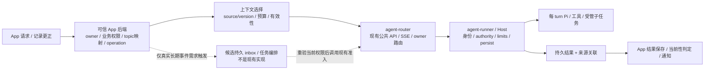

# 业务任务、上下文与可选编排

本文补充[总体架构 §1](00-architecture.md#1-目标与约束)与[上下文装配](00-architecture.md#context-projection-flow)的设计取舍。**§1 区分当前能力，§2–6 是后续实现的设计约束与需求触发候选，不是已交付 API 或新的执行授权。** 当前版本、验收和待办只看 [PROGRESS](../PROGRESS.md#superagent-design-followups)。参考输入见 [Super-agent 研究](../research/08-superagent-prototype-analysis.md)。

## 1. 当前基础与职责决策

主要场景仍是可信 App 后端在验证用户和记录权限后，提交记录分析、补充、更正或同主题追问。一般反问可结束本次 turn，补充到来再发新 turn；无需维持一个跨天等待的进程或常驻模型会话。

| 层 / 概念 | 当前能力和本轮决策 |
| --- | --- |
| App topic / task | 业务对象；推荐由可信 App 后端维护到 session 的持久映射、CAS 与结果保存幂等。现有参考实现仅是单进程内存 fixture |
| `agent-router` | 保持公共 HTTP/SSE、owner 路由和 fleet 门禁，不承担模型语义分派、跨任务记忆或业务优先级 |
| `agent-runner` / SessionHost | 保持权威身份、写入 authority、执行准入、审批、预算、提交、取消和 repair；所有编排动作继续经过相同关口 |
| Pi / engine | 每 turn 独立 loop；已有 `steer/interrupt/done` adapter。不因外部应用原型更换引擎或增加独立 harness 进程 |
| 受管 subagent | 已有根 authority、权限交集、真实 child 账本、共享预算与唯一计费；用于单个任务内部委派，不作为业务长期任务的替代模型 |
| 上下文 | 已有版本化 agent、有限 history/compaction、预算、Blob 水合、skills 与固定可信 memory 注入；跨 session 检索与来源失效仍缺业务合同 |

文章中的 Router 是**语义协调者**，Worker 是**具体任务执行会话**；它们不是本项目两个服务的对应物。如果后续确有多任务关联和协调需求，先在可信业务编排层定义小接口，可用受限 agent 完成语义部分；逻辑模块不要求新增长期服务。通用编排设施是否抽取由实际复用需求决定；已经由记录场景暴露的创建核对、来源绑定和上下文失效，则可先完善Runtime通用合同，不以出现多个App为前提。

责任要分清：App决定来源事实、业务权限和任务选择；Runtime一旦保存、压缩并再次注入这些副本，就应提供通用的来源承接、投影失效及恢复机制。App结果保存CAS不能替代模型调用前的上下文有效性检查。以下方案仍为规划，不表示当前Runtime已具备这些机制。

## 2. 业务任务与执行身份

本节是实际 App 集成的设计要求；不向现有 `CreateSessionRequest` 增加字段，也不把 turn 幂等扩成 session 创建幂等。

| 关联 | 设计要求 |
| --- | --- |
| 业务主题 → session | 绑定实际 tenant/user、主题和固定 agent/version；默认同主题续聊，不把一个用户全部任务塞进同一 session。映射版本支持并发 CAS |
| operation → turn / result | 持久保存请求摘要、输入来源版本、session/turn 和结果身份。相同 operation 异请求拒绝；提交未知保持原身份并只读核对，不能换 key 或新建 session 掩盖 |
| session 创建未知 | 当前只能保留 pending 映射并停止盲目重建，尚无按创建operation精确查回的恢复合同；metadata/topic扫描不能证明唯一分配。需设计owner范围内的创建幂等收据及只读核对，不能靠turn幂等弥补；收据过期、删除或请求冲突均不得自动分配替代session |
| task → 多次执行 | 仅在真实跨轮次任务需求出现时建模；业务 task 与 Runtime 受管 child task 使用不同名称空间，保留每轮 session/turn/operation 来源，不覆盖旧执行 |
| 完成 → 当前业务结果 | 先核业务认可的自然终态和所需持久结果齐备（参考集成为`completed/end_turn`），`completed/max_steps`等不当作成功分析；再按来源版本 CAS 判 current/superseded。Runtime 完成和 App 保存成功是不同事实；旧结果只可在权限允许的历史读取中展示，不能冒充最新记录的分析 |

对齐与验收应覆盖并发首建、创建响应丢失、进程重启、turn 响应未知、Runtime 完成而 App 保存失败、记录版本竞态、跨 owner 访问。已有[记录助手样例](../../examples/record-assistant/README.md)是小接口参考，不能当作这些真实仓储条件已验。

## 3. 有界上下文与可追溯引用

先定义“模型应看到什么和为什么仍有效”，再选择检索或记忆实现。复用现有 history、compaction、Blob、工具和预算路径，在Runtime内补齐来源承接与失效，不新增可绕过 Host 的通用记忆数据库。

### 3.1 来源及引用合同（规划）

下表是逻辑信息要求，不是新增公共 JSON schema。业务方决定字段映射和保存边界，Runtime 只在正式协议支持后承接相应验证。

| 信息 | 目的与约束 |
| --- | --- |
| 来源身份与版本 | source system、业务对象 ID、不可变版本/摘要、观察时间；区分业务事实、用户声明、工具结果和模型推断 |
| owner 与可见范围 | 实际 tenant/user 与业务权限由可信后端/授权工具验证，不能由正文或模型生成 ID 代替；关联边不自动授予下一跳权限 |
| 有效性与依赖 | 标记 superseded、撤权、删除或过期；派生 summary/result 保存其来源依赖，不能只保留脱离来源的“记忆”文字 |
| 有界内容 | 有限摘要、单位明确的长度、是否截断、可用时的续读引用；引用由已授权读取器解析，不能接受任意路径/URL 作为取数指令 |
| 执行关联 | 记录消费该版本的 operation/session/turn、agent/config 身份及结果依据；关联信息也按内容与访问级别受控保存 |

### 3.2 装配顺序与按需展开（规划）

1. 解析实际 owner、固定 agent/version、工具和预算，核对业务记录的当前权限与版本；授权不成立时拒绝本次取数，不退回模型记忆。
2. 确定性选择当前主题、最新有效更正、待决问题及最近相关结果；这些是上下文结构建议，不是已经存在的新 memory 功能。避免把无关 session 全量拼接。
3. 先给完成当前任务所需的有限原文/摘要与来源引用；关联且近期可能使用的资料适量内联，低频或长内容留在授权数据源中按需读取。
4. 每一跳重新校验可见范围和有效版本，限制总字节/token、读取次数、深度、时间与循环；统一纳入现有工具/turn 预算，不能因“召回”免费扩张。
5. 预算不足、截断、资料失效或取数不可用时给出明确缺口；需要时向用户补问，不用无来源 summary 猜成事实。

短摘要可能省去工具往返，也可能漏掉关键约束；具体 inline 大小与召回策略由任务质量、延迟和 token 实验决定，不复制文章中的固定字符数或团队规模指标作为本项目默认值。

### 3.3 更正、撤权与删除（规划，实施前置）

当前业务记录复制到 item、工具结果或 summary 后，源更正/删除不会自动改变这些副本；固定 memory prefix/append 和 compaction 也没有建立传播链。补入一个新的检索入口不能掩盖该缺口。

- 更正：版本变化先使派生结果失去“当前”资格；后继输入选择新版本，对含旧事实的 summary 按依赖失效并从有效来源重建。历史快照可否保留和可否展示由业务与生命周期合同分别决定。
- 撤权：停止新的读取、召回和模型注入；缓存、引用、summary 与异步任务都需按权限版本/失效标记重新准入。已送达 provider 的内容不能声称可撤回；活动执行如何停止与结算需明确处理。
- 删除：新建索引、引用、任务输入、summary、outbox、导出和备份副本都进入[生命周期 inventory](04-data-lifecycle.md)。未覆盖的新域必须阻断相关完成声明；不因此开启 purge、外部删除或自动清理，也不重释旧 receipt。

这组规则是后续功能的设计目标，当前系统没有因此获得自动副本失效或删除传播能力。不得仅靠文档标记声称已完成 erasure。

### 3.4 Runtime落点与历史兼容（规划）

当前[`ContextCompactionItem`](../../packages/protocol/src/item.ts)没有业务来源依赖，[`projectItems`](../../packages/core/src/context/history.ts)会将summary加入历史上下文；[`SessionHost`](../../packages/core/src/session/host.ts)先读历史、规划并可能调用摘要，再组装主模型上下文。因而以下工作不能全部留给App，也不能只在最终回答保存时处理：

1. **可信来源绑定。** 输入快照与依赖记录经受认证控制路径保存source身份、版本/摘要及可见性修订。业务正文、检索结果和模型摘要都是数据，不能从其中解析标记补造来源或权限；固定可信`memory-injection`修改system prompt的路径不是动态业务记录注入捷径。typed依赖防程序信任混淆，不宣称消除了模型提示词注入。
2. **失效先于消费。** Host在选择旧历史、加载受影响附件和请求摘要之前检查来源状态，随后在实际模型/工具准入边界复核适用的当前状态。禁止把失效资料先发给summariser、再只从最终答案中过滤。每次检查与执行之间的变更竞态、通知延迟和在途结算必须有明确合同；已经发给provider的内容不能撤回。
3. **覆盖派生依赖。** 依赖覆盖原始输入、工具结果、由其产生的assistant内容及递归summary。只删除旧summary、却再从含旧事实的其它内容重建，会重新污染投影。无法证明依赖闭包时保守隔离受影响投影段，从仍获授权的来源重建或明确缺口，不让模型凭旧摘要猜回有效事实。
4. **历史兼容与配置身份。** 不修改已持久事实来伪装过去已具来源证明；旧的无依赖summary不能自动补证。需要严格撤权/删除隔离时，明确旧session的拒绝/降级条件及人工出口，不能自动换session掩盖。缓存/投影身份需反映来源修订，但缓存命中或epoch相同仍不授予读取/写入权限。
5. **独立核算与生命周期。** 摘要请求可能早于主turn-start，来源门禁必须覆盖它及其usage；新依赖/失效记录、派生副本和恢复路径进入现有inventory。具体协议、前向迁移和发布兼容单独设计，不在本轮改schema或历史数据。

最小验证轨迹是“v1输入→压缩→v2更正/撤权→后继执行”，观察摘要和主模型实际收到的输入，而非仅断言最终保存标签。还需测并发变更、旧summary、恶意正文、跨owner、缓存、崩溃及费用unknown。当前实际App的数据权威和通知时效仍待确认；可先用合成记录源定义并验证程序合同，不将其称为真实App权限验收。

### 3.5 首版收敛决策与详细设计入口（规划）

用户已确认两项方向：**采用保守整代隔离；来源模式保留SSE。** 前者在来源变化后隔离受影响的上下文代际，首版不追求逐item依赖DAG；后者要求补齐来源模式的读取、队列关闭与恢复合同。两项确认不表示能力已经实现，也不把其余协议细节自动视为已获确认。

推荐的最小首包是新建、显式opt-in的source-aware会话，限定单一实际owner、文本来源和固定无工具agent，继续使用现有router/runner/Pi拓扑。这个范围及具体协商方式仍为设计提案；现有普通会话的输入、更正与SSE行为保持原合同，新模式不能在协商失败后回退到未受来源约束的读取路径。§3.4列出的更广能力组合仍须分包设计，不都纳入首包。

详细合同集中在[11 来源绑定与上下文失效](11-source-context-invalidation.md)：[首包范围](11-source-context-invalidation.md#scope)、[来源控制](11-source-context-invalidation.md#source-control)、[代际状态](11-source-context-invalidation.md#state-model)、[协议](11-source-context-invalidation.md#protocol)、[SSE与重放](11-source-context-invalidation.md#sse-replay)、[执行和结算](11-source-context-invalidation.md#execution-settlement)，以及[验收出口](11-source-context-invalidation.md#acceptance)。字段、API、数据模型、兼容与验证要求均属规划，不是已发布协议或已通过验收。

来源失效约束后续消费与可见投影，不等于物理删除旧历史、Blob、导出或备份，也不推进生命周期完成声明。已经派发的模型及摘要仍需保存真实或unknown用量并唯一结算；不能为隔离旧正文而丢账，不能把unknown当零费用。详细设计须分别处理内容准入、旧执行结算和MySQL写权，不新增自动重试、模型费用或部署授权。

## 4. 持久事件与异步任务（需求触发候选）

只有真实需求包括“耗时任务不阻塞前台、外部事件续推、跨进程等待/回调或长期多任务”时才立项。当前 active turn 的 steer 已有持久输入及 step 边界注入；`resume` 读状态、dynamic callback 的进程内等待和 SSE 重连均不等于持久任务续跑。

| 关口 | 立项时必须明确的合同 |
| --- | --- |
| 入站事件 | 验来源、实际主体、租户、签名/防重放和 schema；正文/引用/机器人报告为不可信数据。区分原生对象ID、不可变事件/修订ID、同ID异内容冲突及编辑/删除语义；定义顺序/乱序与过期策略。跨信道账号关联须由可信映射验证，不能凭提示词别名继承actual-user权限 |
| 接收与去重 | 同一事务记录接收、目标绑定和待投递事实；明确 accepted、delivered、consumed、settled 的区别。投到进程内队列或claim不算消费，持久纳入上下文也不等于模型/工具已成功执行 |
| 代际与批次 | 合并wake/投递任务仍保留不可变事件及顺序，旧generation回执不能结清后来新增的工作。批次保留每条输入的主体/来源/可见范围，不能用最强事件的身份给其余成员授予权限；批次边界不能跨owner合并上下文 |
| 路由 | 先用已授权 task/topic/session 映射；多订阅仅分发可见上下文。确需多处置者时定义消费、处置责任与释放条件，订阅或ACK不等于新动作授权。语义归属判断只能在允许集合中选择，不得授予新身份、工具或预算 |
| 消费与写权 | 消费前重核当前权限、取消版本/期限和 agent 配置；session 写入仍通过 Host 和 fresh MySQL authority。队列锁或消息 ACK 不授予普通 writer 权限 |
| 投递与派发 | 数据库事务、provider/tool 派发和远端效果分开。稳定 action ID、派发前标记、唯一 usage；未知外部结果只读核实，无远端幂等证明不自动重派 |
| start / status / stop | 是候选逻辑动作，不是已发布 API；Started 只证明具名接收/准入。stop 先关新准入，再 abort 并等待真实 settle；迟到结果不得重新激活已取消任务 |
| 控制含义 | 分别定义停止来源接收、暂停自动消费、撤销业务授权和终止执行；说明backlog保留/过期与在途结算，不用一个pause或policy hash替代所有当前权限检查 |
| 重启与恢复 | 区分未派发、已结算、已 started unknown；保留原身份和证据。不得把“新 Assignment + 请模型检查”当作未知动作安全重放证明 |
| 资源与生命周期 | 定义有界 backlog、并发、公平性及跨 turn/Assignment 的任务总执行次数、总费用/期限和超限人工出口；费用 unknown 关闭新准入，不能靠新建 turn 重置任务总预算。新域纳入 inventory/retention/备份恢复；自动消息不无限延长已有根 turn/family deadline |

App 侧 inbox 可先持有业务事件和任务映射，再通过现有公共 API 执行；不能直写 Runtime 表或绕过鉴权。需要共享设施时再设计 Runtime 协议，复用现有 outbox、账务与生命周期机制，避免另一套宽松 authority/副作用账本。

长期预算是立项前置：现有受管family以根turn为界，不自动累计后继普通turn。未来稳定且owner-scoped的执行组要覆盖每轮主模型、主turn前摘要及工具准入；child usage只汇集已有账务，不二次计费。它只能额外收紧准入，不能增加工具权限或替代MySQL authority；估价与响应后结算仍不升级成金融级硬预授权。

## 5. 对人输出与进度观察

借鉴“只在有人能行动时通知”：按业务界面区分待补信息、待审批、阻断、可验收和完成，附任务/版本/执行关联及授权回读入口。默认由 App 做通知投影，不改变既有 HTTP/SSE 的事件、游标与持久终态；后台 child 的细节是否展示是产品选择，不删除真实执行事实。

如果引入外部通知，须单独定义投递去重、目标撤权、过期、合并和限频；本地 outbox 收据不能单独保证远端 exactly-once。未知投递不伪装成功，也不能盲目重发。

进度观察先采用可解释的阶段/活动时间/已结算事实和独立健康检查，再决定是否需要模型诊断。模型的“没有进展”只是建议，不自动触发重启、重放、策略改写或权限扩大；人工停止仍需保持。此处不创建定时任务或 Watchdog，也不改变本机 OWNER 启停合同。

## 6. 实施触发与验收要求

| 包 | 启动条件 | 交付前必须证明 |
| --- | --- | --- |
| Runtime创建幂等与精确核对 | 为已知创建未知缺口先定通用合同；实现前明确收据生命周期、兼容和SDK跨进程恢复需求 | 同owner/同创建operation同请求只一session，异请求冲突；COMMIT后响应丢失/重启可只读查回；跨owner拒绝；删除/过期不自动重建 |
| Runtime来源与压缩失效 | 按[首版范围提案](11-source-context-invalidation.md#scope)先用合成记录源设计；真实接入另需确认来源权威、权限修订、通知与保留责任 | v1→摘要→v2后实际模型输入排除不适用旧依赖；摘要前门禁、旧历史、SSE视图/恢复、并发/崩溃/恶意输入及生命周期负例，详见[首包验收](11-source-context-invalidation.md#acceptance) |
| SDK持久映射与真实App集成 | 同步明确小接口；完整恢复依赖创建核对，来源正确性依赖Runtime失效能力 | 跨进程CAS/重启；未知只读核对；完成后保存失败只重存；旧结果不成current。受控持久fixture与实际App仓储/权限分开验收 |
| 有界引用与续读 | 有来源/权限/失效合同后按实际检索需求扩展 | 复用owner-scoped item/Blob；每跳鉴权、修订失效、截断/缺口及读取次数/字节/token/深度限制，不能用任意URL/path扩权 |
| 可选事件/任务编排 | 确认具体长期任务、事件来源、期限和费用预算；已有多 turn 不能满足 | 重复/乱序/跨租户/过期输入；取消与迟到竞态；崩溃注入；started unknown 不重派；唯一账务和生命周期覆盖 |
| 语义协调角色 | 确认必须模型判断的跨任务关系；确定性基线不足 | 在相同轨迹下比较正确关联率、P50/P95、usage、错误外部动作和邻租户影响；规则准入不可被模型突破 |
| 隔离执行 / BYOM | 确需 shell、stdio、脚本或特定设备资源 | 独立评审 tenant/OS/网络/凭据隔离、IPC、设备身份、撤销/离线、取消结算与恢复；工作目录不作沙箱证明 |

纯程序合同优先用确定性来源与 FakeVendor；效果和厂商费用分开具名验收，真实模型另有预算。增加 Runtime 功能时仍按既有完整门禁，不因本文为设计候选省略正确性检查。开发顺序与当前 TODO 在 [PROGRESS](../PROGRESS.md#superagent-design-followups) 单处维护，不把上述所有候选自动放入近期开发。
