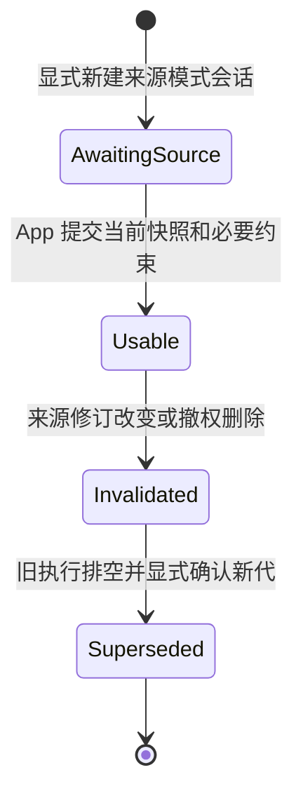

# Runtime 来源绑定与上下文失效

本方案面向记录分析、补充、更正和同主题追问：App 决定业务事实与权限，Runtime 对已保存并再次使用的副本负责。来源是业务记录或文档，不是模型 provider。总体分工沿用 router、runner、SessionHost 和 Pi，不增加长期服务或通用记忆平台。

**状态为规划，尚未实现。** 已确认两项方向：保守整代隔离，以及首版保留 SSE。保守隔离保留原会话记录，隔离整个旧模型上下文，由 App 在后续显式带入有效快照及必要约束。下面的首包范围、重确认操作、字段、路由和数据布局是供开发评审的推荐方案，不是已发布 API。当前源码与验收看 [PROGRESS](../PROGRESS.md)，设计取舍看 [设计 10](10-task-context-and-orchestration.md#source-context-first-slice)。

人工阅读可先看 §1、§3、§5 和 §9，再检查协议与数据细节。开发顺序和任务状态只在 [TODO](../PROGRESS.md#runtime-source-context-plan) 维护。

<a id="scope"></a>

## 1 首版范围与保证

### 1.1 推荐最小范围

| 范围 | 首包方案 |
| --- | --- |
| 会话 | 仅新建且显式启用 `source-aware-v1` 的会话；普通会话保持当前合同，旧会话不原地升级或自动补证 |
| 来源 | 一个实际 tenant/user、一个业务来源，来源键绑定受信 issuer、namespace 和不可变 incarnation；一次使用一个有效版本 |
| 输入 | 有界纯文本来源快照、普通用户消息和 App 重新声明的必要约束；用户消息不取得修改来源 head 的权限 |
| agent | 固定版本、无工具 agent；不启用 MCP、dynamic tools、subagents、skill 调用、正文外发 hooks、动态业务 memory 注入或 steer，避免遗漏新的数据消费与派发路径 |
| 执行与读取 | 保留主模型、自动及显式压缩、现有预算和结算；保留 POST/GET SSE、当前代快照与安全状态读取 |
| 历史 | 原始事实保留；默认公开读取与模型投影仅面向当前有效代。跨代审计读取另行授权和设计，首包不提供通用跨代时间线过滤 |

首包不建立 item 依赖 DAG。每代采用整体依赖集合：来源快照、该代普通消息、assistant 内容、递归 summary 及派生内容均随整代隔离。普通用户补充可以继续发文本，但不能靠一句“已获授权”改变来源状态；需要更正权威记录时由 App 走来源控制操作。

建议固定的初始资源边界为来源正文最多 16 KiB、重新声明的约束最多 8 KiB，均按原始 UTF-8 字节计；安全快照最多 1000 个 item、整体序列化最多 4 MiB，超限拒绝，不截断后推进游标。这是待开发验证的协议上限，不是容量或模型质量结论。已有更紧的 turn、SSE、租户及模型预算仍适用；长历史分页不进入首包。

### 1.2 可以保证的边界

Runtime 来源 head 更新提交后，后续权威检查不得再准入旧修订的新消费、派发或内容发送。更新前已准入的调用可能已经在途、发生费用或结果未知；abort 只作尽力取消。App 尚未通知 Runtime 的业务更改不在这个时间点保证内，真实接入须单独约定通知延迟和失败处理。

来源操作已提交、观察连接已关闭、执行已排空、账务已结算是四个不同事实。来源 ACK 不证明所有旧连接或网络缓冲已排空；已经送到 provider、router、socket、代理或客户端的内容不能撤回。通知用于加速关流，不能代替权威来源检查。具体发送边界见 [§5](#sse-replay)，执行与账务边界见 [§6](#execution-settlement)。

<a id="source-control"></a>

## 2 来源权威与身份

### 2.1 不能混用的身份

| 名称 | 含义 |
| --- | --- |
| 来源键 | `(tenantId, userId, issuer, namespace, sourceId, incarnation)`；owner 由认证和实际资源绑定得出，不能从正文采信 |
| `businessVersion` | App 的不可变版本标签；只作相等判断，不按数字或字符串排序推断新旧 |
| `contentSha256` | 来源正文原始 UTF-8 字节摘要；不隐式换行、Unicode 或空白规范化 |
| `sourceRevision` | Runtime 单调递增的控制修订，用于 CAS、防旧更新与消费检查；不证明 App 未通知的最新 ACL |
| `contextGeneration` | session 内单调递增的模型上下文代际；不复用现有配置指纹 `contextEpoch`、压缩水位或事件 seq |
| `viewId` | 服务端确认的读取视图，绑定 session、generation、协议和来源修订；它是前置条件，不是权限凭证 |
| `operationId` / `dispatchId` | 前者标识控制/重确认操作，后者标识一次实际模型或摘要派发；都不能凭客户端文本变成 writer proof |

同一完整来源键下的版本标签一旦绑定摘要就不可换正文，不同记录可各有自己的 `v1`。同一 `sourceId` 删除后不得复用旧 incarnation；删除控制记录或查不到来源均按不可验证处理，不能解释成“无需依赖”。

### 2.2 控制操作

当前 scope 只有 `runtime` 和 `admin`。首包建议仅允许**显式登记为某 namespace 来源权威**的可信 App 后端使用 tenant admin 控制路径；Runtime 另核实际 tenant/user、issuer 绑定和操作权限。普通 runtime key 只能消费已认可的来源，不能登记或撤权。拥有 admin scope 不自动证明某条业务记录的当前 ACL；真实业务权威与通知责任仍由 App 提供。

每次 register、replace、revoke、delete、regrant 都带稳定 operation、请求摘要和 `expectedSourceRevision`。事务内按来源键锁定 head，先核同 operation 同请求，再 CAS 修订并原子保存版本元数据与收据；同 operation 异请求返回冲突。新来源仅允许从明确的“不存在”前置条件创建，不能用 upsert 覆盖已有来源。重新授权也产生新修订，不复活旧代。

来源控制事务只更新 source head、版本元数据与自己的收据；不持有来源锁再遍历 session 加锁，不分配 session seq，不获得普通 session 写权。其回复区分 `committed` 与只读核对得到的 `unknown`；不报告 `allObserversDrained`。精确重试和查询沿原 operation，收据过期或来源删除也不能自动当成首次请求重新执行。

控制操作使用闭合 schema 和确定性请求摘要，覆盖实际 owner、来源键、操作种类、预期修订、状态、版本与正文摘要。注册信息、关联和收据本身也可能含个人信息，保存与删除按 [§7](#data-model) 处理。

<a id="state-model"></a>

## 3 上下文代际与恢复状态

### 3.1 四组独立状态

| 状态组 | 建议状态与含义 |
| --- | --- |
| 来源 | `active / revoked / deleted` 为已提交事实；查询失败或证明缺失是 `unverifiable`，不伪造永久撤权事实 |
| 上下文代 | `awaiting_source / usable / invalidated / superseded`；是否实际可用还须与当前 head、owner、lifecycle 匹配 |
| 执行 | 继续沿用现有 turn、lease、repair 和真实 I/O 状态，另关联 generation；不以 source 状态替换 fencing |
| 结算 | `not_dispatched / pending / settled_known / settled_unknown` 表示该次派发事实；unknown 不等于免费、退款或可重派 |

有效性以“代际绑定仍匹配当前权威 head”为准，不等待异步 `invalidated` 标记或通知落库。观察到已经提交的来源变更即阻断旧代，即使它仍显示 `usable`。一旦确认代际失效，后续同摘要 regrant 也不能使该代恢复。临时 DB 失败只关闭当前准入和观察；恢复后若 head 确未变化，可以重新读取同一有效代。



图中的最后一步创建一个新的 `Usable` generation；旧代保留 `superseded`，不回到可用状态。新的来源快照和 App 重述的约束是新代 seed；旧消息、assistant、summary、Blob 派生和客户端旧气泡都不自动转为 seed。初始 `awaiting_source` 可用 generation 0 表达，首次确认产生 generation 1。

### 3.2 新代的准入条件

App 显式重确认时须满足：实际 owner/agent 仍匹配；最新来源修订可用；旧代关闭新的执行和公开内容写入；旧执行已真实排空，或接管者已经按既有 repair 合同封存结果未知且拒绝旧 writer；结算记录已唯一持久化。`idle`、terminal event、lease 超时或请求取消单独都不是排空证明。

执行排空和费用已知分开判断。可以持久保存 `settled_unknown`，但本包须新增 owner/session 范围的 unresolved-dispatch 门禁：该会话仍有结果或 usage 未核清的旧 dispatch 时，后续 summary/main/fallback 均拒绝，不因 generation 改变清除。只允许沿原 dispatch/operation 精确只读核对为已知结算或严格未派发后解除；人工可以结束会话，不能靠改标记把 unknown 记零。仅价格未知仍按既有成本门禁处理，不能把这个新门禁误写为当前普通会话已有能力。不要求伪造厂商最终账单才结束执行，也不能以本地超时替代真实 I/O 退出。配额、repair、费用等既有门禁继续独立适用，不自动换 session 或放行。

历史保留不等于历史可见。更正和撤权都先采用同样的当前代隔离，默认来源模式内容读取拒绝旧代；审计、导出、删除的权限分别核验。来源失效不等于物理删除，不触发 purge 或自动清理。

<a id="protocol"></a>

## 4 推荐协议

### 4.1 协商与操作面

以下路由是拟定协议位置；实现时一起更新 protocol、OpenAPI、SDK 和错误白名单，不只添加可被旧 parser 丢弃的可选字段。

| 操作 | 推荐请求与响应 |
| --- | --- |
| 新建 session | `contextMode: source-aware-v1`，响应明确回显 mode 和 `source-context-v1`；初态不带业务正文。客户端未收到回显时停止，不能继续提交文本 |
| 来源控制和核对 | 管理路径 `/sources/...` 的 mutate 与按原 operation GET；闭合请求含 §2 的身份、CAS 和请求摘要，响应含修订、状态、收据，不返回旧正文 |
| `POST /sessions/:id/context/reconfirm` | 稳定 operation、预期旧 generation、最新 sourceRevision、typed `sourceSnapshot` 和 App 重述的必要约束；原子生成 seed、绑定和 reset 事实，返回 generation/view。它不启动模型 |
| `GET /sessions/:id/context/operations/:operationId` | owner 范围内精确核对重确认/前置处理结果；不能用扫描 metadata 或当前 generation 猜测原操作是否执行 |
| `POST /sessions/:id/turns` | 在原 turn 幂等请求内带稳定 `contextOperationId`、预期 view、generation、sourceRevision；普通文本输入仅在该绑定仍有效时开始，`stream: true` 继续支持 SSE |
| `POST /sessions/:id/compact` | 来源模式下带稳定 `contextOperationId` 及相同 view/代际/来源前置条件；独立核对和结算，不把显式压缩请求当成无费用读取 |
| `GET /sessions/:id/context/status` | 无来源正文的安全状态：上下文、执行与结算分开；给出固定 reason 和允许的只读核对动作 |
| `GET /sessions/:id/context/snapshot` | 当前有效代的一致性、有界快照和 `snapshotThroughSeq`；无效时返回无正文的安全状态/冲突，不自动创建新代 |
| items、turn、output、resume、events 等 | 带相同协议与 view 前置条件，全部经过来源感知投影；没有协商不能降为旧接口返回正文 |

重确认的 `sourceSnapshot` 是闭合 typed 数据，包含 `type: sourceSnapshot`、来源键、businessVersion、sourceRevision、contentSha256 与原始 text。由服务端核实际 head、摘要、owner 和长度，不能从普通 text、metadata 或模型回复中解析来源证明。seed 与重述约束按原 operation 原子保存；下一次 turn 从该 seed 开始，不额外自动请求摘要或模型。来源正文和重述约束以数据/用户上下文进入投影，不提升为固定系统指令或工具权限。重确认重复同请求返回原结果，但它不授予已经失效的 view 持续读取权。

`contextOperationId` 覆盖 turn-start 之前的处理。它和原 Idempotency-Key 一同纳入请求摘要并保持稳定；相同前置 operation 异请求拒绝。核对响应分开报告 preflight、dispatch、acceptedTurnId 和结算，acceptedTurnId 可以为空，不能把“未 accepted”误当“没有摘要调用”。lookup/收据缺失或过期时保留 unknown，不自动用同 key 开始新一轮前置处理。

普通 turn 不允许夹带未绑定的第二来源，也不接受靠 metadata 覆盖 generation 或压缩水位。若实现选择将 typed source part 同时加入通用 InputPart，其旧 union 必须拒绝未知 discriminator；仅给旧请求加可选 `sourceRefs` 不足以防静默丢弃。新控制端点、创建响应回显和读取协商三者都要保留。

建议请求/响应使用 `Agent-Context-Protocol: source-context-v1`，内容读取另带 `Agent-Context-View`；POST 流可在已校验的请求 context 中携带相同前置条件。headers 和 view 均不替代每次实际鉴权。来源相关新字段在 aware schema 中严格校验；不同 endpoint 对重复字段值不一致时直接拒绝。

### 4.2 错误与安全状态

| 条件 | 行为 |
| --- | --- |
| 已认证但 generation/view/来源修订冲突、旧 cursor | `409 state_conflict`，安全 reason 如 `context_invalidated`、`view_mismatch`、`reconfirm_required`、`cursor_out_of_view` |
| 同 operation 异请求 | `409 idempotency_conflict`，保留原收据，不自动 rebase |
| 缺协议、坏 cursor、超边界输入 | `400 invalid_request`，固定 reason；快照超限用 `409 state_conflict / snapshot_limit_exceeded`，不推进游标 |
| 无权限/跨 owner | 沿既有不泄露资源存在性的鉴权/资源错误，不暴露 source、view 或边界 |
| DB/权威证明暂不可用 | 无正文的临时 `503`，建议复用 `draining` 并给 `context_verification_unavailable`；不得用它表达已确认的永久来源失效 |
| SSE 已经返回 200 | 无法改成 HTTP 409；强关 body，客户端沿原 operation/turn 只读核对 |

reason 为闭合白名单，不拼接业务文字或底层异常。安全状态只包含必要的 opaque ID、代际、固定状态和已结算数值；剥离 title、metadata、来源正文、partialText、原始 error.message 和嵌入的 item/turn body。session 列表、搜索及管理内容出口也不能漏出这些字段。安全状态与普通完整 `Turn` 不是同一种 DTO。

<a id="sse-replay"></a>

## 5 SSE 输出与历史重放

### 5.1 固定视图和游标

每条 aware SSE 绑定服务端确认的固定 view/generation。推荐外层 envelope 带 `protocol`、`observation: { sessionId, viewId, contextGeneration }`，内部 `event` 保留正式 canonical Event 的字段和持久 seq。新增持久类型时仍要修改 Event union；不能把它们假装成当前已有类型。

持久事件使用真实 session seq 作为 SSE `id`，跨 generation 不重置、不重编号。delta、progress、heartbeat 和尽力的无正文失效控制帧没有持久 seq，不设置新的 SSE id；失效控制帧是独立的 envelope 分支，不表示执行终态或账务完成，也不保证一定送达。

读取前同时核 owner、协议、view、generation、当前 source head 和 cursor。若当前代第一条可读持久事件为 F，最小 `after` 为 F−1；大于当前 head、低于该边界或属于旧 view 的 cursor 拒绝。`Last-Event-ID` 与 `after` 同时存在时必须一致，不能自动 clamp、补造或跳过禁读事件推进内部 seenSeq。

同一有效 view 内继续采用 subscribe-first、持久 seq 去重和 MySQL gap 回补；首批回放、逐页读取、Redis live、gap 重读和最终发送都受相同约束。保留内部原始 readEvents 方法供既有 repair/lifecycle 使用，在公开投影层阻断旧代，避免改底层读取而破坏已有 tombstone 等合同。

失效或不可验证时关闭整条流，不做“过滤旧事件但继续把 seq 向前推”的首包方案。durable `session/context-invalidated`、`session/context-reset` 只能由仍持 fresh authority 的 Host 在实际 session 事务中追加；来源控制事务不代写。通知缺失或 notice 尚未落库不影响来源 guard 生效。

### 5.2 停止输出必须覆盖三个队列

| 层 | 必须处理的工作 |
| --- | --- |
| Host 模型生产 | `onTextDelta` / `deltaChain` 停止接纳旧代新 delta；迟到回调不得重新发布 |
| Host 订阅 | live、回放、gap 队列绑定 view，取数与向 listener 交付前复核；旧队列不能凭订阅时的鉴权继续发送 |
| runner SSE writer | Frame 保留服务端 view/generation 标记，尽量靠近 `controller.enqueue` 的交付准入复核；失效强关并丢弃尚未交付的 current/queue |

现有 `close(false)` 会排空已接纳帧，并 abort 生产 signal。来源 guard 不能随这个 signal 提前销毁：正常终态已经开始 drain 时，来源仍可能失效，必须能升级到 `close(true)`。观察与 guard 的资源释放以实际 pump、attach/disposer 和底层工作退出为准，不提前释放 permit。无内容和 idle 时也要做有界权威检查，不能只依赖 Redis 通知或业务 delta。

首包不允许正向 TTL 缓存充当发送许可。复核、排队与网络 I/O 不是一个数据库事务；权威检查之后的本地同步交付仍可能与另一个 runner 的失效提交交错。保证是新权威检查不认可旧修订、观察到失效后停止后续本地交付；先前已准入或已交付的字节可以迟到。禁止持 SQL 锁跨慢 socket 写入来宣称全局零迟到。若业务需要“ACK 后所有出口零旧字节”，须另建跨出口排空屏障和 unknown 合同，不纳入首包。

逐帧检查的 DB 负载、慢消费者资源和失效观察延迟须具名测量。不能用放宽 freshness 或延长正向缓存来静默改变保证；性能不达标则保持未发布并重新评审实现。

### 5.3 一致性快照与续接

当前 item.seq 是首次持久化序号，item/turn 的 body 会原位更新。因此 `seq ≤ H` 过滤并不代表 H 时刻的正文，当前 resume 加几次 items/turn GET 也不是一致快照。

首包推荐在一次有界、一致性数据库读取中取得 owner、generation seed、当前代可读 item/turn 投影、持久事件 head H 和源绑定，再在响应准入处复核实际 owner/lifecycle、当前 generation/view 和来源；不用多次普通分页拼接。返回：

```text
protocol, viewId, contextGeneration, contextState
snapshotThroughSeq = H
seed + 当前代完整的持久状态投影
```

H 表示这份快照所覆盖的持久事件边界，不表示客户端曾消费全部历史事件或实时 delta。达到 §1 上限时整体拒绝，不部分返回后推进 H；后续若需分页，必须另定义冻结读取视图或从事件重建的协议。

客户端完整应用快照后，以相同 view 和 `after=H` 显式订阅；服务端再次核来源。后续持久事件由回放补齐；快照与订阅间的 live delta 允许缺失，最后的持久 completed item/turn 快照补全结果，不承诺逐 token 无损恢复。已准入的快照也可能在之后来源变更时才抵达，view 不能变成长期 grant。

新代起点必须晚于旧代公开写入的封口。安装新代 floor 后，旧代迟到结算只更新原 dispatch、受限账务 ledger/收据，不追加旧代 item 或 canonical session Event，也不消耗公开 session seq。需要核对时读无正文安全状态；不借新代事件包装旧代结果。既有会自动产生 usage 事件的 commit 路径须拆出这条窄结算能力，不能直接复用。若发现旧代正文或旧代事件越过新 floor，拒绝读取并进入 repair，而不是自动移 cursor。

### 5.4 SDK 和 H5

aware SDK 在更新 cursor 前验证 protocol、session、view、generation、事件类型及真实 `event.seq`。当前 `parseSse<T>` 只解析 JSON 并作类型断言；SSE frame.id 还会继承上一帧的值，不能据它给 delta 或控制帧推进持久游标。

H5 在 view 改变或失效确认后清除旧 items、streamItems、turn 正文和 cursor；用请求代际丢弃迟到 GET/SSE 回调，保留未发送草稿。代理只透传来源冲突的安全 reason/边界白名单，不转发原始上游异常。控制帧丢失、EOF、HTTP 200 或断流都不代表 turn 未提交、已完成或免费；按原 operation/turn 核对，不自动重 POST、重确认或发送下一条草稿。

<a id="execution-settlement"></a>

## 6 执行准入与在途结算

### 6.1 关口与事务

1. 在读取/投影旧历史、使用 generation seed、Blob 水合、摘要预算规划之前核有效代；plain 无工具 agent 也必须执行，不能只挂在 extensions/delegation 条件分支下。
2. 自动/显式 summariser、主模型每一步、允许的 fallback 都在实际派发准入处复核来源和预算，并登记独立 dispatch。已有 provider `sourceGuard` 是凭据来源检查，不是这里的业务 source gate。
3. 现有 `createRequest(beforeDispatch)` 可以承接部分检查，但其回调之后还存在 pool、quota、fleet 和凭据检查的 await。实现须在实际 delegate/fetch 前建立明确的业务派发准入；不能把当前 callback 单独称为最终网络边界。事务准入到实际 I/O 仍是 §1 的在途窗口，不能宣称与来源 COMMIT 原子。
4. 正常内容 commit 在同一事务内核 session authority、owner/subject、fence、generation 与 source head；`expectedLastSeq` 只能保护事件顺序，不能替代来源 CAS。
5. 保留当前 authority 内部 root/session/binding/subject 以及普通 commit 的既有锁序；source heads 放在所需既有门禁之后，按来源键排序，generation/operation 锁也必须纳入统一顺序。控制事务不反向锁 session。锁内不发网络请求。新增 batch 字段同时进入 `assertPureFenceClaim` 等完整性校验，不能让纯 claim 携带来源业务写集。Memory Store 需提供同语义原子负例，不能只改 MySQL 或依赖 TypeScript 类型。

### 6.2 失效后的两类提交

| 提交 | 来源失效后的处理 |
| --- | --- |
| 新模型/摘要派发、当前代正文发布、summary/watermark 前进 | 拒绝；通知并 abort 活动请求，迟到生产者不重新开启准入 |
| 已登记 dispatch 的结算、unknown、旧代终态及修复 | 继续核当前 session authority 和原 dispatch 身份，允许窄结算；不能顺便注入新内容或执行新外部动作 |

不能把 source invalidation 直接设为 `state.fenced`：实际丢失 session authority 时旧 writer 必须退出，由新 owner repair；仅来源失效时仍需结算已产生的请求。这两个条件不能共用“静默跳过 finish”的路径。

摘要可能早于 ActiveTurn 和 turn-start。前置处理因此需要独立 operation/dispatch 记录；即使主 turn 从未 accepted，也能沿原操作查回摘要派发与费用。付费摘要成功后才发现来源失效，应唯一结清其 usage，废弃结果，不写成功 compaction item 或推进当前水位。不得把异常优化失败回退路径变成失效内容再次注入。

主模型迟到成功也保留原 generation 和 dispatch 的结算身份；首包优先不接纳迟到正文为新的 item/event，只记录必要的受限结算事实。失效前已提交的正文按旧代保留。若调试/审计确需保存额外迟到正文，必须另走明确的旧代隔离存储与生命周期合同，不能混入新代 SSE。

### 6.3 崩溃与未知

dispatch 至少区分未派发、已准入/可能派发、已知结算、未知结算；COMMIT 后响应丢失不自动重派。网络错误和 abort 不能反证请求没有到达 provider。只有原有严格证明“未派发”的 fallback 分支可以另作一次受控准入，来源失效不能成为 fallback 的理由。

断流后若 POST 已 accepted，原 turn 继续按来源 guard 处理；不能因 SSE attach 失败删除现有 runOnce 逻辑而遗留已接受的 lease。终态提交失败时保留 pending/unknown 证据，不以本地 active 已释放当结清。接管者先按真实 authority 封旧执行和结算，禁止复用旧 dispatch 发起请求。

<a id="data-model"></a>

## 7 数据变更

以下为逻辑记录及索引要求，不指定迁移编号，也不修改现有历史 SQL。表名可在实现评审调整，身份、唯一性和原子边界不能因此削弱。

| 逻辑记录 | 必须保存的信息和约束 |
| --- | --- |
| `source_heads` | 完整 owner/issuer/namespace/source/incarnation 唯一键；当前 revision、状态、businessVersion、摘要和控制 operation；修订只能 CAS 前进 |
| `source_versions` | 来源键 + businessVersion 的不可变摘要绑定，以及 revision 对应的控制历史；同标签异摘要拒绝，不必集中重复存正文 |
| `context_operations` | 实际 owner、session/来源范围、kind、稳定 operationId、requestHash、处理状态、原结果/冲突与关联 dispatch；唯一 `(owner, operationScope, operationId)`，kind 纳入 hash，换 kind 复用同 ID 也冲突。查询先核 owner，重确认 seed 的受限输入随原子收据关联保存，不能只留进程内 Promise |
| `session_context_generations` | 唯一 `(sessionId, generation)`；mode、状态、来源绑定、seed/重述约束、固定 agent/config 身份、startSeq/floor、独立 compaction 水位和 view epoch；正文只保存一份，operation 可引用 seed，不在多处复制 |
| `context_dispatch_admissions` | 服务端 dispatchId、operation/session、generation、sourceRevision、kind（summary/main/fallback）、step/attempt、派发及结算状态、唯一 usage 关联；每次实际派发恰一身份，重复结算返回原事实 |

session 显式保存 mode 和当前 generation；turn、item、compaction、持久事件的 generation 关联由服务端生成并参与 commit 校验。不能仅放在 caller-writable metadata。当前 `lastCompactionSeq` 的普通会话语义保留，aware 投影只使用当前代水位，不跨代读取旧 summary。

businessVersion 是不透明且有界的标识；sourceRevision、generation 和 view epoch 是各自单调的整数。新修订/代际字段建议从首版使用规范十进制串精确往返，禁止静默舍入，不改变既有 event.seq 类型。请求 hash 使用显式版本化的确定性编码；来源正文摘要始终独立按原始 UTF-8 计算。唯一键、外键/孤儿检查和字节比对策略须与已有 owner 规则一致，不让数据库大小写折叠合并两个来源。

重确认事务原子保存 generation seed、source bindings、操作收据、当前代指针和 reset 事件。摘要结果/usage 采用 §6 的正常或失效结算事务，不复用仅面向 turn accepted 的幂等收据。sourceRevision 的校验必须使用锁定/当前读，不能用旧 RR snapshot 放过更新。

全部新增内容、关系、收据和派发记录进入生命周期 inventory、owner 导出/保留、孤儿扫描及备份恢复。内部 proof/locator/秘密不随用户导出；业务可导出来源与 seed 的范围要在 allowlist 中明确。旧 receipt 不覆盖新域，不重签历史、不把 completion=false 改为 true，也不开启外部删除或自动 purge。

异步导出及已生成文件的下载也属于内容出口。包含来源会话时，首包必须绑定实际来源/代际并重核；不能经原始 SQL 导出或旧文件绕过失效。无法满足该合同的范围显式拒绝，不默默省略来源域后声称完整导出。跨代历史导出的独立授权尚不在首包，保留事实和完成 erasure 是另外的合同。

恢复后的 `active` 来源行可能只是旧快照，0066 证明写权而不证明业务 ACL 新鲜。恢复来源模式内容先阻断，须由真实来源权威重新确认当前状态，并产生新的可用代；不能凭备份内的旧 revision 自我认证。任意物理回退的检测仍依赖既有恢复与外部证明边界，本方案不提供额外 HA/PITR 保证。

<a id="compatibility"></a>

## 8 兼容与发布

普通会话、现有 SDK 的普通事件与 API 语义保持；严格来源模式仅接受协商后的客户端。已有无依赖历史不自动回填来源，旧 session 需要严格来源保证时拒绝就地转换，由 App 人工决定是否显式新建及带入哪些已授权事实；不自动重建 session 掩盖未知创建。

新客户端未收到 mode/protocol 确认就停止，不向旧服务器退回普通文本。新服务器对来源会话所有正文出口拒绝旧客户端；只增加新 Event 或响应字段不够，因为当前 SDK 解析器与 H5 可能忽略未知类型或先推进 seq。

发布顺序为：冻结 protocol/DDL 与源码接入面 → 关闭新来源准入并排空旧 fleet 的读写连接/事务 → 独立前向迁移和 schema/metadata/权限指纹检查 → 全部兼容 binary 冷启 → 验证 SDK/H5 与旧客户端负例 → 显式开放来源模式。仍运行的旧 binary 可能绕过读取门禁，不能仅靠 header、capability 或 default-off 安全地混跑；不回退到不理解新表和 mode 的 binary，失败 forward-fix。

迁移增加的表、约束、权限和 fingerprint 必须走既有完整门禁；原 ordinary writer、生命周期、相邻 owner 和普通 SSE 都要回归。不得修改旧迁移、缩减公开合同或通过文档声称新功能已验。

<a id="acceptance"></a>

## 9 验收标准

程序正确性使用确定性来源、FakeVendor 输入捕获、真实隔离 MySQL 事务和 router→runner 慢 socket；不需要付费 provider。下表是未来实现的验收出口，不表示本轮已运行。

| 轨迹 | 必须证明 |
| --- | --- |
| v1 → 压缩 → 更正 v2 → 新代 | summariser 与主模型实际输入均排除旧代原文、assistant、递归 summary；App 显式重述的约束才进入新代 |
| 撤权/删除/regrant 相同正文 | 旧代永久失效；缺失 head、旧 revision、同标签异摘要不被当成有效或无依赖 |
| 来源控制并发与响应丢失 | CAS 一胜、异请求冲突；原 operation 精确查回；不能丢收据后自动注册或修改 owner |
| 摘要/主模型/fallback 在途 | 派发准入检查时 head 已失效则拒绝；准入后来源 COMMIT 与 fetch 的交错按在途处理；迟到成功只唯一结算，不采纳正文或水位，不自动重派 |
| 普通来源模式 agent | 无 extensions、hooks、tools、delegation 时仍执行全部门禁；首包拒绝不支持的组合和 steer |
| 三层队列与终态 drain | producer、Host、writer 各队列中未交付旧内容被丢弃；normal close 后仍可 force-upgrade；permit 等真实 cleanup 才释放 |
| 权威检查与交付交错 | 强制安排检查、失效 COMMIT、handoff 的竞态，断言准入/在途分类与迟到边界；不写“ACK 后零旧字节”的错误 oracle |
| replay/gap/游标 | 初始及补 gap 均受 view/owner/source 检查；旧/未来/矛盾 cursor 在 HTTP 200 前拒绝，无过滤跳 seq 或原始 readEvents 旁路 |
| 快照并发与上限 | item/turn 原位更新、同时新事件下仍得到一致的 H 与状态；超限整体拒绝；after=H 不漏持久 suffix，不伪造 live delta |
| 全读取面及 H5 | items、turn.partialText、output、resume、列表、export 的相关出口和旧异步响应不泄正文；旧视图清理但草稿保留 |
| 多 runner 与基础设施故障 | 旧缓存、延迟/丢通知、Redis 回退、DB unknown、idle 流均不变成授权；查询恢复不复活确认失效代 |
| accepted 后 attach/连接失败 | 原 operation/turn 状态保留，无重复执行、盲目重 POST 或“断流即免费”判断 |
| 崩溃/接管与新代封口 | 终态持久化失败不能假结清；未排空不能开启新代；旧代结算不越过新 floor 追加 item/Event；unresolved-dispatch 与既有费用门禁分别生效，代际变化不解除 |
| 兼容/恢复/相邻资源 | 旧客户端/旧 binary 负例、普通 session、相邻 tenant/user、权限与 lifecycle 回归；恢复旧 source active 行不能直接放行 |
| 资源边界 | 同时测源检查 QPS、P95、慢消费者、队列字节与回放预算；不以缓存授权换性能，也不外推 App DAU 容量 |

除上述定向外，产品功能包仍须按[开发与 CI](../operations/development-and-ci-guide.md)完成适用的完整门禁；纯文档静查不能替代实现验收。真实 App 上线前另核 issuer 权威、业务 ACL、通知时效、保留政策及结果 current CAS；合成源只能证明 Runtime 合同。

<a id="code-map"></a>

## 10 当前源码接入地图

| 位置 | 当前事实和实施落点 |
| --- | --- |
| [session 协议](../../packages/protocol/src/session.ts)、[item.ts](../../packages/protocol/src/item.ts)、[event.ts](../../packages/protocol/src/event.ts)、[http.ts](../../packages/protocol/src/http.ts)、[API 生成入口](../../scripts/generate-api.ts) | 当前没有上述 mode、来源依赖或 generation；增加闭合 schema、DTO、事件和 HTTP 事件枚举，并沿现有流程生成 OpenAPI/SDK |
| [SessionHost](../../packages/core/src/session/host.ts) | 历史投影、maybeCompact、prepareModelStep、commit、subscribe 与 repair；补无工具路径门禁、前置 operation、失效结算和真实排空关联 |
| [history](../../packages/core/src/context/history.ts) / [assemble](../../packages/core/src/context/assemble.ts) | summary 会进入模型历史；先按有效代筛选，再投影/水合/规划。contextEpoch 仍只承担配置身份 |
| [Pi adapter](../../packages/core/src/engine/pi.ts) / [provider service](../../packages/providers/src/service.ts) | summarise 与主模型的 createRequest/派发路径都要覆盖；凭据 sourceGuard 和业务 source guard 分开 |
| [CommitBatch](../../packages/store/src/types.ts) / [MySQL Store](../../packages/store/src/mysql/store.ts) / [Memory Store](../../packages/store/src/memory.ts) | 在现有 authority/锁序中增加 source/generation CAS 与受限结算；item/turn upsert 说明快照不能只靠初始 seq |
| [runner app](../../apps/agent-runner/src/app.ts) / [SSE writer](../../apps/agent-runner/src/sse.ts) | 全读取面和响应前置检查；带视图的 Frame、最终交付检查、正常关闭后的强关及 cleanup |
| [SDK SSE](../../packages/sdk/src/sse.ts) / [client](../../packages/sdk/src/client.ts) | 新协议校验、操作精确核对与快照续接；普通 parseSse 的类型断言不算校验 |
| [H5 代理](../../scripts/ops/chat-h5.mjs) / [SSE 代理](../../scripts/ops/chat-h5-sse.mjs) / [页面](../../scripts/ops/chat-h5/public/app.js) | reason 白名单、view 缓存/请求代际、草稿保留；额外代理缓冲仍受网络迟到边界约束 |
| [identity inventory](../../packages/store/src/tenant-content-inventory.ts) / [生命周期](04-data-lifecycle.md) | 新来源、代际、seed、operation、dispatch 等域要明确进入清单、导出与恢复，旧封闭域/receipt 不自动覆盖 |

开发评审还需把这里的推荐路由/字段和真实 App issuer 对接参数冻结为 protocol/迁移清单。首包没有要求先实现 session 创建幂等，但真实 App 的跨进程完整恢复仍依赖该独立 TODO；本方案不靠新建来源会话解决创建未知。
