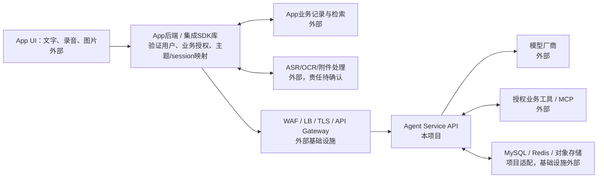
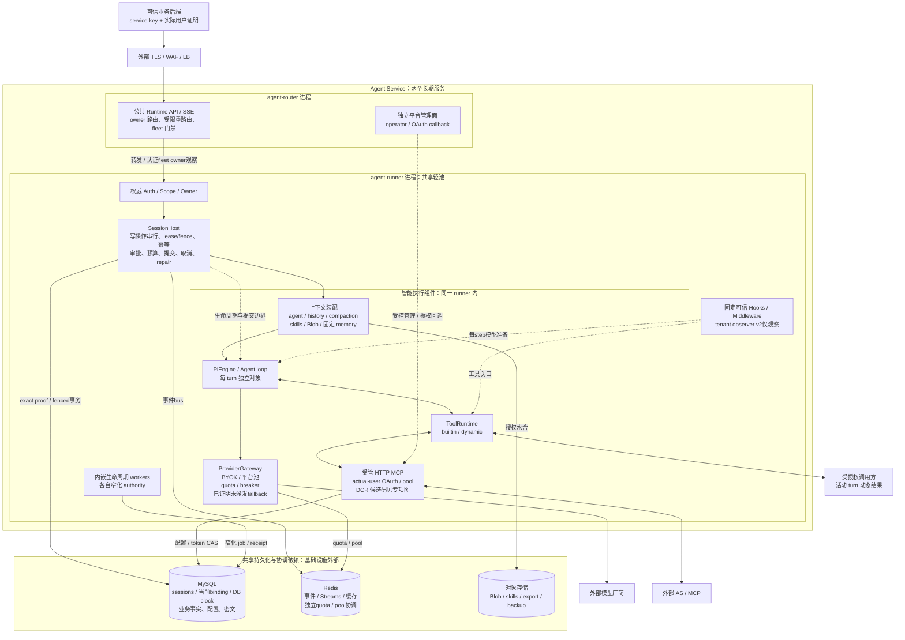
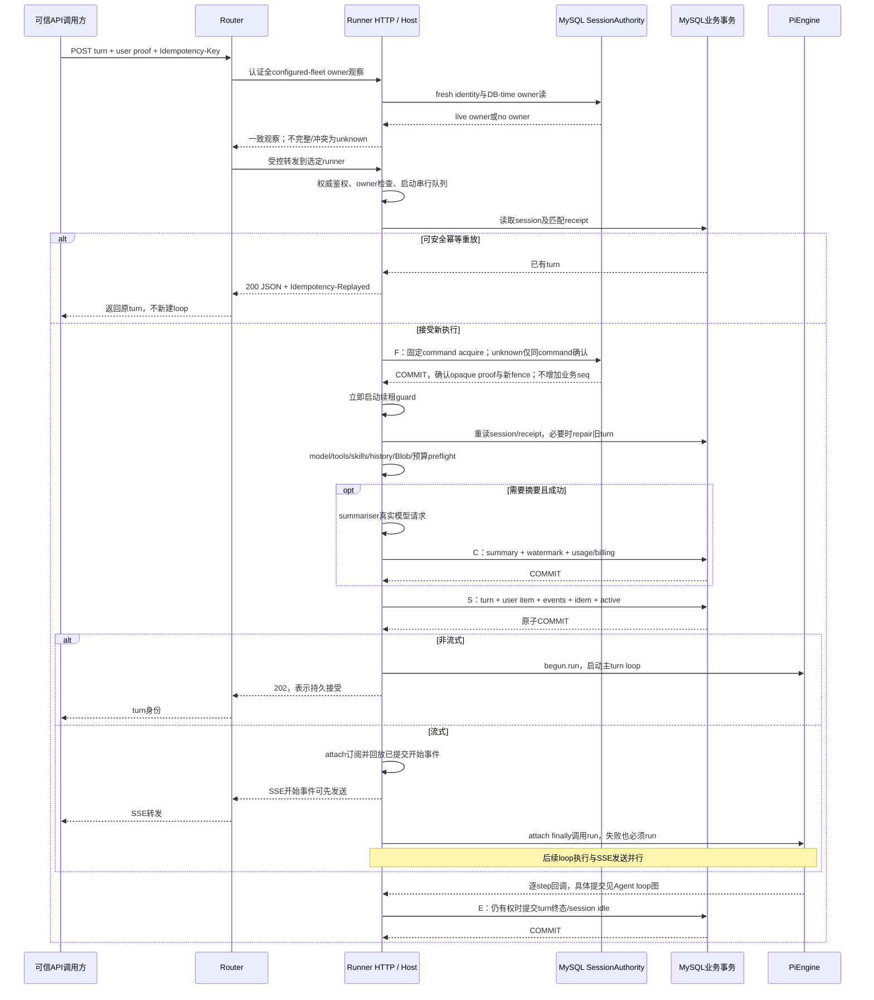
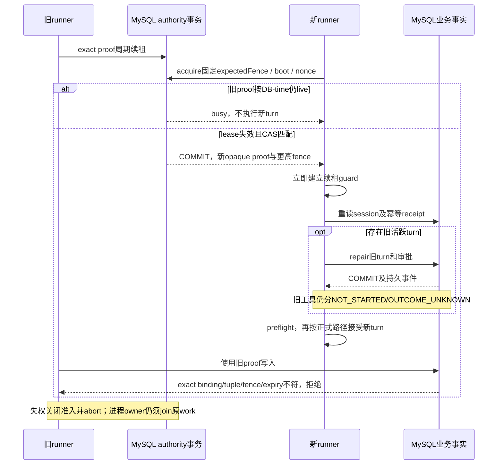
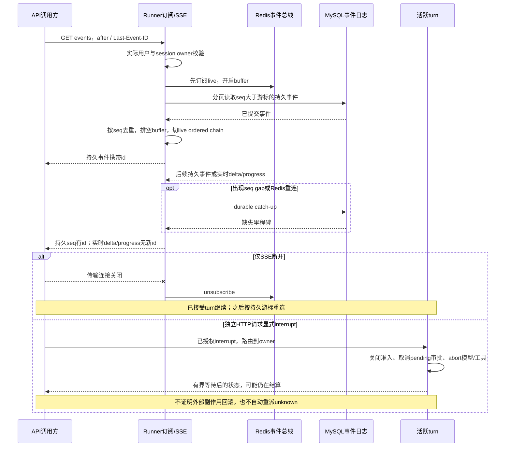
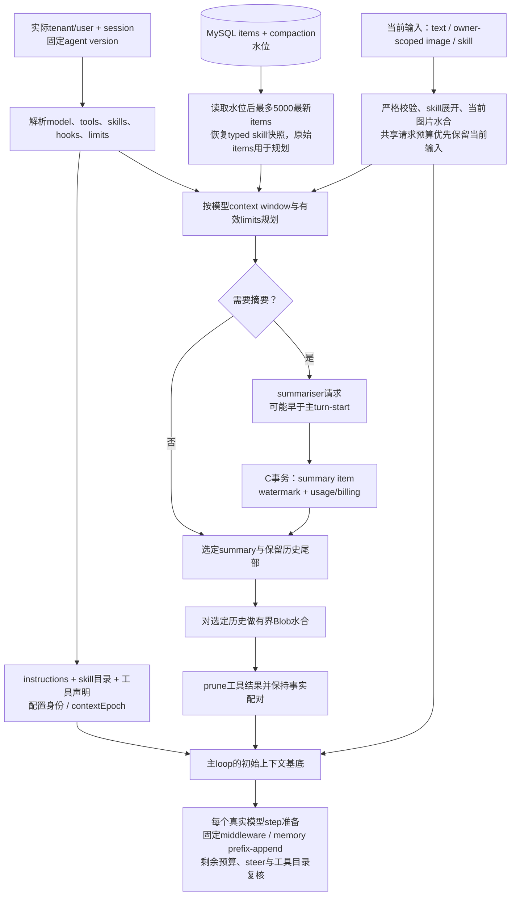
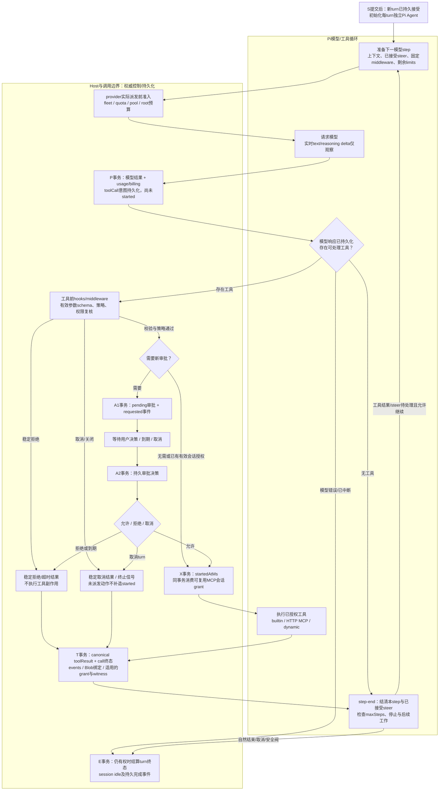
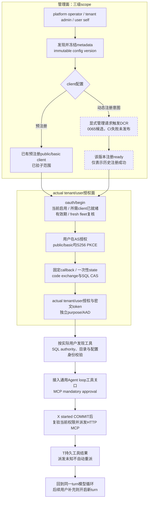
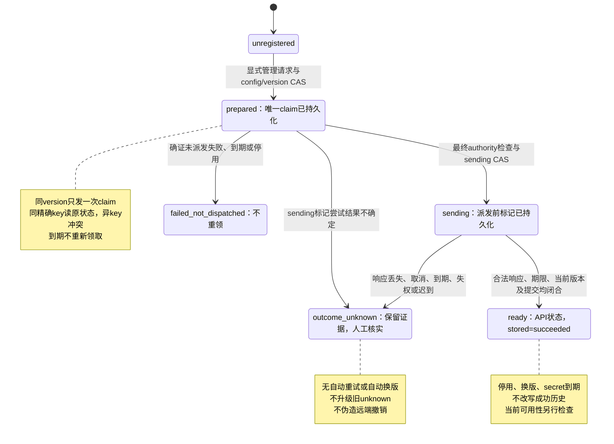

> 历史封存：2026-10-25 文档整理前的 `docs/design/00-architecture.md`。原文 SHA-256 `8aa782fff5178fec50eb58fb84776b3b73c827c78eca854435f2d9f0290f6dfa`，248672 字节。正文保留原时点判断，仅重定位相对 Markdown 链接（155处）；其中“当前/待验/下一步”均不是现状。现行入口：[原文件](../../../../design/00-architecture.md)；[归档说明](../../README.md)。

# Agent Service 架构：当前实现与历史基线

> 当前0066/M4工作树合同（2026-10-23，尚待最终exact-SHA CI与审计）：MySQL模式的普通live session由`MySQL sessions + 当前immutable binding + DB clock`建立单一authority，Redis不再决定该owner/fence。下方当前组件/一致性视图按此候选同步；明确日期的旧验收、v0.1、原§8/§14与原失败快照均保留，不能用于覆盖当前合同。正式发布只认[PROGRESS](../PROGRESS.md)最新exact-SHA结论；不称完整M3/M4/P2或生产完成。

## 核心功能版V1收口（2026-10-22，本地分源验证）

用户已确认以“最核心流程完成开发、验证和交付”为近期目标，边角能力长期登记，并于2026-10-22批准核心版开发、验证和交付。本轮在原工作树、以09ee675为base完成必要CI窄修、普通web_fetch连接IP绑定和一个合成参考集成；不追加重池、通用长期workflow或完整灾备。既有隔离、安全、启动/迁移与正式门禁保持，长期M1/M3/M4/P2未完成范围保留。

本地定向已取得：原0058完整10例V8通过，目标用例24.315秒（仍为30秒期限）；web_fetch原生HTTP/TLS25例与SDK参考5例通过；真实router→runner→Pi→受限MySQL/Redis→本地FakeVendor的记录三轮纵向通过，含版本、历史、服务端同key重放不增派发、结果关联保存及runtime停服冷读，测试body含清理14.026秒。App仓储和主题映射仍为单进程内存fixture，不能外推为真实App持久化、跨进程CAS、自动失效、模型理解或独立billing全链对账。

本轮local full原生退出1，报告8140pass、19fail、1未执行及87项special skip；root将TMPDIR置于checkout内导致3文件失败。改用checkout外临时目录后，这3文件312/312、native0；控制器误写期望310而拒绝的报告也保留。逐原title独立核验后，remaining v2为native0：历史58文件354项、cluster12文件41项、独立T3g4项重叠子集，以及SDK、六bundle入口和双角色Darwin arm64 dirty VM。不能将这些分源结果写成一次local full或coverage全绿。

完整S3的16文件86项及source/dist两次装配均为native0；各本地分源验证绑定同一1057项冻结源码输入，精确root与报告见[PROGRESS](../PROGRESS.md)。本地三进程已独立确认PID消失、端口拒绝连接；原失败与新数据保留，未读取项目.env或进行付费模型、真实AS调用。参考入口见[record-assistant](../../../../../examples/record-assistant/README.md)；最终发布状态以PROGRESS最新节为准，本次事实同步时最终SHA CI及三独立审计待验，不预称发布或生产验收。

## 阶段评审概览（2026-10-21时点）

2026-10-21阶段评审采用工作树 `09ee675b98f0cc20d44598bbc0641e21abd91d0e`，parent 为 `3a5f1026347bc01622a0bd68c135e457e4d528bd`。当时仅修订本文，不修改产品、测试、CI、迁移、配置或其它文档，也不新增运行验收；原 `PROGRESS` 增补和所有失败证据保留。下表记录该评审时点，后继核心版的授权、实现与验证按本文顶部及PROGRESS判断。

| 层次 | 本次评审采用的事实 | 不能外推的结论 |
|---|---|---|
| 最后完整功能包验收 | Gateway `3a5f102` 的 [CI39550826586](https://github.com/zhgqwx-del/agent-service/actions/runs/39550826586)/attempt1 全部13job及主历史、runtime、下载Linux双VM字节三独立审计通过 | 不等于当前DCR源码、部署、生产或全项目完成 |
| 当前实现候选 | `09ee675` 已实现0065、per-config DCR CAS、public/basic、三级管理API/SDK和fresh configured-fleet门禁 | 有代码、默认关闭和分段通过均不等于发布验收 |
| 当前候选CI | [CI39607359173](https://github.com/zhgqwx-del/agent-service/actions/runs/39607359173)/attempt1 为failure，9job成功、4job失败；直接失败及证据限制见§0.1 | 完整主coverage未通过，三独立审计未执行，DCR未发布 |
| 项目阶段 | M0完成；M1未冻结；M2本地/CI代码范围冻结；M3、必要M4已有已验子能力，整体及P2完整生命周期/灾备未完成 | 本地功能、CI、真实模型小样本、容量和生产验收分别判断 |

当前架构适合继续承载共享、多用户的通用Agent API。保留两个长期服务：`agent-router`承担公共HTTP/SSE代理、owner路由、平台管理入口和configured-fleet门禁；`agent-runner`承担权威service/user鉴权、SessionHost、模型/工具执行和内嵌workers。产品JavaScript入口/镜像仍为六个/两个，不采用一用户一进程、永久Agent或独立VM的资源假设。

当前最重要的边界是：参考集成以小接口明确App侧主题/session映射、版本记录读取与结果保存职责，真实App的持久仓储、分布式CAS和授权合同仍由外部集成落实；同session历史不等于跨session记忆；冷恢复是保留事实并安全终结旧执行，不是持久恢复原loop。普通`web_fetch`原DNS rebinding缺口已有连接IP绑定候选修复及25个原生用例证据，最终发布状态见PROGRESS；普通live-session Redis fencing恢复、慢SSE消费者和共享DCR行锁风险仍见§12，不用默认off掩盖普通路径问题。

业务范围见§1，总体架构见§3，关键时序与流程见[图集索引](#architecture-view-index)，实际保证见§4～6，范围绑定的模块状态和后续顺序见§11。精确历史验收及原报告索引见[PROGRESS](../PROGRESS.md)；[部署契约](../operations/local-and-deployment.md)、[生命周期](04-data-lifecycle.md)、[MCP](../../../../design/06-mcp.md)、[skills](../../../../design/07-skills.md)、[hooks](../../../../design/08-tool-hooks.md)及[Gateway](../../../../design/09-provider-gateway.md)中的旧候选描述保留其时点，不能覆盖本节和对应源码/原始证据。

0037 grant硬拒、0054 original-primary-only destructive、旧receipt/descriptor不重签、unknown不提升、既有production拒绝、外部删除/自动清理关闭和completion=false均保持。开发优先级调整不改变协议、安全门禁、停服排空和forward-fix合同。

阅读入口：[CI定位](#dcr-ci-review) · [业务与边界](#1-目标与约束) · [图集索引](#architecture-view-index) · [分层架构图](#current-layered-architecture) · [全景与实现关系图](#3-总体架构) · [实际保证](#4-有状态性与分布式一致性) · [上下文](#62-上下文装配与前缀稳定) · [状态与路线](#11-里程碑与验收) · [风险](#12-风险与调整取舍)。

<details>
<summary>历史：v0.1（2026-09-22）及后续基线/候选快照，原文保留</summary>

以下原快照中的“当前”“未实现”“未发布”“未开始”等只表示各自记录时点；当前有效判断以本文顶部及§11为准。旧测试、失败、恢复限制和授权边界不因状态更新而改写。

> 当前基线（2026-10-20）：`838f685` 的 CI39369339361/attempt1 全13job及主历史/runtime/下载Linux双VM字节三审计通过；M4独立schema、runtime硬verify/metadata/逐表最小权限和人工预置/bootstrap/external-infra已完成本地/CI交付，真实云/生产尚未验收。runtime无DDL/TRIGGER；locked definer须预置精确app schema trigger可见性，SHOW_ROUTINE全局定义范围仍须部署披露，不是业务库授权。实际操作见[运维文档](../operations/local-and-deployment.md#m4-独立迁移与-runtime-权限开发中不是部署步骤)。

> 当前开发（未发布）：M4 Gateway 的三级 quota、平台池/BYOK熔断、L0观测及显式未派发 fallback 已分段定向；多平台独立受保护库存、v4 fleet、独立平台付费 opt-in 与实际目标账务已接通。request-local全configured证明与32/1024有界探测保持原2秒；此前受控构建（source `3613c130` / dist `e2559a89`）的本地平台2/32/1000容量通过，BYOK/fallback/真实厂商持续容量和全包门禁/发布仍待。任何已派发 unknown 停止，合同见 [09](../../../../design/09-provider-gateway.md)。MCP DCR 采用三级权限/每配置版本独立 client 的决策仍未实现。仍两服务/六产品入口/两镜像；M2冻结、M1/完整M3/M4/P2/生产未完成。下方历史候选与数字不覆盖PROGRESS当前快照及末节。

> 当前事实（2026-10-18）：`197800b` 的[CI39157776225](https://github.com/zhgqwx-del/agent-service/actions/runs/39157776225)13job与三独立证据审计全过，轻池 lifecycle hooks / 四个固定可信middleware包 / root-lease task 已交付，公共MCP progress/2025 stateful保留。合同见[08 第7节](../../../../design/08-tool-hooks.md#7-完整轻池-lifecycle--middleware)与[02 子任务设计](../../../../design/02-subagents.md)。子agent仅显式同租户固定版本白名单、默认prompt-only，不复制历史/凭据/审批授权；仍两常驻服务、六产品JS入口、两镜像。下一必要M4；完整M3/M4/P2及生产未完成。以下旧顶部为历史，原失败与精确证据见PROGRESS。

> 当前发布（2026-10-18）：main `fe598dc` 的 [CI39117339664](https://github.com/zhgqwx-del/agent-service/actions/runs/39117339664) 13job全成功，分片/覆盖率、runtime与下载VM字节已独立审计；受管MCP、skills、tenant webhook v2与CI分片包均已验收。下一公共MCP progress/2025 stateful包正在实现，尚未发布，合同见[06第11节](../../../../design/06-mcp.md#11-公共进度与-2025-stateful-候选)。仍两服务/六入口/两镜像，M1未冻结/M2冻结，完整M3/M4与生产能力未完成。下方较早日期的候选状态保留为历史，不覆盖本段和PROGRESS最新事实。

> 受管 skills 已验收（2026-10-17）：main `a04acd0bdfb9c1083c0d09787c80b53bd2626bcb` 的 [CI39057873543](https://github.com/zhgqwx-del/agent-service/actions/runs/39057873543) 五项 job 全部成功，core/history/VM 已独立核验；`SKILL.md` 的 platform/tenant/user 三级 scope、不可变版本/CAS、已挂载名的 request version override、安装 guard、Host 双调用、独立 user 导出与逻辑删除通过，合同与证据边界见 [07 第6节](../../../../design/07-skills.md)及[PROGRESS](../PROGRESS.md)。0061 全旧 writer 停服排空、独立迁移、marker 单根与 forward-fix 门禁保持。仍两服务/六入口/两镜像，默认 off；完整 M3/M4、脚本隔离、物理生命周期及生产验收不因此完成。

> M3 当前范围（2026-10-17）：固定匿名HTTP MCP、静态及受管 `SKILL.md`、固定operator工具前策略/提交后观察已有验收范围；合同见 [06](../../../../design/06-mcp.md)、[07](../../../../design/07-skills.md)、[08](../../../../design/08-tool-hooks.md)，当前证据见PROGRESS。受管三级scope与请求选择不等于完整动态MCP注册/OAuth或任意插件平台。它们内嵌runner；router只公开API/全部configured fleet能力交集，仍两常驻服务、六产品入口、两镜像，不新增微服务。

> 当前状态（2026-10-16，优先于下方历史候选说明）：main `6fdb63c` 的最终五项 CI 全绿，已完成隔离本地 router/runner/MySQL/Redis 确定性体验。当前工作树进入 M3.1a MCP 候选，尚未发布或完成新 CI；范围与未完清单见 [MCP 设计](../../../../design/06-mcp.md)，实际验证只看 [PROGRESS](../PROGRESS.md) 顶部及末节。M1 未冻结不再阻挡 M3，按用户确认顺序推进 M3、必要 M4、剩余 P2。对外 API 仍由 router 暴露，runtime/MCP 执行在 runner；常驻服务及镜像仍各两个。

> 当前恢复边界（2026-10-15T22:37Z）：0055～0057单次恢复已随main3414发布且对应CI五绿。0058候选的真实SQL/历史/单跳证据保留；有界trigger batch后原180秒完整双跳首次通过，含新Pi、finalcold与cleanup，178638.82ms，仅约1.36秒余量。该单次定向不证明稳定提速、完整锁行为或整包验收；完整verify/verify-s3/新CI仍待，候选未合入。0054原primary-only、0037、外部删除/自动off、completion=false及M1未冻结/M2冻结/M3未开始不变；精确证据及旧失败见[PROGRESS](../PROGRESS.md)与[数据生命周期§14～16](04-data-lifecycle.md)。

> M4本地测量增量（2026-10-15，历史候选检查点）：已有一个实际runner dist在真实MySQL/独立Redis/FakeVendor下完成1000并发基线，SSE与已提交inProgress峰值均1000，全部正常turn、usage/billing/item/event与seq对账及清理通过。它只补本地可复现实测，不证明真实模型SLO、持续压力、云容量或M4整体完成；方法见[基线文档](../operations/runner-load-benchmark.md)，源身份/失败与结果见PROGRESS。

> M4离线签名候选（2026-10-15）：复用受限tar/manifest和独立Node工具，以受保护Ed25519文件签署exact clean release statement；consumer必须同时持有独立可信SPKI DER pin与选定role/commit，并核对实际归档、manifest和执行工具自身hash。全部signed metadata在输出创建前闭合，第二次解包读取重新验归档摘要，无unsigned fallback。新增离线脚本不是新的应用dist入口，长期router/runner、六入口和两个镜像不变；不生成产品key、不执行DDL/服务安装/环境晋级，不代表生产trustroot、OCI签名、freshness或吊销。操作见[离线VM签名](../operations/local-and-deployment.md#离线-vm-发布签名)，实际验收见PROGRESS，M1和恢复门禁不变。

> M4本地候选补充（2026-10-15）：受保护的L0 runtime metrics复用router/runner各自HTTP端口，`METRICS_ENABLED=0`默认关闭；独立只读token只用于GET/HEAD /metrics，禁止进入业务路径或upstream。固定低基数进程/HTTP聚合仅驻内存，不属于owner telemetry inventory，也不是SSE完整寿命、turn指标或完整OTel平台；不新增schema、进程、JavaScript入口或镜像。定向与实际bundle证明、尚待整树/CI状态及M1门禁均以PROGRESS最新节为准；协议见[可观测性设计](05-observability.md#受保护的-l0-runtime-metrics)。

> 本地集成验收（2026-10-15）：M4目录/受限tar与0054在干净代码提交e278ead通过完整verify；主2897、真实历史47文件282零skip、cluster28与独立T3g3、SDK/六JS入口及VM335/实际clean双tar均通过。该本地证明限macOS arm64/Node24，不替代main对应Linux CI或生产验收；发布/CI实际状态以main及对应Actions run为准。0054只给同primary、新完整tenant、T1前全written/ACK、全部Blob/export计划域零的v2来源建立保留式本地删除桥；legacy/mixed/未知来源和新epoch恢复仍拒绝。0037 hard-deny、外部对象删除/自动清理关闭、四false与M1未冻结/M2冻结/M3未开始不变。较早版本表保留历史边界，完整结果看PROGRESS顶部及末节。

> M4独立VM目录发布包候选复用现有六个Node24 ESM入口，附带完整production依赖、严格manifest及Linux非root systemd样例，不新增长期服务或镜像。实际依赖闭包含esbuild原生程序，目录包绑定Linux/macOS与x64/arm64，不能把JS应用等同跨OS通用闭包或独立ELF程序；`productionAccepted=false`固定。构建从冻结Git/copy-once源码进行，验真还要求独立可信摘要与匹配host；帮助/服务入口以真实文件身份识别current/path alias。VM离线签名候选见上方；实际双包/类型/必跑测试及完整验收状态只看PROGRESS，schema发布、生产无DDL账号、OCI签名/环境晋级及真实环境验收仍缺，M1不冻结/M3不开始。

> 本地MySQL逻辑备份与selected continuation使用同一受保护exact 32-byte ref key，且与制品加密key分离；missing/wrong key仍拒绝。0055～0057已补active0053/0054三态来源的单次受控新epoch路径，但必须实际checkpoint、0031 reservation/binding、0030 replay/activation、独立cutover与fresh fleet逐层验真，不是自动rebind或startup audit豁免；operator不获得普通writer权限。旧inactive/active0033证明不代替这条纵向，当前结果见PROGRESS。

> `0053`新增默认关闭、仅限本地的provider-step failure durable capture：首failed-step业务写集与source/member/spool/job/failure receipt原子提交，turn结束仍独立commit。控制激活绑定真实0030 primary runtime epoch、exact protected ref key和完整configured fleet；v1/traces capture保持inactive，active第六source继续阻断T3d/T3f及全域completion。新`telemetry-capture`为一次性前台CLI，产品Node入口增至六个，常驻服务/OCI镜像仍各两个。相关strict fingerprint160（全库662）；须排空旧writer、独立迁移后只启动0053-aware进程，不支持热混跑。完整验证以PROGRESS为准。

> 状态：**已采用的 2026-09-22 架构基线**。本文保留调研阶段（`docs/research/01–07`）形成设计时的目标态与原始缺口；核心决策已经实施并经过后续评审。当前实现范围、验证结果和剩余事项以 `docs/PROGRESS.md` 的顶部快照及最后一节为准。
>
> 当前实现仍保持两个长期应用边界：对外入口是无状态`agent-router`，实际Agent Runtime和生命周期worker位于`agent-runner`。`0034`默认关闭的telemetry writer已接runner，可选本地单runner filesystem或S3-compatible target；`0035`只为`provider.upstream_request_failed` logs建立exact producer contract，traces必须inactive。`0036`为默认休眠的非生产disposition协议；`0037`继续硬拒真实grant，`0038`～`0041`依次封存新write membership、T3f owner/grave、T3d五类source与逐source观察目标。`0042`从同一次source/owner快照为**新**T3d plan封存逐artifact目录和logs/traces精确count/root；旧0041 terminal仍为原零target plan、缺catalog为unknown。`0043`无schema变更，仅修复新plan非零target的T3e实时复核并给terminal T3f后的本地来源提供只读候选诊断；候选固定`executionReady=false`、`externalAuthorityVerified=false`。`0044`新增默认休眠的逐artifact、版本化pre-grant intent/claim账本，在自身原子边界独立重验并绑定精确本地source与claim租约，两个记录均固定`grantReady=false`。新目录和pre-grant记录都不是执行许可，两域仍为`blocked_adapter_unconfigured`，真实grant和产品外部处置继续关闭；没有产品v2 S3 mutation、受控telemetry disposition activation/worker/CLI或旧快照恢复门禁。第五个同机MinIO bucket只证明0036协议，不证明云IAM/KMS和独立故障域。M1仍未冻结、M2冻结、M3/M4主体未开始；这些切片不新增常驻服务、进程、JavaScript入口或产品镜像。

> 后续`0045`/`0046`/`0048`只增GET-only v2 journal、artifact及v3 journal观察器；`0047`是与产品路径分离的v3 CAS-head非生产夹具，观察或fixture事件均不能证明可信DB grant、physical ACK或restore fence。`0049`新增default-dormant persisted provider-step failure capture v2三表/13 guards、严格139-trigger指纹；logs预置单一producer但control保持inactive，coverage/binding及v2写路径硬拒，source身份使用tenant-bound、kind-separated keyed HMAC ref而非原始ID。`0050`为新普通session DELETE追加post-COMMIT可信数据库时间的30天保留floor，旧/erasure/legacy origin仍unknown；后续runner内嵌恢复caller默认关闭，仅补已提交未seal来源，不排期或执行purge。`0051`另安装来源/seal write-once trigger；相关启动指纹集合为140（不是全库trigger总数），0049自身仍是139-trigger历史指纹。trigger不证明真实来源或两次COMMIT，旧writer无origin仍unknown，T3f可删除行。`purge_after_ms=NULL`、`session.purge`不可领取，自动物理清理没有开启。新provider失败的持久化/公开error message已改为固定`Provider request failed.`，历史原始错误未清除。三项migration及后续code-only收紧均不新增服务、JavaScript入口或OCI镜像，也不改变M1/M2/M3/M4判定。

---

</details>

## 0. 一页结论

本节原选型表保留为设计起点；其中第二loop实现、工作区、KMS、重池和密度等目标态不构成当前能力证明。当前实现采用精确锁定的Pi `0.87.0`，实际接口见[`engine/types.ts`](../../../../../packages/core/src/engine/types.ts)和[`engine/pi.ts`](../../../../../packages/core/src/engine/pi.ts)。0066候选的一致性由本地session串行队列、MySQL原子acquire/续期及事务内exact opaque proof/binding/fence/DB-time校验维持；路由亲和是性能策略。Redis保留事件、缓存及Gateway等独立协调/配额域，不能由这些域的状态推导live session授权；最终SHA验收待完成。

<a id="dcr-ci-review"></a>

### 0.1 DCR候选的CI失败定位与证据边界

本次官方证据观察为UTC2026-10-22T03:17Z（America/New_York 2026-10-21晚），核对的是同run39607359173/attempt1/完整SHA `09ee675b98f0cc20d44598bbc0641e21abd91d0e`，不是重跑或新attempt。[test-main (2)](https://github.com/zhgqwx-del/agent-service/actions/runs/39607359173/job/119246900632)在Collect native main coverage shard阶段因既有测试[`tenant-telemetry-capture-repeat-restore.mysql.test.ts`](../../../../../packages/store/test/tenant-telemetry-capture-repeat-restore.mysql.test.ts)的`rolls back a CP2 permit and job CAS when the live lease expires before commit`触发默认30000ms超时，原生duration为30009.154ms。

原阶段日志显示fixture就绪13.957秒，R1完成17.878秒，CP2完成21.913秒，R2就绪25.024秒，writer就绪26.919秒；claim结清及拒绝核对在28.770秒，六表前后快照核对在28.789秒，fixture清理/finally退出在30.149秒。由此可定位包含清理的测试总生命周期越过预算；不能把超时前已执行的断言改写成整例通过，也不能据此认定0065、某段SQL、环境或慢机是耗时增加的根因。该测试文件与parent字节相同，不排除新schema对fixture成本的间接影响，但仍需另行验证。

主分片2原生结果为3098pass/1fail/60skip；这些仅属于该分片。main-merge先因`MAIN_SHARDS_RESULT=failure`拒绝，随后缺聚合上传文件是连锁结果；test-core因main-merge拒绝，test为required-jobs汇总拒绝。不能将其解释为四个独立产品缺陷。main1/main3、runtime、历史和镜像的成功也不能拼成完整主coverage或发布通过。

本次读取的失败分片官方ZIP为9,015,658B，SHA-256=`bf1921000e8b02609685ee953a823b0135a0aa3f08f9bed5a553ad9bee06dfcc`，与官方artifact12351635601元数据一致；原日志、ZIP和原生JSON保存在本机独占只读证据目录，没有执行下载代码。该下载核对不是三独立发布审计。receipt中的`sourceUnchanged=false`在native非零后仍为初始化值：[`run-main-coverage-shard.mjs`](../../../../../scripts/run-main-coverage-shard.mjs)先拒绝`collection_native_exit`，未执行末尾源码比较；不能误认作已经证明源码漂移。

2026-10-21阶段评审当时，下一步代码修复、定向验证、完整门禁和最终SHA CI须另行授权；2026-10-22用户已批准核心版开发、验证和交付，后继证据见本文顶部及PROGRESS。仍不放大deadline、不省略清理、不跳case、不放宽oracle或coverage，不为本文修订单独发CI；本节原CI失败与耗时观察保持原样。

### 0.2 原选型与生命周期摘要（保留设计时点）

普通usage子切片`0052`是ordinary session operational usage retention的本地执行切片，不是内容purge：新DELETE绑定immutable policy，原子执行核对owner/source/seal、DB time、宽限期/更长政策、hold、erasure/restore fence与独立billing facts，只移除operational ledger。T3f receipt与grave以versioned摘要桥接先前保留的匿名账单事实，legacy v1 hash不变；双gate默认0、production拒绝启用、旧记录不回填。八列/五guard的相关组合指纹为145（不是全库trigger总数），须独立迁移及排空旧writer；无新服务/入口/镜像。M1仍未冻结，完整结果看PROGRESS最新节。BYOK删除只清除本系统保存的key，客户负责厂商侧撤销；这项已确认责任须由后续versioned来源契约表达，不能重释0026历史blocker或伪造remote ACK。

| 问题 | 结论 | 依据 |
|---|---|---|
| agent loop 用什么 | **内嵌 `@earendil-works/pi-ai` + `pi-agent-core`**（MIT），封在自研 `AgentEngine` 接口后面；保留自研 loop 作为第二实现 | research 04 §4、05 §4.2、01 §3.2 |
| opencode / dsh / codex / openclaw / hermes 怎么用 | 都**不作为运行时依赖**。opencode 取 `packages/llm` 的方言修补与 v2 schema 设计；dsh 取 MCP 配置模型、`scrubbedParentEnv`、日志修补；codex 取 `thread/turn/item` 协议与审批枚举；openclaw 取 `tool-call-repair`、BYOK 配置形状、忙时输入四档；hermes 取 `/v1/runs` 语义、`skills_guard`、provider profile | research 03 §9、04 §4.1、05 §4、06 §6 |
| 服务拆分 | **独立无状态 `agent-router` + 有状态 `agent-runner`**。前期方案的"对等转发"被否定：通用 harness 的 runner 负载曲线（内存/fd/子进程）与 router（连接/鉴权/限流）不同，且要对外开放 | research 02 §1.2(a) |
| 一致性保证 | 路由只是效率优化；**正确性只由 runner 侧 Redis 租约 + fencing token 保证**（DB 写入带 `WHERE fence_token=?`） | research 02 §1.1、§3.3 |
| 路由键 | `sessionId`，不是 `userId`；工作区放对象存储，runner 本地只做缓存 | research 02 §1.2(b) |
| 对外协议 | HTTP + SSE；资源 `agents / sessions / turns / items / events / approvals`；每条持久化事件有 per-session 单调 `seq`；delta 不落库不占 seq；审批是一等资源且有 `expiresAt` | research 06 §6、07 结论 |
| 存储 | MySQL（sessions/turns/items/events-milestone/approvals/配置）+ Redis（租约、所有权目录、Streams 热重放、配额）+ 对象存储（大输出/附件/工作区）。本地先单库 MySQL，schema 预留 `user_id` 分片键 | research 02 §4 |
| 代码执行 / 沙箱 | **一期不提供** shell/文件工具。runner 分"轻池"（API 工具 + 远程 MCP，1,000 turn/进程）与"重池"（按 agent 配置起沙箱，走 exec-server 协议）；一期只建轻池，预留接口 | research 02 §5.3、06 §6.6 |
| MCP | 必须支持；**远程 streamable-http 优先**，stdio 只在重池；按租户动态注册，SSRF/配额/命名空间自写 | research 01 §2 #8、partials/dsh-mcp |
| Skills / Plugins | Skills 用 `SKILL.md` 标准，来源三级（平台/租户/用户），存 DB + 对象存储；Plugins 一期 = 平台部署的进程内 hook 包 + 租户级 webhook hook，**不在共享进程加载用户代码** | research 05 §4.1 #8/#9、01 §3.2 C6 |
| BYOK | 租户级 provider 配置 CRUD，KMS 信封加密，per-request 注入 pi 的 `apiKey/headers/fetch`；全局 key 池 / 配额 / 熔断状态在 Redis | research 04 §4.3 #1、02 §1.2(f) |
| 技术栈 | TypeScript / Node 24+，pnpm monorepo，Hono，mysql2 + drizzle，ioredis，zod-openapi | §10 |

---

## 1. 目标与约束

### 1.1 业务链与项目责任

主要调用场景是记录类App：用户持续输入文字、语音或图片，业务后端验证身份和访问权限，选择内部上下文，调用Agent API装配模型、skills、MCP和工具，执行后返回普通或流式结果，并按业务合同保存事实与使用量。通用runtime不绑定某个App界面或记录流程。

2000万以上DAU指整个App；Agent采用率、调用频次、峰值、执行时长和供应商额度尚待估算。它不是Agent DAU、QPS或并发执行数；容量与费用按§9建模，延迟、可用性、首期容量、预算和RPO/RTO仍是待确认参数。

| 职责/模块 | 所属范围 | 当前接口边界 |
|---|---|---|
| App UI、录音采集、拍照、业务记录展示 | App外部系统 | 不要求Agent Service实现终端页面或录音链路 |
| 终端用户验证、业务权限、主题/任务关联 | App后端；映射责任待正式约定 | 推荐近期由可信后端维护主题/任务到session的映射；服务仍校验实际tenant/user与资源归属 |
| App业务记录、检索、写入 | 外部业务系统 | 通过授权业务API/MCP或调用方注入；runtime不任意读取App数据库 |
| ASR/OCR、通用附件解析 | App或独立服务，责任待确认 | 不默认自建；现有image Blob上传/水合仍要求owner、字节格式和模型能力校验，不等于所有模型支持图片 |
| CDN/WAF/LB/TLS/外部API Gateway | 外部接入设施 | 可在全景中表达，不自动成为项目开发待办 |
| Runtime API、SDK、HTTP/SSE、scope、owner路由、执行与限额 | Agent Service | router为公共入口；权威service/user鉴权和执行在runner，平台管理及fresh fleet决策按独立authority执行 |
| MySQL/Redis/S3与模型、远端工具 | 外部依赖，项目负责适配 | 功能协议、数据归属与运行限制由项目定义；真实托管环境/IAM/容量另验 |
| 任意脚本、stdio、代码沙箱、通用长任务 | 后续范围 | 按真实业务需求独立评审，不能从hooks、dynamic callback或全景节点推导为已交付 |

“接入层”须按职责区分：外部TLS/WAF设施与本项目API入口不是同一层；把外部设施排除出实施范围，不排除Agent Service自身的协议、安全、流量管理和路由责任。设计、实现、部署与验收范围分别记录，外部节点不机械标成本项目todo。

### 1.2 身份、业务记录与内部执行单元

| 概念 | 含义与归属 |
|---|---|
| tenant / caller | 授权业务与调用方权限；service key、admin、operator各有边界 |
| user | 经验证或由可信业务后端委托的实际用户，不直接等同tenant |
| 业务记录 / 主题 / task关联 | App的业务对象与关联关系，不自动等同session |
| session | 服务端历史归属、单写者控制、压缩水位及事件游标单元 |
| turn | 一次Agent执行；同一session可以多turn，同一user可以多session并行 |
| SSE连接 | 可断开、更换的传输连接，不等同执行或持久任务 |

用户无需显式创建聊天会话，但当前Runtime API仍要求内部session ID。session不等于用户、设备、常驻Agent或runner。共享进程按活跃turn承载，Pi每turn新建独立Agent；隔离依赖实际owner、配置、凭据、权限、缓存身份和lease/fence，而非一用户一VM/容器/进程。

### 1.3 业务集成合同与待确认决策

推荐先由App后端维护`(tenant,user,业务主题/任务) → session`，定义跨设备选择、CAS、结束/归档以及创建响应丢失后的处理。当前[`CreateSessionRequest`](../../../../../packages/protocol/src/session.ts)没有业务context key或session创建幂等合同；turn的`Idempotency-Key`不能消除重复session。若需要跨多个调用方共享映射能力，再单独设计原子get-or-create，不把它隐含进现有POST语义。

核心V1的[记录SDK参考集成](../../../../../examples/record-assistant/README.md)将映射、版本记录读取与保存判定定义为App侧小接口，只用单进程内存fixture示范三轮分析、补充与追问。真实App仓储和跨进程CAS不属于该fixture的交付证明；旧版本输入会保留在runtime历史中，参考结果的`current`仅表示保存时版本匹配，不提供自动撤权、删除或副本失效。

业务历史的权限、相关性和token预算应共同决定上下文。引入App记录时，需明确授权查询或注入方式、source ID/version、允许保存的副本、业务写入权限、更正/撤权/删除通知，以及旧工具结果/summary失效规则。当前metadata透传和同session compaction不会自动完成这些工作，固定memory注入也不是跨session记忆系统。

普通反问可以结束当前turn，由下次补充开启新turn；权限审批、活动turn内工具回调、跨天挂起和外部回调恢复分别定合同。是否近期实施长期任务、业务检索/记忆由谁负责，以及ASR/OCR边界仍待确认；这不阻碍已有通用API与轻池能力的范围判断。

<details>
<summary>历史：原始需求简报与2026-10-20共享App场景补记</summary>

下列“任意外部客户端”和20M规模是原始表达；当前身份委托、范围与容量解释以本节上文和§5、§9为准。“跨session注入未实现”不否认后来已发布的固定可信memory槽。

来自需求简报的硬约束：

1. 类 `opencode serve` 的后端 agent API，任意外部客户端可调用。
2. 通用 harness 能力：MCP、skills、插件、BYOK。
3. 生产分布式部署，20M+ DAU。
4. 多用户多会话隔离；同一用户/会话的请求连续、一致。
5. 独立路由服务 `agent-router`（无状态）+ `agent-runner`（有状态），历史入云端存储、可迁移。
6. 模型以国内厂商为主（qwen / kimi / deepseek），OpenAI chat/completions 兼容。
7. 允许嵌入开源 agent 作为 loop（router → runner → agent）。

**非目标**（一期明确不做）：TUI/桌面端、多渠道（IM）接入、语音/ASR、产品级记忆层（前期方案 05 的三层记忆属于业务层，runner 只提供注入钩子）、自建推理。

### 共享 App 场景边界（2026-10-20）

App 的多个用户通过 API 共用 runner；共享进程按活跃 turn 承载执行，Pi 为每个 turn 建立独立 Agent 对象，按实际 tenant/user 与 agent 配置解析模型、skills、MCP 和工具。VM/容器围绕 router/runner 实例扩缩容，用户隔离依赖身份校验、资源归属和租约/fence。实现见 [SessionHost](../../../../../packages/core/src/session/host.ts) 与 [PiEngine](../../../../../packages/core/src/engine/pi.ts)。

session 是内部历史持久化、并发单写者和流式重连的逻辑单元；App 后端可以维护映射并向用户隐藏 session，当前 Runtime API 仍要求内部 session ID。每个 turn 从该 session 的压缩水位后装配历史；跨 session 的 user memory、检索与注入尚未实现，需要独立的业务契约。现有 [上下文装配](../../../../../packages/core/src/context/history.ts)、[skills](../../../../design/07-skills.md) 和 [MCP](../../../../design/06-mcp.md) 能力不自动形成整用户长期记忆。

20M DAU 是业务规模目标，吞吐与并发须结合 AI 使用率、turn 频率、峰值和时长推算。当前 [本地 1000 并发 profile](../operations/runner-load-benchmark.md) 证明受控平台请求的峰值与对账，不涵盖公网 router 吞吐、BYOK/fallback 持续容量或生产验收。[Gateway](../../../../design/09-provider-gateway.md) 的单 Redis slot 与逐请求全 configured-fleet 核验成本、真实持续负载及[完整可观测性](05-observability.md)仍需后续工作包验收；本节只记录场景边界，不新增能力或交付承诺。

---

</details>

## 2. 调研结论摘要

本节保留2026-09-22研究时点，作为选型历史，不是各上游最新能力、许可证或安全性的重新认证。当前实际依赖以[`core/package.json`](../../../../../packages/core/package.json)与lockfile为准：Pi `0.87.0`通过本项目adapter使用。opencode、deepseek harness、Codex、OpenClaw和Hermes是研究输入，不是必须接入或必须统一wrapper的产品要求；本轮没有重做这些候选最新版的外部审计。

<details>
<summary>历史：原始仓库调研摘要与判断</summary>

七份报告在 `docs/research/`。结论按仓库：

| 仓库 | 一句话 | 我们拿什么 |
|---|---|---|
| **pi**（0.87.0, MIT） | `pi-ai` / `pi-agent-core` 是真正的纯库：零 process 副作用，`Models` 是实例，每次调用可注入 `apiKey/headers/fetch`；deepseek/moonshot/qwen/zai/minimax 内置，`reasoning_content` 三种拼法 + 3 种 cache 字段都处理；`AgentHarness` 有可插拔 `Storage/SessionRepo` + conformance 测试。缺 MCP、缺步数/成本上限、不做租约；发版快且每版有 Breaking | **作为 loop + provider 层内嵌**，pin 精确版本 |
| **deepseek-harness**（0.1.6-alpha, MIT） | 插件架构最彻底，loop 干净（并发池 10、durable inbox、日志修补），但凭据/身份/存储根全是进程级；`deepseek-official` 适配器**默认**上传 `x-deepseek-harness-user-id`、插件清单、完整会话日志；alpha、不接外部 PR | 只借设计：MCP 配置 schema 与工具命名规则、`scrubbedParentEnv`、`repair.ts`、`isConcurrencySafe(args)` |
| **opencode**（v1.18.32, MIT） | v1 是 81K 行 + 99 依赖的单机应用，v2（`@opencode-ai/core/server/llm`）有更好的原语（`SessionInput` steer/queue、`ContextEpoch`、`EventV2` aggregate+seq、持久化 permission 表）但未接入 server。`private:true` 无发布物，Effect 4 beta。11 条多租户阻碍 | 只借设计：`packages/llm` 的方言修补、v2 schema、`SessionInput`、`ContextEpoch`、compaction 阈值、权限规则语义。**方案 A（容器化 opencode）保留为重池的候选后端** |
| **codex**（Apache-2.0） | `WireApi` 仍只有 `Responses`，`"chat"` 被显式拒绝，国内模型接不上；但 `app-server-protocol`（164 请求 / 84 通知，thread→turn→item，UUIDv7，审批决策枚举，resume 重发未决审批）是最完整的服务端 agent 协议规格 | 协议类型定义逐字复制（保留 NOTICE）；`ThreadStore` trait 签名；exec-server 拆分 |
| **openclaw**（MIT） | 2.47M 行，"一个 Gateway = 一个信任域"，多租户靠每租户一个容器；agent-core 是 pi 血统 | `packages/tool-call-repair`（国产模型把 tool call 当文本输出的修复）、`{baseUrl, apiKey, api, models[]}` BYOK 形状、steer/followup/collect/interrupt 四档、`activeWriterRunId` 写栅栏 |
| **hermes-agent**（Python, MIT） | 825K 行，同步 loop + 10 线程池；但 `/v1/runs`（202 + SSE + stop/steer/approval + durable Idempotency-Key）几乎就是我们要的 API；`skills_guard` 安装前威胁扫描；声明式 `ProviderProfile` | `/v1/runs` 语义、`skills_guard` 正则表、provider profile 数据、`session_turn_leases` DDL |
| **前期方案 + PoC** | 6,042 行 TS PoC，151 测试。可带走：事件信封与 seq 水位线、SSE 无损重放、`openai-compatible.ts`、`resilient.ts`、安全阀、`length` 丢弃 tool call、write-ahead + 崩溃恢复两码、压缩配对、前缀稳定化机制。**代码级缺陷**：租约从不续期、无 fencing token、runtime 不回收、历史只在内存、跨副本 250ms 轮询 | 带走上述模块的设计与测试，重写分布式部分 |

四家共有的结构性事实（与产品无关）：全部是单用户进程拓扑，HOME 单例，无租户维度，无分布式所有权，无成本阀。**多租户、分布式、BYOK 三块在所有开源 harness 里都是零，必须自写。**

---

</details>

## 3. 总体架构

<a id="architecture-view-index"></a>

### 3.0 视图分工与阅读顺序

总体图回答“谁负责、组件在哪里、依赖谁”；行为图回答“何时提交、如何循环、失败后怎样处理”。两者不混为调用栈或部署验收。下表给出本轮补齐的最小视图集；§3.2和§3.3是同一当前架构的渲染版与文本版，不是两套方案。

| 视图 | 回答的问题 | 位置 |
|---|---|---|
| 业务全景/责任 | App、业务数据、外部设施与本项目如何分工 | [§3.1](#31-全景业务架构与范围) |
| 容器与组件/分层 | 两个服务、runner内组件、模型/工具支路与并列依赖 | [§3.2](#32-当前实现架构)、[§3.3](#current-layered-architecture) |
| turn接收时序 | 鉴权、租约、fence、摘要、turn-start与响应的先后 | [§4.6](#turn-request-sequence) |
| 所有权接管 | 旧新runner和MySQL authority怎样拒绝旧proof、修复旧执行 | [§4.7](#ownership-handoff-sequence) |
| SSE与取消 | 订阅/回放/补gap怎样交接，断流与interrupt为何不同 | [§4.8](#sse-recovery-sequence) |
| 上下文数据流 | 持久历史怎样变成本次有限模型上下文 | [§6.2](#context-projection-flow) |
| Agent智能循环 | 模型、工具、审批、安全阀和业务提交如何闭环 | [§6.6](#agent-step-loop) |
| MCP管理—授权—运行 | 配置owner与actual-user凭据为什么分开，何时注册 | [§7.2.1](#mcp-control-runtime-flow) |
| DCR状态机 | 一次claim、派发标记、ready与unknown怎样转换 | [§7.2.2](#dcr-registration-state) |

此外，建议在对应专用设计中补齐以下两组图，按各自协议维护，避免在架构总页复制庞大状态机后发生漂移。本轮仅登记建议，尚未修改这些文档。

| 后续视图 | 应表达的内容 | 维护位置与前提 |
|---|---|---|
| 多实例部署拓扑与发布迁移流程 | 多router/runner、SSE转发、共享依赖；operator与runtime权限、全writer停服排空、独立迁移、strict fingerprint及forward-fix | [部署契约](../operations/local-and-deployment.md)：发布流程可按现有合同绘制；实际拓扑的副本、网络、故障域与容量参数须由部署环境确认 |
| 分域生命周期与受控恢复状态 | 普通DELETE保留与未开启purge、tenant T1/T3、逐域blocker/ACK、0030/0031及selected恢复的authority与人工关口 | [生命周期设计](04-data-lifecycle.md)：按具体协议拆图，保留unknown、旧receipt、original-primary-only、0037硬拒及completion=false；已有本地切片与未完成域分别标注 |

上述图表达协议和责任边界；真实部署、完整灾备及全域删除的验收状态继续按§11和PROGRESS判断。


### 3.1 全景业务架构与范围



图表达业务调用关系，不授权runtime绕过业务接口访问App数据，也不要求本项目建设图中的全部外部模块。主题/session映射当前是推荐的App后端职责，仍需集成合同确认。

### 3.2 当前实现架构



实现依据为[`router/app`](../../../../../apps/agent-router/src/app.ts)、[`runner/auth`](../../../../../apps/agent-runner/src/auth.ts)、[`SessionHost`](../../../../../packages/core/src/session/host.ts)、[`PiEngine`](../../../../../packages/core/src/engine/pi.ts)、[`ProviderService`](../../../../../packages/providers/src/service.ts)和受管MCP/skills/hooks模块。框内组件属于所在进程；实线表示主要调用/数据依赖，虚线表示治理或管理关系，不表达时序：Host控制审批、持久化和账务，engine不得绕过authority直接提交业务事实。主链路为身份/owner校验→session串行及lease/fence→必要repair→模型/工具/上下文preflight→原子turn-start→loop与逐步提交→turn终结。

MCP管理/OAuth是另一条受控链：管理scope选择immutable配置→显式DCR候选注册或已有预注册client→actual-user OAuth→工具发现→强审批/write-ahead→调用/持久结果→后续模型步骤。共享配置不共享用户token，管理权限不授予普通writer或任意工具执行权。当前图不包含跨session自动检索、通用长期任务、任意脚本、stdio/沙箱和Kafka；它们不是已有实现。

| 逻辑组件 | 当前进程边界与状态 | 扩缩容/依赖 |
|---|---|---|
| agent-router | 两长期服务之一；无业务持久状态，但有连接、peer能力观察与门禁状态 | 连接数/QPS；依赖稳定configured地址和共享Redis |
| agent-runner轻池 | 两长期服务之一；活跃turn/回调/池在内存，权威事实在共享存储 | 活跃turn、内存、I/O、供应商quota；不是永久user Agent |
| ProviderGateway、tools、hooks、生命周期workers | runner内库/内嵌循环，不新增服务 | 保留实际身份、事务和资源治理边界 |
| 独立schema/备份恢复/selected维护命令 | 既有显式one-shot入口/模式 | 独立operator权限、停服与exact-run门禁，不是daemon |
| 重池/exec-server/其它harness进程 | 后续规划，尚未交付 | 先证明代码执行隔离需求，再定资源和权限合同 |

<a id="current-layered-architecture"></a>

### 3.3 当前分层架构图（2026-10-22，组件嵌套版）

与§3.2表达同一架构：上方区分外部业务/接入，中部用两个进程容器嵌套实际组件，下方并列展示持久化/协调依赖。模型与工具是Agent loop的两条支路，不能把Gateway、MCP或workers误读为新增长期服务。

```text
                        ┌─ 外部业务调用方 ───────────────────────────────────────────────────┐
                        │ 可信App后端 / 其它授权后端；SDK是集成库                            │
                        │ 终端身份、业务权限、主题/session映射按外部合同确定                 │
                        └────────────────────────────────────────────────────────────────────┘
                                                           │
                                                           ↓
                        ┌─ 外部接入设施 ─────────────────────────────────────────────────────┐
                        │ TLS / WAF / LB / API Gateway                                       │
                        │ HTTP / SSE直通；真实拓扑与容量未验                                 │
                        └────────────────────────────────────────────────────────────────────┘
                                                           │
                                                           ↓
╔═ Agent Service：两个长期服务；已验子范围见§11 ═════════════════════════════════════════════════════════════════════╗
║                                                                                                                    ║
║   ┌─ agent-router进程 ─────────────────────────────────────────────────────────────────────────────────────────┐   ║
║   │ 公共API / SSE代理 · Owner路由    · 受限幂等重路由 · configured-fleet门禁                                   │   ║
║   │ 独立operator平台管理 / 固定OAuth callback；不持runner密钥                                                  │   ║
║   │                                                                                                            │   ║
║   └────────────────────────────────────────────────────────────────────────────────────────────────────────────┘   ║
║                                                          │                                                         ║
║                                                          │   受控内部HTTP / SSE返回                                ║
║                                                          ↓                                                         ║
║   ┌─ agent-runner进程：共享轻池，按活跃turn承载 ───────────────────────────────────────────────────────────────┐   ║
║   │                                                                                                            │   ║
║   │   ┌─ 权威Auth / Scope ─────┐        ┌─ SessionHost：执行与持久化权威 ──────────────────────────────────┐   │   ║
║   │   │ tenant / actual user   │        │ 相关写操作串行 · proof/fence[D]   · turn幂等                     │   │   ║
║   │   │ scope / owner校验      │───────→│ 审批 / 预算 / steer / interrupt / repair · COMMIT[D]             │   │   ║
║   │   │                        │        │                                                                  │   │   ║
║   │   └────────────────────────┘        └──────────────────────────────────────────────────────────────────┘   │   ║
║   │                                             │       │                                                      │   ║
║   │                 ┌───────────────────────────┘       │   控制 / 逐边界提交                                  │   ║
║   │                 ↓                                   ↓                                                      │   ║
║   │   ┌─ 上下文装配 ─────────────┐        ┌─ PiEngine / Agent loop ──┐        ┌─ ProviderGateway ────────┐     │   ║
║   │   │ agent版本 / history      │        │ 每turn独立Agent          │        │ ProviderService / BYOK   │     │   ║
║   │   │ summary / token预算      │        │ 模型 → 工具 → 模型       │        │ quota/pool/breaker[R]    │     │   ║
║   │   │ skills / fixed memory    │───────→│ steer / interrupt        │───────→│ 仅未派发fallback         │     │   ║
║   │   │ Blob水合[B] / prune      │        │ 状态提交交给Host         │        │ 模型请求/响应 ↔ [M]      │     │   ║
║   │   │                          │        │                          │        │                          │     │   ║
║   │   └──────────────────────────┘        └──────────────────────────┘        └──────────────────────────┘     │   ║
║   │                                                     │                                                      │   ║
║   │                                                     ↕                                                      │   ║
║   │                                                     │   工具调用 / canonical结果                           │   ║
║   │                                                     │                                                      │   ║
║   │   ┌─ Hooks / Middleware ─────┐        ┌─ ToolRuntime ────────────┐        ┌─ 受管MCP / OAuth ────────┐     │   ║
║   │   │ 固定策略 / 观察包        │        │ builtin / dynamic        │        │ HTTP pool / user token   │     │   ║
║   │   │ operator/tenant权限      │        │ 经Host策略与审批         │        │ 预注册已验子范围         │     │   ║
║   │   │ 模型与工具准备边界       │───────→│ started提交后执行        │───────→│ DCR候选，未发布          │     │   ║
║   │   │ 不加载租户任意代码       │        │ 持久结果交回loop         │        │ 配置/密文[D] 出站[T]     │     │   ║
║   │   │                          │        │                          │        │                          │     │   ║
║   │   └──────────────────────────┘        └──────────────────────────┘        └──────────────────────────┘     │   ║
║   │                                                                                                            │   ║
║   │     内嵌生命周期workers按各自权限使用[D/R/B]；不是通用业务任务队列                                         │   ║
║   │                                                                                                            │   ║
║   │   ┌─ 数据与协调端口 ───────────────────────────────────────────────────────────────────────────────────┐   │   ║
║   │   │ [D] MySQL authority/事务 / [R] Redis bus、quota/pool / [B] BlobStore                               │   │   ║
║   │   └────────────────────────────────────────────────────────────────────────────────────────────────────┘   │   ║
║   └────────────────────────────────────────────────────────────────────────────────────────────────────────────┘   ║
║                                                                                                                    ║
║   横切：安全日志/L0 metrics；维护one-shot另走operator通路，不是第三常驻服务                                        ║
║                                                                                                                    ║
╚═════════════════╤════════════════════════════════════════╤════════════════════════════════════════╤════════════════╝
                  │ [D]                                    │ [R]                                    │ [B]
                  ↓                                        ↓                                        ↓
┌─ [D] MySQL：权威事实 ────────────┐     ┌─ [R] Redis：协调与分发 ──────────┐     ┌─ [B] 对象存储 ───────────────────┐
│ session / binding / DB时钟       │     │ 事件分发与热重放                 │     │ 图片/大结果/skills包             │
│ 审批 / 配置 / 凭据密文           │     │ Streams / PubSub / 缓存          │     │ export / backup实际bytes         │
│ 幂等receipt / usage / billing    │     │ Gateway quota/pool/breaker       │     │ 共享S3-compatible                │
│ exact proof与原子写集            │     │ 独立配额/协调域需验真            │     │ FS限本地单runner合同             │
│ 外部副作用不在DB事务内           │     │ live owner由MySQL决定            │     │ 托管IAM/故障域未验               │
│                                  │     │                                  │     │                                  │
└──────────────────────────────────┘     └──────────────────────────────────┘     └──────────────────────────────────┘


┌─ [M] 外部模型厂商 ──────────────────────────────────┐        ┌─ [T] 外部工具、AS与业务调用方 ──────────────────────┐
│ ProviderGateway发起真实请求                         │        │ MCP工具强审批；OAuth按actual user配置               │
│ 国内API为主；方言/模型能力分别校验                  │        │ dynamic：活动turn内授权结果回调                     │
│ 未知费用不自动重试；估价不是厂商账单                │        │ 业务记录经受控接口，不任意直读App DB                │
│                                                     │        │                                                     │
└─────────────────────────────────────────────────────┘        └─────────────────────────────────────────────────────┘


┌─ 后续/待定区域：无当前执行实线，不回退已实现切片 ──────────────────────────────────────────────────────────────────┐
│ 重池/stdio/脚本与resources；跨session检索/记忆更新、长期workflow责任待定                                           │
│ Kafka/分片、完整生命周期/联合灾备及真实云/生产验收未整体完成                                                       │
│                                                                                                                    │
└────────────────────────────────────────────────────────────────────────────────────────────────────────────────────┘
```

实线表示主要调用/数据依赖，框内组件属于所在进程；[D/R/B]分别连接MySQL、Redis和对象存储，[M/T]连接外部模型与工具/AS。端口用于减少跨层交叉线，不表示所有访问都经过Host：MCP配置/token CAS、Gateway协调和worker保留各自权限；router通过认证的configured-fleet内部观察读取MySQL owner，不直接持DB权限，也不把Redis提示当写授权。Hooks/Middleware的策略与观察边界不授予绕过Host审批/提交的权限。

图中“智能”是实际模型step—工具—结果回灌循环，详见§6.6；没有添加未实现的自主长期记忆、自动规划服务或任意代码执行。skills/固定memory参与上下文与工具选择，不自动形成业务检索系统。

本图最初依据09ee675绘制，阶段评审沿用的最后完整功能包验收为3a5f102；当时补图仅完善文档，没有新增运行验证，原DCR CI失败仍保留。后继核心版开发与本地分源验证已获授权并完成上述范围，当前状态按本文顶部及PROGRESS判断；普通web_fetch的候选网络边界见§7.1。图内已验标签均按§11限定子范围，普通Redis回退恢复、完整生命周期和真实部署未因补图完成；外部/待定节点不自动变成项目todo。


### 3.4 历史方案按职责对齐

历史输入为`02-Agent-Runtime架构方案.md`的§2及相关上下文，仓库摘要见[前期方案与PoC调研](../../../../research/02-prior-architecture-and-poc-digest.md)。历史方案不是当前验收标准。

| 职责 | 历史参考 | 当前选择与差异原因 |
|---|---|---|
| 身份 | 曾采用tenantId与userId等同假设 | 当前tenant/user/caller/operator分开，适配共享多用户业务 |
| 入口/执行 | peer-forwarding、单二进制 | router/runner分开，连接/路由与执行/凭据/worker职责不同；不是能力缺失 |
| loop | 自研主线和多adapter设想 | 当前Pi主线、Host掌权威；Native仅规划，暂未证明替换收益 |
| 业务工具与记忆 | 列出记录搜索、记忆检索、长期画像 | 当前有扩展基座与固定注入，具体业务接口/版本/失效仍需合同 |
| 总线/存储 | Kafka/Pulsar、PG/TiDB及分片目标 | 当前MySQL＋Redis＋S3-compatible，分片/总线升级须测量触发 |
| Gateway | 独立逻辑模块 | 当前内嵌runner，职责合并；已验Gateway与DCR候选分开 |
| 异步任务 | MQ/Scheduler、周报等业务调度 | 内嵌生命周期worker不等于通用业务workflow |
| 日志/生命周期 | 两套日志、概括级联删除设想 | 当前业务items/events与诊断日志分开，删除/恢复须逐域证据及unknown，不简化成完成 |

<details>
<summary>历史：v0.1目标架构图与一期服务表</summary>

下图包含未实施的重池、exec-server、冷事件分区、sharded Pub/Sub、自建推理和密度设想；不是当前拓扑或容量承诺。当前服务边界以上文为准。
```
 外部客户端（App / Web / 服务端调用 / opencode-compatible 客户端）
        │  HTTPS  Authorization: Bearer <service api key>   X-User-Id / 端用户 JWT
        ▼
┌─────────────────────────────────────────────────────────────────────────┐
│ 接入层（现有 API Gateway / nginx / envoy）                                 │
│   TLS · WAF · 全局限流 · SSE 直通（X-Accel-Buffering: no，idle ≥ 90s）      │
└───────────────────────────────┬─────────────────────────────────────────┘
                                ▼
┌─────────────────────────────────────────────────────────────────────────┐
│ agent-router（无状态，N 副本）                                              │
│   1. 透传外部身份；权威 service/user 鉴权仍由 runner 完成                    │
│   2. 幂等：透传 Idempotency-Key；仅对带 key 的 turn POST 允许安全重路由      │
│   3. 定位：lease:{sessionId} 内 owner/addr → runnerAddr；无 owner → 一致性哈希 / 最少负载 │
│   4. 反向代理（SSE 不缓冲）；runner 回 409 lease_conflict → 重查目录重路由一次 │
│   5. 非 session 类请求（agents/providers/skills CRUD）直接打任意 runner      │
│   只有连接态，没有业务态；可随时重启                                          │
└──────────┬─────────────────────────┬────────────────────────────────────┘
           │                         │
┌──────────▼──────────┐   ┌──────────▼──────────┐   ┌──────────────────────┐
│ agent-runner 轻池    │   │ agent-runner 重池    │   │ （可选）容器化 opencode │
│ 无 shell/fs 工具     │   │ 按 agent 配置起沙箱   │   │ 作为重池的另一种后端    │
│ API 工具 + 远程 MCP  │   │ exec-server 协议     │   │ 同一对外协议            │
│ ~1,000 turn/进程     │   │ 独立容量、独立 SLO    │   │ 二期再评估              │
└──────────┬──────────┘   └──────────┬──────────┘   └──────────────────────┘
           │                         │
           ▼ runner 内部
┌─────────────────────────────────────────────────────────────────────────┐
│ HTTP(Hono) → TenantContext → SessionHost（租约 + fencing + 单写者）        │
│   → AgentEngine（pi adapter | native）→ ToolRuntime（内置 / MCP 桥 / 动态） │
│   → ProviderGateway（BYOK 解析 · key 池 · 配额 · 熔断 · 方言）               │
│   → EventLog（seq 分配 · 先落库再扇出）→ SSE writer                          │
│   Hooks/Middleware（PreToolUse … Stop；租户策略；审计）                     │
└──────┬───────────────────┬───────────────────┬──────────────────────────┘
       ▼                   ▼                   ▼
┌─────────────┐   ┌────────────────┐   ┌─────────────────┐   ┌───────────────┐
│ MySQL        │   │ Redis           │   │ 对象存储 (OSS)   │   │ 模型厂商 API   │
│ sessions     │   │ lease/fence     │   │ 大工具输出       │   │ deepseek/qwen │
│ turns/items  │   │ owner 目录      │   │ 附件/工作区      │   │ kimi/zhipu…   │
│ events(里程碑)│   │ Streams 热重放  │   │ 冷事件分区       │   │ 自建 vLLM     │
│ approvals    │   │ 配额/key 池     │   └─────────────────┘   └───────────────┘
│ agents/skills│   │ sharded pub/sub │
│ provider cfg │   └────────────────┘
│ usage_ledger │
│ idem receipts│
└─────────────┘
```

**服务边界**：

| 服务 | 状态 | 扩缩容依据 | 一期 |
|---|---|---|---|
| agent-router | 无状态（仅 SSE 代理连接态） | 连接数 / QPS | 是 |
| agent-runner（轻池） | turn 内有状态，turn 间无状态 | 并发 turn 数 × 内存 | 是 |
| agent-runner（重池） | 同上 + 沙箱生命周期 | 沙箱数 | 否，预留接口 |
| exec-server | 每会话/每租户沙箱 | 沙箱数 | 否，预留协议 |
| llm-quota（逻辑组件） | 状态在 Redis | — | 作为 runner 内库实现 |

---

</details>

## 4. 有状态性与分布式一致性

### 4.1 三层有状态性（沿用前期方案，结论不变）

| 层次 | 要求 | 不满足的后果 |
|---|---|---|
| 一个 turn 之内 | **强制单所有者** | 两个 writer → seq 冲突、工具重复执行，数据损坏 |
| 同 session 跨 turn | 优选亲和 | 只是变慢（上下文冷启动） |
| 同用户跨 session | 不需要 | — |

### 4.2 所有权与租约

当前同session的turn-start、显式compaction及相关写操作仍经runner本地串行队列；普通GET、订阅和interrupt不概括为均经此队列。MySQL模式0066由sessions完整tuple、当前binding、真实DB时间及事务锁提供live authority。固定acquire command绑定实际runner/boot/nonce、expectedFence和owner；确认后才获得不可由数值fence或JSON补造的opaque proof。unknown只确认同一command，不更换nonce或退回Redis。业务写入在同一事务内重验proof、binding、root/owner/fence与DB-time后发布原子写集。

新owner实际提交acquire后再重读session/receipt、repair和preflight；同runner不再因名称相同自动复用旧lease。原work真正settle后exact release旧proof，后续turn用新command取得新proof/fence；warm内容缓存本身仍可保留。失权guard不会被迟到renew复活，不把abort或grace到期当原生work已结清；进程owner仍须实际join。路由通过认证全configured-fleet观察，只有一致fresh结果才判断live/no owner，不完整/冲突为unknown；它不授予写权限。

Redis的bus/热重放/缓存、Gateway及其它独立协调和配额域仍按各自合同工作；Redis lease/counter被删、恢复或回退不再授权普通session接管。MySQL物理回退、双primary、部署凭据泄露及真实HA仍不由本切片证明。0066启动没有inactive/numeric/Redis fallback，既有session须按[schema bootstrap §5.5](../../../../operations/schema-bootstrap.md#55-0066-单一-mysql-authority独立停止窗口与固定初始绑定)完成全writer停服、旧runtime所有host退休、独立迁移/metadata、新账号固定初绑与同command确认。实现见[Host](../../../../../packages/core/src/session/host.ts)、[authority guard](../../../../../packages/core/src/session/authority.ts)、[MySQL authority](../../../../../packages/store/src/mysql/session-authority.ts)、[binding](../../../../../packages/store/src/mysql/session-authority-binding.ts)和[router观察](../../../../../apps/agent-router/src/registry.ts)。以下Redis逻辑仅保留历史。

<details>
<summary>历史：租约键、SQL与请求顺序示意</summary>

```
Redis:
  lease:{sessionId}   = {runnerId, owner, addr, fence, expiresAt}  hash + TTL；Lua 校验 runnerId
  fence:{sessionId}   = 单调递增整数（INCR），每次成功抢占 +1
  router 直接读取 lease hash 的 owner/addr；不存在独立 owner key

MySQL:
  sessions.fence_token   = 最近一次成功写入的 fence
  所有写入：UPDATE ... WHERE session_id=? AND fence_token<=?   （旧 fence 的写被拒绝）
  events 追加：INSERT ... 前在同一事务内校验并推进 sessions.next_seq 与 fence
```

runner 处理 `POST /sessions/{id}/turns` 的顺序：

1. 校验租户/用户归属（不属于 → 404，不泄漏存在性），并为解析后的 turn 请求计算语义 hash。
2. 从 MySQL 查 completed receipt；同 key 异 hash → `409 idempotency_conflict`，可直接安全重放时返回原 turn。
3. 抢租约；失败 → `409 session_lease_conflict`，响应头 `X-Owner: <runnerAddr>`，router 仅在 turn POST 带 `Idempotency-Key` 时重路由。
4. 获得租约后立即启动 TTL/3 续期，重读 session 和 receipt，必要时修复孤儿 turn；续期失败立即 abort，之后任何写入都会被 fence 拒绝。
5. 从 MySQL 装载最近 compaction 之后的 items，完成 model/tools/context preflight，再把 turn、首条 user item、events 和 completed receipt 放入同一个 fenced 事务；事务若检测到 legacy pending，则不写入任何数据并返回 `409 idempotency_conflict`。提交后才启动 engine。
6. turn 结束（`session.idle`）后租约保留一个短窗口（默认 60s）供下一 turn 命中亲和，之后释放并删 `owner`。

</details>

### 4.3 故障场景

| 场景 | 当前行为与限制 |
|---|---|
| router重启/SSE断开 | 客户端按持久seq重连，turn继续；临时delta/progress不补发 |
| runner在turn中崩溃 | 下一写请求取得lease和新fence后做orphan repair；保留已提交事实，旧turn终结为interrupted，工具分NOT_STARTED/OUTCOME_UNKNOWN；不恢复原模型栈、不盲目重放已派发动作 |
| runner发布/缩容 | drain停止新turn，在grace内等待现有turn完成，到期后取消并有界等待结算；没有持久暂停在step边界再跨runner续跑的协议 |
| 审批等待时runner重启 | approval行持久化，但等待栈不持久化；新owner修复旧turn时将其pending审批过期/取消，标记`system:owner_lost`；续聊开启新turn |
| 调用resume | 返回session/近期turn/pending审批标识的快照，不恢复原执行，不因读快照自动接管 |
| 显式interrupt | 发起abort及审批取消，有界等待后可能返回仍在结算的turn；不证明厂商或工具副作用回滚 |
| Redis中断/丢失/回退 | 不改变0066 MySQL live authority；事件提示/缓存及独立配额域可降级或拒绝，持久事件按MySQL补齐。MySQL HA与跨域恢复另验，不把Redis重建等同全域恢复 |

依据为[`host.ts`](../../../../../packages/core/src/session/host.ts)的repair、interrupt和drain，以及[`runner/app.ts`](../../../../../apps/agent-runner/src/app.ts)的resume入口。下面保留原目标表，原“step checkpoint后释放”“重发未决审批”不再作为当前实现承诺。

<details>
<summary>历史：原故障目标表</summary>

| 场景 | 行为 |
|---|---|
| router 重启 | 客户端 SSE 断；客户端带 `Last-Event-ID` 重连到任意 router → 查 owner → 续订 |
| runner 崩溃（turn 中） | 租约过期；下一请求由新 runner 抢占（fence+1）；`repairSession` 按 write-ahead 的 `tool.call.started` 把孤儿分为 `TOOL_NOT_STARTED` / `TOOL_OUTCOME_UNKNOWN`；turn 记为 `interrupted` 并发 `turn/completed{status:interrupted}` |
| runner 发布/缩容 | drain：拒绝新 turn，等进行中 turn 到 **step 边界**做 checkpoint（items 已落库）后释放租约；超时则 abort |
| 路由完全失效（随机落点） | 每次多一跳 + 上下文冷启动，**不会**出现双 writer |
| 客户端断开 SSE | 不等于取消（沿用 AI SDK / hermes 语义）；turn 继续跑，持久化事件可由 `?after=` 补齐，实时 delta/progress 丢失不补；显式取消走 `POST .../interrupt` |
| 审批等待期间 runner 重启 | 审批是 DB 资源（不是内存 Deferred）；resume 时按 codex 流程**重发未决审批**；超过 `expiresAt` 按策略自动 decline |

</details>

### 4.4 事件扇出与重放

持久事件先随业务写集提交MySQL，再发布Redis；实时delta/progress没有持久seq，不写业务历史或Redis Stream。订阅先接live再补历史，按seq去重并从MySQL补gap，避免回放与订阅之间漏持久事件。超过热Stream保留窗口仍可读取持久业务事件和最终文本，不恢复逐token输出；具体支持事件以协议源码为准。

当前[`sse.ts`](../../../../../apps/agent-runner/src/sse.ts)每连接`Event[]`与Host的replay buffer/liveChain没有明确的字节、事件或滞后上界。慢读、长replay和存储gap恢复阻塞可能累积共享runner内存；这是源码可见的风险，不是本轮已测得OOM。需要另行验证有界策略、断开清理、持久游标重连和邻租户影响，不能由单次1000并发profile替代。

Stream分片/Kafka选择依赖§9的实际到达率、存储与SLO；下方15～30万msg/s是旧假设，不是当前规模证明。

<details>
<summary>历史：事件扇出与固定20M负载示意</summary>

- 每条**持久化**事件：`(session_id, seq)` 主键，先落 MySQL 再 `XADD` 到 `stream:{sessionId}`（Redis Streams，TTL 1h，MAXLEN 近似裁剪）。
- **实时事件**（`item/agentMessage/delta`、`item/reasoning/delta`、本包候选 `item/mcpToolCall/progress`）只走 Pub/Sub，不写 Redis Stream 或 MySQL、不占 seq，也不重放（SSE 不写新 `id:`，客户端游标沿用上一条持久化事件的 seq）。
- SSE 订阅：`?after=<seq>` 或 `Last-Event-ID` → 先从 MySQL 读 `> seq` 的里程碑事件，再切到 Stream tail；超过 1h 的断线只能拿到里程碑 + 最终文本，**写进协议**。
- 20M DAU 中档下 Stream 消息量峰值 15–30 万 msg/s：Redis 按 sessionId 分片（Cluster + sharded pub/sub 或多实例哈希）；超过阈值时切 Kafka 按 sessionId 分区，接口不变。

---

</details>

### 4.5 接收、提交、派发与可见结果

| 边界 | 当前保证 | 限制 |
|---|---|---|
| MySQL fenced commit | 同一业务写集的item/event、状态、usage/billing及receipt原子提交 | 不保证客户端必收到响应；模型和远端工具不在该事务内 |
| turn接收 | preflight后持久提交turn-start/user item/events/幂等receipt，再启动主turn loop；202是durable接受 | preflight摘要可能先派发并独立记账；202不等于模型或外部业务完成，session创建不因此获得turn幂等语义 |
| 模型请求 | 记录实际派发与已报告usage，完整估价与unknown分开；Pi请求明确零自动重试 | 取消不证明未执行/未收费，估价不等于厂商账单 |
| 工具 | 审批、write-ahead、started证据和持久结果；失联分类结果未知 | 不承诺与DB共同exactly-once，不盲目重试unknown |
| SSE | 持久seq重连补齐；已接受执行不因客户端断流而取消 | delta/progress为实时观察，不逐token重放 |

<a id="turn-request-sequence"></a>

### 4.6 turn请求、接收与提交时序

本图聚焦一个新turn的主路径；幂等重放、同session busy/steer、拒绝与fenced分支仍遵循正式合同。F/C/S/E只是图中助读记号，不新增API、schema或receipt类型。



L与D是同一MySQL的authority及业务逻辑关口，不是两个独立存储。S提交后才可启动主turn loop；但preflight的摘要请求及其独立账务可能先于S发生，不能写成“turn-start前绝无付费模型请求”。摘要已派发后失败/取消按现有失败账务合同结清，不因缺S而伪造免费或重派。HTTP attach失败也须运行已接受turn，避免持有lease却永不执行。启用hooks/子任务等可能增加正式提交边界，本图不替代完整事务合同。

依据：[HTTP分支](../../../../../apps/agent-runner/src/app.ts)、[Host beginTurn/maybeCompact/finishTurn](../../../../../packages/core/src/session/host.ts)、[Pi adapter](../../../../../packages/core/src/engine/pi.ts)。202、模型/工具副作用、DB COMMIT和客户端可见结果分别判断；SSE细节见§4.8。

<a id="ownership-handoff-sequence"></a>

### 4.7 正常lease失效后的接管与fencing

0066候选的MySQL authority在同一binding和DB-time下原子判断expiry及fixed expectedFence；Redis不参与这个决定。这里恢复的是新owner对旧执行的修复，不迁移原Pi对象。图中两个MySQL参与者是同一DB的逻辑关口。



同runner的新claim也须新command/proof，不以runnerId相同续活；旧work未真正结清不提前release。unknown只confirm原command，不更新expectedFence或重获替代proof。失权后不能补写自己的terminal；新owner按来源修复，已started动作不自动重放，审批不续原等待栈。普通模型step不是每步都await DB admission，本图不作每步派发强隔离承诺。依据：[guard](../../../../../packages/core/src/session/authority.ts)、[MySQL authority](../../../../../packages/store/src/mysql/session-authority.ts)、[Host](../../../../../packages/core/src/session/host.ts)。

<a id="sse-recovery-sequence"></a>

### 4.8 SSE订阅、持久重放与两种取消路径



router负责转发连接，图中省略该代理以突出订阅交接。持久事件先随业务提交再发布；回放不恢复临时delta或原SSE/Pi对象。现有queue/buffer/liveChain无明确上界，图表达当前顺序，不把慢消费者背压画成已完成能力。依据：[Host subscribe/interrupt](../../../../../packages/core/src/session/host.ts)、[SSE writer](../../../../../apps/agent-runner/src/sse.ts)、[events入口](../../../../../apps/agent-runner/src/app.ts)。


## 5. 对外协议（agent-router 公网入口 / agent-runner 执行 API v1）

命名综合 codex（thread/turn/item）、opencode（session）、hermes（runs）。对外叫 **session**（与简报一致），内部结构就是 codex 的 thread。所有 id 用 UUIDv7。

当前端点、字段、错误信封和兼容边界以[`packages/protocol/openapi.json`](../../../../../packages/protocol/openapi.json)、对应route及专用合同为准。MCP/skills/hooks、受保护L0 metrics已有已发布子能力，不能一概称“未实现”；`fork`、重池和其它目标态也不能因出现在原资源表中就当已交付。当前范围见§11，下面的资源/事件表保留为历史概要。

### 5.1 鉴权

双层：`Authorization: Bearer <service_api_key>`（→ `tenantId`，服务级）+ `X-User-Id`（或租户配置的端用户token，→ `userId`）。`principal = (tenantId, userId)`贯穿业务存取；用户凭据及可变执行缓存按正式scope、实际subject和配置版本隔离，共享配置缓存遵循其配置身份，不能笼统要求所有缓存都按principal分片。

当前精确合同见[身份设计](../../../../design/01-identity-and-auth.md)及[`auth.ts`](../../../../../apps/agent-runner/src/auth.ts)：`trusted_caller`依赖持service key的可信租户后端验证并委托本tenant用户；终端不得持该key。`end_user_token`以验证后的subject决定user，若同时提交X-User-Id必须一致。session普通路径要求实际user，admin管理与runtime权限分开，platform/operator为独立authority；共享配置缓存可按其正式身份复用，但不能混用用户凭据或可变执行状态。

### 5.2 资源与端点

内部session由调用方显式创建/选择，绑定agent version与owner；App隐藏session的映射、创建CAS和response-loss处理仍须§1.3的业务合同。turn幂等作用域为tenant/user/session；接收、执行、业务提交、SSE可见与终结分开，见§4.5。resume是快照读取，不是长期执行恢复。

<details>
<summary>历史：v0.1资源表，精确可调用端点以OpenAPI和route为准</summary>

| 资源 | 端点 | 说明 |
|---|---|---|
| Agent 定义（版本化） | `POST/GET /v1/agents`，`GET/PUT /v1/agents/{id}`，`GET /v1/agents/{id}/versions` | `{name, instructions, model, tools[], mcpServers[], skills[], limits, approvalPolicy, sandbox}`；每次 PUT 生成新版本；session 引用 `agentId@version` |
| Session | `POST /v1/sessions`，`GET /v1/sessions?cursor&limit&userId`，`GET /v1/sessions/{id}`，`DELETE`，`POST .../archive`，`POST .../fork`，`POST .../compact`，`POST .../resume` | `resume` 返回快照 + 游标 + 未决审批（codex 流程） |
| Blob | `POST /v1/sessions/{id}/blobs`，`GET /v1/sessions/{id}/blobs/{blobId}`，`GET /v1/sessions/{id}/items/{itemId}/output` | 当前支持 image 原始字节上传和大工具结果读取；外部只见 owner-scoped opaque `blobId`，声明 MIME 必须匹配文件签名，执行模型必须支持 image input，staging 与 item 同事务绑定后才可读 |
| Turn | `POST /v1/sessions/{id}/turns`（`stream=true` 直接 SSE；`false` 返回 202 + turnId），`GET .../turns`，`GET .../turns/{turnId}`，`POST .../turns/{turnId}/interrupt`，`POST .../turns/{turnId}/steer` | body `{input:[...], model?, limits?, busyPolicy: steer|reject}`；`Idempotency-Key` 建议必填，作用域是 tenant + user + session；服务端对解析后的请求语义取 hash（`stream` 仅影响传输，不参与 hash），同 key 异请求返回 `409 idempotency_conflict`；命中 completed receipt 时返回 `200 application/json {turn}` + `Idempotency-Replayed: true` |
| Item | `GET /v1/sessions/{id}/items?turnId&cursor`，`GET .../items/{itemId}/output`（大输出） | 完整消息历史（替代 opencode 的 `GET /session/:id/message`） |
| Event 流 | `GET /v1/sessions/{id}/events?after=<seq>&exclude=item/reasoning/*` | SSE；`id: <seq>`；`Last-Event-ID` 等价 `after` |
| 审批 | `GET /v1/sessions/{id}/approvals?pending=true`，`POST /v1/sessions/{id}/approvals/{approvalId}` `{decision}` | decision ∈ `accept | acceptForSession | decline | cancel`；资源含 `expiresAt`、`availableDecisions[]` |
| Provider / 模型 | `GET /v1/providers`，`GET /v1/models`，`POST/PUT/DELETE /v1/providers/{id}`（租户 BYOK） | BYOK 配置形状见 §7.4 |
| MCP | `POST/GET/DELETE /v1/mcp-servers`，`GET /v1/mcp-servers/{id}/tools`，`POST .../refresh` | 租户级或用户级；`transport: streamable-http | stdio(重池)` |
| Skills | user/tenant 管理走 `/v1/skills`；platform 管理仅走 `/v1/platform/skills`；不可变版本与独立用户导出见[skills §6](../../../../design/07-skills.md#6-受管注册包候选独立版本域) | 来源三级；user-own 用实际用户身份、tenant 需同租户 admin、platform 用独立 router-only `SKILL_REGISTRY_OPERATOR_TOKEN`，不能复用 tenant/erasure bearer |
| 工具 | `GET /v1/tools` | 当前 principal 可见的内置 + MCP + 动态工具目录 |
| 用量 | `GET /v1/usage?sessionId|userId&from&to` | 来自 `usage_ledger` |
| User data export | `POST /v1/data-export-requests`，`GET /v1/data-export-requests/{requestId}`，`GET .../{requestId}/download` | admin + user + Idempotency-Key；异步生成 owner-scoped `ndjson-v1` 临时制品，request gate默认关闭 |
| 全局 | `GET /healthz`，`GET /readyz`，`GET /metrics`，`GET /v1/capabilities`，`GET /openapi.json` | capabilities 声明而非版本猜测 |

</details>

### 5.3 输入与信封

下例为原请求形状示意，不保证示例模型当前可用或所有输入类型均可执行；模型、图片、skill、动态工具及limits仍需实际能力、agent与owner授权校验。metadata不是业务检索或长期记忆注入接口。

```jsonc
POST /v1/sessions/{id}/turns
{
  "input": [
    {"type":"text","text":"..."},
    {"type":"image","blobId":"blob_...","mimeType":"image/png"},
    {"type":"skill","name":"..."},          // 显式 /skill 调用
    {"type":"mention","name":"..."}
  ],
  "model": {"provider": "deepseek", "model": "deepseek-v4"},   // 可选对象，受 agent 定义与租户策略约束
  "limits": {"maxSteps":20,"maxToolCalls":50,"maxWallClockMs":300000,"maxCostCNY":2},
  "busyPolicy": "steer",
  "dynamicTools": [ {"name":"...","description":"...","parameters":{...}} ],  // 客户端侧工具（codex item/tool/call）
  "metadata": {}
}
```

### 5.4 事件类型

持久里程碑事件与实时delta/progress的区分见§4.4；业务items/events可能含正文或快照，须适用内容授权与生命周期，不可作为普通诊断日志无限保留。下面保留原目标枚举，包含未实施或语义已调整的项；尤其“resume重发审批”不代表当前跨重启续跑，实际行为以§4.3为准。

<details>
<summary>历史：v0.1事件表与信封示意</summary>

| 事件 | 持久化 | 说明 |
|---|---|---|
| `session/created` `session/status/changed` `session/compacted` | 是 | status ∈ `idle | active{waitingOnApproval|waitingOnUserInput} | error` |
| `turn/started` `turn/completed{status: completed|interrupted|failed, stopReason}` | 是 | stopReason ∈ `end_turn | max_steps | max_tool_calls | max_cost | max_wall_clock | interrupted | error` |
| `turn/steered` | 是 | steer 在 step 边界注入后发出 |
| `item/started` `item/completed` | 是 | 携带完整 item 快照；type ∈ `userMessage | agentMessage | reasoning | toolCall | toolResult | mcpToolCall | dynamicToolCall | approvalRequest | contextCompaction | plan | subAgentActivity` |
| `item/agentMessage/delta` `item/reasoning/delta` `item/toolCall/argsDelta` `item/mcpToolCall/progress` | **否** | 实时 Pub/Sub，不进 Redis Stream、不重放；progress 的当前候选范围见设计06 §11 |
| `approval/requested` `approval/resolved` | 是 | resume 时重发未决 `approval/requested`（id 不变） |
| `usage/updated` | 是 | 每 step 一次，含 cache hit/miss 归一化字段 |
| `hook/started` `hook/completed` | 可配 | 插件可观测 |
| `warning` `error` | 是 | |
| `heartbeat` | 否 | 10s，不占 seq |

事件信封：`event: <type>`，`id: <seq>`，`data: {sessionId, turnId?, itemId?, emittedAtMs, ...}`。时间戳全部毫秒。

</details>

### 5.5 错误码

下列为原错误族示意，不能代替当前OpenAPI/route的status、闭合字段或错误oracle；当前未知外部结果、幂等冲突和draining按正式合同表达，不从通用错误文本推断安全重试。

`400 invalid_request` · `401 unauthorized` · `404 not_found`（跨租户与不存在不可区分）· `409 session_busy`（busyPolicy=reject）· `409 session_lease_conflict`（内部，router 处理）· `409 idempotency_conflict` · `422 limits_exceeded` · `429 quota_exceeded{scope: tenant|user|provider}` · `502 provider_error{provider, retryable}` · `503 draining`。

---

## 6. agent-runner 内部设计

### 6.1 AgentEngine 接口（harness adapter 边界）

当前接口由[`engine/types.ts`](../../../../../packages/core/src/engine/types.ts)定义：`AgentEngine.start(params,sink)`返回带`steer/interrupt/done`的`EngineRun`。Pi负责模型/工具loop，Host负责身份、审批、authority、持久化、预算与恢复；每turn建立独立Agent，并显式装载该session上下文。`prepareModelStep`、工具前write-ahead和结果提交等sink边界不能被替换harness绕过。

保留当前Pi精确版本与adapter，只有可证明的兼容、隔离、性能或维护收益出现后才评估替换。独立执行进程需重新定义IPC、取消、状态归属、审批、usage和恢复；NativeEngine仍为规划退路，不能作为已验第二运行时。下列旧接口和“双实现契约”是设计目标，不是当前类型或交付清单。

<details>
<summary>历史：原AgentEngine接口与双实现规划</summary>

```ts
interface AgentEngine {
  runTurn(ctx: TurnContext, input: TurnInput, sink: EventSink): Promise<TurnResult>;
  steer(turnId: string, input: TurnInput): Promise<void>;
  interrupt(turnId: string): Promise<void>;
}
// TurnContext: principal, agentDef@version, history(items after last compaction),
//              providerResolver(BYOK), toolRuntime, limits, abortSignal, hooks
```

两个实现跑同一套契约测试（前期方案 04 §6 的 `HarnessAdapter` 思路）：

- **`PiEngine`（一期主线）**：路线 A —— `pi-agent-core` 的 `Agent` 类，`initialState.messages` 从我们的 store 装载，`subscribe` 转事件，`agent_end` 后落库；`streamFn` 包装 `models.streamSimple(model, ctx, {apiKey, headers, fetch, signal})` 注入 BYOK。二期评估切到 `AgentHarness` + 自研 `SessionRepo`（跑 pi 的 conformance 套件）。
- **`NativeEngine`（二期）**：从 PoC `loop.ts` + openclaw agent-core 移植，作为 pi 断供/Breaking 时的退路。

pi 要替换的缝（research 04 §4.3）：模型/凭据解析、会话存储、单写者租约（pi 明确不做）、`ExecutionEnv`（一期不挂）、MCP → `AgentTool` 桥、skills 从对象存储装载、`finishTurn` 实现步数/成本上限、`Context.abortSignal` 接取消、telemetry 接 OTel。

</details>

### 6.2 上下文装配与前缀稳定

当前流水线由[`host.ts`](../../../../../packages/core/src/session/host.ts)、[`history.ts`](../../../../../packages/core/src/context/history.ts)、[`compact.ts`](../../../../../packages/core/src/context/compact.ts)与[`assemble.ts`](../../../../../packages/core/src/context/assemble.ts)共同实现：

1. 按session的agent version和实际tenant/user解析模型、工具、skills、hooks与有效limits。
2. 从最近compaction水位后读取最多5000条最新items，形成有限历史；持久历史可以更多，但本次模型不保证看到所有尚未压缩的内容。
3. 规划预算，按条件做摘要、保留近期步骤，执行有界Blob水合和工具结果prune，再加入当前输入。
4. 使用固定instructions、服务端解析的skill目录和工具声明形成前缀/epoch；实际模型调用准备边界可以应用固定可信middleware。

| 概念 | 当前状态 | 不应推导的能力 |
|---|---|---|
| 服务端持久历史 | items/events等业务事实在共享存储 | 全部历史都进入当前模型 |
| 本次模型上下文 | 按版本、压缩水位、预算与资源上限形成投影 | 整用户/跨session历史或任意App数据访问 |
| 固定memory注入 | [`middleware.ts`](../../../../../packages/core/src/hooks/middleware.ts)按实际subject ACL注入可信配置prefix/append，已有发布范围 | 自动检索、记忆写回、来源更新或失效系统 |
| 跨session用户记忆/业务检索 | 归属、授权、source/version及修改删除传播合同待定 | 由compaction、metadata、skills或MCP自动形成 |

5000条是当前有界读取行为，不是历史删除。极长短消息历史、summary是否仍在有效窗口、工具配对与上下文缺口表达需另行验证；不据静态上限认定已发生数据丢失。若App记录被复制进item、工具结果或summary，原记录更正/删除不会自动替换这些副本，必须由业务合同明确失效与重建行为。

前缀稳定是上下文一致性/缓存效率设计，不表示实际厂商命中率或完整observability已经验收。L0 metrics没有因此获得逐tenant prompt正文、成本账本或无限基数标签；完整观测见[05](05-observability.md)。

<a id="context-projection-flow"></a>

#### 6.2.1 从持久历史到模型上下文

图表示资源与投影依赖；当前输入先做严格校验并保留同请求水合预算，再根据规划选择历史，不能让旧附件先耗尽当前输入预算。模型实际收到的是有界投影，不是整个数据库历史。



业务记录、source/version、跨session记忆写回和更正/删除后的摘要失效没有自动接入该数据流；它们仍依赖§1.3集成合同。M→C仅表示摘要成功：失败不提交成功C，可跳过的优化失败退回未压缩投影；已派发摘要失败及准入拒绝按正式合同结清或拒绝新turn，不伪造免费、成功摘要或自动重派。具体预算、skill typed快照和Blob行为以[Host](../../../../../packages/core/src/session/host.ts)、[history](../../../../../packages/core/src/context/history.ts)、[compact](../../../../../packages/core/src/context/compact.ts)、[assemble](../../../../../packages/core/src/context/assemble.ts)为准。


<details>
<summary>历史：前缀/epoch及指标目标示意</summary>


- 不可变前缀区：`instructions(agent@version)` + 工具定义（按名排序、`stableStringify`）+ skills 目录 + 长期记忆注入槽；**`contextEpoch = hash(agentVersion, toolSetHash, mcpToolCatalogHash, skillCatalogHash)`**，任何一项变化 bump epoch，并在对话尾追加一条"XX 列表已变更"的消息而不是改前缀（opencode `SystemContext` 增量）。
- 追加区：本 turn 消息 + 工具结果。
- 指标 `agentrt_prompt_cache_hit_ratio{provider,tenant}` 上线第一天就有；CI 里跑前缀 sha256 回归测试。

</details>

### 6.3 安全阀（内核不变量，策略只能收紧）

`maxSteps`、`maxToolCalls`、`maxWallClockMs`、`maxCostCNY`、重复工具调用检测、`finish_reason=length` 丢弃**全部** tool call。取 `min(config, agentDef, request)`。触发后优雅终止：带 `partialText` 的 `turn/completed{status:completed, stopReason}`，session 回到 `idle`。

### 6.4 压缩与崩溃恢复

当前摘要作为业务item与compaction水位、usage在同一fenced commit提交，不能将摘要生成、DB提交和对外结果混为一步。工具call/result按配对与步骤边界处理，水合和持久化大输出有独立资源限制；prune实现见[`context/history.ts`](../../../../../packages/core/src/context/history.ts)，compaction规划见[`context/compact.ts`](../../../../../packages/core/src/context/compact.ts)，不能沿用旧示意的固定20k阈值推断实现。

write-ahead在实际工具副作用前保存started事实；恢复区分未开始与结果未知。新owner的repair是保留已提交事实并终结旧turn，不自动重放已派发工具或原模型请求；审批恢复见§4.3。真正的跨天挂起、跨重启callback inbox和持久continuation须另立范围，当前dynamic pending仍是进程内Map。

<details>
<summary>历史：两级压缩与恢复目标摘要</summary>

- 两级压缩：便宜级只清工具输出（保留配对、迟滞 >20k、保护 skill 输出）；摘要级作为 `contextCompaction` item 进历史；换模型前先用旧模型压缩；`cache.read + cache.write` 计入占用。
- write-ahead：`toolCall` item 先落库再执行；恢复时 `TOOL_NOT_STARTED` / `TOOL_OUTCOME_UNKNOWN` 两码交给模型。
- 并发工具：dispatch 可乱序、commit 按模型顺序；`isConcurrencySafe(args)` 按参数判并发。

</details>

### 6.5 八条生产坑 → 回归测试

下文是原契约目标；已有Pi/Host测试与exact-SHA验收只证明其对应实现范围，NativeEngine尚未交付，不声称“两种engine均已通过”。本次文档修订没有运行或扩展这些测试。

research 01 §3.1 的八条（合成 tool_result id 稳定、length 丢弃、换模型前压缩、崩溃三态、thinking 丢弃告警、并发 commit 顺序、取消先于清审批、两级压缩事务）全部做成 `packages/core` 的测试，作为 `AgentEngine` 契约的一部分，两种 engine 都要过。

---

<a id="agent-step-loop"></a>

### 6.6 Agent智能循环与Host持久化关口

Pi负责反复请求模型、分派工具并把canonical结果加入下一step；Host负责身份/权限、安全阀、审批、预算与业务提交。图中的P/A1/A2/X/T/E仅为现有边界的阅读记号。工具批可有受控并发，但提交顺序、grant和结果来源仍按正式合同，不由图授予新并发或执行权。



| 图中边界 | 必须区分的事实 |
|---|---|
| P：模型step提交 | 保存模型结果、step usage/billing与未派发toolCall；item/started事件本身不是远端已派发证明 |
| A1/A2：审批 | pending与决策分别持久化；审批资源可读不等于跨重启恢复等待栈 |
| X：工具执行开始 | startedAtMs持久化，并按适用MCP合同同事务消费会话grant，成功后才允许副作用 |
| T：工具结果 | canonical结果提交后才回到Pi live transcript；失败/unknown不能保留可静默重用的MCP授权 |
| E：执行结束 | 与前述step/result提交分开；被fenced的旧owner不补写自己的terminal，由接管者repair |

无工具也要先判定已接受steer；maxSteps在本step工具批结算后检查。取消/blocked工具的合成结果仍经T持久化，取消后不再派发下一模型。图示主路径以继续持有执行权为前提；准入拒绝时不派发模型，失权后旧owner不提交E。失败/未知工具结果进入下一模型step不代表自动重派同一外部动作；MCP再次执行仍需新的有效审批，已派发模型费用unknown会关闭后续准入。固定observer只有观察权限；不把模型/skill/工具返回自动升级为系统权限。图省略的hook witness、子任务和来源捕获必须继续遵守各自提交合同。

依据：[Host step、beforeToolCall、result、finish](../../../../../packages/core/src/session/host.ts)、[Pi afterToolCall先提交再追加transcript](../../../../../packages/core/src/engine/pi.ts)、[Gateway实际派发与准入](../../../../../packages/providers/src/service.ts)。


---

## 7. 扩展性

### 7.1 工具

当前builtin为`current_time`与`web_fetch`，见[`builtin/index.ts`](../../../../../packages/core/src/tools/builtin/index.ts)；agent须显式授权可见工具。MCP和客户端dynamic工具各有独立解析/权限路径，不能从`GET /v1/tools`概要推导全部运行期目录。下方`http_request`和结构化业务工具是原目标，不是已交付builtin。

`web_fetch`的候选实现使用原生匿名HTTP(S) GET，校验全部DNS答案、把选定公网IP绑定到实际socket，并保留原hostname、Host/SNI与TLS证书身份校验；拒绝redirect并保持有界读取。实现见[`public-web.ts`](../../../../../packages/core/src/tools/builtin/public-web.ts)及[`web-fetch-tool.ts`](../../../../../packages/core/src/tools/builtin/web-fetch-tool.ts)，25个原生HTTP/TLS用例已通过，最终发布状态见PROGRESS。取消与deadline触发后会协作式等待DNS lookup结清及native资源关闭，不承诺15秒硬返回；导出的`assertPublicHost`仍只是预检，不能当作其它调用路径的socket能力。dynamic tool是活跃turn内反向委托，pending和默认等待期限不构成通用durable任务队列；跨重启结果仍按未知副作用合同处理。

<details>
<summary>历史：原工具类别与目标清单</summary>

三类：**内置**（`web_fetch`、`http_request`（SSRF 白名单）、结构化数据工具；一期无 shell/fs）、**MCP 工具**（桥接）、**动态工具**（客户端在 turn 请求里声明，runner 发 `item/started{dynamicToolCall}` 后等待客户端 `POST .../items/{id}/result`，codex `item/tool/call` 反向委托）。工具可见性是 **session 的属性**（hermes 原则），由 agent 定义 + 租户策略 + 请求参数解析，不靠进程级缓存。

</details>

### 7.2 MCP

受管MCP内嵌既有router/runner。配置owner分platform、tenant、user；共享配置及该版本的AS client身份，实际用户的OAuth state、PKCE和access/refresh token不共享，始终属于actual tenant/user。router处理独立operator平台面、固定callback和configured-fleet门禁；runner执行SQL授权状态机、凭据加解密、HTTP出站和连接池。精确合同见[06](../../../../design/06-mcp.md)，代码见[`mcp/registered.ts`](../../../../../packages/core/src/mcp/registered.ts)、[`cipher.ts`](../../../../../packages/core/src/mcp/cipher.ts)和[`network.ts`](../../../../../packages/core/src/mcp/network.ts)。

已发布范围包括受管HTTP MCP、预注册public/basic OAuth、强制审批、池、公共progress及支持的stateful协议。全部远端工具保持强审批，工具结果/description/annotations不能授予系统权限；progress是非durable观察，remote SID/GET不迁移，已started副作用不重放。

0065 DCR为已实现未发布候选：显式管理操作prepare→sending→ready/outcome_unknown，oauth/begin不隐式注册；每immutable config version独立AS client、同version只发一次claim。相同精确idempotency key读原状态、异key冲突，prepared丢claim到期也不重新领取；仅确证未派发且确需再次注册时由管理者显式新建version，unknown不能借自动换版绕过人工核实。ready是历史注册成功receipt，不证明当前enabled、secret未过期或实际用户已授权。

首包只支持无需initial-access-token的注册端点，不借用其它凭据；public/basic的实际用户OAuth均使用S256 PKCE，basic另将client secret仅注入精确token endpoint。AS client secret与用户token以独立purpose/AAD加密，state为受保护派生值，不将旧raw tuple示意当当前wire格式。实际受保护密钥/AES-GCM实现不等于云KMS交付。

metadata、registration、token、resource分目的控制；DNS全答案校验、socket pin、原hostname/SNI/TLS校验、精确目的地凭据注入、redirect拒绝及字节/时间预算共同约束出站。派发前后重验CAS/失权/expiry和fresh configured fleet；未知结果不自动重试，本地disconnect/delete不冒充远端client撤销。严格闭合DCR响应子集会拒绝包含未支持字段的响应，派发后可能为unknown；此保守兼容取舍已在06§12披露，真实AS兼容矩阵未完成。共享DCR行锁热点见§12。

stdio、任意headers/env、trust-full绕过审批、脚本/resources执行及远端client management read/delete不属于上述已验范围。下列是历史目标示意，不放宽当前合同。

<a id="mcp-control-runtime-flow"></a>

#### 7.2.1 管理配置、实际用户授权与工具运行

管理面决定“谁能配置/注册AS client”，actual-user授权面决定“谁持有state、PKCE和token”；二者不随共享配置合并。配置/OAuth不是每turn必经的重新注册链，已存在授权仍在实际使用边界复验。



虚线框仅标DCR候选，不将整个MCP链退回未实现。oauth/begin不触发DCR；AS client secret不与user token混用，basic secret只进入精确token endpoint。本地disconnect/停用/删除不证明远端client撤销；remote client management不在首包范围。运行关口X/T对应§6.6，避免在本图重复通用loop和SSE。

<a id="dcr-registration-state"></a>

#### 7.2.2 DCR一次claim与未知结果状态机（候选）



sending是派发前的持久标记，不单独证明AS已实际收到请求。终态没有回到prepared/unregistered的边；只有确证未派发且仍需注册时，管理者才可显式创建新immutable version，那是新配置操作，不是原claim重领。unknown不能借自动新版本重建绕过核实。候选实现与证据见[registered](../../../../../packages/core/src/mcp/registered.ts)、[store状态机](../../../../../packages/store/src/mcp-registry.ts)、[MySQL CAS](../../../../../packages/store/src/mysql/mcp-registry.ts)和[06§12](../../../../design/06-mcp.md)。


<details>
<summary>历史：原MCP传输/schema/OAuth目标清单</summary>


- 传输：`streamable-http`（主）、`stdio`（仅重池）。配置 schema 照 dsh：`{serverName, transport, url|command, headers|env, toolCallTimeoutMs, maxInstructionBytes, reconnect{...}, trust: full|untrusted}`。
- 作用域：platform / tenant / user 三级注册；连接按 `(principal, serverId)` 池化 + TTL；工具名 `mcp__<server>__<tool>`，超 64 字符截断 + hash。
- 自写清单：OAuth（回调落自己域名，`state` 编码 `(userId, serverId, nonce)`）、token KMS 信封加密 + 撤销级联、分布式刷新单飞、SSRF / 内网 CIDR / DNS rebinding 防护、per-user 配额熔断、工具目录 cache key 含 principal、第三方 tool description 的 prompt 注入标记、`untrusted` server 的写工具强制审批。

</details>

### 7.3 Skills

当前受管包仅执行Markdown文档读取/注入：三scope、不可变版本/CAS、实际owner解析、user优先及已挂载名的请求version pin已有发布范围。请求override不能挂载新权限，guard是启发式安装门禁，不证明正文可信。scripts/resources物化、任意代码执行和完整物理生命周期未交付；精确格式、选择与typed历史快照见[07](../../../../design/07-skills.md)和[`skills/registered.ts`](../../../../../packages/core/src/skills/registered.ts)。下列保留格式/优先级设计摘要，不替代正式合同。

- 格式：`SKILL.md` frontmatter（`name`、`description`、`whenToUse`、`disable-model-invocation`、`user-invocable`、`metadata`、`dependencies.tools[]`(codex)）。
- 来源与优先级：请求级 > user > tenant > platform；存 MySQL（元数据）+ 对象存储（包）；provider 接口照 dsh `SkillProvider{list, get}`。
- 注入：目录消息（按摘要去重）+ `skill` 工具 + 输入项 `{type:"skill"}`；codex 的 token 预算截断。
- 安装前跑 `skills_guard` 规则扫描（翻译 hermes 正则表）。
- 资源物化（`scripts/`、`reference/`）只在重池有意义，一期不做。

### 7.4 BYOK 与 Provider Gateway

当前Gateway内嵌runner，已随`3a5f102`完成功能包本地/CI验收；独立tenant/user/provider配额、平台key池、BYOK熔断、有限L0指标和显式未派发fallback见[09](../../../../design/09-provider-gateway.md)。只有已证明未派发的key-selection候选可以切换，BYOK到平台付费还需显式opt-in；派发后费用unknown停止自动尝试，usage记录实际目标。取消、零token或HTTP错误不能作为免费证明。

BYOK按tenant保存配置与密文、按请求解析注入和重验lifecycle；当前[`SecretCipher`](../../../../../packages/providers/src/secrets.ts)及本地AES-GCM不等于真实云KMS已部署或轮换已验。租户删除只清除本系统key，客户负责厂商侧撤销，不重释旧external blocker。[`presets.ts`](../../../../../packages/providers/src/presets.ts)明确价格为占位估价，不能作为厂商账单或金融级hard cap；保留unknown和独立billing事实，不回写历史。

模型方言、工具调用、stream、usage/cache、上下文和image能力分别由实际provider/model配置及adapter验证；Qwen/Kimi/DeepSeek不能因兼容API名称而视为行为相同。下面是原配置/方言示意，包含规划KMS引用与示例模型；不证明当前配置支持该模型、任意出站代理或自动重试。

<details>
<summary>历史：BYOK配置与Gateway设计摘要</summary>

租户 provider 配置（openclaw 形状 + hermes quirk 字段化）：

```jsonc
{
  "id": "my-deepseek",
  "api": "openai-completions",
  "baseUrl": "https://api.deepseek.com",
  "apiKeyRef": "kms://tenant/xxx/keys/1",     // KMS 信封加密，永不回显
  "models": [{"id":"deepseek-v4","contextWindow":128000,"input":["text"],"price":{...},
              "compat":{"thinkingFormat":"reasoning_content","supportsJsonSchema":false}}],
  "quota": {"rpm":600,"concurrency":50},
  "fallback": ["platform-qwen"]
}
```

- per-request 注入：解析 principal → provider 配置 → pi `apiKey/headers/fetch`；自定义 `fetch` 加出站代理、超时、审计、遥测剥离。
- 平台 key 池：多 key 轮换（含 rate-limit reset 时间）、租户/用户/provider 三级配额、熔断，状态在 Redis，当前实现合同见[09](../../../../design/09-provider-gateway.md)。原“三层 failover（同模型有界重试 → 凭证轮换 → 模型链）”是目标态而非已启用行为；本轮仅显式、已证明未派发的key-selection候选切换，实际usage记录目标模型。已派发费用unknown立即停止，不能据旧示意开启自动重试。
- 方言：pi-ai 已覆盖；`tool-call-repair`（openclaw）作为流后处理；假厂商探针（PoC 脚本）进 CI。

</details>

### 7.5 Plugins / Hooks

- Hook 名沿用 Claude Code / codex：`SessionStart | UserPromptSubmit | PreToolUse | PostToolUse | PermissionRequest | PreCompact | PostCompact | SubagentStart | SubagentStop | Stop | Interrupt`。
- 两层：**observer hook**（只观察，有超时、fail-open）与 **middleware**（可改写 LLM 参数 / 工具参数 / 拦截，fail-closed），租户策略（配额、内容安全、审计、模型路由）用 middleware。
- 一期插件形态：① 平台部署的进程内包（随 runner 发布）；② 租户级 **webhook hook**（HTTP 回调，带超时与签名）。**不在共享进程加载租户上传的代码**；需要的话二期在重池以隔离进程/容器承载。

已发布的 operator v1 与 tenant-admin observer v2 分别见[08](../../../../design/08-tool-hooks.md)。v2只覆盖pre/post两阶段、管理员逐范围披露和有durable witness的单次ACK观察，不是上述11阶段或middleware改写。完整轻池11阶段/固定middleware/root-lease子任务已随`197800b`完整CI验收，固定平台包与tenant webhook的配置和权限仍独立；真实task协议见[02](../../../../design/02-subagents.md)，不从普通parentSessionId推断委托。不加载租户代码、逻辑DELETE不等于新域物理生命周期完成；最终发布/验证事实只看PROGRESS。

tenant observer的ACK没有allow/deny或参数改写authority；prompt/tool正文披露必须由管理员显式配置，prompt快照不是整个拼装上下文。固定可信middleware的改写仍须schema复核和工具审批，不能将用户提供的skill、检索或工具返回升级为系统权限。它们不是任意插件平台或长期回调workflow。

### 7.6 沙箱分层（一期只建轻池）

下表是原轻/重池规划。轻池有已发布实现，但`~1,000 turn/进程`只对应指定受控profile的峰值证据，不是通用密度或生产SLO；重池、exec-server和替代harness后端未交付。是否引入按需沙箱由代码执行风险决定，不与普通用户资源分配混用。
| | 轻池 | 重池 |
|---|---|---|
| 工具 | API 工具 + 远程 MCP + 动态工具 | + shell / fs / stdio MCP |
| 隔离 | 进程内租户上下文 | 每会话沙箱（exec-server 协议，`ExternalSandbox` 语义）或容器化 opencode |
| 密度 | ~1,000 turn/进程 | 每沙箱一个 |
| 审批策略 | `on-request` 默认 | `untrusted` 默认 + `read-only|workspace-write` 沙箱轴 |

接口预留：`AgentDef.sandbox`、`environments[]`、exec-server 的 `process/* fs/* http/request` JSON-RPC 方法表（codex）。

---

## 8. 存储

本节后续迁移/账本细节保留各自历史协议与证据边界；新当前状态不重签或重释旧receipt，不因某域有实现就宣布全生命周期完成。

| 状态/数据 | 当前归属与权威性 | 不可外推的恢复能力 |
|---|---|---|
| session/turn/item/event、审批、配置、密文、幂等及usage/billing | MySQL共享持久事实；业务写集按正式事务/锁/fence提交 | COMMIT响应可能丢失；外部动作不在该事务内 |
| lease/fence counter、永久purge marker | Redis有正确性意义的状态；owner在lease hash | 不能当任意可清缓存；普通live-session HA/回退恢复未闭合 |
| Stream/PubSub、quota/pool协调 | 热事件与准入状态；持久事件可由MySQL补gap，quota/pool有各自原子/失效合同 | 事件可补不等于配额/authority可随意重建；T3g不清理quota/pool/MCP域 |
| 图片、大结果、export/backup bytes | BlobStore/S3-compatible或受限本地FS，DB存owner/manifest/摘要与引用 | DB摘要不能代替遗失bytes；同机多bucket不证明独立故障域 |
| 活跃loop、dynamic pending、连接池、缓存 | runner内存，按实际owner与配置身份隔离 | 冷加载可恢复事实并repair，不恢复原栈/远端SID或跨天等待 |

Memory是单进程实现/夹具，不将其原子性当跨进程证明；MySQL事务、外部S3 CAS及工具/模型副作用分别陈述。filesystem只限相应本地单runner合同，不由目录/0700权限推导断电持久性或多机共享能力。

### 8.1 MySQL（一期单库，schema 预留分片）

以下按迁移编号保留各自交付时点的账本/schema说明，其中“当前”“仍缺”“候选”不代表本次完整验收状态；后继实现与证据见[PROGRESS](../PROGRESS.md)和§11。原技术不变量与安全限制仍须遵守，只有明确的后继协议/授权可以替代；不把旧缺证据句静默改成后来通过，也不从后继恢复能力推导新增删除权限。

下表同时保留目标态并标注当前边界；实际可迁移 schema 以 `packages/store/migrations/` 为准，当前完成度以 `docs/PROGRESS.md` 顶部和最后一节为准。受管 MCP/skills、tenant webhook 与 root-lease 子任务已有正式迁移及运行接线，但完整 M3/P2 尚未完成；events 已持久化，其分区与外部归档仍是目标态。

| 表 | 关键列 | 说明 |
|---|---|---|
| `tenants` / `api_keys` | | 当前鉴权真相；user identity 来自受信调用方或端用户 token，目前没有独立 `users` 表 |
| `agent_versions` | `(tenant_id, agent_id, version)` | 当前定义快照，不可变；没有单独 `agents` row |
| `sessions` | `session_id PK, tenant_id, user_id(分片键), agent_id, agent_version, status, fence_token, last_seq, last_compaction_seq, parent_session_id, archived_at_ms, deleted_at_ms, deletion_generation`，以及0050五个nullable ordinary DELETE origin/seal/floor证据列 | 当前投影与 lifecycle marker；0050只给新普通DELETE封存保守30天保留下限，不排期或执行purge，T3f删除session时证据同事务消失 |
| `turns` | `turn_id PK, session_id, seq_start, seq_end, status, stop_reason, body(JSON), started_at_ms, completed_at_ms` | turn 完整资源保存在 `body` JSON |
| `items` | `item_id PK, session_id, turn_id, seq, type, status, body(JSON)` | 完整消息历史；Blob 引用是 body 中的 opaque id，不保存物理 locator |
| `events` | `(session_id, seq) PK, type, body(JSON), emitted_at_ms` | 当前 durable 里程碑事件；分区/外部归档仍是目标态 |
| `approvals` | `approval_id PK, session_id, turn_id, status, body(JSON), expires_at_ms` | 一等资源 |
| `provider_configs` | `(tenant_id, provider_id), config(JSON), secret_cipher, secret_key_id` | 当前 BYOK 加密信封 |
| `skill_registry_owners` / `skill_registry_slots` / `skill_registry_installations` / `skill_registry_versions` / `skill_registry_deletions` | scope ∈ platform/tenant/user | `0060` 的受管 skills 五表；`0061` 只加强原生查询/guard，不新增表；当前只接收文档包，不执行脚本/资源 |
| `mcp_registry_controls` / `mcp_registry_versions` / `mcp_registry_authorizations` / `mcp_registry_pending` / `mcp_registry_operations` / `mcp_registry_credentials` / `mcp_registry_materials` / `mcp_registry_replays` | registration scope 与 tenant/user credential subject | `0062` 的受管 HTTP MCP 八表；共享 registration 不共享用户凭据，不能把旧目标名 `mcp_servers` 当成当前实际表 |
| `mcp_registry_dynamic_clients` | immutable config version + owner/generation/revision + operation | `0065` 候选的 per-config DCR sidecar；独立 prepared/sending CAS，成功结果、加密 basic secret 与 ready 投影原子提交，不借 actual-user exchange/refresh claim；unknown 不自动重发，发布状态见 PROGRESS |
| `tenant_webhook_slots` / `tenant_webhook_versions` / `tenant_webhook_replays` / `tenant_webhook_snapshots` / `tenant_webhook_intents` / `tenant_webhook_milestones` | tenant/name + immutable version/intent | `0063` 的 tenant-admin webhook 六表；不等于任意 tenant 代码 hooks 或完整生命周期 |
| `subagent_root_turns` / `subagent_tasks` / `subagent_budget_entries` | tenant/user + root-turn/task | `0064` 的 root-lease 子任务与共享预算三表；只按显式白名单、同用户和任务 prompt 调用，不继承已有 approval grant，仍保留亲子各级审批要求，不扩大工具权限 |
| `usage_ledger` | nullable opaque `usage_id` + tenant/user/session/turn/step + usage JSON；`UNIQUE(session_id, turn_id, step)` | operational 归因；legacy row 可暂时没有 `usage_id` |
| `billing_usage_facts` | `usage_id PK, tenant_id, accounting_period, provider/model, token columns, nullable cost, checksum` | 当前最小财务事实；不含 user/session/turn/step/raw JSON |
| `usage_reconciliations` | owner/session/generation + totals/checksum/status | 当前核对/匿名化 operational 证明，最终 subject purge 尚未实现 |
| `idempotency_keys` | `(tenant_id, user_id, session_id, idem_key) PK, request_hash, value, expires_at_ms` | 新版只写 completed receipt；升级期可暂存 legacy pending |
| `subject_lifecycle` / `erasure_requests` / `erasure_audit_events` | tenant + subject + generation/request/status/audit + claim lease/policy identity + quarantine overlay | user erasure gate 与 worker queue；当前最多推进到 `awaiting_purge_policy` |
| `tenant_erasure_admissions` / `tenant_credential_revocation_fences` | tenant/request/generation + policy identity + append-only evidence | `0018` tenant-erasure T1原子gate与全credential逻辑fence；T2经独立platform控制面公开admission/status/replay并由fleet barrier保护 |
| `tenant_credential_revocation_jobs` / `tenant_credential_revocation_receipts` / `tenant_credential_revocation_cutover` | T1 proof + DB-time claim lease + aggregate before/after proof + write-once cutover | `0019` T3a本地DB credential-store清除；只删除API-key/provider行并清空tenant auth三列，不删除registry/content，也不证明runtime/external撤销 |
| `tenant_credential_tracking_subjects` / `tenant_credential_provider_slots` / `tenant_credential_versions` / `tenant_credential_target_dispositions` + `tenants.auth_*` projection | coverage/gap + permanent provider CAS slot / tenant-auth CAS projection + immutable material-presence version + external/KMS target disposition | `0026` default-dormant versioned lifecycle inventory；不保存secret/config/header/URL或明文locator，legacy history显式unknown；只有受信任服务端写路径提供真实source时才可产生受保护的`executable_ref`，否则保持blocker/`not_applicable` |
| `tenant_credential_tracking_cutover` / `tenant_credential_inventory_receipts` | write-once全库coverage cutover + T3a request/generation/source/version/target roots | tracking激活与旧writer按锁序线性化；T3a本地删除与inventory sidecar同一原子边界发布，terminal replay重新绑定完整账本 |
| `tenant_credential_target_execution_jobs` / `tenant_credential_target_execution_targets` / `tenant_credential_target_execution_acks` / `tenant_credential_target_execution_receipts` / `tenant_credential_target_execution_cutover` | terminal T3a/0026 source + claim lease + exact operation/evidence + external/KMS terminal flags | `0029` default-dormant external-credential执行切片；Memory/MySQL原子账本与runner内嵌worker，当前只有Memory-only非生产fake，真实provider adapter未实现，KMS固定不可执行且全域completion固定false |
| `tenant_restore_journal_control` / `tenant_restore_journal_jobs` / `tenant_restore_journal_targets` / `tenant_restore_journal_target_acks` / `tenant_restore_journal_receipts` | write-once target catalog + T1 request/generation/fence + claim lease + external sequence/head roots + terminal publication proof | `0030` default-dormant独立journal publication；激活后新T1与job/target原子提交，T3a在全部target ACK/receipt前fail closed；publisher内嵌runner |
| `tenant_restore_replay_runs` / `tenant_restore_fences` / `tenant_restore_replay_entries` | restore run/source-backup/runtime epoch + sealed target head + per-T1 permanent fence/replay proof | 停服恢复时由runner镜像内one-shot reconciler分页重放；CLI使用verify-only连接，不执行DDL，并在0030 marker存在时校验精确schema/trigger fingerprint及恢复临时session设置；sealed replay与runtime activation分离 |
| `tenant_restore_runtime_control` / `tenant_restore_runtime_heads` / `tenant_restore_runtime_known_entries` / `tenant_restore_runtime_events` | active lineage/epoch + per-target durable head + known external entry + append-only activation/head event | runner监听和mutation前的fail-closed runtime gate；当前单target、跨MySQL/S3 saga且依赖operator ACK；0031在其上绑定backup source，但仍不是完整DR |
| `backup_catalog_control` / `backup_catalog_external_events` / `backup_snapshot_anchors` / `backup_catalog_entries` | active catalog identity + 完整外部content-free event mirror + schema/runtime/journal/Blob lineage anchor + operator-attested full-backup摘要 | `0031` default-dormant authoritative catalog；external mirror是全链sequence/hash唯一authority，anchor同时绑定建锚时的source catalog sequence/root。adapter只校验摘要格式、target/chain identity并绑定操作者提供的manifest/provider digest，不读取或验证物理backup、manifest/provider内容；不保存secret或明文locator，也不创建物理backup |
| `tenant_telemetry_lifecycle_control` / `tenant_telemetry_lifecycle_targets` / `tenant_telemetry_lifecycle_coverages` / `tenant_telemetry_lifecycle_subjects` | logs/traces generation control + 固定双target identity + per-tenant coverage/gap + T1-bound subject evidence | `0032` default-dormant、expand-only inventory substrate；migration不激活、不回填、不连接sink、不生成owner ref、不删除遥测，也不写ACK/restore/completion。当前safe structured logging与W3C trace传播只是入口安全基线，不等于受管遥测生命周期已经闭环 |
| `tenant_telemetry_activation_receipts` / `tenant_telemetry_artifact_inventory` | 全tenant activation root + immutable external artifact identity / opaque owner / policy-hold-restore-source binding | `0033` default-dormant Memory/MySQL原子store；activation绑定精确32-byte protected ref key、固定logs/traces target与全部canonical tenant coverage，新tenant创建与complete coverage同一原子边界。artifact exact replay、跨tenant/owner/key/source漂移与启动一致性审计均fail closed；该store本身不授予应用capture、writer activation、delete/restore或completion authority |
| `tenant_telemetry_write_jobs` / `tenant_telemetry_write_payloads` / `tenant_telemetry_write_acks` | owner/source-bound短期payload spool + claim lease + jobs行内的write-once external mutation reservation字段 + immutable terminal ACK | `0034` default-dormant writer substrate；每条live record绑定exact tenant ref，user/session还双绑定exact owner ref；payload先于sink durable，claim按adapter protocol分流，首次create前重验lifecycle并持久化reservation，terminal事务同时写0033 inventory/ACK/written job并删payload。credential-job guard封住active旧writer缺subject窗口；历史gap只允许停写后的DDL-free全量原子reconcile。worker已接runner且默认关闭，支持filesystem或`telemetry-s3-object-v1` S3-compatible adapter；0035仅接`provider.upstream_request_failed` logs exact producer，仍无delete/restore/retention/completion |
| `tenant_telemetry_application_domain_controls` / `...activation_receipts` / `...coverages` / `...write_bindings` | per-domain producer cutover、legacy/pre-cutover unknown集合与post-cutover exact binding | `0035` default-dormant；logs/traces独立。当前只有provider failure logs contract，traces保持inactive；无operator CLI、真实managed环境验收或完整处置生命周期，不能宣称完整coverage |
| `tenant_telemetry_artifact_memberships` | 新受管write的不可变逐项artifact membership/source sidecar | `0038` default-dormant、expand-only。Memory原子发布中sidecar与job同步绑定；MySQL单事务先写sidecar再插job，绑定0033 inventory、0034 operation/payload、可选0035 application binding、coverage/source DB高水位及写时keyed opaque owner tuple claim；新job缺精确sidecar被additive trigger拒绝。历史job不回填且缺失为unknown；claim不是T3f删除后owner closure，也不授予T3d可执行计划、grant、external delete/restore或completion |
| `backup_restore_source_bindings` / `backup_runtime_reservations` / `backup_catalog_evictions` | exact restore source + permanent external epoch reservation/resolution + retention/head/reservation-bound eviction tombstone | restore必须选中仍有exact local anchor的backup；binding/reservation与0030 prepare原子提交，epoch与已淘汰backup不可复用。availability/eviction本地投影可由mirror重建；resolution只有在本地reservation与terminal 0030 run精确匹配时才投影，否则只保留外部mirror authority |
| `tenant_runtime_revocation_jobs` / `tenant_runtime_revocation_target_receipts` / `tenant_runtime_revocation_receipts` | T1 fence + T3a receipt + DB-time claim lease + configured-fleet/per-target hashes | `0020` T3b本地runtime清空证明；只证明精确configured runners的引用丢弃与已跟踪I/O结算，不证明内存清零、external撤销或content purge |
| `tenant_content_inventory_jobs` / `session_content_receipts` / `tenant_content_inventory_receipts` | T1/T3a/T3b proof + immutable policy + source-high-water DB-time anchor/deadline + per-session identity/state/relationship roots + hold/orphan aggregate | `0021` T3c非破坏性内容清单；枚举session/turn/item/event/approval身份、状态与拓扑，不保存正文/user id/locator/claim token，明确`content_purge_executed=FALSE` |
| `tenant_purge_plan_jobs` / `tenant_purge_plan_entries` / `tenant_purge_plan_receipts` | T1/T3a/T3b/T3c + immutable policy/DB-time deadline + 固定33域count/root/disposition/source hash + blocker root | `0022` T3d非破坏性全域计划；`plan_complete=TRUE`只表示目录完整，`execution_ready=FALSE`、`content_purge_executed=FALSE`固定禁止执行/完成 |
| `tenant_telemetry_plan_artifact_targets` / `tenant_telemetry_plan_artifact_target_receipts` | 新T3d逐artifact content-free目标身份、logs/traces count/root、source/owner/ACK摘要与独立aggregate | `0042`默认休眠：与0040/0041及新plan terminal同一原子边界封存，MySQL append-only/terminal guard；旧0041 plan不回填，缺catalog为unknown。非零target仍是blocked，不授予grant/delete/restore/completion |
| `tenant_telemetry_pregrant_intents` / `tenant_telemetry_pregrant_claims` | 逐artifact不可变本地source checkpoint及版本化、DB-time有界claim租约 | `0044`默认休眠：只从0042新plan精确catalog entry、0040/0041 receipt、0039 owner closure与T3f terminal/grave及当前T1/hold/control/restore gate建立；Memory/MySQL原子发布，MySQL append-only guards与严格126-trigger指纹。`grant_ready=0`，不签发0037 grant、不接触外部journal/marker、不授予删除或completion |
| `tenant_telemetry_capture_v2_controls` / `tenant_telemetry_capture_v2_coverages` / `tenant_telemetry_capture_v2_source_bindings` | persisted provider-step failure capture v2双域control、future-only tenant coverage和逐write来源ref | `0049`默认休眠：logs预置唯一producer contract、traces无producer，control固定inactive/generation 0；coverage、binding及activation由SQL硬拒。未来source session/turn/item只准tenant-bound、kind-separated keyed HMAC ref，当前不回填旧v1、不接应用producer；13 guards/139-trigger严格指纹使异常footprint阻断旧T3d/T3f/v1 writer，不授予grant/delete/restore/completion |
| `tenant_purge_execution_jobs` / `tenant_purge_execution_domains` / `tenant_purge_execution_domain_acks` | T3c/T3d source + execution generation/claim lease + 固定domain ACK chain | `0023` T3e本地受限执行账本；只记录operational usage、Blob/export outbox及export control/snapshot动作，不授予其余域或全局completion |
| `tenant_purge_local_cutover_receipts` / `tenant_purge_local_physical_ack_receipts` / `tenant_purge_execution_cutover` | exact outbox roots + local/physical ACK roots + write-once cutover | local cutover固定`all_domains_complete=FALSE`、`content_purge_executed=FALSE`；只有精确outbox实际completed后才可seal physical receipt，dead-letter不是成功 |
| `tenant_database_purge_jobs` / `tenant_database_purge_predelete_entries` / `tenant_database_purge_predelete_receipts` | T3c/T3d/T3e source + 11域pre-delete count/root + claim lease | `0024` T3f本地数据库投影清理；pre-delete目录、destructive action与terminal publication处于同一Memory原子发布或MySQL RR事务 |
| `tenant_database_purge_domain_acks` / `tenant_database_purge_receipts` / `tenant_purge_session_grave_markers` / `tenant_database_purge_cutover` | exact 11域ACK + terminal flags + global session-id grave + write-once cutover | billing facts保留，session id永久禁止复用；receipt固定不授予Redis、外部、恢复或全局completion |
| `tenant_redis_purge_jobs` / `tenant_redis_purge_targets` / `tenant_redis_purge_target_acks` | T3d/T3f source + namespace/operation + per-session Redis existence/marker proof + claim lease | `0025` T3g session-scoped Redis清理；target与T3f grave及T3d三个Redis plan entry精确闭合，Redis mutation与MySQL ACK按replay-safe saga收口 |
| `tenant_redis_purge_domain_acks` / `tenant_redis_purge_receipts` / `tenant_redis_purge_cutover` | 三域aggregate ACK + terminal flags + write-once namespace cutover | 固定`redis_purge_complete=TRUE`、`all_domains_complete=FALSE`、`content_purge_executed=FALSE`；同库row还形成startup/periodic marker replay projection，但不是独立Redis恢复证据；0030只覆盖T1 fence |
| `retention_policy_versions` / `retention_policy_controls` / `retention_policy_activation_events` | tenant + immutable policy document/hash + generation-fenced active projection + rooted audit | `0015` canonical policy authority；activation提交即生效，但自身不调度或授权physical purge |
| `legal_holds` / `legal_hold_controls` / `legal_hold_events` | tenant/subject/hold + active projection + generation/hash audit | tenant/user多hold账本；单个hold只允许一次release，legacy shadow由canonical active set投影 |
| `erasure_policy_evaluation_jobs` | request/subject/build generation + cursor/root + attempt/token/lease | `0016`非破坏性evaluator队列；只调度`awaiting_purge_policy`，不具备erasure phase或删除权限 |
| `erasure_purge_targets` / `erasure_policy_evaluation_decisions` | per-session content-free摘要 + immutable build generation / rooted decision chain | request-bound deadline、ready Blob/usage/receipt摘要与hold快照；target不是turn/item/event/approval全量内容清单 |
| `erasure_purge_authority_controls` / `erasure_purge_authorities` | generation-CAS active projection + immutable eligible candidate | 无availability/claim/lease，`eligible_execution_disabled`也不可执行；完成证明固定不完整 |
| `user_export_requests` / `user_export_jobs` | tenant/user/subject generation + policy/build + idempotency + claim lease | `0017`异步user export admission与worker queue；request/job原子建立，erasure互锁 |
| `user_export_snapshot_records` / `user_export_snapshot_blobs` | build-scoped whitelist record/root + pinned source descriptor | RR时间点快照；不保存secret、claim或公开物理locator |
| `user_export_artifacts` / `user_export_artifact_parts` | owner/build/deletion generation + deterministic part descriptor + digest/TTL | 只有完整manifest与整体digest验证后才ready |
| `user_export_download_leases` / `user_export_artifact_delete_outbox` | bounded download lease + exact-identity delete claim/CAS | 普通TTL等待活动下载；subject撤销优先清理临时制品 |
| `erasure_job_control_events` | request + control generation + phase/reason/action + actor + evidence commitments | append-only quarantine/maintenance control audit；与普通状态 audit 分离，损坏 control chain 不允许通用自动修复 |
| `erasure_job_terminal_incidents` | request locator + exact raw control fence + fixed reason + evidence commitment + time | unsafe owner/generation/time envelope的append-only content-free事故证据；不复制owner/raw payload，不授予repair/resume权限 |
| `legacy_tombstone_cutover` | singleton + generation + actor/time/evidence | `0014`默认inactive的单向activation；与session写守卫线性化，激活后禁止pre-0009 generation-zero tombstone写入 |
| `legacy_tombstone_compensation_jobs` | owner/session + source proof + attempt/token/lease + terminal result | 每个legacy session一个durable补偿job；worker只可补齐generation 1证明，不能启用purge或删除内容 |
| `legacy_tombstone_compensation_events` | job/session + control generation + before/after evidence + fixed result | append-only成功/terminal incident证据；与session/event/outbox/job完成在同一事务发布 |
| `lifecycle_outbox` | topic + aggregate + generation + claim token/lease | 当前可靠投递 `session.tombstoned`；`session.purge` intent 默认不可领取 |
| `blob_objects` | `blob_id PK, tenant_id, user_id, session_id, item_id, purpose, storage locator, state, integrity descriptor` | ownership manifest；`staging → ready → delete_pending → deleted` |
| `blob_delete_outbox` | `(blob_id, generation) UNIQUE, available_at_ms, claim token/lease, attempts, completion/dead-letter` | 独立的 at-least-once 物理删除队列 |

创建路径：`SessionStore.createSession` 必须在一个原子操作中写入 session 与 `session/created(seq=1)`；MemoryStore 在发布状态前完成整个写集的 staging，MySQLStore 在同一 InnoDB 事务中插入两行。失败不得暴露孤立 session、事件空洞或部分游标。

后续写路径：`SessionStore.commit` 锁定 session 行，再检查 tenant/user subject gate 与 fence（长操作再校验 `expectedLastSeq`），把 `events`、`items`、turn/approval、operational usage ledger、对应 billing fact、幂等 receipt 与 session 投影放进同一个 MySQL 事务；提交后才向 Redis 扇出。session/turn usage 是该单写者事务内的绝对聚合投影，operational ledger 是可归因明细，最小 billing fact 是未来删除内容身份后保留的财务层。

滚动升级兼容：迁移保留旧版 runner 写入的 legacy pending receipt；新版命中 pending 时返回 `409 idempotency_conflict`，不得接管或替换，以免旧 runner 随后执行 delayed complete 覆写新版结果。运维上必须先排空并下线全部旧 runner，确认不存在旧进程后，才可清理已过期 pending。新版自身不再创建 pending，只原子写入 completed receipt。

user erasure 的 durable gate 属于不可撤销 admission。router 只有在 writer gate 开启、`RUNNERS` 中每个 configured target 都健康且同时声明 `dataErasureRequests` 与 policy-aware `dataGovernance`、selected target 仍满足能力时才接受 POST；status GET 继续 fail-closed。新request与policy activation通过同一tenant control锁线性化：观察到active control就把immutable version/hash写入request与首条audit，activation前backlog保持原身份且不能事后补绑。`0015`的MySQL BEFORE INSERT guard还会在activation提交后拒绝旧writer的NULL/partial/wrong binding。runner 内嵌 worker 与 admission 独立，通过 claim-bound `drain-v1` 控制面跨 owner有界请求 abort、child-first tombstone，并在同一事务重验 terminal proof后 reconcile usage，最多到 `awaiting_purge_policy`；它没有一般 SessionStore 写权限，也不执行 anonymize/purge/completed。超时后不主动释放 session lease，router 仅在 Redis 明确确认 owner 消失时绕过旧 runner；未知状态 fail-closed。`0013` 让 Memory/MySQL按候选原子隔离确定性claim-stage poison。安全quarantine envelope保留原phase、移除worker authority并追加无正文control event；管理员只能经独立maintenance capability按canonical evidence + control generation CAS执行固定repair/resume，损坏control audit没有通用自动修复。若request/tenant/subject identity、generation或有序安全时间戳这些隔离坐标本身损坏，store保留原字段与精确raw fence，只清queue authority并原子追加append-only terminal incident；incident不复制tenant/user/subject/raw payload、不猜测owner、不开放repair/resume，且隔离提交后继续邻居。

`0014`为pre-0009 `deletion_generation=0` tombstone增加独立、默认休眠的补偿控制面。Memory/MySQL都支持全局maintenance sweep与有效erasure claim定向enqueue；每个job用attempt/token/lease防ABA，并把异常active turn/pending approval结算、保留原删除时间的terminal event、generation 1、两条lifecycle intent、append-only结果证据和job完成放入同一原子边界。确定性owner/session/child/proof冲突终止为content-free incident并继续邻居；未知故障完整回滚且可重试。该worker不领取`session.purge`，不匿名化usage，也不删除任何正文或Blob。

`0015`建立canonical policy/hold authority但保持destructive path休眠。策略版本不可变，七个duration字段的`NULL`都表示没有到期授权；active control与activation event使用generation CAS、before/after hash和immutable version hash防lost-update、ABA与审计重写。tenant/user legal hold可并存多个active record，control投影承诺active集合，release只结算一个hold；每次usage anonymize或purge边界都必须同时读取tenant和user canonical state。跨runner wall clock只作为审计输入，写入时间在持锁后单调clamp；当前没有scheduled activation模型。管理API另由双端默认关闭的gate与全configured fleet capability激活，管理面本身不能删除数据、推进erasure或领取purge intent。

`0016`建立独立的、默认关闭的purge-policy evaluator/authority substrate，仍不提供destructive executor。request从`reconciling_usage`原子进入`awaiting_purge_policy`时同时建立首个evaluation job；历史awaiting row由显式scheduler补排。job以build generation、attempt/token/lease防止stale/ABA worker，分页写入按generation不可变的per-session target root，并把`unbound/invalid/unconfigured/held/waiting/eligible_execution_disabled`全部追加到rooted decision chain。只有最后一种会写immutable authority与generation-CAS active projection；这些表故意没有execution availability、claim token或lease，公开capability也固定`dataPurgeExecution=false`。

evaluator seal会重新读取request-bound policy、session tombstone、ready Blob摘要、usage reconciliation/billing一致性、receipt摘要，以及tenant/user hold generation和active projection。build过程中live evidence变化会以`evidence_changed`释放claim并开启新build；sealed结果后出现live inventory或hold ABA变化会清除active projection并重新调度，而不覆写旧证据。这里的target是policy候选摘要，不是turns/items/events/approvals的完整owner清单；当前eligibility还使用runner记录的wall clock，跨VM forward/slow skew没有由共享数据库时间线性化。因此authority只能作为non-executable candidate。`0023` T3e不把它当作删除许可，而是在自己的DB-time事务中重验T3c/T3d、owner与hold，只补齐本地usage/Blob/export子集；`0024`/`0025`再分别闭合本地数据库投影与session-scoped Redis，`0030`补T1 fence独立journal/replay，`0031`补权威backup来源、retention与epoch reservation，`0032`安装logs/traces dormant schema并收紧入口遥测，`0033`补原子activation/coverage/artifact inventory store，后续0034/0035及S3-compatible adapter补default-dormant writer与单一logs producer contract。完整全域executor仍需补齐secret/KMS、其它domain恢复/erasure证据，以及剩余application capture、traces producer、受控activation、telemetry delete/ACK/restore执行链、真实managed环境proof与其它物理ACK；当前completion恒为false。

`0017`实现user-scoped异步导出，但不授予任何源数据删除权限。request/job在同一事务建立并绑定active policy的正值artifact TTL；MySQL worker在RR一致性快照中复制owner白名单，再在事务外生成确定性multipart NDJSON。artifact仅在part、manifest与整体digest全部验证后原子ready；download持有有界durable lease，TTL/revocation通过独立delete outbox清理。所有状态都绑定tenant/user、subject/build/deletion generation，跨owner与不存在一致。build/cleanup是runner内部循环；filesystem只支持local单runner，共享S3-compatible adapter已经接线，但production开放export read capability前仍须在真实managed bucket完成IAM、private access、容量与故障恢复验收。

`0018`实现tenant-erasure T1的内部存储边界。独立tenant admission、tenant lifecycle generation、首条无正文audit和append-only credential fence在同一Memory原子边界或InnoDB事务提交；现有API key、provider/auth secret、agent/session普通入口及tenant-key policy/hold管理写在gate后逻辑隐藏或拒写，已解析provider handle在解密或outbound fetch前重验generation。append-only admission或fence还是user-erasure worker与purge evaluator的独立parent-authority fence，mutable lifecycle被异常复位也不会复活claim/renew/transition/session action或policy authority。admission故意不进入`erasure_requests`，避免frozen pre-0018 user worker把无queue authority的tenant row当成poison。

T2在上述存储边界外增加独立platform控制面。公开`POST /v1/tenant-erasure-requests`与status GET只由router拥有；platform bearer在router终止，不进入runner环境或普通tenant代理，runner在环境中发现router-only platform authority会拒绝启动。router注入`INTERNAL_ROUTER_TOKEN`与固定operator identity并改写到版本化runner-only路由，要求固定ACK；新的admission/create path还要求runner在store事务前即时请求router私有barrier，后者刷新并要求每个configured稳定runner当前健康、code-aware且local gate已启用。关闭writer gate时，router把本次POST固定为独立的read-only replay模式。0030 journal control为generation `0`时，精确已提交的tenant/idempotency key/hash沿用旧语义并返回原`202`；0030 active后，create可能已原子提交T1，但create与exact replay在terminal publication receipt可读前均返回可重试`503`，receipt读取失败也fail closed。调用方只能用完全相同的tenant、body与`Idempotency-Key`重试，不能换key或把`503`解释为未提交；receipt可读后才返回同一`202`。未命中仍返回`503`，即使gate在请求途中打开也不得升格为create。status/replay不依赖writer gate，但要求healthy code-aware target，并在Memory同步视图或MySQL一致性快照内校验admission、lifecycle、credential fence和首条audit。路径编码、合并Authorization、伪造内部header、错误ACK和直接runner访问均fail-closed。pre-`0018` runtime必须先排空，首次admission后只能forward-fix。

`0019`实现tenant-erasure T3a的本地数据库credential-store清除，不等同于完整T3。新admission在原T1事务内同时建立独立queued job；`0018`时期已经提交的admission只由显式materializer在验证admission、lifecycle、首条audit与fence的完整T1 proof后补job，migration本身不扫描、不回填、不删除。runner内嵌的最小权限worker使用数据库时间计算claim/renew/retry lease，并在materialize/claim及紧邻不可逆事务前取得router的fresh all-configured barrier；claim attempt/token/lease阻止ABA与stale worker。

完成事务按固定锁序重新核对raw tenant identity、request/generation/T1 evidence和有效claim，并在首次DELETE前锁定全局cutover、验证完整proof。inactive generation要求receipt与terminal job同时为空；active generation必须把首receipt重新绑定到对应terminal job、completion proof及append-only T1 admission/首audit/fence，任何孤儿、缺失或冲突证据均fail closed。terminal proof不依赖mutable lifecycle，因而后续T3b把projection推进为`erased`或清理后仍可验证；queued/blocked读取、claim/control和DELETE则始终要求live `deleting` lifecycle与精确request/generation。随后删除该tenant所有`api_keys`行（包括已revoked verifier）与所有`provider_configs`行，并把`tenants.auth_policy`、`auth_secret_cipher`、`auth_secret_key_id`清空；tenant registry和全部session/content/usage/receipt/Blob保留。相同事务再扫描确认post-state为零，写入不含key hash/provider id/config/header/cipher/key-id的immutable aggregate receipt，完成job并在首个receipt时激活write-once cutover。receipt的scope固定为`local-db-credential-material-v1`，并明确`runtimeDisposition=not_in_scope`、`externalDisposition=not_supported`、`contentPurgeRequired=true`；响应丢失只允许精确completed claim identity重放，不能从当前空表推断成功。任一步失败整体回滚。公开tenant status仍为`gated`，protocol的`dataPurgeExecution`继续为`false`。

`0026`为上述T3a补充版本化credential生命周期来源证明，但不扩大删除能力。expand migration只建立inactive singleton、每tenant coverage/gap、永久provider slot与tenant-auth CAS投影、immutable credential version、固定`external_credential`/`kms_key` target disposition和inventory receipt sidecar；它不读取credential value、不激活tracking或T3a。cutover把已有tenant标为`legacy_history_unknown`并为当时live source建立保守版本/target；之后新tenant是`complete_since_creation`，每次provider/auth material变更都在同一Memory原子发布或MySQL事务内以source generation CAS退休旧version、推进对应slot/projection并建立两个target。provider delete/recreate不能重置slot generation。hot read、inventory snapshot和T3a terminal replay都会重验coverage、slot/version、source material presence、`createdAtDbMs === slot.updatedAtDbMs`及完整target集合；T3a删除source、退休version、推进slot/projection、写原receipt、inventory sidecar和terminal job是同一原子边界。受信任服务端provider写路径可在同一业务提交中保护content-free target identity并生成`executable_ref`；legacy或缺少真实source的目标仍写`blocked_no_locator`、`blocked_shared_local_key`或`blocked_legacy_history`，无material写`not_applicable`。KMS target仍没有可执行adapter。

`0029`只把具有真实受保护reference的external-credential target接入独立执行/ACK saga。expand migration仅安装default-dormant job、target、ACK、receipt与write-once cutover；Memory/MySQL store绑定terminal T3a inventory和0026 slot/version/target，runner内嵌worker在每个关键边界取得router的fresh fleet ACK并用exact operation/evidence收口响应丢失。当前adapter只是显式`STORE=memory`的非生产fake，标准MySQL本地栈固定两道gate关闭；真实provider adapter、远端权限/故障验收和KMS执行均未实现。receipt因此固定`kmsKeyExecutionComplete=false`、`allDomainsComplete=false`、`contentPurgeExecuted=false`。

`0030`把新tenant T1的逻辑fence扩展为数据库外的独立journal publication与恢复前置门禁，但不提供backup本身。default-dormant migration只安装journal、runtime lineage和restore replay账本；首次primary activation要求外部head为空、pre-0030 writer已排空且不存在绕过journal完成的T3a receipt。one-shot入口同时要求`RESTORE_JOURNAL_PRIMARY_ACTIVATION_ACK=1`、`RESTORE_FLEET_STOPPED_ACK=1`与显式Blob backend：filesystem必须声明`BLOB_STORE=filesystem`；S3必须声明`BLOB_STORE=s3`和`BLOB_S3_BUCKET`，且该bucket不得与journal bucket相同，无法证明时在连接MySQL/S3前fail closed。激活后，admission/fence/首audit与publication job/target在同一Memory原子边界或InnoDB事务建立，T3a在terminal publication receipt前拒绝执行。runner publisher经router fresh all-fleet gate，用S3-compatible create-only record、CAS head和连续hash chain写外部journal；合法并发后继的数据库ACK可以等待缺失前驱重试，真正的identity/root/source冲突才永久阻断。restore S3 client忽略AWS环境变量/shared profile指定的endpoint，durable target identity绑定受控region与normalized custom endpoint或明确的standard-endpoint模式，不能被provider chain静默重定向。

旧备份恢复要求整个fleet停服、由独立migration Job先升级恢复数据库，再用runner镜像内one-shot reconciler执行prepare/replay/verify；每个已发布T1会成为永久restore fence，人工审阅后才另行activate-runtime。0030 restore-ledger CLI所有命令使用verify-only store连接：要求完整migration marker集合、绝不执行DDL；0030 marker存在时还校验精确schema/trigger fingerprint，并在结束或失败后恢复临时修改的MySQL session `group_concat_max_len`。复合run不自动激活runtime。router仅持有公开namespace/target/runtime digest，MySQL、原始journal namespace、endpoint和credential只属于runner/维护入口。当前只有单target，MySQL/S3是saga；failure domain、fleet stopped与primary activation仍需operator证明，activation前external-head读取到DB commit还有TOCTOU窗口。S3的每个请求有独立deadline，但完整chain/restore operation没有统一deadline；分页scan每页都从chain起点重验sealed prefix，当前对象读取复杂度为`O(n²)`，必须在staging按实际journal规模验证容量与维护窗口。

`0031`在0030之上增加权威backup source和外部runtime epoch reservation。default-dormant migration只安装control、完整external-event mirror、snapshot anchor、catalog entry、restore source binding、runtime reservation与eviction账本；不连接S3、不创建/删除backup、不激活catalog。外部mirror是完整content-free event chain的sequence/hash唯一authority。`begin-backup`要求整个fleet已停写并先把外部chain完整验证、镜像到本地，再从同一数据库边界固定当前schema migration root、restore runtime/head、journal control、Blob storage control以及当时的source catalog sequence/root；外部流程完成full backup后，`publish-backup`只校验摘要格式、target/chain identity，并把operator-attested的artifact manifest/provider evidence digest绑定到create-only availability event。adapter不读取或验证物理backup bytes、manifest或provider内容，独立backup producer/operator必须先完成真实制品验证并保留外部证据。

首次`prepare-restore`只允许在物理恢复前选择仍可恢复、未被淘汰且具有exact local anchor的entry，先在外部catalog永久预留never-used epoch，再在一个Memory原子边界或InnoDB事务内写source binding、reservation及0030 restore run/target；响应丢失只能按完整identity exact replay。旧数据库快照不会包含availability之后的本地entry/binding/reservation/run，但selected backup快照必须包含它自己的exact anchor；恢复并升级/验证schema后，以安全保留的同一backup/run/epoch ID、source evidence与target identity再次执行0031 `prepare-restore`，即可从完整external mirror重建availability，再exact replay reservation并原子建立本地binding/reservation及0030 run。不含该anchor的更早/错误快照会fail closed，不能从外部event猜造anchor；但“存在anchor”只是必要条件，另一个更晚快照也可能保留该anchor，代码无法据此证明实际恢复的bytes就是selected snapshot。backup producer/operator必须在应用之外独立核验物理snapshot identity、manifest/provider evidence与source digest。缺少绑定时0030普通`prepare`由active-catalog guard拒绝；active 0031 schema上的数据库trigger也会阻止仍在运行的pre-0031 writer创建unbound 0030 run，但这只是fail-closed护栏，不能替代排空旧writer、全程fleet-stopped和单一catalog operator。数据库runtime成功激活或abort后，`resolve-restore`向外部chain追加terminal resolution；只有本地reservation与terminal 0030 run精确匹配时才建立本地resolution投影，否则该event仍只存在于权威external mirror。

淘汰由`prepare-eviction`在数据库时间下重验active retention policy digest、最短保留期、最少可恢复backup数、catalog head与活动reservation；对象删除是外部受控步骤，只有operator独立确认artifact已经物理不存在并提供content-free absence acknowledgement，`record-eviction`才让adapter校验/绑定该摘要、追加永久catalog tombstone并建立本地eviction投影。两条eviction命令均要求`RESTORE_FLEET_STOPPED_ACK=1`，且全部writer及其它catalog operator必须从prepare前持续停服、经过外部物理删除直到record提交后；该ACK只是人工声明。当前prepare不写durable eviction intent，故数据库计划与外部删除之间仍是需要运维隔离的两阶段窗口，后续应增加可恢复、可审计的durable intent。0031由runner镜像内one-shot `backup-catalog` CLI操作，不新增服务或镜像；长期router/runner剥离原始catalog配置及operator变量，router只观察runner capability中的公开namespace/target/runtime-binding digest。本地第三个MinIO bucket只证明S3协议与配置隔离，不等于独立账号/region或生产故障域；永久epoch防复用依赖该独立catalog证据存续，0031也不证明某tenant在所有历史backup中已完成erasure。

`reconcile`要求恢复数据库里的0031 control已active且target identity精确匹配；它完整验证外部sealed chain，并把每个content-free event写入本地mirror，缺少某个local anchor不会阻断后继event的sequence/hash验证与镜像。availability与eviction acknowledgement可仅凭已镜像event和其完整摘要重建本地投影；resolution则只有在本地reservation与terminal 0030 run精确匹配时才提升为本地投影，否则仅保留权威mirror记录。mirror不会猜造control、snapshot anchor、restore source binding/reservation、0030 journal/fence/run、业务数据或backup bytes；selected backup缺少exact local anchor时仍拒绝restore。若不含该anchor的旧快照对应的外部reservation已经存在，当前也没有external-only orphan abort入口，必须由operator恢复并独立核验所选物理snapshot后按同一operation继续；anchor gate本身不能排除另一个仍含anchor的更晚错误快照。不能换epoch、手改SQL或把“完整event mirror”描述为“任意旧快照可完整恢复”。

`0020`实现T3b的configured-fleet runtime/cache/active-I/O drain，但仍不等同于完整T3。runner内的单一tenant coordinator覆盖TenantPolicyCache、end-user JWT/JWKS/introspection verifier、provider registration、SessionHost与动态工具引用，并把auth/provider/turn等操作以tenant lease跟踪。drain先同步fence新操作，再abort底层fetch/turn，等待已接纳operation settle，清空本地引用，最后要求cache、active operation和active turn计数全部为零；任何hook异常、超时或无法取消的response body都会保持tenant fenced并让本次证明fail closed。service API key当前没有进程级verifier cache，每次都从store解析，故receipt不虚构这一类缓存清理。

router只对`RUNNERS`中的每个稳定、逐实例直连origin执行私有fan-out，前后fresh探测并要求runnerId/bootId不变、全fleet唯一；LB别名不满足证明边界。Memory/MySQL的独立worker先把已完成T3a proof materialize为`0020` job，再以数据库时间claim；完成事务同时写入每个target的append-only receipt、aggregate receipt和terminal job。target URL、runnerId与bootId只以SHA-256保存，响应丢失只能用同attempt/token和逐target精确proof重放，不能从当前空缓存推断成功。receipt明确声明`memoryDisposition=references_dropped_not_zeroized`、`externalDisposition=not_supported`、`contentPurgeRequired=true`：JavaScript字符串无法保证清零，远端provider请求可能已经产生副作用，外部provider/KMS凭据未撤销，tenant registry和全部content/usage/receipt/Blob/Redis仍保留。

`0021`实现T3c的非破坏性content inventory。默认关闭的runner内嵌worker只从完整T1/T3a/T3b proof显式materialize；事务在所有可能等待的source/policy锁之后读取数据库时间，且anchor必须不小于T3a credential receipt与T3b runtime receipt两个DB时间的最大值，再按T1绑定的policy计算deadline。数据库时钟低于source high-water、既定anchor或已写page evidence时分别返回可重试的`trusted_clock_before_source`、`trusted_clock_before_anchor`、`trusted_clock_before_evidence`，不转成integrity block。分页事务锁读tenant session及其turn/item/event/approval，schema-parse持久化body并核对索引列，验证owner/parent DAG/seq和event引用；content-free roots绑定结构identity、生命周期状态及关系投影。只有`contextCompaction`允许synthetic `turnId`而无turn row；approval canonical关系是唯一同session/turn且toolCall/name一致的`approvalRequest.approvalId → Approval.id`，legacy `Approval.itemId`仍进入历史hash但不是外键。任何分页后拓扑漂移都会在seal复算时触发`evidence_changed`。

page在全部session receipt INSERT后重新读取DB time并复核attempt/token/live lease；过期时receipt、cursor与job update整事务回滚。seal使用显式`REPEATABLE READ`重新扫描并锁定五类全库结构关系，以next-key/gap lock关闭orphan插入窗口，再验证tenant及全部已知user的canonical legal-hold ledger。pre-insert `finalNow`同时成为aggregate `storeDbTimestampMs`与job `inventorySealedAtDbMs`；aggregate INSERT后的`publishNow`只重新验证lease并单调抬高`updatedAtMs`，过期则aggregate与terminal transition一起回滚。receipt不包含正文、user id、Blob/外部locator或claim token，且固定`contentInventoryComplete=true`、`contentPurgeExecuted=false`；它只是时间点proof。T3e/T3f/T3g会在各自本地受限动作边界重新验证它；0030为T1 fence提供独立journal/replay，0031为数据库backup来源和epoch reservation提供authority，0032/0033提供dormant telemetry schema与可显式激活的inventory store，0034/0035及S3-compatible adapter提供default-dormant writer和单一logs producer contract。后续完整全域executor还必须补齐external/KMS、backup内tenant erasure与其它domain恢复证据、剩余telemetry capture/activation/delete/ACK/restore、真实managed环境proof及其它completion ACK。

`0022`实现T3d的非破坏性full-domain purge plan，仍不等同于destructive T3。默认关闭的runner内嵌worker只从完整T1/T3a/T3b/T3c、request-bound immutable policy和可信DB-time deadline显式materialize。固定33域包含registry/profile、agent/session/idempotency、usage/billing、Blob/outbox、export、user/tenant lifecycle/governance evidence、Redis、external provider、KMS、backup/restore及logs/traces；catalog不能随部署环境或adapter集合漂移。每条entry只保存target count/root、固定disposition、source hash与DB capture time，不保存正文、user id、credential、locator或raw claim token。

无adapter不是空集合：Blob bytes、export bytes、Redis lease/fence/stream、backup、restore、logs/traces必须形成显式blocker。历史pre-0026计划继续按冻结的粗粒度T3a计数得出原9/10/11 blocker分支；新计划则读取0026精确target disposition，把真实external `executable_ref`记为可撤销，legacy/source blocker继续阻断，KMS仍全部阻断。旧locator/secret已经不可恢复的域只能标为`blocked_legacy_external_source_unavailable`。计划仍允许seal以证明缺口完整可见，但aggregate固定`planComplete=true`、`executionReady=false`、`contentPurgeExecuted=false`。

生产worker不通过分页逐步发布计划：对新空job直接调用seal，Memory在单一原子边界、MySQL在一个显式`REPEATABLE READ`事务中重验live T3c source、canonical tenant/全部user hold、全局owner closure、DB clock与claim lease，然后一次性写入全部33条entry、aggregate receipt和terminal job。owner closure要求idempotency、usage ledger/reconciliation对应同tenant/user/session，并在MySQL中对其全范围执行`FOR SHARE`直到commit，阻止scan后并发phantom写入。legacy pending idempotency的`NULL` value仍是可接受的升级期状态；历史completed值`{turnId}`只在该turn反向解析到同一session时兼容，新格式若显式带`sessionId`也必须相同。operational usage可合法引用无turn row的synthetic/legacy turn，因而只强制session owner；usage reconciliation则必须对应已tombstone的session及其精确正generation。subject lifecycle↔user erasure request/tenant admission必须双向闭合，erasure purge target必须精确匹配session tombstone的generation与deletion timestamp；任何孤儿、跨owner或时点漂移都fail closed。最后一个可能阻塞的写入之后仍需用数据库时间重验lease，过期则整批回滚。分页build仅保留为诊断/兼容路径，不由生产worker调用；任何partial entry都不是sealed authority。tenant T1后仍合法queued且build generation为`0`的export必须作为明确值进入root，不能误判为已撤销或因falsy判断漏掉；download lease只允许把claim token的domain-separated hash写入证据，不能保存raw token。Memory/MySQL store接口没有delete/anonymize/revoke/completion方法；响应丢失只允许exact claim identity重放。

`0023`实现T3e的**本地受限执行与物理ACK账本**，不是全域tenant purge。`TenantPurgeExecutionWorker`内嵌于runner且只有窄化`TenantPurgeExecutionStore`；它不新增公开API、第三个服务、独立进程或镜像。runner的`TENANT_PURGE_EXECUTION_WORKER_ENABLED`和router的`TENANT_PURGE_EXECUTION_ENABLED`独立且默认关闭。每次materialize、claim、lease续期、local cutover及physical seal前，worker都请求router的token-protected fresh non-sticky ACK；router即时刷新并要求每个configured稳定runner健康、声明`local-execution-ack-v1`且worker-active。ACK只授权紧邻的有界边界，不能缓存或解释为公开`dataPurgeExecution`。

首次local cutover在一个Memory原子发布或MySQL事务内重新验证T3c/T3d source、immutable policy、DB-time deadline、canonical tenant/全部user hold、owner闭包和live lease，然后按固定顺序执行：把目标operational usage从owner-scoped ledger去身份化而保留已核对billing fact；为每个未删除Blob写精确`blob_delete_outbox`；撤销tenant的user-export control、清除download lease并释放snapshot source pin；为每个export part写精确artifact-delete outbox。每个动作都追加不可变domain ACK，Blob/export原plan blocker只能由对应exact outbox scheduled证据解析；它不会给session content、idempotency receipt、Redis、external/KMS、backup/restore、logs/traces或其它域补造ACK。首次receipt同时激活write-once execution cutover；任何一步失败整事务回滚，响应丢失只允许同一claim identity精确重放。

对象字节仍由既有Blob/export cleanup worker处理。T3e只在原scheduled ACK所绑定的同一outbox id、deletion generation和target hash已实际`completed`后追加`physical_delete` ACK并seal local physical receipt；pending只重试，dead-letter在同一store边界把execution job终结为`blocked/physical_ack_dead_lettered`，不能静默记成功。local cutover receipt固定`localDestructiveProgress=true`、`physicalAcksComplete=false`、`allDomainsComplete=false`、`contentPurgeExecuted=false`；physical receipt也固定`localPhysicalAcksComplete=true`、`allDomainsComplete=false`、`contentPurgeExecuted=false`。这使本地不可逆进度可审计，但不会推进公开tenant status或completion。

`0024`实现T3f的**本地数据库内容/控制投影清理**，仍不是全域tenant purge。`TenantDatabasePurgeWorker`继续内嵌runner并只持有窄化store；它从terminal T3e physical receipt显式materialize独立job。固定11域是`tenant_profile`、`agent_definitions`、`session_content`、`idempotency_receipts`、`billing_reconciliation`、`blob_manifest`、`blob_outbox`、`lifecycle_outbox`、`user_export_control`、`user_export_snapshots`和`user_export_artifacts`。每域先写绑定T3d entry及T3e successor（如适用）的content-free pre-delete count/root，再执行固定action并写exact ACK；catalog不能由部署环境裁剪。

execute在一个Memory staged publication或单个MySQL显式`REPEATABLE READ`事务内锁定并重验T3c/T3d/T3e source、canonical tenant/全部user hold、DB time、live claim lease、settled lifecycle outbox、retained billing root，以及Blob/export scheduled+physical ACK与当前live manifest/outbox/artifact/part集合的双向精确对应。随后只把tenant row清成无敏感profile的最小生命周期锚点，删除agent与session/turn/item/event/approval、idempotency、usage reconciliation、Blob/lifecycle/export投影；T3e已生成的匿名billing facts按精确count/root保留。每个删除session都在同事务写content-free grave，grave以全局session id永久阻止任何tenant复用，而读取仍按owner tenant返回404语义。grave的`ownerSha256`是同事务从live session捕获、由append-only/最小权限保护的opaque claim；T3c receipt不含`userId`，因此它不能被表述为可脱离外部owner tuple独立复验的上游ownership proof。

pre-delete entries/receipt、grave markers、11个domain ACK、terminal receipt/job及首次write-once cutover与业务删除同事务提交；任一步失败、最后一次lease检查失败或证据漂移全部回滚。completed replay不能只信terminal hash：必须同时匹配原authorization、完整bundle、active cutover、T3c session catalog、T3d plan、T3e physical ACK及其operational-usage billing root。receipt固定`localDatabasePurgeComplete=true`、`sessionContentDeleted=true`、`allDomainsComplete=false`、`contentPurgeExecuted=false`；Redis、external/KMS、backup内tenant erasure/其它domain restore、logs/traces仍在边界外，0030/0031的恢复authority不能替代这些证明。

`0025`实现T3g的**session-scoped Redis状态清理与本地restore replay**，仍不是全域tenant purge。`TenantRedisPurgeWorker`继续内嵌runner且只持有窄化store/adapter；它从terminal T3f receipt显式materialize job，把T3f永久grave中的每个session与T3d固定`redis_leases`、`redis_fences`、`redis_streams` entry精确闭合后形成不可变target。Memory/MySQL负责job、target、target ACK、commit-ordered restore序号、三个domain ACK、terminal receipt与cutover；真实Redis adapter负责物理mutation。二者没有跨存储分布式事务，而是用namespace-bound operation hash、永久marker及response-loss replay组成saga。

实际key统一为`${prefix}:lease:{sessionId}`、`fence`、`stream`、`evt`与`purge`，其中大括号中的session id是Redis Cluster hash tag；owner/addr/fence目录位于lease hash，不存在独立owner key。首次mutation的Lua先对同slot相关key、既有marker、类型和operation identity做完整预检，再一次原子写入无TTL、无正文的固定marker并删除lease/fence/stream；首次existence bits进入target ACK。独立的existing-marker-only Lua只在相同namespace/operation的exact marker已存在时返回原bits并再次删除可能复活的三域；marker缺失时零写入、零删除，不会绕过gate建立新authority。`evt`只用于瞬时Pub/Sub，不是第四个持久domain。lease acquire/renew/getOwner、router owner lookup、持久event publish与live publish均先检查marker，所以清理后不能重新建立owner、lease、fence、stream或继续向该session广播。

target+ACK row同时形成durable restore projection：runner在开始监听/ready之前只重放已经有durable ACK的partial/terminal marker，之后周期性重放，恢复后出现的旧Redis状态会再次被同一marker清除。未ACK target不进入startup projection；worker开始轮询后会claim并先调用existing-marker-only Lua，exact marker存在时即使destructive gate关闭也能再次删除三域、持久化ACK并seal，marker缺失时则保持Redis不变并转入需要fresh gate的新mutation路径。namespace由operator指定的非密钥`REDIS_NAMESPACE_ID`与`REDIS_PREFIX`计算digest；它必须准确、唯一地指向实际logical Redis cluster/database/prefix。namespace漂移、marker conflict或证据损坏fail startup或阻止后续destructive work。恢复边界不能过度解释：若Lua已写marker但MySQL ACK尚未提交，且该marker在worker成功existing-marker replay并持久化ACK前又丢失，首次lease/fence/stream existence bits无法由same-MySQL projection恢复；MySQL与Redis同时回滚到旧snapshot也不受same-MySQL projection保护。0030已为T1 fence增加独立journal，但不捕获这些Redis首次bits。大tenant restore keyset的扫描/重放成本、普通live-session fence灾备、marker GC及其它domain独立恢复仍待设计和staging压测。当前真实adapter测试使用standalone ioredis并验证same-slot grammar，尚未在真实Redis Cluster、ACL、persistence/failover环境验收。

T3a rollout独立于T2 admission，并先增加`0026` writer-awareness阶段：应用expand-only `0026`；以`CREDENTIAL_LIFECYCLE_TRACKING_ENABLED=0`发布新router/runner并完全排空pre-0026 writer；核对全部configured稳定runner声明`versioned-target-ledger-v1`；再显式启用runner tracking，让一个新runner完成write-once cutover，并确认全fleet都观察到active；随后开启router tracking gate。只有此后才按既有`0019`顺序逐runner开启credential worker、核对`credential-store-v1`与worker-active，最后开启router execution gate。tracking activation位于T3g durable restore preflight之后、bootstrap mutation/worker/listener之前；restore、tracking读取或activation阶段失败会关闭当时已创建的store/lease/bus/adapter，commit后响应丢失只能独立重读active恢复；后续bootstrap、应用装配或listen失败不在该显式清理边界内。任一cutover后不得回退pre-0026 writer或pre-0019 worker，只能forward-fix；关闭execution只暂停新批次，不恢复已经删除的credential或撤销durable evidence。当前activation仍由runner启动flag触发，没有独立fleet-barrier migration Job，因此生产操作必须严格执行全旧writer drain，后续M4应改为受控发布步骤。

0029 external-target rollout独立于T3a gate：应用default-dormant migration；先以`TENANT_CREDENTIAL_TARGET_EXECUTION_ENABLED=0`发布新router并完全排空旧router，再以`TENANT_CREDENTIAL_TARGET_EXECUTION_WORKER_ENABLED=0`滚动声明`external-credential-execution-v1`的新runner；逐实例开worker并核对全部configured target健康/active，最后开router gate。每个materialize、claim、renew、adapter mutation与seal边界都取fresh ACK；首个receipt/cutover后只能forward-fix。当前fake只允许Memory/non-production，标准MySQL栈固定双gate关闭；真实provider adapter和staging验证完成前不得激活，KMS始终不在该执行切片内。

0030 journal rollout要求先expand、再全量code-aware、最后显式primary activation与publisher gate：由独立migration Job安装default-dormant schema，router gate与runner worker均保持关闭，彻底排空pre-0030 writer并确认外部head为空、没有绕过journal的T3a terminal receipt；随后在全停服窗口运行one-shot activation。恢复同样必须停整个fleet：先恢复数据库并由独立migration Job升级schema，再以全新run/epoch和实际backup digest执行prepare/replay/verify，人工审阅后单独activate-runtime；全fleet用exact identity通过startup preflight且router gate仍为0后才可逐步开放。首次activation或外部record之后只能forward-fix，不能把本地同机MinIO当作独立故障域或复用旧epoch。

0031 catalog rollout同样是default-dormant的停服/operator边界：先应用migration并部署包含one-shot CLI、但长期进程不持有catalog authority的新binary；独立确认catalog bucket/namespace/failure domain、private access、0030 journal和0027 Blob control均已激活，再用`activate`做一次forward-only control cutover。active trigger会阻断pre-0031 writer建立unbound 0030 run，但旧writer仍必须完全排空，所有catalog操作保持fleet-stopped并由单一operator串行。之后每次backup严格按`begin-backup（完整mirror外部head并绑定anchor）→ 外部创建、独立验证full backup → publish-backup（只绑定operator-attested摘要）`；restore按`恢复前0031 prepare-restore → operator核验并物理恢复selected snapshot/升级验证数据库 → 原ID/evidence再次0031 prepare-restore → 0030 replay/verify/activate-runtime → 0031 resolve-restore`，不得用无catalog binding的0030普通`prepare`跳过第二个0031边界。exact anchor能拒绝不含它的旧快照，但不能证明另一个仍含anchor的更晚快照就是selected制品。eviction按`prepare-eviction → 外部物理删除 → record-eviction`，全部writer与其它catalog operator必须从prepare前持续停服到record提交后，并在两条命令都提供仅代表人工声明的`RESTORE_FLEET_STOPPED_ACK=1`；当前没有跨该窗口的durable two-phase eviction intent。任一步响应丢失都用相同operation identity重放；禁止手改digest、复用epoch、删除catalog event或把未完成物理删除记为evicted。

`0032`～`0038`均为expand/code-aware、default-dormant的telemetry演进，不是可直接启用的production rollout。`0033`提供lifecycle target activation/coverage/inventory，`0034`提供payload-before-sink spool、reservation/ACK并已接入默认关闭的runner worker，`0035`再把lifecycle target activation与per-domain producer capture分离。当前只有`provider.upstream_request_failed` logs exact contract；active owner log只走durable enqueue、不重复stdout，inactive owner-scoped helper与普通provider/router fallback剥离全部owner/subject/target refs；traces没有producer contract，必须保持inactive。既有tenant与pre-cutover job分别保留unknown/unbound，不能重标为完整覆盖。filesystem adapter仅限本地单runner私有目录，人工single-runner ACK不是自动证明且没有OS lock，production拒绝；`telemetry-s3-object-v1`提供共享managed-capable对象写入，但本地MinIO证明不能替代真实云IAM/KMS、private access、故障域与容量验收。deterministic filesystem operation staging会在exact ACK前清理并fsync，正常durable job replay可恢复；但当前没有全目录startup sweeper，DB/job投影非原子丢失时仍可能遗留staging。S3 startup probe在response-loss/deadline耗尽时也可能遗留content-free orphan且当前无sweeper。`0036`仅安装disposition原子control/receipt、future-only账本及非生产同keyCAS tombstone/CAS-head journal协议夹具，产品store和外部处置路径仍默认拒绝；它未取得source-valid grant、物理marker验真、fresh external head与0030/0031 restore绑定、旧快照replay/startup gate或跨MySQL/S3端到端证明。`0037`以新migration轮换grant claim-hash hard-deny trigger和严格指纹，Memory/MySQL issue/get仍不签发grant；`0038`只为新受管write增加不可变逐项membership/source sidecar，旧write不回填且缺失为unknown；独立v2 sealed-chain/Memory CAS夹具只承诺grant receipt含tenant/request/claim的哈希绑定，不证明可信DB来源，也没有产品v2 S3 mutation或旧快照恢复authority。迁移、启动或helper都不会自动激活；`0035` v1仍无activation/operator CLI，telemetry delete/restore/retention executor也未实现；通用capture helper不能把任意业务事务与enqueue变成跨store crash-atomic边界。因此标准local-service和production都必须保持v1 application capture inactive；`0053` v2另有受控本地CLI，常规默认关闭且production仍拒绝，T3d logs/traces blocker与全域completion=`false`不变。`0034→0035`发布仍要求全部旧writer排空、精确key/target/producer contract和完整fleet审计；首个activation/binding后只能forward-fix。该基座复用现有router/runner与产品镜像，不新增daemon、进程、entrypoint或镜像。下一步仍须闭合可信DB授权、外部marker和旧快照恢复链，再讨论可执行处置。

T3b rollout另用三道默认关闭gate：先应用expand-only `0020`；发布`TENANT_RUNTIME_DRAIN_EXECUTION_ENABLED=0`的新router并排空旧router；滚动`TENANT_RUNTIME_DRAIN_ENABLED=0`、`TENANT_RUNTIME_REVOCATION_WORKER_ENABLED=0`且具有稳定`RUNNER_ID`的新runner；逐实例开启私有drain endpoint并核对configured direct origins与runner/boot identity，再开启worker，最后开启router execution。部分fan-out失败可能已经fence此前target，此状态不可回滚，只能修复配置并精确重试。关闭execution/worker只暂停新批次，不解除已经提交的fence或删除receipt；`0020` receipt也不授权content purge或公开completion。

T3c rollout不新增router端点或第三个服务：先应用expand-only `0021`，再把全部新runner以`TENANT_CONTENT_INVENTORY_WORKER_ENABLED=0`滚动上线；核对新表、append-only guards和新binary后才逐实例开启worker。migration会严格fingerprint engine/collation/no-partition、列顺序/类型/default/charset/extra/generation、ENFORCED CHECK、完整index shape和精确trigger set；同名但不兼容的人工/中断DDL必须fail fast。queued未claim要求`available_at_ms >= updated_at_ms`，claimed要求`lease_until_ms >= updated_at_ms`，retry也由永久guard维持单调时间。关闭worker只暂停新materialize/claim，不删除job/receipt；首个`0021`证据提交后不得回退到会忽略它的旧reader/worker。当前seal的全库五表RR共享锁扫描是本地/CI正确性基线，不是最终大规模生产方案；M4必须以FK/tenant owner索引、分区或等价一致性机制消除全库扫描和跨tenant写阻塞，并完成容量压测。

T3d rollout同样不新增router端点或第三个服务：先应用expand-only、execution-dormant的`0022`，再把全部新runner以`TENANT_PURGE_PLAN_WORKER_ENABLED=0`滚动上线；核对三张表的严格schema/index/CHECK/trigger fingerprint、append-only guards与新binary后才逐实例开启worker。migration不扫描T3c、不回填plan、不调用adapter或执行任何处置。关闭worker只暂停新materialize/claim，不改变公开status或已写receipt；首个`0022`证据提交后必须保留schema并forward-fix。`0023` T3e只实现独立默认关闭、最小权限的本地子集；后续全域executor仍必须在执行边界重验0016/T3c/T3d、canonical hold、owner关系和全部物理/外部/恢复ACK，不能为省去blocker而动态删减catalog。

T3e rollout在`0022`之后另走`0023` expand→code-aware→local-cleanup/worker→execution-gate：先应用expand-only `0023`，发布`TENANT_PURGE_EXECUTION_ENABLED=0`的新router并排空旧router；再把全部新runner以`TENANT_PURGE_EXECUTION_WORKER_ENABLED=0`滚动上线，此时仍应声明`tenantPurgeExecution=["local-execution-ack-v1"]`但worker-active为false。filesystem路径只允许一个runner独占root，故只能在local单runner确认`BLOB_CLEANUP_ENABLED=1`、`DATA_EXPORT_CLEANUP_ENABLED=1`和`BLOB_FILESYSTEM_SINGLE_RUNNER=1`后开启；共享S3-compatible路径则必须先完成`0027`/`0028` cutover、全fleet namespace收敛与真实staging跨runner cleanup验证。核对全部configured runner当前健康且worker-active后，最后才开启router execution gate。每个queue/action边界仍重新取fresh ACK。关闭router gate/worker只暂停新边界，不能撤销已提交usage anonymization、export revoke、outbox、ACK或write-once cutover；首个cutover后不得回退pre-`0023`执行语义，只能forward-fix。真实managed对象存储IAM、容量及故障恢复验收完成前，该顺序仍不是production物理删除授权。

T3f rollout另走`0024` expand→router-first parser replacement→worker→execution-gate。新runner会同时声明`tenantPurgeExecution=["local-execution-ack-v1","local-db-content-delete-v1"]`，而pre-T3f router的严格单值parser会把整个capability响应视为不兼容；因此必须先应用`0024`，发布`TENANT_DATABASE_PURGE_ENABLED=0`且理解双值的新router并**完全排空全部旧router**，之后才能以`TENANT_DATABASE_PURGE_WORKER_ENABLED=0`滚动新runner。核对全部configured runner健康、旧/新capability同时存在后逐实例开启worker，最后开启router gate；runner-first不是安全顺序。worker在materialize、claim、renew、destructive execute及模糊response replay前分别获取fresh、`no-store` ACK。关闭gate只暂停新边界，不能恢复已删projection或移除永久grave/cutover；首个receipt后只能forward-fix。T3f依赖T3e的精确physical proof；filesystem只允许local单runner，S3多runner必须先完成上述storage cutover、真实staging cleanup及managed环境验收，才能作为production启用前提。

T3g rollout另走`0025` expand→marker-aware router→marker-aware runner→worker→execution-gate。先应用execution-dormant migration；为所有router/runner配置相同且准确的`REDIS_NAMESPACE_ID`与`REDIS_PREFIX`；发布`TENANT_REDIS_PURGE_ENABLED=0`的新router并完全排空旧router；再滚动`TENANT_REDIS_PURGE_WORKER_ENABLED=0`但声明`tenantRedisPurge=["session-state-delete-v1"]`与namespace digest的新runner，并在任何T3g Redis mutation前完全排空所有marker-unaware旧runner。核对每个configured stable URL当前健康、capability及digest一致后，保持router gate关闭并逐实例开启worker；这允许已有durable ACK restore及existing-marker-only收口，但不materialize新job或创建首次marker。全部worker-active后最后开启router gate。fresh、`no-store` ACK只用于materialize与每一次新的Redis mutation；mutation前固定执行`gate → renew claim → gate`。worker lease至少是barrier timeout的两倍再加1秒，第二次proof后续租耗时超过lease一半时不开始mutation。claim、existing-marker-only replay、ACK持久化/精确重放、durable restore与全ACK seal不需要destructive gate。首个marker/ACK/cutover后只能forward-fix；关闭router gate只能暂停新materialize/mutation，worker必须保持开启以收口marker-only窗口并执行startup/periodic durable restore，不得切回旧runtime或更换namespace identity。fleet barrier不能约束仍存活且能直接写Redis的旧进程，所以旧runner drain是强制条件。

普通erasure worker与legacy补偿worker在每次数据库claim或cutover activation前都要求router私有v2 barrier，证明本进程已观察每个稳定`RUNNERS`地址同时支持`quarantine-v1`和`legacy-tombstone-compensation-v1`；公开capability不暴露这个rollout状态。policy evaluator使用另一条token-protected固定ACK barrier，runner/router两端`PURGE_POLICY_EVALUATOR_ENABLED`均默认关闭，且router只有在每个configured稳定地址当前健康并声明`policy-evaluator-v1`时才放行一次schedule/claim pass；该ACK不携带request、tenant或删除权限。v1 barrier路径故意返回404，阻止pre-0014 worker混跑。首次接受gate后不得恢复lifecycle-unaware writer；任一0013 control证据写入后不得恢复pre-0013 reader/worker；0014 cutover从generation 0激活为1后，session trigger会拒绝新的legacy tombstone写，且不得恢复pre-0014 writer/worker。回滚只能forward-fix，或在尚未越过相应不可逆边界前先排空并在edge阻断相关流量。

当前T3d全库RR/next-key owner扫描是local/CI正确性基线，在staging必须验证索引、容量、跨tenant写阻塞/死锁、lease预算和锁超时。损坏的queued purge-plan envelope可能在逐候选隔离前解析失败并饿死后续job，cursor重启还会重扫损坏前缀；该路径fail-closed、无receipt/执行authority，但M4仍应增加不信任字段的raw-key quarantine/skip。`0022` migration的trigger fingerprint目前只绑定trigger集合/元数据而不校验action body，历史迁移夹具也只显式模拟第一个DDL auto-commit边界；这些是特权schema tamper与测试深度的剩余风险，不会扩大`0023`仅限本地usage/Blob/export子集的destructive authority。

全局orphan/cross-owner损坏当前会使claim终结为`blocked`，从而保证没有receipt或执行authority被伪造；但修复底层数据不会自动resume/rebuild该plan，所以可形成永久的per-tenant fail-closed可用性阻塞。未来需要受审计的operator repair/resume协议，不能通过手工改job状态或删除evidence规避。

T3d owner closure还包括Memory中export request、user erasure request与tenant admission到idempotency索引的反向完整性。Memory/MySQL中的legacy compensation deterministic `jobId`必须绑定精确session owner/tombstone generation/time；MySQL还重算`candidateSha256`并校验`sourceLastSeq`。`erasure_claim`必须精确匹配request/generation，job status必须对应单个匹配audit/result，completed event seq必须等于`session.lastSeq`且success evidence完整。任一关系断裂都fail closed并回滚atomic seal；有效回归使用T3c可接受的completed fixture实际到达该闭包，不能被旧generation-zero guard提前挡住。

`0038`在writer与未来处置授权之间补逐项source证据，不改变本节原有的两个长期服务边界。受管write提交时，Memory以单一原子发布同时保存membership与0034 job；MySQL在同一事务先写不可变membership再插入job；sidecar绑定tenant/domain/target、artifact/inventory/operation/payload、0033 coverage/owner opaque ref、0035可选binding、source schema/generation/DB时间与写时keyed owner tuple claim。`inventoryCreatedAtDbMs`是DB当前时间与control/coverage/hold/restore/source高水位的最大值所形成的inventory逻辑创建高水位，不能解释为外部对象已写成或被删除。pre-0038 job无sidecar就维持unknown，不从job JSON补造；更没有不可变legacy cutover root可在特权DDL/篡改后离线重建其真实来源。T3f会删除canonical owner行，因此这个写时claim不是删除后独立owner closure。0038的additive job guard/87-trigger严格指纹要求先停止相关写入并排空旧binary，再独立迁移、启动0038-aware进程；不能与pre-0038 writer原地混跑，也不能以回退指纹修复可用性。T3d logs/traces仍为零target blocker、0037 grant硬拒、产品外部处置默认拒绝、全域completion=false；后续必须独立证明可信source/grant、物理ACK与旧快照恢复门禁。

`0039`将上述写时membership与T3f删除前的canonical owner线性化：T3f同一Memory原子发布/MySQL RR事务先完整扫描tenant的queued、reserved、blocked、written受管write和membership，用受保护ref key核对真实tenant/user/session owner，session owner还绑定同事务创建的永久grave；逐项entry和aggregate receipt与11域数据库删除及terminal job一同提交，空集合也有显式receipt。缺membership、owner不闭合、租约/SQL失败均回滚T3f，不允许删除后借可变job重建owner。旧terminal缺0039 sidecar只表示unknown，不是零write；未来grant不得把null作为授权。0039新增两张append-only表、同事务terminal guard与95-trigger严格指纹，必须排空pre-0039 T3f writer再独立迁移，旧进程不能与新schema混跑。它不签发grant、不执行telemetry删除/恢复、不中断T3d零target blocker，也不修改全域completion；真实pre-0039 binary terminal历史升级仍缺独立CI夹具。由于没有冻结历史terminal集合的外部cutover root，特权DDL删除完整closure投影后本地无法区分历史null与篡改，生产必须依赖最小权限、schema drift监控和后续独立恢复证据。

`0040`把T3d的telemetry来源判定固化在plan提交边界：Memory单一原子发布/MySQL RR事务对inventory、write job、ACK、0038 membership和0035 application binding做全范围核对，逐项封存content-free entry并追加绑定T3d terminal receipt/claim的aggregate。legacy、未完成、缺失或孤立source保持unknown，pre-0040 sealed plan缺aggregate也不是“零项”。新schema的103-trigger严格指纹要求排空pre-0040 T3d writer再独立迁移，旧进程不能热混跑；该证据不改变T3d零target blocker、grant硬拒、产品外部mutation/restore拒绝和全域completion=false。大表范围锁与lease预算仍须在staging压测。

`0041`在同一T3d原子发布边界把每条0040 source精确覆盖到一个不可变artifact group，另封存观察目标集合和独立aggregate，不改33域plan receipt或T3d执行target。只有inventory、written job、ACK、0038 membership、0035 binding、精确target tuple及当时canonical owner/opaque ref均闭合，group才有一个观察目标；legacy、未完成、缺job的inventory及其它孤立source仅为unknown/零观察目标，不能推断外部locator或owner。旧terminal缺0041 receipt仍为unknown；T3f后只读关系核对还要与已验证的0039 closure/grave匹配，但返回`executionReady=false`且无grant/delete方法。MySQL增两张append-only表、terminal receipt guard和严格111-trigger指纹，必须排空pre-0041 T3d writer、独立迁移并只启动0041-aware进程。0037硬拒、产品外部mutation/restore拒绝及全域completion=false不变；全表锁/lease和真实N-1发布仍需staging验证。

`0042`只对新T3d plan增加逐artifact target catalog，与0041观察目标和外部可执行删除target严格分开。seal在同一次全范围锁内捕获inventory/job/ACK/membership/binding和真实canonical owner，先投影logs/traces精确count/root，再在同一Memory原子发布或MySQL RR事务里提交33域plan、0040/0041、0042逐项目录/aggregate与terminal；这个顺序避免T3d receipt和0041/0042 root循环。只为五源、target tuple和owner/ref均闭合的group入目录；unknown/孤立项不推断locator。零目标也显式receipt；pre-0042旧0041 plan保持原零target/hash，缺catalog是unknown而非已证明空集。新logs/traces entry即使非零仍`blocked_adapter_unconfigured`、`executionReady=false`。MySQL两张append-only表、terminal guard和严格119-trigger指纹要求排空pre-0042 T3d writer、独立迁移并只运行0042-aware进程；冻结0041旧二进制非空terminal升级已有独立夹具。grant、产品mutation/restore和全域completion继续拒绝；全表锁/lease与真实N-1排空仍须staging验收。

`0043`不增加表或迁移，只修正T3e对0042新plan非零logs/traces target的live recheck：Memory/MySQL重新核对锁定的五类source、真实canonical owner、0040～0042证据与原plan count/root；MySQL 1205/1213锁争用必须保持可重试，而非永久integrity conflict。另有只读`getTenantTelemetrySourceEligibility`在terminal T3f、0039 closure/grave、0040～0042和当前T1/hold/control/DB时钟/restore gate全部闭合时返回`local_source_candidate`及managed artifact数量，证据缺口为unknown，跨tenant不可见。它只诊断本地source，不锁定未来mutation时刻的外部journal head，不验同keymarker；两个授权标志固定false。旧0042二进制已写成blocked的非零T3e job不会被诊断自动解封。0044已完成当时要求的versioned source-bound pre-grant intent前置切片；仍须独立闭合可信DB grant、physical ACK与旧快照恢复fence，不能直接打开0037 hard-deny。

`0044_tenant_telemetry_pregrant_intent.sql`完成上述本地pre-grant前置切片，但不改变0043候选或0042 blocker的含义。新intent逐artifact绑定0042 catalog entry/aggregate、0040 source、0041 manifest、0039 owner closure和T3f terminal receipt；同一版本只允许精确重放，claim以hash后的token、单调attempt和DB-time租约串行化，过期或数据库时钟倒退的晚期插入必须整事务回滚。Memory/MySQL每次prepare/get/claim仍重验当前本地source、T1/hold/control及restore状态；跨tenant、缺目录、历史零target或漂移返回无候选或fail closed。MySQL新增两张append-only表与七个guard，严格126-trigger fingerprint要求独立迁移前排空pre-0044进程，不能热混跑。`grantReady=false`固定不变；0037 hard-deny、产品外部mutation/restore拒绝和全域completion=false仍在，0044既不观察外部head，也不新增服务、进程、JavaScript入口或OCI镜像。

`0045`与`0048`分别以GET-only观察v2 grant journal和v3 disposition journal的sealed chain，`0046`只读精确artifact data/同keytombstone；观察器只验证传入target/事件语法与内容，不提供DB grant、physical ACK、restore fence或external authority。`0047`另以独立v3 wire family构建source/claim/restore/terminal-bound事件及S3 create-only event/CAS-head非生产fixture，不能因为S3协议可测就接入产品mutation。它们没有migration、常驻进程、CLI、bundle或镜像。`0049`新增默认休眠的capture v2三表、13 guards和严格139-trigger指纹，固定control inactive，拒绝coverage、binding、v2 job和activation；旧T3d/T3f不能遗漏异常第六类来源。未来source ID只可作为tenant-bound、kind-separated keyed HMAC ref，不得持久化raw session/turn/item。发布必须先关相关gate并排空pre-0049 writer/事务，再独立迁移并只运行0049-aware进程；这不是完成应用capture或开放0037 grant。

`0050`对普通session DELETE使用专用trusted store入口：首个Memory原子发布/MySQL事务把versioned origin、tombstone、terminal event和两条outbox一起提交；提交后第二事务锁定并重验精确owner/source，在所有锁等待结束后观测DB时间，以`observed + 1ms + 30天`封存保守最低保留floor。旧writer、erasure/legacy来源一律unknown；第二事务失败只留未seal origin，有界恢复原语可以exact retry。后续code-only caller已接入runner，但`SESSION_DELETE_GRACE_RECOVERY_ENABLED=0`默认关闭；开启后按默认30秒/25条扫描并由store逐条锁定、重验、CAS seal，重复扫描不缩短floor，也没有purge调度或执行方法。损坏候选可阻断同批后续行，当前无逐行quarantine、专用候选索引或统一whole-operation deadline。五个nullable列与CHECK附在sessions row，T3f会随canonical owner删除证据；0050自身未安装SQL级write-once origin guard，旧writer也不会在新schema被强制双写，故mixed-writer完整覆盖不能宣称。`purge_after_ms`继续NULL、`session.purge`不可领取，无自动物理清理、删除或completion；真正执行仍需更长canonical policy、hold及外部/恢复域ACK，并保持默认关闭。

`0051`以独立MySQL `BEFORE UPDATE` trigger为已存在的0050来源与seal提供write-once保护：origin只能随首次live→tombstone写入，非NULL后digest、DB时间、BINARY tenant/user/session身份、删除generation/time与lastSeq不可改；seal只能在旧行版本已有origin时写入，非NULL后时间、floor、digest不可改。trigger完整动作与140-trigger相关组合指纹由启动核对；精确trigger在位而marker丢失可create-only恢复，动作漂移fail closed。它不证明trusted来源或0050两次COMMIT，不把无来源旧tombstone改写为ordinary，也不阻止T3f删除session行。pre-0051 writer须在独立迁移前完全排空；mixed-writer覆盖、最小权限/schema drift和物理清理仍未闭环。

新provider/transport失败的安全边界也已收紧：PiEngine不把原始`errorMessage`传至step/sink，SessionHost在最终持久化/公开边界把turn error和`error` event/SSE统一为`code=provider_error`、`message="Provider request failed."`，summariser失败及相关运行日志不含异常正文。此前可见的429/rate等上游message不再提供，客户端应按错误码/stopReason处理；历史已持久化的原始错误未被本次代码迁移或清除。它不是0049 capture v2激活或其它第三方输出安全审计完成的证明。

#### 本地受控MySQL备份制品（0052之后的code-only切片）

既有`backup-catalog`增加`create-artifact/verify-artifact/restore-selected`；不新增migration、daemon、JavaScript入口或镜像。旧`publish-backup`及S3 catalog adapter仍只绑定opaque attestation；新的producer层才实际dump MySQL 8 InnoDB应用表与trigger、校验同源anchor/schema、AES-GCM加密并认证实际bytes。它明确限定可信本机operator、非production、在线source、受保护的独立key/目录及绝对路径宿主工具；当前runner镜像不含mysql/mysqldump。

恢复在actual server UUID/database tuple和filesystem/named locks下，先从新鲜sealed catalog选择来源并永久预留epoch，再向显式空且不同的target导入DDL/DML，严格核对schema/anchor/marker，最后重建同ID binding/run，只到prepared。新`restore-selected`不是DDL-free；旧metadata命令和restore-ledger CLI仍只verify既有schema。它是first-attempt-only，任意既有run或epoch（含resolved）永久禁止再次导入，不能靠新目录/target/旧数据库快照绕过；失败留下reservation/可能部分target，要求人工forward-fix，不自动DROP、重导或activation。成功后仍须显式0030 replay/verify、审阅和activation。

schema-root v2只规范真实string列、表默认utf8mb4且显式列utf8mb4 collation时的一段冗余charset显示，保持literal/default/order/index/constraint/table option和trigger严格；未知或反斜杠DDL保留原字节，可能安全拒绝其它合法schema。全操作单调预算贯穿native MySQL/S3/child/spool，但已发COMMIT/CAS可能成功，取消不是回滚；未settle工作不会提前释放operator lock。可信本机FS、同UID与endpoint稳定性仍是边界；它不提供任意schema、物理backup/PITR、Blob/Redis联合恢复、tenant backup-copy erasure、生产独立故障域或RPO/RTO证明。M1继续未冻结，M3/M4主体验收不受此切片替代。

### 8.2 Redis 键

当前session键和永久marker的精确grammar见[`redis/keys.ts`](../../../../../packages/store/src/redis/keys.ts)；lease、fence与purge在同session hash slot，owner位于lease hash。Gateway跨层quota/pool采用共同namespace slot以维持原子性，已验功能不等于吞吐分片方案；实际配置身份见[09](../../../../design/09-provider-gateway.md)。

普通live-session fence灾备、真实Redis Cluster/ACL/persistence/failover与大规模marker重放仍需设计/实际环境验证。更换namespace或恢复旧快照必须先证明停写、旧owner排空和durable authority衔接；不能用T3g已ACK marker projection替代。下段原“Gateway未发布”仅表示当时快照。

<details>
<summary>历史：session键与Gateway候选namespace说明</summary>

session key的实际grammar为`${prefix}:lease:{sid}`、`${prefix}:fence:{sid}`、`${prefix}:stream:{sid}`、`${prefix}:evt:{sid}`与`${prefix}:purge:{sid}`；`{sid}`是Redis Cluster hash tag，使T3g Lua涉及的key落在同一slot。owner目录直接保存在lease hash的`owner/addr/fence`字段，不存在独立`owner:{sid}` key。`evt`是瞬时Pub/Sub channel，不是持久清理domain；`purge`是无TTL、无正文的永久防复活marker。`REDIS_NAMESPACE_ID + REDIS_PREFIX`的SHA-256是rollout/restore身份承诺，URL故意不进入digest，因此operator必须保证它唯一、准确地代表logical cluster/database/prefix。旧示意`quota:{scope}:{id}`与`keypool:{provider}`不是当前Gateway实际grammar：本轮未发布实现使用独立域摘要/随机member及共同namespace hash slot，不保存raw owner/provider/key，详见[09](../../../../design/09-provider-gateway.md)。它们和目标态`mcp:catalog:{principal}:{serverId}`都不属于T3g；幂等completed receipt是MySQL业务真相，不在Redis预留。

</details>

### 8.3 迁移路径

单库MySQL、当前Redis及S3-compatible是已交付适配范围，逻辑/物理分片、Redis Cluster和Kafka不是由接口抽象自动获得的能力。触发迁移前需验证按实际owner/tenant的查询与索引、分页、事务跨分片边界、quota原子slot、事件顺序、回放、停服窗口与失败恢复，不能直接套用1024逻辑分片数字。

schema升级按已发布合同执行全旧writer/在途事务排空→独立显式迁移→strict fingerprint/metadata/runtime权限核验→新binary冷启→forward-fix；不热混跑、不删marker、不自动续部分DDL。runtime无DDL/TRIGGER，SHOW_ROUTINE的全实例routine定义可见范围须部署披露，不能称为业务库授权。操作以[部署契约](../operations/local-and-deployment.md)和[bootstrap手册](../../../../operations/schema-bootstrap.md)为准。

<details>
<summary>历史：原存储迁移路径设想</summary>

本地 MySQL 单库 → 云 RDS（按 `user_id` 1,024 逻辑分片，先逻辑后物理）；单 Redis → Cluster；Streams → Kafka（按 sessionId 分区）；大字段从第一天走 OSS 引用。存储接口 `SessionStore` / `EventLog` / `BlobStore` 抽象，实现可替换。

</details>

---

0031的S3 catalog authority由create-only不可变event objects与单一可变`If-Match` CAS head构成，LIST不参与head判定；event先落盘、head CAS后提交，二者之间的崩溃由精确读取下一sequence并验证完整链后推进head收敛。启动同时探测条件创建、正常CAS和陈旧ETag拒绝，v2 target identity拒绝隐式复用旧布局；生产IAM必须允许受控head条件覆盖并禁止其它writer覆盖event/head。

## 9. 容量与成本：参数化模型与验证层次

App DAU不是Agent DAU。先定义采用率、人均turn、峰值分布、执行与连接时长、模型step/token、工具耗时和供应商quota；延迟、可用性、预算、首期容量与RPO/RTO未提供时保留待确认，不由本地profile或CI填入承诺值。

```text
AgentDAU = AppDAU × Agent采用率 a
turn/day = AgentDAU × 人均turn数 r
平均turn启动率 = turn/day ÷ 86400
峰值turn启动率 = 平均启动率 × 峰值因子 k
活跃turn ≈ 峰值启动率 × 平均执行时长 W
SSE连接 ≈ 流到达率 × 平均连接寿命
模型RPM ≈ 60 × 峰值turn启动率 × 平均模型step数
```

活跃量近似需要相应时间窗口/到达分布，突发、排队和重连应另建情景。SSE连接寿命不同于turn执行时长，不能固定把两者等同；摘要模型请求另计。供应商token额度按实际input/output/cache、模型step及摘要开销计算；工具并发、上传/下载带宽和业务记录检索也分别计量。

下面仅是假设情景，采用`AppDAU=2000万、r=2、k=4、W=30秒`，不是业务确认或容量承诺：

| Agent采用率a | turn/天 | 峰值启动率 | 估算活跃turn |
|---|---:|---:|---:|
| 1% | 40万 | 18.5/秒 | 约556 |
| 5% | 200万 | 92.6/秒 | 约2778 |
| 10% | 400万 | 185.2/秒 | 约5556 |

存储按各域`每日turn × 每turn条数 × 平均bytes × 保留天数`及附件/大结果实际bytes计算，再加入索引、复制、备份与增长；业务正文、运行日志、metrics/traces和审计分别设计保留与访问控制。费用按实际模型、价格版本、规范usage/cache字段计算估价，unknown不作零；preset占位价格和估价不得当厂商账单，不回写历史账务。

验证分层是本地功能→假模型容量→有限真实模型→最终SHA CI→真实环境持续容量/故障→生产验收。现有1000并发profile只证明对应受控构建/路径的峰值与对账，不能直接用来除算生产runner数量；BYOK/fallback持续容量、公网SSE、慢消费者、公平性、单Redis slot及全configured-fleet证明成本均需测量。quota拒绝和有限proof FIFO不是通用公平任务队列，不据此宣称背压/排队完整。

<details>
<summary>历史：20M全部采用、3 turn/DAU/天、90秒的固定成本/容量情景</summary>

下表保留原假设与历史费用，不采用为当前业务负载、最新价格或已验规模。

| 指标 | 值 |
|---|---|
| turn / 天 | 6,000 万 |
| 峰值 QPS（×4） | ~2,800 |
| 峰值并发 turn = 并发 SSE 下限 | ~25 万 |
| 轻池 runner 进程 @1,000 turn/进程 | ~250 |
| 里程碑事件 / 天 @10/turn | 6 亿（~180 GB/天 @300B） |
| 若 delta 落库 | 900 GB/天 → **禁止** |
| Redis Stream 峰值 | 15–30 万 msg/s → 分片 |
| LLM 成本 / 月（单步、缓存 85%） | ~¥6.7M；agent 4× token 时 ~¥27M |

直接后果：delta 不落库；厂商 RPM 配额是硬上限（需多 key + 多厂商 + 企业配额）；`prompt_cache_hit_ratio` 是头号成本指标；沙箱不能 per-session 默认开。

---

</details>

## 10. 技术栈与 monorepo

> 以下是v0.1的**目标态目录树**，不是当前文件清单。租约实际位于`packages/store/src/redis/`；OpenAPI/SDK、HTTP MCP、受管skills、有限hooks和Gateway已有已发布范围，DCR为候选，重池及真实部署仍未完成，见§11。原独立`lease/mcp/skills/hooks`包名、Kubernetes清单与OpenTelemetry选型不证明当前均按该目录实施。

```
agent-service/
├── apps/
│   ├── agent-router/        # Hono；所有权目录、capability gate、幂等 turn 安全重路由、SSE 反代
│   └── agent-runner/        # Hono；SessionHost、engines、tools、providers、SSE
├── packages/
│   ├── protocol/            # zod schema + OpenAPI 生成 + 事件类型（codex 类型移植，含 NOTICE）
│   ├── core/                # AgentEngine 接口、PiEngine、context assembly、safety、compaction、repair
│   ├── store/               # SessionStore/EventLog/BlobStore 接口 + mysql/redis/memory 实现 + 迁移
│   ├── lease/               # Redis 租约、fence、owner 目录（Lua 脚本）
│   ├── providers/           # BYOK 解析、key 池、配额、方言探针、tool-call-repair
│   ├── mcp/                 # MCP 客户端桥、注册表、SSRF 防护
│   ├── skills/              # SKILL.md 解析、provider、skills_guard
│   ├── hooks/               # hook/middleware 分派
│   ├── sdk/                 # 由 OpenAPI 生成的 TS 客户端
│   └── testkit/             # 假厂商（deepseek/dashscope 方言）、假 MCP server、契约测试
├── deploy/                  # docker-compose(mysql+redis)、k8s 清单
├── docs/                    # research/ design/ adr/
└── pnpm-workspace.yaml
```

选型：TypeScript + Node 24 LTS（pi 是 TS；PoC 是 TS；团队栈未确认，见 §13）；pnpm；Hono + `@hono/zod-openapi`；`mysql2` + drizzle；`ioredis`；`@modelcontextprotocol/sdk`；vitest；OpenTelemetry。pi 用精确版本 pin 并 vendoring 打包。

---

## 11. 里程碑与验收

### 11.1 状态规则与模块矩阵

`todo`指明确实施范围内尚无有效实现；`doing`指已有实现但必要实现/集成/验收未结；`done`仅指注明范围内实现与验收均满足。外部系统或责任待定能力标“外部/待定”，不机械计入本项目todo。状态不按代码量、接口存在、默认关闭、测试登记数或完成百分比推断。

下表“已验基线”指Gateway `3a5f102 / CI39550826586 attempt1`及其对应既有子能力证据，不替代后继候选的最终SHA验收。确定性API体验与有限真实模型体验分别保留：前者13组本地fixture场景，后者两租户四用户、6session/12turn/14次DashScope HTTPS调用；不证明通用模型质量、完整并发、当前DCR源码或生产。2026-10-21只读review本身不产生新测试证明；2026-10-22核心版本地分源验证按本文顶部单列。证据索引及底层报告见[PROGRESS末节及相邻体验节](../PROGRESS.md)。

| 模块/职责与层次 | 明确实施范围 | 状态 | 代码证据 | 已有验证证据 | 剩余工作/外部依赖 | 生产验收 |
|---|---|---|---|---|---|---|
| API/SDK、session/turn/items | 通用服务API与生成客户端 | done | [app](../../../../../apps/agent-runner/src/app.ts)、[SDK](../../../../../packages/sdk) | 已验基线、确定性API体验 | App集成与持续负载 | 未验 |
| service/user/scope与owner | 可信后端委托、端用户token、管理与运行权限 | done | [auth](../../../../../apps/agent-runner/src/auth.ts) | 已验身份/隔离范围 | key交付、IAM与撤权传播合同 | 未验 |
| M2路由、lease/fence、冷repair | 已验M2基线；0066/MySQL与必要M4候选 | 基线done；本包doing | [Host](../../../../../packages/core/src/session/host.ts)、[MySQL authority](../../../../../packages/store/src/mysql/session-authority.ts) | 本地分源/受影响复验见PROGRESS；最终exact-SHA CI与审计待 | 全host退休/固定binding、稳定configured地址；MySQL HA及生产另验 | 未验 |
| Pi loop与模型/工具循环 | 当前轻池与精确依赖 | done | [PiEngine](../../../../../packages/core/src/engine/pi.ts) | 已验基线、有限真实模型体验 | 更多方言、依赖升级兼容 | 未验 |
| 同session历史/摘要/水合 | 有界历史和预算投影 | done | [context](../../../../../packages/core/src/context)、[Host](../../../../../packages/core/src/session/host.ts) | 已验compaction/Blob范围 | 5000边界、超长历史与容量 | 未验 |
| 固定memory注入 | 可信配置prefix/append与subject ACL | done | [middleware](../../../../../packages/core/src/hooks/middleware.ts) | 已发布固定middleware范围 | 不含检索、写回或失效 | 未验 |
| App主题/session映射 | 参考接口明确App后端责任；真实系统外部落实 | 外部 | [创建协议](../../../../../packages/protocol/src/session.ts)、[参考接口](../../../../../examples/record-assistant/reference.ts) | 单进程fixture示范，不证明真实App分布式映射 | 真实App持久仓储、跨设备/CAS、创建response-loss/孤儿处理 | 不适用本项目独立判定 |
| 记录SDK参考纵向 | 版本输入、同主题三轮、exact-key重放与结果关联 | doing；本地验证完成 | [参考实现](../../../../../examples/record-assistant/reference.ts)、[原生纵向](../../../../../apps/agent-runner/test/record-assistant-reference.mysql.test.ts) | SDK5例与真实router/runner/MySQL/Redis/FakeVendor纵向 | 最终SHA CI；不承担真实App仓储、自动失效或模型质量 | 未验 |
| 业务检索/跨session记忆 | 归属待定；若纳入本项目则尚无完整实现 | 外部/待定；纳入后todo | 固定注入与metadata不提供该authority | 无完整纵向证明 | 授权查询、source/version、更正/撤权/删除与摘要失效 | 未验 |
| 普通反问与补充续聊 | 同内部session的后续新turn | done | [Host](../../../../../packages/core/src/session/host.ts) | 确定性及有限真实体验 | App关联规则，模型质量持续评估 | 未验 |
| SSE持久重连/interrupt | 持久seq、实时delta、有界等待取消协议；工作树新增本地观察上限候选 | done；上限候选待完整CI | [SSE](../../../../../apps/agent-runner/src/sse.ts)、[Host](../../../../../packages/core/src/session/host.ts) | 已验基线；上限候选393项/真实MySQL-Redis42项分源定向及三轮冷读，见PROGRESS | 持续容量、跨fleet公平性、LB及全RSS/fd边界 | 未验 |
| 审批资源与活动dynamic回调 | 当前执行内审批/反向委托 | done | [Host](../../../../../packages/core/src/session/host.ts)、[dynamic](../../../../../packages/core/src/tools/dynamic.ts) | 已验对应范围 | 不含跨重启继续原栈 | 未验 |
| 长期挂起/通用callback恢复 | 是否近期实施待确认 | 范围待定；纳入后todo | 进程pending不是durable inbox | 无持久workflow证明 | task/inbox、callback认证、期限/unknown恢复协议 | 未验 |
| 预注册HTTP MCP/OAuth/池 | 已发布受管合同与实际用户隔离 | done | [MCP](../../../../../packages/core/src/mcp/registered.ts) | 已验基线 | 云AS/MCP兼容与容量 | 未验 |
| MCP progress/2025 stateful | 已发布协议子集 | done | [MCP](../../../../../packages/core/src/mcp) | 已验基线 | 非durable progress、SID/GET不迁移，不重放started动作 | 未验 |
| DCR public/basic、三scope、0065 | 0065候选及本轮必要窄修 | doing | [DCR](../../../../../packages/core/src/mcp/registered.ts)、[store CAS](../../../../../packages/store/src/mcp-registry.ts) | 本地分源验证；原09ee675 CI失败保留，不得拼full成功 | 最终SHA CI/三审计；锁粒度风险独立评估 | 未验 |
| 受管SKILL.md | 文档包、版本/CAS/pin/guard | done | [skills](../../../../../packages/core/src/skills/registered.ts) | 已验基线 | scripts/resources、物理生命周期与云依赖未闭合 | 未验 |
| hooks/webhook/middleware/子任务 | 各已发布轻池合同 | done | [hooks](../../../../../packages/core/src/hooks)、[子任务设计](../../../../design/02-subagents.md) | 已验基线 | 不等于tenant任意代码/通用workflow | 未验 |
| Gateway/BYOK资源治理 | 三级quota、池/breaker、明确未派发fallback | done | [ProviderService](../../../../../packages/providers/src/service.ts) | Gateway已验基线 | 计价来源、真实持续容量、云KMS及供应商quota | 未验 |
| L0 metrics/安全日志 | 有限聚合和闭合字段/trace入口 | done | [metrics](../../../../../packages/protocol/src/runtime-metrics.ts)、[telemetry](../../../../../packages/protocol/src/telemetry.ts) | 已验基线 | 不含完整turn/tool观测平台 | 未验 |
| 完整计价/观测/公平性/容量 | 必要M4剩余范围 | doing | [Gateway合同](../../../../design/09-provider-gateway.md)、[观测设计](05-observability.md) | 仅对应已有局部证据 | 价格版本/对账、collector/SLO/告警、持续负载/故障 | 未验 |
| schema/runtime权限、VM/OCI | 双角色本地/CI交付 | done | [main](../../../../../apps/agent-runner/src/main.ts)、[部署合同](../operations/local-and-deployment.md) | 已验基线及三审计 | 0065候选另验；云权限、信任根、升级与真实运行 | 未验 |
| archive/tombstone/export/T1/T3 | 各自明确受限切片 | done | [生命周期](04-data-lifecycle.md)及store/worker | 对应既有历史/真实服务证据 | 不等于自动内容purge或全域完成 | 未验 |
| 完整生命周期/灾备P2 | 长期范围保留 | doing | [生命周期](04-data-lifecycle.md)、[store](../../../../../packages/store/src) | 分域证据，未闭环域不作通过 | 外部/KMS、backup内erasure、跨域恢复、generic purge/全域completion | 未验 |
| stdio/脚本/resources执行重池 | 已保留后续隔离范围 | todo | 当前未交付 | 无正式验收 | 先定实际场景、sandbox与权限/资源合同 | 未验 |

`done`行只封闭其明确子范围，不能覆盖同一模块的剩余风险。当前DCR本地原full失败、remainder控制器失败、各修后分段及CI失败均保留；旧基线、登记数量和不同源/attempt结果不能替新源码背书。

### 11.2 权威顺序与下一最小工作包

长期顺序仍为功能包验收→尽早本地体验→剩余M3真实纵向（安全随功能）→必要M4本地可验发布/迁移/运行与基础quota/观测→P2完整生命周期/灾备；真实云验收等待资源。前两步已有基线，M1全部闭环不再是进入M3的前提；普通路径、启动/迁移、安全与隔离阻断不因default-off或后置阶段而豁免。

| 后续包 | 最小范围与依赖 | 可验证验收标准 |
|---|---|---|
| 核心V1必要修复与参考纵向，本轮已授权 | 0058必要fixture窄修、web_fetch原生连接绑定与单进程SDK参考；本地分源验证已留证 | 保持30秒/真实lease到期/六表快照/body-finally清理/隔离；原失败与复验分开，最终SHA门禁待验 |
| DCR候选收口，本轮已授权 | coherent包收口；共享client行锁是否调整仍按独立并发证据决定，不扩入本轮 | 最终exact-SHA完整CI及同run/attempt三独立审计，保留原失败 |
| 真实App集成合同，外部后续 | 在参考接口之外落实持久主题映射、授权查询、source/version与更正删除语义 | 按实际App需求验证跨设备/CAS、response-loss/并行主题与副本失效；不作为当前通用服务及合成参考版的前置条件 |
| 剩余M3与必要M4 | 以业务需要选择兼容/重池；补计价、观测、背压、公平性与容量 | 假模型/真实厂商/真实服务/CI/生产分别留证，不由峰值推导业务规模 |
| 真实资源与P2 | Redis HA、managed S3/IAM/KMS、升级排空、联合恢复 | 明确SLO/RPO/RTO/故障域并演练；未闭合域保持unknown/blocker和completion=false |

2026-10-21阶段评审当时仅批准文档；2026-10-22已另行批准核心版开发、验证和交付，范围是通用服务及合成参考集成。该后继授权不扩展为付费请求、真实AS注册、真实App仓库接入、部署或路线图中其余能力的自动执行授权。

<details>
<summary>历史：原里程碑定义、工期与各阶段技术快照</summary>

> 权威开发顺序（用户确认，2026-10-16）：功能包收口/最终SHA CI → 尽早本地手动体验 → M3 MCP/skills/hooks真实纵向（安全随功能）→ 必要M4本地可验发布/迁移/运行、基础quota/观测 → P2完整生命周期/灾备，云验收待资源。长期M1～M4目标和下表验收范围不缩减；M1未闭环/未冻结、M2冻结，M3已开始且轻池hooks/middleware/root-lease子任务等已有已发布基线，必要M4正在推进，但两阶段均未整体完成。M1全部闭环不再是M3启动前提。下方旧阶段排序仅在优先级上由此覆盖，不改历史结果或协议安全门禁。

可本地运行的功能版不是全架构或生产完成；default-off不能掩盖普通路径、启动或迁移正确性问题，所有P0仍须先修。已完成代码和native WIP保留，未验事项继续记录；0037硬拒、0054原primary-only destructive、旧receipt/unknown及completion=false等授权边界不变，实际进度见[PROGRESS](../PROGRESS.md)。

| 里程碑 | 交付 | 验收（可自动化） |
|---|---|---|
| **M0 调研**（已完成） | `docs/research/01–07`、本文 | — |
| **M1 单节点 runner MVP**（2–3 周） | 协议包 + OpenAPI；runner：sessions/turns/items/events/approvals；PiEngine；BYOK provider 配置；内置工具；MySQL+Redis 存储；安全阀；压缩；崩溃恢复；假厂商 | 端到端 SSE 一轮 ≥3 step + 工具；`?after=` 无重复无空洞；前缀 sha256 三请求一致；跨租户 404 不可区分；五条安全阀触发；八条生产坑测试通过；真实 deepseek/qwen key 探针通过 |
| **M2 router + 多节点正确性**（1–2 周） | agent-router；租约 + fence + 续期 + drain；owner 目录；idempotency | **3 runner + 1 router 共享 MySQL/Redis，turn 中 kill 租约持有者：另一 runner 接管、事件无空洞、客户端补齐**；10 并发 writer 只 1 成功；旧 fence 写入被 DB 拒绝 |
| **M3 扩展性**（2–3 周） | 远程 MCP 注册与桥接；skills 上传/注入/guard；hooks/middleware + webhook hook；动态工具反向委托 | MCP 工具在 turn 中被调用并落 item；skill 目录注入去重；hook 超时 fail-open/closed 行为；SSRF 用例被拒 |
| **M4 生产化**（原始估算 2–3 周，非当前承诺） | 配额/key 池/熔断；OTel + 指标；压测（单进程并发 turn 上限实测）；Streams 分片；VM 独立进程发布包与容器/k8s 交付；重池/exec-server 设计评审 | 单 runner 1,000 并发 turn 压测报告；`prompt_cache_hit_ratio` 面板；混沌测试（Redis 抖动、厂商 5xx）；VM/容器两种形态的同协议发布与回滚验收 |

下列两个技术段落保留0058收口前的历史快照（包括当时的“未合入”“M3未开始”），不是当前判定。当前里程碑与已发布范围以本节顶部、本文顶部及`PROGRESS`最新快照为准；不能用这些旧候选状态回退已完成工作。

当前判定不按上表原始工期推断：M2的本地/CI代码范围已冻结。0034 writer已接runner并支持本地filesystem或`telemetry-s3-object-v1` S3-compatible adapter；0035已建立per-domain capture与provider failure logs exact contract；0038～0042再依次补新write membership、T3f owner closure、T3d source/观察目标/逐artifact目录；0043/0044只补本地候选复核与不可扩权pre-grant intent/claim。S3 adapter已经闭合managed-capable写入协议，但traces、真实managed云环境验收、telemetry处置/retention、0035 v1 operator activation与任意业务事务crash-atomic dual-write仍缺失。已发布0053提供受控本地v2 logs；0055～0057已在实际加密MySQL制品上接通单次新epoch历史审计、显式新capture及原validated-v2 pending恢复，有本地分段真实验证，`3414b43`对应CI五job现已全部success。0058重复备份/多跳恢复仍是未合入候选：CP2另封固定27族lineage，独立v2 permit保留旧CP/49-family根、P1与原reservation，不能凭新hash重释旧unknown；八根已校准，SQL/历史/单跳已有分段证据，有界trigger batch后原180秒完整双跳首次通过但仅约1.36秒余量，整包verify/verify-s3/新CI仍待，不宣称稳定提速。旧schema原生制品跨迁移导入/升级/续跑、backup-copy erasure、真实provider/KMS、generic user purge与全域completion仍未闭环，所以M1尚未冻结、M3未开始；M4主体与云环境验收亦未整体完成。当前候选与历史验收不能相互背书，详见PROGRESS及数据生命周期§14～16。

0045～0048增加的外部观察器与v3非生产journal不改变上述执行判定；0049原始阶段的capture v2 control/coverage/binding被SQL硬拒；后续0053另以独立guard轮换支持受控本地logs，不开放traces或外部处置。0050普通DELETE只封存post-COMMIT 30天保留下限，后续默认关闭的runner恢复caller也只补可信未seal来源；0051以SQL trigger冻结已存在origin/seal，但不强制旧writer双写或开放自动物理清理。用户已选择M4同时交付独立VM进程发布包和Linux OCI镜像；两个候选OCI镜像已有CI构建/启动门禁，Node24目标平台目录包已完成macOS arm64双包验真与真实进程检查，受限tar归档和独立验真工具候选已通过335定向与clean双tar真实装配，但不是签名、晋级或生产许可。本地VM证明不能替代main对应Linux CI或生产许可，签名/晋级、受控schema发布、托管运行及真实staging/production资源验收仍未完成。

---

`0043`提供的是code-only本地来源候选与T3e复核正确性收尾；`0044`独立重验相同本地来源后封存default-dormant、source-bound pre-grant intent/claim。它们都没有外部authority、物理marker或旧快照replay证明，不能改变上表M1/M3/M4判定、解除T3d blocker或签发grant；冻结0042旧二进制真实MySQL夹具只证明旧非空T3e阻断及旧零目标T3f的兼容性。

</details>

## 12. 风险与调整取舍

本节P0/P1/P2/P3是问题优先级，与“P2生命周期/灾备阶段”不同。源码可见的窗口/锁/无界结构不等于已发生攻击或容量事故；已登记缺口不包装为新漏洞，未验证后果不写成确定故障。

### 12.1 当前重要问题与最小验证

| 问题性质/优先级 | 触发与证据 | 最小方向及验收 | 暂缓的影响 |
|---|---|---|---|
| CI发布阻断，P1 | §0.1原0058单例总生命周期超30秒的失败保留；候选必要窄修后完整10例V8通过，目标24.315秒 | 期限、租约、oracle、清理和隔离不变；本地full原失败与分源复验分别留证，等待最终SHA门禁 | 不将定向或分源结果提前称为发布；原CI耗时增加根因不外推 |
| web_fetch原DNS缺口修复候选，发布前P1 | 原预检后普通fetch未pin socket；现[`public-web.ts`](../../../../../packages/core/src/tools/builtin/public-web.ts)原生匿名GET校验全DNS答案、绑定实际IP并保留原host/TLS，拒绝redirect | 25个原生HTTP/TLS用例已通过，最终SHA CI待验；取消协作式等待lookup及native close，不承诺15秒硬返回；其它调用方不得把预检当socket能力 | 候选证据不等于发布或全部出站路径安全；原登记保留于[威胁模型](../../../../design/03-threat-model.md) |
| 原Redis ordinary authority缺口的0066候选，验收P1 | 本包改为MySQL sessions/binding/DB clock及exact proof；Redis不决定普通live owner。原Redis风险与§8历史保留 | 完整/受影响SQL、历史、cluster和恢复角色复验；全旧账号退休、固定command确认、unknown/失权及native join；最终exact-SHA CI与审计 | 本地WIP不等于发布；MySQL物理回退/双primary、真实HA及其它Redis配额域仍须独立验收 |
| 已登记SSE共享资源缺口/风险，P2；局部修复候选 | 原38c75a6基线无明确queue/buffer/liveChain上界；工作树候选已增加runner共享准入、单pump/有界inflight、Host单worker/episode预算及可等待退订，精确源/393+42分源定向见PROGRESS；[旧安全review H3](../../../../review/03-security.md)保留 | 候选完整功能包/最终SHA CI待验；继续验证持续容量、真实LB和邻租户延迟，不以局部queue上限宣称整个RSS有界 | 生产容量/公平性未验，不宣称已测得OOM；原风险历史与旧H3其它分支不回写，Redis authority另验 |
| DCR共享行锁热点，P2 | [`mysql/mcp-registry.ts`](../../../../../packages/store/src/mysql/mcp-registry.ts)runtime读dynamicClients沿用FOR UPDATE，同配置不同subject短事务串行；不是已证安全漏洞/CI根因 | 区分immutable ready侧读与management CAS锁；真实MySQL持锁证明跨subject并行，并回归disable/replace/expiry/exchange/refresh | 吞吐/锁等待后果待测，不凭Promise.all最终成功证明无串行 |
| 真实App集成与上下文失效，P2 | §1.3/§6.2已有单进程参考接口和版本输入；真实App持久映射、创建重试与副本失效未接入 | 外部App落实CAS与授权业务接口，并按需求验证双设备/response-loss/并行主题/更正撤权删除；参考保存只判定保存时版本 | 不阻塞通用服务及合成参考版；不能宣称真实App持久化、自动失效或跨session记忆 |
| 已登记计价与完整观测缺口，P2 | [`presets.ts`](../../../../../packages/providers/src/presets.ts)占位估价；L0指标不覆盖turn/tool全链 | 正式收费前核价格版本、cache/usage及账单口径，保留unknown/历史；按用途区分业务正文、诊断日志、metrics/traces和审计 | 不把估价当实付/金融级hard cap，不默认记录敏感正文 |
| 容量/维护风险，P2/P3 | Gateway共同Redis slot、逐请求全configured-fleet证明；生命周期全范围RR/next-key锁、startup strict验证及长链重放有成本 | 用真实索引/锁等待、死锁、lease、启动/维护窗口和持续负载测量；局部优化保完整集合/来源/权限/失败关闭 | 不凭trigger数或文件体积断言不可扩展；云容量/运维仍未验 |

### 12.2 保持现状、局部改进与结构调整

| 可行选项 | 本次建议 | 收益、代价与迁移条件 |
|---|---|---|
| 保留router/runner与Pi adapter | 保留 | 分离连接/路由和执行/凭据负载，复用已验合同；无证据支持一用户一实例或立即替换harness |
| 安全网络、SSE上界、DCR锁与store内部领域提取 | 优先局部改进 | 可明确验证影响范围；保留同一authority和事务边界，不削弱strict verifier或普通路径门禁 |
| 新队列/Kafka、独立harness进程或重池 | 由需求与测量触发 | 需重新评估顺序、幂等、IPC、权限、取消、账务和恢复；不能为架构图完整而新增服务 |

### 12.3 阶段评审与后继验证的证据限制

2026-10-21阶段评审只完成架构/关键纵向源码与既有报告静态核对及官方失败日志/一个失败分片ZIP读取，当时没有执行产品测试、build/typecheck、DB、服务、迁移或付费/真实AS调用，进一步复现与修复当时须另行授权。2026-10-22已批准核心版开发、验证和交付，后继实际本地分源结果见本文顶部及PROGRESS；原full、分段和旧失败不回写。

本轮仍未逐一重新审计全部trigger/迁移、provider方言和生命周期状态组合，未验证真实Redis Cluster/failover、云IAM/KMS、持续容量或厂商账单。参考App仍为内存fixture；runtime冷读与usage投影不证明真实App持久仓储或独立billing全链，FakeVendor脚本不证明模型理解。有限验证不构成全项目无缺陷证明，最终SHA CI及三独立审计待验，付费请求、真实AS和生产验收不在本轮证据内。

<details>
<summary>历史：原始风险与对策表</summary>

| 风险 | 对策 |
|---|---|
| pi 每版 Breaking、新贡献者 PR 自动关闭 | pin + vendoring；`AgentEngine` 边界；NativeEngine 退路；契约测试驱动升级 |
| 国产厂商未文档化的流式行为 | 假厂商复刻方言进 CI；M1 就打真实 key 探针 |
| 20M DAU 的厂商配额 | 早做企业配额谈判；多 key 池 + 多厂商从 M4 起 |
| 前缀缓存在多租户下难保持 | `contextEpoch` 复合键 + 增量通知 + CI 回归 |
| 审批/长 turn 与发布缩容冲突 | step 边界 checkpoint + drain；审批落库 + `expiresAt` |
| 内容安全（国内上线硬要求） | 作为 middleware 插槽预留；输出侧分段送审会改流式主路径，需尽早定策略（见 §13） |
| 多租户 MCP 的安全面 | §7.2 自写清单一期全部做；`untrusted` 默认 |

---

</details>

## 13. 决策记录（最初默认值加粗）

下表保留设计时点；当前职责选择见§1/§3，harness接口与退路状态见§6.1，身份委托见§5.1，当前顺序/范围见§11。原默认或工期估算不是新的实现、资源或生产承诺。

| # | 决策 | 选项 | 默认 | 影响 |
|---|---|---|---|---|
| 1 | 技术栈 | **TypeScript/Node** · Go · Java | TS | 选 Go/Java 则 pi 复用路径不成立，loop/provider 全自研，M1 工期 ×2 |
| 2 | agent loop | **内嵌 pi（Agent 类）+ AgentEngine 边界** · 纯自研 · 内嵌 dsh | pi | 见 §6.1 |
| 3 | 一期是否提供代码执行（shell/fs 工具、沙箱） | **不提供，预留重池接口** · 提供（需要 exec-server + 容器编排） | 不提供 | 提供则 M1 后新增 2–4 周，容量模型改变 |
| 4 | 鉴权模型 | **service key + X-User-Id** · 端用户 JWT 直连 · 两者都支持 | service key + X-User-Id | 影响 router 鉴权实现与 SDK |
| 5 | 对外资源名 | **`sessions`** · `threads` | sessions | 只影响命名 |
| 6 | 内容安全策略 | 全量后审 · 分段送审可回滚 · **一期只留 middleware 插槽** | 插槽 | 分段送审会改流式主路径 |
| 7 | 本地基础设施 | **brew 装 Redis + 已有 MySQL 8.0** · 安装 Docker/OrbStack 用 compose | brew | 本机没有 Docker；两种都会写 compose 文件供他人使用 |
| 8 | 现有基础设施对齐 | K8s？MQ（Kafka/RocketMQ）？RDS 类型（MySQL/TiDB）？Redis 规模？ | 按 MySQL + Redis + Kafka 假设 | 影响 M4 与 deploy/ |

这些默认值已作为 M1/M2 的实现起点；身份鉴权后来扩展为 `trusted_caller` 与 `end_user_token` 两种租户级模式，定稿见 `docs/design/01-identity-and-auth.md`。其余决策的当前状态以代码和 `docs/PROGRESS.md` 为准。

---

## 14. 原始缺口清单（v0.1 设计时快照）

> 本节保留设计形成时的缺口，不能直接当作当前待办；其中多项已实现或调整。当前剩余事项以 `docs/PROGRESS.md` 最后一节为准。

当前范围矩阵与本次review风险分别见§11、§12。尤其固定memory注入、HTTP MCP、skills、有限hooks、SDK与schema/runtime交付已有已验子范围；这不等于产品记忆系统、完整插件/重池、全部生命周期或生产完成。下表保留原文，不因新的状态矩阵删除历史缺口和验收边界。

| # | 缺口 | 补齐方式 | 时机 |
|---|---|---|---|
| 1 | **pi 嵌入假设未实跑**：`Agent` 类装载历史、`streamFn` 注入 per-call apiKey、事件映射、abort 传播都来自读源码，没有运行验证 | M1 第一件事做 spike：`packages/core` 里写 PiEngine 最小版打真实 deepseek/qwen | M1 首周 |
| 2 | 协议只有资源与事件清单，没有字段级 schema、错误信封、API 版本与兼容策略 | `packages/protocol` 用 zod 定义并生成 OpenAPI；`docs/design/01-protocol.md` | M1 |
| 3 | 子 agent（task 工具）模型：子 session 的租约归属、事件如何投影到父 session、并发上限 | `docs/design/02-subagents.md`；一期子 agent 与父 session 同 runner 同租约 | M1 后期 |
| 4 | 忙时输入（steer / queue / reject）的精确语义：steer 注入点、队列长度上限、与审批等待的交互 | 写进 01-protocol.md，参考 opencode `SessionInput` 与 openclaw 四档 | M1 |
| 5 | 安全威胁模型：SSRF、prompt 注入、BYOK 密钥处理、动态工具结果信任边界、MCP `untrusted` | `docs/design/03-threat-model.md` | M3 前 |
| 6 | 数据生命周期：会话/事件/附件保留期、用户删除（PIPL 个人信息删除权）、审计日志保留、导出 | `docs/design/04-data-lifecycle.md`；schema 预留 `deleted_at` 与归档任务 | M1 schema 定稿前 |
| 7 | 可观测性规范：指标清单、trace 传播（W3C traceparent 从 router 到厂商请求）、结构化日志字段与脱敏级别（按租户配置） | `docs/design/05-observability.md` | M2 |
| 8 | 限流与配额策略的具体层级与算法（租户 / 用户 / provider；令牌桶 vs 并发槽） | 写进 providers 包设计 | M4 |
| 9 | 长期记忆注入钩子的接口形状（前缀区 / 追加区两个注入点 + epoch bump） | 作为 hooks 的一种 middleware 定义 | M3 |
| 10 | 决策记录：本文的关键取舍尚未拆成 ADR | `docs/adr/0001-embed-pi.md` 等，随实现逐条补 | 持续 |
| 11 | 本地无法验证的项：真实 OSS / KMS / Kafka / K8s drain / 厂商配额 | 全部藏在接口后并提供本地实现（文件 blob store、本地密钥加密、Redis Streams、进程 SIGTERM drain）；云上部署时只换实现与配置 | 部署前 |
