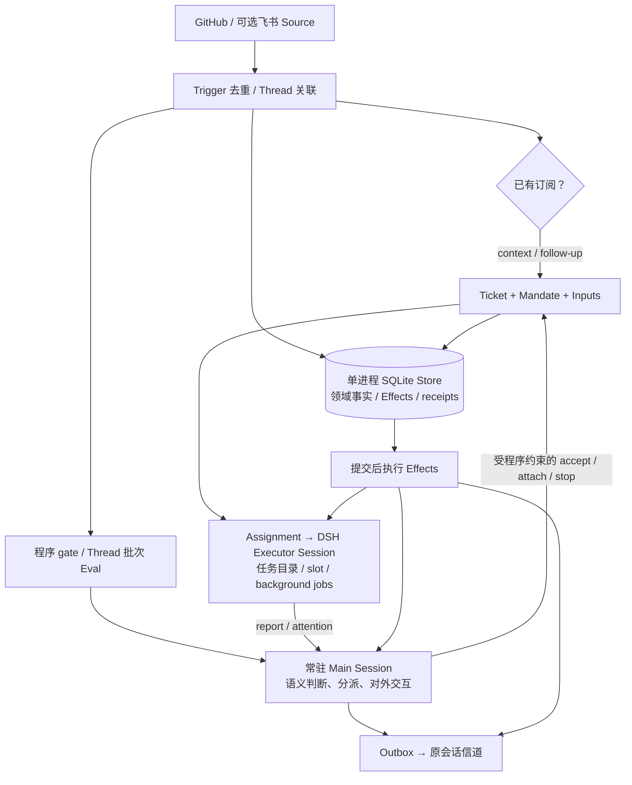

# Super-agent：文章、原型与本项目适配分析

调研日期：2026-10-31；后继源码深查：2026-11-01，沿用同一固定快照。本文是时间点研究输入，不是产品能力或验收声明。当前设计取舍见[任务与上下文编排](../design/10-task-context-and-orchestration.md)，当前待办及版本仍由 [PROGRESS](../PROGRESS.md) 维护。

## 1. 来源与阅读范围

| 输入 | 固定身份与范围 |
| --- | --- |
| 用户保存的文章 | `~/Desktop/技术调研/Super-agent 设计探索：迈向更自主的 Agent 系统.html`；4,730,607 bytes，SHA-256 `bf2fa5461d66050b98a20ed81776040a2d58b59237d58b514587cad81a1ad389`。完整阅读正文 §1–9，并核对总架构、存算分离及实验图片；未执行网页脚本 |
| 文章原链接 | HTML 中记录为[《Super-agent 设计探索：迈向更自主的 Agent 系统》](https://mp.weixin.qq.com/s/zoS7GlReWPhfCjENGxXCdg)；本次以本地保存字节为研究输入，不声称在线文章与本地字节相同 |
| 官方公开原型 | [deepseek-ai/dsh-superagent-prototype](https://github.com/deepseek-ai/dsh-superagent-prototype)，commit [`6337fc823ce20251c8de8085948165c81aaa701e`](https://github.com/deepseek-ai/dsh-superagent-prototype/tree/6337fc823ce20251c8de8085948165c81aaa701e)，提交时间 `2026-10-31T20:05:39+08:00`；下载到本机临时研究目录，只读分析 |
| 源码范围 | README、docs/000–008、package/preset；抽查 core 的领域模型、intake/evals/tickets/stage，app 的 Store/Effects/Outbox/AgentDelivery/resources/cards/sessions，以及 executor、对应测试。未安装、构建或运行上游，不宣称其测试通过 |
| 本项目基线 | `5d38b2cd6307aab9c8dec2c475b1bebf886d8283`，继承工作树已有四份文档修改；对照当前设计、协议、App 参考集成及关键源码。新主机未持有原本机证据，原 A 私有验收仍未独立复核 |

上游 README 明示：这是研究原型，不是官方产品或生产就绪软件；发布版与内部系统、文章描述并不完全相同，部分内容是未来方向。它是 **DeepSeek Harness 上针对一个 GitHub 仓库的应用编排插件**，不是通用多租户 Agent API，也不是另一套底层模型 loop。[原型 README](https://github.com/deepseek-ai/dsh-superagent-prototype/blob/6337fc823ce20251c8de8085948165c81aaa701e/README.md)

后继深查沿接收→判定→任务→投递→消费→报告/停止/恢复的链路核对实现，并阅读相关测试的夹具与断言，详见§7。**这些证据足以支持本次架构适配取舍，但不是全仓逐行审计或运行验收。** 面板所有交互、完整供应商/DSH依赖内部实现、真实渠道故障和容量没有逐项实测；测试存在与测试通过严格分开。

研究与深查阶段未修改产品代码、启停本地环境或发起真实模型请求。用户于2026-11-01后继授权整体文档复核后提交并推送；此次收尾仅含研究、设计、索引和对应进度，使用`[skip ci]`。本地 HTML、上游仓库与私有证据不搬入公开文档，产品开发、部署和模型费用授权不变。

## 2. 核心理念：把人的注意力从会话搬到任务

文章的起点不是“再增加几个 Agent”，而是单个任务逐渐能自主执行后，人仍必须在多个 session 之间记住背景、搬运信息、追进度和验收。设计希望同时得到连续、高效、主动、持久四种性质，把产品中的任务管理与底层 session 分离。

| 设计 | 解决的问题 | 必须保留的限定 |
| --- | --- | --- |
| 逻辑 Router / Worker 双层，§2 | 统一承接人类交互、跨任务协调；具体任务进入独立上下文并行执行 | Router 是语义协调角色，层内不必只有一个 session；不是两个操作系统服务的规定 |
| 程序准入 → 语义判断，§3.1 | 大量事件先过滤，再为有意义的候选付出推理成本 | 语义判断不能代替身份、工具权限或费用授权 |
| Thread 订阅直通，§3.2 | 关联已确定的跟进消息直接到 Worker，减少反复全局分派 | 多对多订阅提供共同观察，不提供共享资源的事务隔离或唯一写入 |
| Inline / Spill 与链式召回，§3.3 | 有限摘要、关联 ID 和相邻信息先进入上下文，完整对象按需展开 | 引用图不等于完整长期记忆，更不授予跨边界读取权限 |
| 提前行动，§3.4 | 用后台算力预备调查、草稿或修复，减少等待 | 额外费用和真实写入仍有成本；静默不等于有权执行 |
| 异步 start / stop，§4.1 | 耗时工具先返回 Started，完成后以事件投递，新输入在 step 边界接入 | Started 不等于完成；文章称该 Harness 机制尚未默认开启 |
| 按信道交付，§4.2 | IM 只给可行动的短信息，PR/文档承载结构化结果 | 减少人类通知不等于省略执行事实与审计记录 |
| 计算 / 状态 / 环境分离，§5 | loop 可替换，状态持久，重环境可原地或远端接入 | 历史可读不等于执行栈可恢复；远程 daemon 引入新的信任边界 |
| 外部 Watchdog，§6 | 进程活着也可能无进展，需独立观察控制回路 | 诊断、建议与实际修复权限必须分开 |

值得参考的工程方法是：把可确定的关联和约束写进程序，把模型留给语义歧义；用上下文结构和能力边界减少主会话承担的工作，而不是仅靠“请优先委派”的提示词。上游[理念文档](https://github.com/deepseek-ai/dsh-superagent-prototype/blob/6337fc823ce20251c8de8085948165c81aaa701e/docs/000-philosophy.md)进一步把“何时保持安静”和“何时需要人”当作产品设计问题。

## 3. 公开原型真正实现了什么

### 3.1 领域与控制流

图是源码控制关系摘要，订阅投递与 Eval 是否同时发生由事件身份和 follow-up ownership 决定，并非两个互斥分支。`Runtime` 组装组件；`Engine` 的同步命令在事务内改变领域状态，窄端口入队外部工作；模型、会话和外部信道在提交后驱动。`Ticket` 是业务工作项，`Assignment` 是一次执行分配，DSH Session 则保存模型执行上下文；三者不是一个 ID。[架构与源码索引](https://github.com/deepseek-ai/dsh-superagent-prototype/blob/6337fc823ce20251c8de8085948165c81aaa701e/docs/007-architecture.md)、[Engine](https://github.com/deepseek-ai/dsh-superagent-prototype/blob/6337fc823ce20251c8de8085948165c81aaa701e/src/core/engine.ts)

### 3.2 值得借鉴的具体做法

| 做法 | 源码证据 | 对本项目的启发 |
| --- | --- | --- |
| 接收事实与处置分开 | `core/model.ts` 的 Trigger / TriggerDisposition；`Intake.receive` 保存一次事件、关联、fanout 及后续归属 | 能追问“收到了什么、为何未执行、送给谁”；不要把模型正文视为可信 actor |
| 授权与上下文分开 | `Mandate` 保存接受时策略版本与依据；context-only follow / note 不授予新工作权限；`followupOwners` 防止同一跟进被主会话重复开工 | 关联和消息到达只是事实，新的能力、支出、外部动作必须另核 |
| 持久事实与副作用分开 | `Store.atomic/afterCommit`；`Effects.enqueue` 在事务中写待办，提交后执行；按 kind/key 合并，seq/generation 防止旧完成删掉新版本 | 可参考其控制代码分层；本项目已有 outbox/write-ahead，不应重建平行账本 |
| 区分投递与模型已读 | `AgentDelivery` 用稳定 message ID检查历史和 pending inbox，`send`正常返回前等待flush；accepted回调可早于flush，Executor另记录Inputs被纳入历史及后续处理 | accepted、delivered、consumed、completed 不应合成一个“成功”，也不能混同它们的持久化时点 |
| 将给人的等待状态显式化 | `ticketStage` 按 delivery、answer、review、blocked/failed、queued、idle 分类 | “在等谁、谁能推进”比一个 running 灯更有用；不修改本项目已有 turn 终态含义 |
| 上下文卡片与续读资源成对 | `triggerCard/ticketCard` 给摘要、长度、read；`resources.ts/readResource` 给分页和关联。部分领域资源按Ticket收窄，但GitHub原始资源可读配置仓库中的其它对象，详见§7 | 高价值的借鉴点是有界投影与可解析引用；领域视图限制不能当作所有数据或OS隔离 |
| 人类跟进优先于新增任务 | Executor 正常 slot 外有一个跟进/状态请求 slot；自动 CI 输入等普通 slot | 可作为今后公平性实验候选；它不能证明本项目多租户容量或邻租户延迟 |
| 版本化可编辑策略与提示词 | settings/prompts 保存修订与 Session 使用历史，preview 和正式保存区分 | 复现决策需记录配置身份；模型可编辑的提示词不能修改程序安全阀 |

以上源码均相对固定上游 commit：[`model.ts`](https://github.com/deepseek-ai/dsh-superagent-prototype/blob/6337fc823ce20251c8de8085948165c81aaa701e/src/core/model.ts)、[`intake.ts`](https://github.com/deepseek-ai/dsh-superagent-prototype/blob/6337fc823ce20251c8de8085948165c81aaa701e/src/core/intake.ts)、[`effects.ts`](https://github.com/deepseek-ai/dsh-superagent-prototype/blob/6337fc823ce20251c8de8085948165c81aaa701e/src/app/effects.ts)、[`delivery.ts`](https://github.com/deepseek-ai/dsh-superagent-prototype/blob/6337fc823ce20251c8de8085948165c81aaa701e/src/app/delivery.ts)、[`stage.ts`](https://github.com/deepseek-ai/dsh-superagent-prototype/blob/6337fc823ce20251c8de8085948165c81aaa701e/src/core/stage.ts)、[`resources.ts`](https://github.com/deepseek-ai/dsh-superagent-prototype/blob/6337fc823ce20251c8de8085948165c81aaa701e/src/app/resources.ts)。这些是阅读结论，未在本机复验运行行为。

### 3.3 文章愿景与原型边界

| 主题 | 公开快照的实际边界 |
| --- | --- |
| 常驻 Router | 确有常驻 Main Session，但程序 Engine/Store/Effects 承担授权与调度；主会话仍可用 bash/read/job。避免亲自读代码主要是提示约束，不能说已经通过工具白名单完全禁止执行 |
| 连续交互与并行 | Thread 多对多订阅、批次候选、跟进/报告汇总、worker slots 已存在；它们是单部署实例内机制，没有多租户分布式全局排序证明 |
| 无状态弹性计算 | 插件实际依赖本地 SQLite、state 目录独占锁、DSH 持久 Session 和工作目录；不是文章描绘的云端弹性多副本部署 |
| 跨设备执行 daemon | 本仓库未交付文章 §5.2 的通用 BYOM/端侧执行平面；不能从工作目录或 background job 推断已经实现 |
| 外部 Watchdog | 部署文档建议在另一个 profile 创建小时检查，尊重手动停止，按状态决定报告或恢复；不是内置的通用任务质量监督及自治修复服务 |
| 全双工 | 有基于 DSH inbox 的 step/turn 投递及后台 jobs/subagents；长命令和子任务可在后台推进，新输入在后续 step/turn 接入，不等于所有工具均异步或同一 session 并行两个推理栈 |
| 长期记忆 | 有 ID 关联、有限卡片、分页、按需续读；跨月记忆仍是文章开放问题。内存分页缓存会随重启丢失，部分读需从 offset 0 重来 |
| 持久化生命周期 | trigger/decision/ticket/outbox/settings 等历史没有删除机制，文档明确会无限增长；不能照作本项目 retention/erasure 方案 |

依据：[授权](https://github.com/deepseek-ai/dsh-superagent-prototype/blob/6337fc823ce20251c8de8085948165c81aaa701e/docs/002-authorization.md)、[执行与恢复](https://github.com/deepseek-ai/dsh-superagent-prototype/blob/6337fc823ce20251c8de8085948165c81aaa701e/docs/003-execution.md)、[部署](https://github.com/deepseek-ai/dsh-superagent-prototype/blob/6337fc823ce20251c8de8085948165c81aaa701e/docs/006-deployment.md)、[架构](https://github.com/deepseek-ai/dsh-superagent-prototype/blob/6337fc823ce20251c8de8085948165c81aaa701e/docs/007-architecture.md)、[`sessions.ts`](https://github.com/deepseek-ai/dsh-superagent-prototype/blob/6337fc823ce20251c8de8085948165c81aaa701e/src/app/sessions.ts)。

### 3.4 不宜移植的可靠性与安全假设

- worker 以操作者 OS 用户运行、命令无需逐次审批；目录和 CLI wrappers 是默认环境，不是安全边界，绝对路径仍可能绕过 wrappers。这适合其可信研发环境，不能充当本项目的租户沙箱。
- Policy 改变会通知受影响的活动 Ticket，但不立即撤销其 Mandate；恢复 ended Ticket 时才按规则重验。不能替代本项目实时身份、scope、lifecycle 与每次写入 fresh authority 的控制。
- resume的重验按Mandate依据分支，显式follow-up的延续规则并不统一重查请求人当前allowed名单；关闭Source、暂停处理、关闭推断接单和人工stop也是不同控制，不能统称为撤权。
- 暂时性模型/网络错误存在自动重试或“继续”投递；host restart 可启动新 Assignment，并提示模型检查目录、Git 和 GitHub 后再行动。这不是对外部未知副作用不重复的程序证明。
- Outbox 有本地稳定 ID 收据及渠道防重：飞书使用 `message.id` 作为服务端 idempotency key，GitHub 使用同 ID 的评论 marker 并先查后发。`Outbox.deliver` 仍是先 `await sources.send` 再保存发送结果；这些渠道机制不能推广成任意副作用的通用 exactly-once 或 unknown 安全重放证明。
- main 能修改部分策略/提示词，worker 保留工作工具；受管子 agent 的安全仍依赖 DSH 与部署环境，不能直接替换本项目 root authority、权限交集、共享预算、取消结算及唯一计费。

这些是适用前提差异，不据静态分析声称上游发生了安全事故。[Outbox 源码](https://github.com/deepseek-ai/dsh-superagent-prototype/blob/6337fc823ce20251c8de8085948165c81aaa701e/src/app/outbox.ts)、[飞书渠道](https://github.com/deepseek-ai/dsh-superagent-prototype/blob/6337fc823ce20251c8de8085948165c81aaa701e/src/sources/feishu-channel.ts)、[GitHub 渠道](https://github.com/deepseek-ai/dsh-superagent-prototype/blob/6337fc823ce20251c8de8085948165c81aaa701e/src/sources/github-channel.ts)、[授权与撤销规则](https://github.com/deepseek-ai/dsh-superagent-prototype/blob/6337fc823ce20251c8de8085948165c81aaa701e/docs/002-authorization.md)、[执行环境与恢复规则](https://github.com/deepseek-ai/dsh-superagent-prototype/blob/6337fc823ce20251c8de8085948165c81aaa701e/docs/003-execution.md)

## 4. 实验说明了什么

文章 §7.1 每方案运行五次，输入约 300 条合成消息、其中约 20 条工作请求；编码由只耗时工具代替。消息间隔和工作时长按 1/4 缩放，模型耗时真实。以下数值取自本地表格图片 `640(12)`：

| 方案 | 完工时间 P50 / P95，分钟 | 全 Session 读缓存 token |
| --- | --- | --- |
| Super-agent | 12.4 / 15.7 | 2323 万 |
| 去掉订阅直通 | 12.6 / 15.5 | 3177 万 |
| 单 Session + Subagent，中性提示 | 20.4 / 29.5 | 605 万 |
| 单 Session + Subagent，优先委派提示 | 13.8 / 29.0 | 1082 万 |

它支持“结构化分工减少该负载的调度长尾”，也显示多 Session 使用更多上下文 token。去直通几乎不改变完工时间，但文章报告 Router 决定增加约 30%、读缓存 token 增加约 37%。不能由此宣称代码质量提高、总成本降低或多租户业务容量已得到证明；读缓存 token 也不是总 token 或厂商账单。

§7.2 是真实 Router 模型加 Mock Worker：需决策的 Trigger 约 1→40 条/分钟，平均 batch 1.0→2.8，单次请求 2.5→3.9 秒，单决定分摊推理 6.4→1.6 秒。单决定分摊值不是端到端事件响应延迟；结果没有封闭排队 P95、丢失率、正确分派率和租户公平性，也不能外推本项目 App DAU/QPS。论文式容量结论仍需真实业务轨迹、基线、费用和失败条件的独立实验。

## 5. 与 agent-service 的关系

### 5.1 场景与同名角色不能混淆

| 概念 | Super-agent | 本项目 |
| --- | --- | --- |
| 产品目标 | 单仓库、团队共享上下文的持续研发协作者 | 记录类 App 后端调用的多租户 Agent Runtime API |
| Router | 承接信道、语义分派、协调、对外交付的模型角色 | `agent-router` 公共 API/SSE、owner 路由、fleet 门禁；不是语义规划器 |
| Worker / runner | Worker 是业务任务执行 Session | `agent-runner` 是承载多个 SessionHost/turn 的服务；不等于一个 Worker |
| 任务 | Ticket 可跨 Assignment、消息、PR 与执行轮次 | App topic/task 关联是业务责任；session 是历史/单写者/游标单元，turn 是一次执行 |
| 隔离 | 一个部署范围的共享上下文、OS 用户与工作目录 | 实际 tenant/user、scope、配置、凭据、审批、预算和 MySQL authority |
| 连续性 | 订阅、保存消息和恢复 Assignment | 已有持久 history/SSE/多 turn；SIGKILL 后 repair 终结旧 turn，不续原 Pi 栈 |

本项目已有[业务映射建议](../design/00-architecture.md#13-业务集成合同与待确认决策)、[SDK 参考集成](../../examples/record-assistant/README.md)、[受管子任务](../design/02-subagents.md)和[有界上下文投影](../design/00-architecture.md#context-projection-flow)。借鉴的重点是补充这些边界的业务合同，而非因为 Router/Worker 同名就调整服务拓扑。

### 5.2 适配判定

| 方向 | 判定与理由 |
| --- | --- |
| 业务任务与 session 分离 | 采纳解释方式，完善真实 App 映射/CAS、版本输入与幂等结果保存；已有参考接口，不另造通用任务平台 |
| Inline / Spill + 关联引用 | 优先完善设计：来源、版本、有效性、有界摘要和每跳授权；复用现有预算、Blob、skills 延迟加载和工具链 |
| 确定性关联后直接续聊 | 复用已有 topic/session 映射；只有存在歧义且有推理预算时才考虑语义选题，不能跨 owner 搜索全局上下文 |
| 工作状态与可行动通知 | 借鉴“在等谁”的输出投影和关联回读；保留 HTTP/SSE 持久事实，通知不授予执行权 |
| 持久事件 inbox / 长期任务 | 需求触发候选；现有 active steer 不等于持久订阅，`resume` 是状态读取，dynamic 等待仍在进程内，需独立协议 |
| 多任务语义协调 Agent | 条件候选；先放可信业务编排层，确定性映射足够时不调用它；有跨任务目标冲突/关联识别需求后再比较收益与额外延迟、成本 |
| 独立 harness / 替换 Pi | 暂无证据支持；该仓库是上层应用而非可直接替换的内嵌 loop，替换仍须完整 Host 契约与收益证明 |
| 云端 daemon / BYOM / 重池 | 延续原需求触发的独立设计，不进入近期默认路径；目录隔离不能替代资源、网络、密钥和租户隔离 |
| 投机写入 / 自治 Watchdog | 不作为本轮方案；可以研究已授权只读预取、进度观察与建议，不能自动重放 unknown、修改门禁或拓展模型预算 |

当前行为的源码依据：[`SessionHost.steerActive`](../../packages/core/src/session/host.ts)、[`EngineRun`](../../packages/core/src/engine/types.ts)、[`DynamicToolBridge`](../../packages/core/src/tools/dynamic.ts)、[runner 的 resume 路由](../../apps/agent-runner/src/app.ts)、[上下文前缀与 epoch](../../packages/core/src/context/assemble.ts)、[Pi 派发与取消边界](../../packages/core/src/engine/pi.ts)。它们只证明已存在的实现，不扩大 PROGRESS 中的具名验收。

### 5.3 为什么暂不调整服务拓扑

| 候选 | 预期收益 | 代价与本轮选择 |
| --- | --- | --- |
| 现有确定性路由 + App 映射 | 直接满足记录分析、补充和同主题续聊，少一次语义协调调用 | 跨主题关系由业务定义；当前优先补真实集成和上下文合同 |
| 在公共 router 内加入常驻模型调度器 | 可在入口集中理解跨任务关系 | 将业务状态、额外推理延迟/费用与公共路由绑定；全局上下文还需重新切分权限。当前场景未证明必须承担这些代价，不选 |
| App 编排层增加受限语义协调角色 | 多入口、多个长期任务确有歧义时可统一选题与交付，复用现有 Runtime | 需独立任务身份、inbox、费用与恢复合同；作为需求触发候选，不要求独立进程 |
| 拆出执行进程或替换 engine | 任意代码/重环境的隔离、特定兼容性或测量出的资源问题可能受益 | 需重定 IPC、状态、取消、审批、usage、fence 与恢复；上游应用插件没有提供替代 Pi 的收益证据，留待具名需求/测量触发 |

这些是当前场景下的选择，不把既有组件定位冻结成不可调整的前提。若真实业务或测量表明当前边界不足，应连同权限、成本和恢复影响重新评审，而不是仅因外部图中的同名组件做映射。

## 6. 本轮设计落点与后续验证问题

新增[任务、上下文与可选编排设计](../design/10-task-context-and-orchestration.md)，以现有职责为基础补充Runtime创建核对、来源/派生失效及SDK/App持久映射的规划规则；它不发布新API、表结构、服务或迁移。长期事件与执行环境继续由需求触发，当前排序统一维护在 [PROGRESS](../PROGRESS.md#superagent-design-followups)。

若以后立项，收益要通过本项目场景验证：相同输入的直接执行与额外协调耗时/usage、正确关联率、跟进响应和邻租户 P95、每个真实 provider/tool 派发的唯一身份、撤权/删除后不可召回、乱序和重复事件、取消后迟到结果、崩溃与 unknown 不重放。FakeVendor/确定性轨迹可以先验证程序合同；模型效果、真实厂商费用和目标部署必须分别具名验证，不能引用本文实验代替。

## 7. 后继源码深查：实现链与证据边界

以下路径与行号都属于§1固定commit；测试列表示读过的断言范围，**未运行上游测试**。这次深查纠正了“worker只能读自身相关对象”的过宽概括，并将可以吸收的细节与不宜照搬的前提进一步分开。

| 链路 | 实际代码结论 | 测试阅读与适配限定 |
| --- | --- | --- |
| 接收与去重 | [`Intake.receive`](https://github.com/deepseek-ai/dsh-superagent-prototype/blob/6337fc823ce20251c8de8085948165c81aaa701e/src/core/intake.ts#L19)先按Trigger ID判重复，不比较重复正文；Source自行决定ID/编辑版本的生成 | `tests/core-engine.spec.ts`核幂等接单；`tests/sources.spec.ts`核来源事件转换。不能据此宣称相同ID异内容冲突已拒绝，未来协议须单独规定 |
| 批次与授权依据 | [`Evals.start`](https://github.com/deepseek-ai/dsh-superagent-prototype/blob/6337fc823ce20251c8de8085948165c81aaa701e/src/core/evals.ts)从可准入事件选primary/strength/actor/basis；上下文批次还可能包含不具授权强度的其它消息 | `tests/policy.spec.ts`、`tests/core-engine.spec.ts`区分明确/推断请求与bot。批次允许模型看到的内容，不能全部继承某一人的权限 |
| 跟进所有者与交回 | [`followupOwners`](https://github.com/deepseek-ai/dsh-superagent-prototype/blob/6337fc823ce20251c8de8085948165c81aaa701e/src/core/model.ts#L76)与[`Evals.handback`](https://github.com/deepseek-ai/dsh-superagent-prototype/blob/6337fc823ce20251c8de8085948165c81aaa701e/src/core/evals.ts)协调多个Ticket对同一消息的处置；交回一次不删订阅，尚有owner时不重新接单 | `tests/followups.spec.ts`、`tests/runtime-concurrency.spec.ts`包含交回/终结竞态。订阅、送达、处置责任不是同一个ACK；本项目无实际多订阅需求时不新增这套机制 |
| 配置与撤权 | [`policyVersion/revalidate`](https://github.com/deepseek-ai/dsh-superagent-prototype/blob/6337fc823ce20251c8de8085948165c81aaa701e/src/policy.ts)与[`Settings.save`](https://github.com/deepseek-ai/dsh-superagent-prototype/blob/6337fc823ce20251c8de8085948165c81aaa701e/src/app/settings.ts)区分Policy和Source配置；旧Eval有版本保护，Source off并不等于停止活动Worker | `tests/policy.spec.ts`、`tests/settings.spec.ts`核版本/恢复分支。explicit follow-up按其依据延续，不能把revalidate泛化为本项目actual-user即时撤权合同 |
| 读取范围 | [`resources.ts:209`](https://github.com/deepseek-ai/dsh-superagent-prototype/blob/6337fc823ce20251c8de8085948165c81aaa701e/src/app/resources.ts#L209)的`github/`直接调用[`readGithub`](https://github.com/deepseek-ai/dsh-superagent-prototype/blob/6337fc823ce20251c8de8085948165c81aaa701e/src/sources/github-read.ts#L102)；`ticket/trigger/thread/prompts`各有领域检查，不能外推到所有源数据和shell | `tests/tools.spec.ts`、`tests/github-read.spec.ts`各核领域资源与仓库读取。OS用户与仓库账号仍是更广访问边界，非多租户沙箱 |
| 投递与消费 | [`AgentDelivery.send`](https://github.com/deepseek-ai/dsh-superagent-prototype/blob/6337fc823ce20251c8de8085948165c81aaa701e/src/app/delivery.ts#L65)按历史/pending inbox去重并flush；[`DshExecutor`](https://github.com/deepseek-ai/dsh-superagent-prototype/blob/6337fc823ce20251c8de8085948165c81aaa701e/src/executor/dsh.ts#L493)收到原生user/message、消息纳入Session历史后标inputsRead，不把claim当消费 | `tests/runtime-concurrency.spec.ts:670/693/710`核取消/崩溃后的消息重投；`tests/delivery.spec.ts`使用Agent/persistence double。消费回调本身不证明磁盘持久化先后，也不证明真实渠道或厂商侧效果 |
| 旧执行完成与新待办 | [`Effects.enqueue/attempt`](https://github.com/deepseek-ai/dsh-superagent-prototype/blob/6337fc823ce20251c8de8085948165c81aaa701e/src/app/effects.ts#L60)用kind/key、seq/generation防旧attempt删除已更新payload | `tests/effects.spec.ts:39/160`用临时SQLite及模拟handler覆盖更新竞态。可吸收代际保护，但不同不可变业务事件不能因合并wake任务而丢失 |
| 并发与后台资源 | [`WorkerSlots`](https://github.com/deepseek-ai/dsh-superagent-prototype/blob/6337fc823ce20251c8de8085948165c81aaa701e/src/executor/dsh.ts#L171)在await前预留slot，人工跟进有额外位置；handoff后的部分shell jobs不占slot，后台期限也不是跨轮总期限 | `tests/runtime-concurrency.spec.ts`用模拟host/jobs验证slot与handoff。worker数不证明全部OS资源、租户公平性或费用上限；本项目既有family限额不因此放宽 |
| 停止与真实结算 | [`background.until`](https://github.com/deepseek-ai/dsh-superagent-prototype/blob/6337fc823ce20251c8de8085948165c81aaa701e/src/executor/background.ts#L36)是有界等待；`stopSubagents`超时可返回，不证明底层工作真正settle | `tests/background.spec.ts:65`用永不结束的drain及fake timers核超时返回。本项目已有真实排空合同，不复制超时即视为停止的语义 |
| 恢复与健康 | [`Assignments.interrupted`](https://github.com/deepseek-ai/dsh-superagent-prototype/blob/6337fc823ce20251c8de8085948165c81aaa701e/src/core/assignments.ts#L79)按Report及后继投递判断是否重开并给恢复说明，已结算分支保留原Assignment；[`RetryHealth`](https://github.com/deepseek-ai/dsh-superagent-prototype/blob/6337fc823ce20251c8de8085948165c81aaa701e/src/app/retry-health.ts)按匹配事件投影健康 | `tests/retry-health.spec.ts`用合成provider/turn/step事件拒绝陈旧成功清新故障。可吸收精确关联，不能当持久执行检查点或安全重试证明 |

`EngineFor*`的窄接口、SourceContext和适配端口还体现了值得参考的代码分层：核心领域不直接依赖信道/模型，状态变更入口集中，副作用由适配器驱动。但TypeScript的`Pick`和同进程插件接口不是不可信代码安全边界。本项目若后续抽取编排模块，可以参考这种小接口组织，仍沿用现有鉴权、Host和store控制，不必搬入其整个领域模型。

本项目对照还确认一处具体设计缺口：[`ContextCompactionItem`](../../packages/protocol/src/item.ts)尚无业务source依赖，[`projectItems`](../../packages/core/src/context/history.ts)会把summary放进模型历史，Host的规划和摘要又早于主模型执行。因此失效检查不能只放App最终保存结果或最后拼接新输入；未来需要在旧历史/Blob/摘要进入模型前由Runtime处理，详见[设计§3.4](../design/10-task-context-and-orchestration.md#34-runtime落点与历史兼容规划)。本轮只完善方案，不用文档将缺口改写成已实现。
