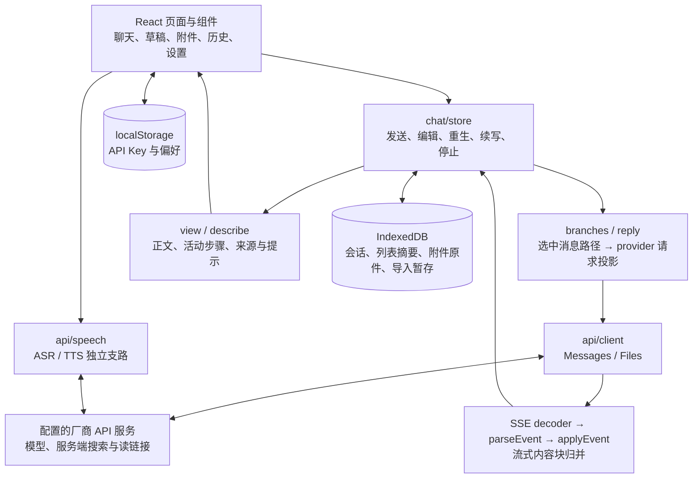

# DeepSeek chat-demo 架构与本项目适配分析

调研日期：2026-11-13。结论是保留本项目的 router、runner、SessionHost 与 Pi 分工，吸收客户端的协议适配、状态投影和渲染组织方法。chat-demo 解决独立聊天客户端的问题；本项目面向可信 App 后端，提供多租户、持久执行与受控工具 API，二者可在客户端层互补。

本文为时间点研究输入；设计承接见[客户端投影与聊天动作](../design/10-task-context-and-orchestration.md#chat-client-projection)，当前待办见 [PROGRESS](../PROGRESS.md#chat-demo-followups)。

## 1. 来源与研究范围

| 输入 | 固定身份与读取范围 |
| --- | --- |
| 官方仓库 | [deepseek-ai/chat-demo](https://github.com/deepseek-ai/chat-demo)，固定 commit [`5d5dd754ebc1948e977ddb880a9eb5aa25f37b4c`](https://github.com/deepseek-ai/chat-demo/tree/5d5dd754ebc1948e977ddb880a9eb5aa25f37b4c)，package 版本 0.1.1；提交时间 `2026-11-13T22:33:04+08:00` |
| 源码取得方式 | 浅克隆到本机临时研究目录；未将上游源码或依赖加入本项目 |
| 说明与在线页面 | 阅读中英文 README、package、构建配置、历史归档格式说明；查看[公开页面](https://deepseek-ai.github.io/chat-demo/)的初始界面与 API Key 提示。在线页面未核对构建 SHA，不与源码快照混称 |
| 核心代码 | API client/SSE/事件解析；chat 的类型、分支、请求投影、store、view、草稿、DB、附件及历史导入导出；Markdown/公式/图表渲染与语音入口抽查 |
| 本项目对照 | 干净工作树 `main / ae6011f4c2e664e955d5d2b18ac2acac6c28e935`；架构、设计10/11/12、生命周期、SDK、记录助手示例及 H5 关键链路 |

本轮以静态源码分析为主，未安装、构建或执行上游测试，未填写 API Key、发送消息或调用语音/模型。源码行为不等于真实厂商兼容性、回答质量或容量验收；在线空页面也不提供这些证明。

## 2. 产品定位与设计取舍

上游 README 明确将它定位为静态聊天示例：浏览器直接请求配置的 API 服务，构建产物可放静态服务器，满足存储与 CORS 条件时也可通过 `file://` 打开。API Key 与偏好在 localStorage，会话及原始附件在 IndexedDB；数据按浏览器配置与 origin 隔离。[README](https://github.com/deepseek-ai/chat-demo/blob/5d5dd754ebc1948e977ddb880a9eb5aa25f37b4c/README.zh-CN.md)

从实现可归纳出三项取舍：尽量减少应用部署依赖；由浏览器保存完整交互历史并为每次请求选择上下文；把搜索、读链接和语音能力交给配置的 API 服务。这使个人体验与离线打开界面很方便，也把凭据保管、本地持久化和消息编排集中到客户端。离线打开界面不代表离线模型执行。

它使用 React、Zustand、idb 和 Rspack，Markdown 相关能力按模块组织。默认聊天模型为 `deepseek-flash`，调用 Anthropic 兼容 Messages/Files 路径；请求还使用服务端搜索、标题和 `latest_reminder` 等扩展，语音另走 ASR/TTS。兼容基础 Messages 格式不能据此推定其它 API 服务支持全部功能。[package](https://github.com/deepseek-ai/chat-demo/blob/5d5dd754ebc1948e977ddb880a9eb5aa25f37b4c/package.json)、[请求组装](https://github.com/deepseek-ai/chat-demo/blob/5d5dd754ebc1948e977ddb880a9eb5aa25f37b4c/src/services/chat/store.ts#L36)、[API client](https://github.com/deepseek-ai/chat-demo/blob/5d5dd754ebc1948e977ddb880a9eb5aa25f37b4c/src/services/api/client.ts)

许可证为 MIT，分发构建须保留 LICENSE，依赖许可证分别适用。若后续实际复用源码，再按选定文件与依赖核对许可；本轮只吸收设计方法。[LICENSE](https://github.com/deepseek-ai/chat-demo/blob/5d5dd754ebc1948e977ddb880a9eb5aa25f37b4c/LICENSE)

## 3. 架构与一次回复的数据流

图中的厂商内部实现不在仓库中；`server_tool_use` 和搜索结果块是远端协议，不是开源的 Agent runner、MCP 执行器或审批系统。主要控制链如下：

1. 发送时确定问题和选中分支，建立本地 assistant 占位；附件先补齐远端 `file_id`。
2. `toRequestMessages` 选择可用的 user/assistant 成对轮次并转换内容，再追加本次问题；续写可带受限 assistant 前缀。历史思考、搜索展示块和引用并非全部原样回传。
3. client 发起流式 Messages POST。SSE 解码、字段解析与 `applyEvent` 分层处理，增量归入文本、思考或服务端工具块。
4. 内存中的 reply 持续更新，可见页面通过动画帧合并 store 刷新；结束、错误或停止后保存本地状态。页面隐藏时另有 flush/保存尝试。
5. `buildReplyView` 从原内容块派生步骤、最终正文、引用编号与来源列表，展示合并不修改原块。

依据：[store 的流消费](https://github.com/deepseek-ai/chat-demo/blob/5d5dd754ebc1948e977ddb880a9eb5aa25f37b4c/src/services/chat/store.ts#L962)、[请求投影](https://github.com/deepseek-ai/chat-demo/blob/5d5dd754ebc1948e977ddb880a9eb5aa25f37b4c/src/services/chat/reply.ts#L193)、[视图计算](https://github.com/deepseek-ai/chat-demo/blob/5d5dd754ebc1948e977ddb880a9eb5aa25f37b4c/src/services/chat/view.ts)。

### 3.1 消息树与请求上下文

所有分支存于同一会话的 messages；父子关系与选中项决定可见路径，展示和请求共用路径计算。编辑问题新增兄弟分支，重新生成新增该问题的另一条回答，旧版本仍可切换。它比“覆盖原数组后丢失版本”更适合比较答案。[branches](https://github.com/deepseek-ai/chat-demo/blob/5d5dd754ebc1948e977ddb880a9eb5aa25f37b4c/src/services/chat/branches.ts#L17)、[编辑与重生](https://github.com/deepseek-ai/chat-demo/blob/5d5dd754ebc1948e977ddb880a9eb5aa25f37b4c/src/services/chat/store.ts#L618)

完整本地历史与模型上下文被显式区分：失败、拒绝及没有可用正文的轮次被筛除，历史思考被省略，读链接结果的回传另受厂商签名协议限制。这体现了独立投影函数的价值，但不提供本项目的 token 预算、来源权限修订或摘要失效能力；浏览器选中路径也不是多租户服务端的上下文授权。[reply](https://github.com/deepseek-ai/chat-demo/blob/5d5dd754ebc1948e977ddb880a9eb5aa25f37b4c/src/services/chat/reply.ts#L215)

### 3.2 本地状态与异步读取

列表摘要、会话详情、原始文件分别保存；详情缓存优先保护当前、生成中和未保存会话，正文变化不必重排列表。保存失败保留未保存状态与文件，只有对应最新快照保存完成后才清理。详情加载使用历史 epoch 和加载对象身份，丢弃导入/删除后的陈旧结果。[缓存与保存](https://github.com/deepseek-ai/chat-demo/blob/5d5dd754ebc1948e977ddb880a9eb5aa25f37b4c/src/services/chat/store.ts#L122)、[详情加载](https://github.com/deepseek-ai/chat-demo/blob/5d5dd754ebc1948e977ddb880a9eb5aa25f37b4c/src/services/chat/store.ts#L320)

这是可参考的异步状态组织：草稿、发送请求、生成中的回答、本地未保存状态各有身份。详情缓存目标与动画帧刷新不构成硬内存上限；草稿本身主要在内存，也不构成跨进程恢复合同。[drafts](https://github.com/deepseek-ai/chat-demo/blob/5d5dd754ebc1948e977ddb880a9eb5aa25f37b4c/src/services/chat/drafts.ts)

## 4. 可参考的工程方法与适用限制

### 4.1 分离协议内容与界面投影

`view.ts` 将内容块转换成活动时间线、正文和来源；每次视图计算按出现顺序为去重 URL 编号，后到元数据可补齐。这样，步骤折叠、来源卡片与正文布局不必改变协议内容。适合本项目未来 App 客户端采用独立读模型，已有 item/event 仍按服务端合同保留。[view](https://github.com/deepseek-ai/chat-demo/blob/5d5dd754ebc1948e977ddb880a9eb5aa25f37b4c/src/services/chat/view.ts#L107)

这里的 URL 来源是展示引用；它不是设计11中的业务 source ID/version、撤权通知或摘要依赖。思考内容也只有在本项目选定 provider 与公共协议实际支持并允许输出时才展示，不能把 demo 的 thinking 块变成所有模型的统一承诺。

### 4.2 把接收增量与昂贵渲染分开

除动画帧合并外，Markdown 更新按上次渲染耗时的两倍节流，等待上限两秒；结束后直接使用最新内容。来源未变时复用数组，避免普通文本增量绕过解析节流。Mermaid 串行处理最新片段，流式语法暂不完整时保留上次有效图。[Markdown 节流](https://github.com/deepseek-ai/chat-demo/blob/5d5dd754ebc1948e977ddb880a9eb5aa25f37b4c/src/components/markdown/useThrottleMarkdownRender.ts)、[来源引用复用](https://github.com/deepseek-ai/chat-demo/blob/5d5dd754ebc1948e977ddb880a9eb5aa25f37b4c/src/components/messages/useReplyView.ts)、[Mermaid 组件](https://github.com/deepseek-ai/chat-demo/blob/5d5dd754ebc1948e977ddb880a9eb5aa25f37b4c/src/components/markdown/MermaidDiagram.tsx)

可吸收“增量及时归并、展示合并更新、终态刷新”的原则，不直接复制数值。本项目 H5 已用 `textContent` 和原位增量更新；引入 Markdown/图表后才有相同解析成本，需先测长回答、交互延迟和内存。

上游除显式 `br` 换行外将 Markdown 原始 HTML 作为文本展示，链接采用协议限制，Mermaid 使用 strict 配置并额外处理图片标签。这些是设计参考，未构成依赖与所有输出通道的安全审计。未来富文本还需明确远程图片请求、链接、SVG/公式输出、超长输入和异步迟到绘制的边界。[AST renderer](https://github.com/deepseek-ai/chat-demo/blob/5d5dd754ebc1948e977ddb880a9eb5aa25f37b4c/src/components/markdown/MarkdownAstRenderer.tsx)、[Link](https://github.com/deepseek-ai/chat-demo/blob/5d5dd754ebc1948e977ddb880a9eb5aa25f37b4c/src/components/markdown/Link.tsx)、[Mermaid 配置](https://github.com/deepseek-ai/chat-demo/blob/5d5dd754ebc1948e977ddb880a9eb5aa25f37b4c/src/services/markdown/mermaid.ts)

### 4.3 本地数据一致性与导入暂存

会话、列表摘要和新增原件在同一 IndexedDB 事务保存。删除会话时通过附件引用索引只清理无其它引用的本地原件，明确不等于远端文件删除。导入先写 staging，全部校验后在一个事务中替换会话、摘要与原件；事务失败保留旧正式数据。[DB 保存与删除](https://github.com/deepseek-ai/chat-demo/blob/5d5dd754ebc1948e977ddb880a9eb5aa25f37b4c/src/services/chat/db.ts#L84)、[暂存提交](https://github.com/deepseek-ai/chat-demo/blob/5d5dd754ebc1948e977ddb880a9eb5aa25f37b4c/src/services/chat/db.ts#L206)

归档入口先预检格式/版本，再写隔离暂存，期间校验路径、重复条目、大小/CRC、索引与消息树一致性，完整校验后原子替换。格式预检失败不会中断当前回答。值得吸收的是这一提交顺序与逐类错误提示，而不是直接引入覆盖导入 API。它受ZIP32与浏览器资源限制，未另设业务大小上限，不能把逐条读取解释为整个操作具有硬内存上限。[importArchive](https://github.com/deepseek-ai/chat-demo/blob/5d5dd754ebc1948e977ddb880a9eb5aa25f37b4c/src/services/chat/history/importArchive.ts)、[zipReader](https://github.com/deepseek-ai/chat-demo/blob/5d5dd754ebc1948e977ddb880a9eb5aa25f37b4c/src/services/chat/history/zipReader.ts)、[schema](https://github.com/deepseek-ai/chat-demo/blob/5d5dd754ebc1948e977ddb880a9eb5aa25f37b4c/src/services/chat/history/schema.ts)

上游格式是可移植聊天历史：只带本地可用的图片原件，不带 API Key、设置与非图片原件，也不完整保留模型、usage、思考签名和原工具调用身份等运行信息。不能作为本项目的 checkpoint、灾备包或可继续执行证明；本项目现有 erasure、导出、恢复与远端删除仍遵守[生命周期](../design/04-data-lifecycle.md)。[归档格式与保留范围](https://github.com/deepseek-ai/chat-demo/blob/5d5dd754ebc1948e977ddb880a9eb5aa25f37b4c/src/services/chat/history/README.md)

### 4.4 附件身份与能力适配

附件本地 ID 与远端 `file_id` 分离，原件可在多消息间复用；上传任务有去重与并发控制。这个数据建模值得参考，但本项目必须另核 tenant/user、provider/凭据范围、字节格式与原件保留许可，不能仅以浏览器本地 ID 授权读取或跨账号复用远端文件。[附件处理](https://github.com/deepseek-ai/chat-demo/blob/5d5dd754ebc1948e977ddb880a9eb5aa25f37b4c/src/services/attachments.ts)、[请求前文件准备](https://github.com/deepseek-ai/chat-demo/blob/5d5dd754ebc1948e977ddb880a9eb5aa25f37b4c/src/services/chat/store.ts#L816)

通用文档上传、ASR/TTS、搜索开关是可参考的交互入口，不自动成为 Runtime 的工具权限。记录 App 是否已有媒体处理服务、谁保存原件、如何撤权和收费，应先按[架构责任表](../design/00-architecture.md#11-业务链与项目责任)确认。

## 5. 不能直接继承的执行与恢复语义

| 上游实际行为 | 对本项目的含义 |
| --- | --- |
| 停止主要 abort 浏览器请求；重新加载将本地 pending/streaming 解释为 stopped | 本项目断开观察不取消 turn；停止须显式 interrupt，随后核对服务端终态与真实结算，不能由页面重载改写执行事实 |
| 续写是带 assistant 前缀的新 Messages 请求，追加到同一条本地回答；usage 保存最近请求的信息 | 不是跨重启续栈或原派发恢复；若未来提供继续生成，必须独立标明新的执行身份、预算、使用量和内容关联 |
| 通常要求 `message_stop`；但已有 stopReason 时，缺结尾帧也可被 store 记为 done | done 是该客户端的收尾解释，不能作为本项目 durable completed 或自然 end_turn 的证明 |
| `file_id` 失效且未收到 content block 时，可补传后最多自动重发两次 | 没有收到内容不证明未派发、未收费或无工具效果；不能继承到本项目 unknown、不自动重派与唯一账务合同 |
| SSE decoder 处理 CR/LF、跨片 UTF-8、多行 data 与 id；调用层未用 id 实现重连/重放/补 gap | 规范解码不提供持久恢复；不得替换本项目有界 SSE、持久 seq 和结果回读机制 |
| 不认识或不合格式的展示事件、部分坏 JSON 被跳过 | 展示兼容策略不能代替终态、seq、usage、权限与来源视图的严格校验 |

关键依据：[停止与加载](https://github.com/deepseek-ai/chat-demo/blob/5d5dd754ebc1948e977ddb880a9eb5aa25f37b4c/src/services/chat/store.ts#L273)、[续写](https://github.com/deepseek-ai/chat-demo/blob/5d5dd754ebc1948e977ddb880a9eb5aa25f37b4c/src/services/chat/store.ts#L688)、[usage 类型](https://github.com/deepseek-ai/chat-demo/blob/5d5dd754ebc1948e977ddb880a9eb5aa25f37b4c/src/services/chat/types.ts#L93)、[重发与完成兜底](https://github.com/deepseek-ai/chat-demo/blob/5d5dd754ebc1948e977ddb880a9eb5aa25f37b4c/src/services/chat/store.ts#L1050)、[SSE](https://github.com/deepseek-ai/chat-demo/blob/5d5dd754ebc1948e977ddb880a9eb5aa25f37b4c/src/services/api/sse.ts)、[流消费与错误](https://github.com/deepseek-ai/chat-demo/blob/5d5dd754ebc1948e977ddb880a9eb5aa25f37b4c/src/services/api/client.ts#L140)。

这些差异来自产品职责，不据静态比较宣称上游已发生重复计费或安全事故。

## 6. 本项目的架构判断与后续选择

### 6.1 router 与 runner 是否需要调整

本次没有发现足以改变两服务分工的证据。chat-demo 把应用后端省掉，是因为它不承担本项目的服务端职责，而不是提供了更简单的等价实现。

| 方案 | 适用前提 | 对本项目的判断 |
| --- | --- | --- |
| 维持 router + runner/Host + Pi | 多租户、受控工具、服务端持久历史与故障恢复 | 继续采用；router 按连接/路由扩展，runner 按执行资源治理；容量补齐见设计12 |
| 浏览器直连 provider，历史以 IndexedDB 为主 | 用户自行保管 Key 的独立个人聊天工具 | 可作为另一类产品，不能替代当前 App 后端场景；service key 仍只在可信后端 |
| 在 App 后端或现有 H5 代理提供聊天适配 | 需要把 Runtime items/events 映射为具体页面 | 有实际价值，复用既有信任边界；不因此新增第三个 Runtime 服务或搬走 Host 决策 |
| 将编排交给厂商 Messages/服务端工具 | 业务愿意采用相应厂商能力与控制边界 | 本仓库只有调用端，缺少等价审批、持久化、恢复与多租户合同证据，不能作为替换 Pi/工具层的依据 |

本项目的 turn 接收、模型/工具派发、MySQL 原子提交和客户端收到本来就分开；这些边界见[架构§4.5](../design/00-architecture.md#45-接收提交派发与可见结果)与[Pi adapter](../../packages/core/src/engine/pi.ts)。未来是否合并部署或更换执行层，仍应由具体部署成本、性能或兼容收益驱动，并给出等价合同与测量结果。

### 6.2 已有能力与真正增量

本地 H5 已有独立草稿、临时 `streamItems` 与持久 items 分层、旧 view 回调隔离、未知提交只读核对、终态回读、历史位置与原位增量渲染。这些不是本次新缺口，也无需为借鉴上游迁移 React/Zustand。[H5 源码](../../scripts/ops/chat-h5/public/app.js)、[体验合同](../operations/chat-h5.md)

真正适合此次文档补充的是：把上述机制提升为客户端设计边界；明确显示、观察、提交与持久执行的身份；为编辑/再生成/分支预先划清语义。`parentSessionId` 当前只提供关联，不复制上下文、不回退历史，也不提供 fork 或父级工具权限。[session 协议](../../packages/protocol/src/session.ts)、[Host 创建](../../packages/core/src/session/host.ts)

后续可按需求评估 H5 状态/传输/渲染拆分、富文本展示和消息版本比较；不据 demo 功能清单全面扩建聊天产品。session 创建幂等与精确核对、App 持久映射、来源失效及轻池资源准入仍是本项目已识别的基础工作，未被富 UI 替代。触发条件、依赖和验收要求集中在[设计10](../design/10-task-context-and-orchestration.md#chat-client-projection)和[PROGRESS](../PROGRESS.md#chat-demo-followups)。
