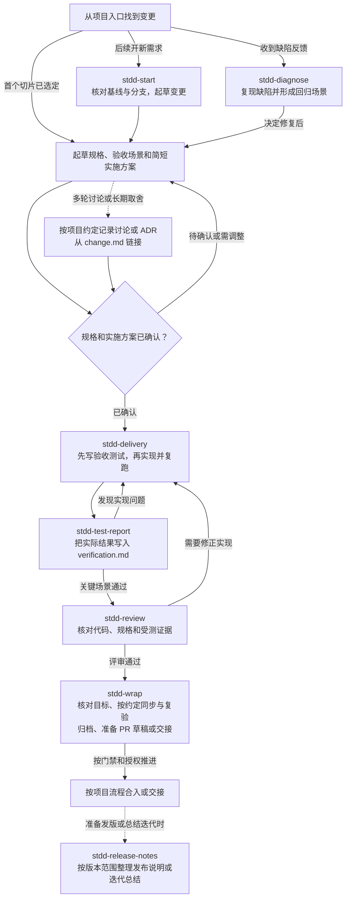

# STDD 研发工作流

产品、设计、研发和测试从[项目入口](project.md)和[角色导航](roles.md)查看同一份变更。在 Codex 中用 `$stdd-start` 起草变更，或直接打开下表中的技能。

## 使用顺序

[首个产品变更](../../changes/001-first-slice/change.md)的目标和范围待定。选定切片后，明确规格和验收场景，再在 `tasks.md` 写修改位置、关键取舍和验证方式。已有同范围确认可直接引用。复杂变更可单独写技术设计。

评审也可以先用 `stdd-wrap` 准备 PR 草稿，再用 `stdd-review` 核对候选。

## 技能速查

| 阶段 | 技能 | 工作产物 |
| --- | --- | --- |
| 开工 | [stdd-start](../../.agents/skills/stdd-start/SKILL.md) | 分支与基线 SHA、已确认的合入目标和同步策略、规格与实施方案、相关讨论和 ADR |
| 实现 | [stdd-delivery](../../.agents/skills/stdd-delivery/SKILL.md) | 按已确认方案和场景编写用例、实现并复跑 |
| 排查 | [stdd-diagnose](../../.agents/skills/stdd-diagnose/SKILL.md) | 用[诊断模板](templates/diagnosis.md)记录资料来源、发生时段、复现状态、影响范围及回归场景 |
| 验收 | [stdd-test-report](../../.agents/skills/stdd-test-report/SKILL.md) | 按场景记录命令、退出状态、用例数量、自动与手工结果，以及历史证据的适用版本 |
| 审查 | [stdd-review](../../.agents/skills/stdd-review/SKILL.md) | 固定目标与候选 SHA，从实际候选读取代码，对照规格和证据给出有定位、触发条件及后果的发现 |
| 收尾 | [stdd-wrap](../../.agents/skills/stdd-wrap/SKILL.md) | 核对合入目标与同步状态、复验最终候选、核对归档链接，按 [PR 模板](../../.github/pull_request_template.md)整理草稿 |
| 版本 | [stdd-release-notes](../../.agents/skills/stdd-release-notes/SKILL.md) | 按[版本说明模板](templates/release.md)记录固定版本快照或明确时间窗内的差异、影响、兼容及验收状态 |

## 脚本

在仓库根目录运行。

- 新变更选定后，用 `python3 -B scripts/new_change.py 002-next-slice '已选变更标题' --roles` 建档，将示例编号和标题替换为实际值。`--roles` 补齐规格、体验设计和验收计划，复杂变更可加 `--design`。脚本保留同名在途和已归档记录。
- 用 `python3 -B scripts/check_traceability.py` 检查 `specs/**/spec.md` 中的 REQ/AC 编号、关联与重复项。接入时尚无此格式的现行规格，输出零项属于正常结果。变更草稿、产品测试和发布门禁按各自入口核对。
- `git_range.py` 只比较已提交的 Git 引用。审查候选提交时，由 root 用 `python3 -B scripts/git_range.py --merge-base main HEAD` 查看目标分支和候选提交的分叉点到候选提交的文件变动，按实际范围替换两个引用。比较两个已存在的版本时，直接传入两个引用，取得两端快照差异。
- 审查工作区时，由 root 用 `git status --short --untracked-files=all` 枚举文件，结合 `git diff --cached`、`git diff` 和未跟踪文件的内容，审阅本次范围内已暂存、未暂存和未跟踪的改动。

## 验证与交付

root 按[协作约定](../../AGENTS.md)和[开发与 CI 指南](../operations/development-and-ci-guide.md#6-分层验证路径)统一执行检查。产品代码先做类型检查与受影响定向测试，真实服务专项和冻结后完整检查按仓库门禁执行。真实模型路径须有另行具名预算。

报告记录候选、命令、实际结果及证据。跳过的场景、预期有用例却未发现任何用例的检查，以及无法绑定到实际受测内容的历史证据均不计为通过。适用必跑门禁失败或缺证据时记录阻断与补验入口。最终候选的 CI 验收核对实际 run、attempt、SHA 和适用门禁结果。

需要单独讨论或记录长期决策时，按[讨论与架构决策](decisions-and-discussions.md)选择位置，在 `change.md` 关联讨论与 ADR，归档时核对双向链接。

### 收尾同步

准备提交或 PR 时，由 root 按[项目 Git 约定](git-workflow.md#收尾同步)和当轮授权核对真实合入目标，记录目标引用及 SHA、刷新状态和同步结果。涉及同步冲突时，按已确认的规格和双方改动意图处理。同步完成后，按项目命令处理依赖变化，复验受影响的范围，并在 `verification.md` 记录实际受测内容。中途交接或离线时，记录已核对的基线及待处理事项。
